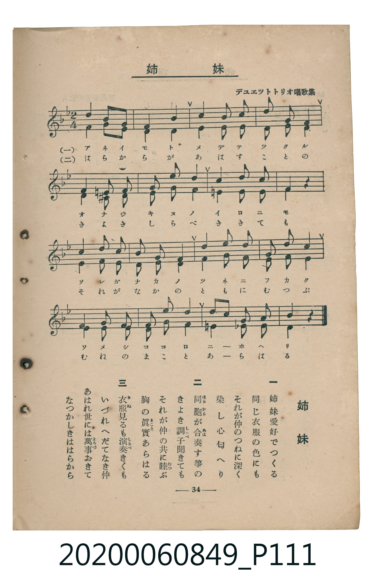

# 姉妹

> Re:Shoka 使用 AI 協助辨識與重建樂譜，可能會有錯誤。歡迎回報。

<audio controls src="shimai.mp3"></audio>

- 臺灣教育會公認《新定兒童唱歌》高等科女子用（2020.006.0849）

## 說明

原書資訊與歌詞全文（對應 P111.jpg，書頁 p. 34，高二重音第 1 首）：
調性與拍號：ヘ長調（1 降記號）、2/4 拍（二部重音合唱）
出處註記：デユエツトトリオ唱歌集

## 歌詞

```text
一
姉妹愛好でつくる
同じ衣服の色にも
それが仲のつねに深く
染し心匂へり

二
同胞（はらから）が合奏（あは）す箏の
きよき調子（しらべ）聞きても
それが仲の共に睦（むつ）ぶ
胸の眞實（まこと）あらはる

三
衣服（きぬ）見るも演奏（しらべ）きくも
いづれへだてなき仲
あはれ世には萬事（よろづ）おきて
なつかしきははらから
```

## ABC

```abc
X:1
T:姉妹
M:2/4
L:1/16
Q:1/4=88
K:F
V:V1 name="Part1" snm="Par"
V:V2 name="Part2" snm="Par"
[V:V1]
!mp! A4 G2 F2 | G4 F4 | B4 B2 B2 | A2 G2 F4 |
G4 ^F2 G2 | A2 c2 c4 | d4 e2 d2 | c4 z4 |
!mf! c4 B2 A2 | G2 B2 A4 | G4 A2 B2 | A2 c2 c4 |
F4 G2 A2 | B2 c2 d4 | c2 A2 B2 G2 | F4 z4 |
[V:V2]
!mp! F4 E2 D2 | C4 A,4 | D4 E2 E2 | F2 C2 A,4 |
E4 ^D2 E2 | F2 G2 A4 | =B4 c2 G2 | E4 z4 |
!mf! F4 F2 F2 | E2 E2 F4 | E4 F2 G2 | F2 E2 F4 |
D4 C2 D2 | E2 F2 G4 | F2 F2 C2 C2 | F4 z4 |
```

## TMD 檔案連結

- [主旋律 TMD 檔案](shimai.tmd) [[在 TMD Studio 編輯](https://tmdlang.github.io/Tmd-TS/#tmd=s7IKdvYPcrWy4qpTUCpJTLdSSM7PyUlNLsnMz7MqzsjMK0nNjM_KTMmPL87Iz05Ugisry88pzU21ys4vyY9PzyzKKY43MjAyiDcwMIs3sDCxRCgszi8tSk61Kk7OyM_PiS9JrShJys_PRsgXFOWXpeYl5gHVFBSB7EsBK0IoSC3LTEkFSaemZJbkF2Um5iC5IrWoGOxSsCXxJUWJecXJRZkFIOcjVJVkpAKdmpaYm5lTqcSlpaXwdHnn02U7FbS0uBRtFSwsuOxtFdy4bIz0TexAel6073reuPjZ1JkvmjY9m9P8tHXNi1W9jxu6nk3b8HTdrKetk56vXvp0ysZna3seN3S_XD3j-drO58snPl26-enaCc-nrHi_pwMUFHrAoNADBcX7PZ1KXFz6Wgq21AJcCgoKT_vmP5u948Xm9hcrul50tAMd82LlvKetK55Nawc64OmG3mftnQoBhoaGelkF6e_39AAVv1zQqFCgp2BsAuQCnf1kV8_L9t6X8zc_X7NGwVDh5bJpQJe-3zMLZPqLVfufNSwHmdvd-2LmfKDo4-YZL6duB4oDTQcqntn7YsUMsEzn44ZGYMgpAFUCpUCGNq-AmPt0QgcwmIAqwO5t3_Vi5tQXK3YD9YGNa3_cvOxx04rHzS2PmzvAaNXjplWQcH05u40LpOnJjgawXnB0PWuZ_XTp3seNyx83Lnnc2P-4qRssN6HnceOMFwsXP5vT-7hx3YvOTY8bVz9uagLJPW6c-7gJKN3zZDdQdB1Y31qg9LPtG4EGgFQ8mz_5ceP0p_ubn_Y0PW7c8bipC2Lvrh6o2S-a5wF99bhx_eOmzseN3UAS5OPGHpDflvaDpYAa14MFZz5f1w-0BmJz7-MmoFwvMMCAqQKsbjrYiJ1ApS8a54EUNAL9j82dT1uBzlv9fO4ykLamBqCzwcZvA0dM8w6giudz5j1dD5Zu3Pe4EegFYKIDqmgC2wB0ajc09MAhDwkbsGKgnWtA9i8DegSImp7tmQLzBcJ1YGXA4IU6reVx41Kw64AWLwC5uXEVUAXQpRBpkO-B0k92TAOFe-P6FxPWPNnVDXY5EAFNWgo2sgviYYgeoAHAmOgGWQoSXY8cvCAVlOcQKFDQ0ufi8k3MzLMKSCwqMXSoMahRqAbZoGBjoWUHZgDzJTD9AxPai4U9IOUgMaCi3IJaBWMFXQUjYM6oAZK6QFoXyDIBkiZAWAOUBckBxcBhDTNnVw-KOWCN6kAKpN4UCEFmmAFJcyBZA-YbYJixoxPNLWm1YJUmQDNARoJokDkgw42hboGajWzO09mzUcwBOdYIbIQJUDHIESAHgAwAOQ8kC3FKLVKQGZEYZCBTzOMVzOJBZseD3AcigF4GUUAJIAJZBZSCSOALO6BaXQUzdbgmkNvBUaAOpEzBjgYrIS4AQS4zBEcmxBmQ6AQbADIaZAFMFF8ggj0CdD7Yh2ANoFgA6Qb7CojQglLXTgEUmgpAWpmLCwA)]
- [鋼琴伴奏 TMD 檔案](shimai_piano.tmd) [[在 TMD Studio 編輯](https://tmdlang.github.io/Tmd-TS/#tmd=s7IKdvYPcrWy4tLSUni6vPPpsp3v93S87N7zfMKWJ3u2PF3a_7yz4_2eTgUtLS5FWwULCy57WwU3LhsjfRM7rjoFpRftu543Ln42deaLpk3P5jQ_bV3zYlXv44auZ9M2PF0362nrpOerlz6dsvHZ2p7HDd0vV894vrbz-fKJT5dufrp2wvMpK4B2GRkYGegZGJjpGViYWAJtUuLi8k3MzLMKyEzMyw_ycKgxqFGo5lIAAhsLLTswQ19L4fmaNU92NLxY2KOgpQ8WAyrKLahVMFbQVTBSMARyjYAsQyCuUTABkiZAWAOUBckBxbiQzdnVg2IOWKM6kAKpNwVCkBlmQNIcSNaA-QYYZuzoRHNLWi1YpQnQDJCRIBpkDshwY6hboGYjm_N09mwUc0CONQIbYQJUDHIEyAEgA0DOA8lCnFKLHGg-pAYayBzzeAWzeJDp8SAXggigp0EUUAKIQJYBpSAS-EIPqFZXwUwdrgnkenAkqAMpU7CzwUqIC0KQywzB0QlxBiRCwQaAjAZZABPFF4xgjwCdD_YhWAMoHkC6wb4CIrTA1LVTAIWnApBW5uICAA)]

## 分析

```text
================================================================================
📊 TMD Song Profile: [ 姉妹 ]
================================================================================
⏱  Duration:       0:21 (21.8s), 16 measures total
🎼 Key & Tempo:    首調基準 F, != 88.0 BPM, <2/4>
   - 分析範圍：      由實際發聲的音符與和弦推測調性；播放脈絡另行呈現
🎤 人聲音域:    F4 (MIDI 65) – E5 (MIDI 76) [跨度: 11 個半音 / 0.9 個八度, 難度: easy]
   - 最低音:  F4 in [Main #1 @ m.1, 0:01]
   - 最高音: E5 in [Main #1 @ m.7, 0:08]
   - 適合: soprano, mezzo-soprano, contralto, tenor, baritone, bass
🏛  結構:      Main (21.8s)
⚡ 編曲密度:        Peak 2 軌道同時演奏
🗝  調性診斷：       F 大調（純淨自然大調，未偵測到可信轉調）
   - 風格氣質:    純淨自然大調（陽光明朗、易唱易記，無明顯調外色彩）
   - 轉調歷程:    全曲維持單一推測調性（未偵測到可信轉調）
   - 核心骨幹音:  F, C, G, A, E
   - 調性數值:    F 大調 [相關度: 0.90, 穩定度: High, 自然音純度: 96.7%]
   - 候選調性 (K-S): F 大調 (0.90), C 大調 (0.76), A 小調 (0.64)
   - 五度圈歷程:   -1
   - 各段落調性細節:
     • [Main #1]: F 大調 (r: 0.90, 自然音純度: 96.7%, 調外音: D#, F#, B)

  [ 五度圈游移軌跡 ]
               C  
        [F ]*          G  
      Bb               D  
      Eb               A  
         Ab           E  
            Db       B  
               F# 
     (* = active key center)

  [ 十二半音累積音高分佈 ]
     C  : ████████████████          15.8%
     C# :                            0.0%
     D  : █████████                  9.2%
     D# : █                          0.8%
     E  : █████████████             12.5%
     F  : ████████████████████████  23.3%
     F# : █                          0.8%
     G  : ███████████████           14.2%
     G# :                            0.0%
     A  : ███████████████           14.2%
     A# : ████████                   7.5%
     B  : ██                         1.7%
--------------------------------------------------------------------------------
Assignment 軌道音域：
  - Part1         : F4 – E5 (11 個半音 / 0.9 個八度, 44 個音符)
  - Part2         : A3 – C5 (15 個半音 / 1.2 個八度, 44 個音符)
================================================================================
```


## 原書掃描頁




