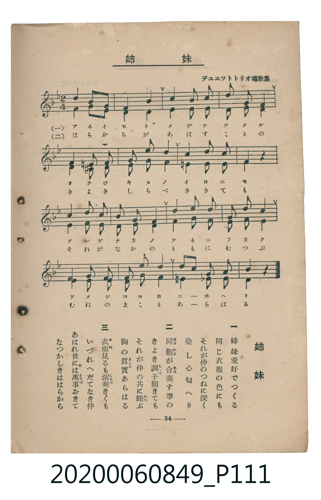

# 姉妹

> Re:Shōka 使用 AI 協助辨識與重建樂譜，可能會有錯誤。歡迎回報。

- **鋼琴伴奏版**：<br><audio controls src="shimai.mp3"></audio>

- 臺灣教育會公認《新定兒童唱歌》高等科女子用（2020.006.0849）

## 說明

原書資訊與歌詞全文（對應 P111.jpg，書頁 p. 34，高二重音第 1 首）：
調性與拍號：ヘ長調（1 降記號）、2/4 拍（二部重音合唱）
出處註記：デユエツトトリオ唱歌集


## 歌詞

```text
一
姉妹愛好でつくる
同じ衣服の色にも
それが仲のつねに深く
染し心匂へり

二
同胞（はらから）が合奏（あは）す箏の
きよき調子（しらべ）聞きても
それが仲の共に睦（むつ）ぶ
胸の眞實（まこと）あらはる

三
衣服（きぬ）見るも演奏（しらべ）きくも
いづれへだてなき仲
あはれ世には萬事（よろづ）おきて
なつかしきははらから
```

## ABC

<div class="abc-score" data-abc-src="shimai.abc" aria-label="五線譜載入中"></div>

[下載 ABC 原始檔](shimai.abc)

## TMD 檔案連結

- [主旋律 TMD 檔案](shimai.tmd) [[在 TMD Studio 編輯](https://tmdlang.github.io/Tmd-TS/#tmd=s7IKdvYPcrWy4qpTUCpJTLdSSM7PyUlNLsnMz7MqzsjMK0nNjM_KTMmPL87Iz05Ugisry88pzU21ys4vyY9PzyzKKY43MjAyiDcwMIs3sDCxRCgszi8tSk61Kk7OyM_PiS9JrShJys_PRsgXFOWXpeYl5gHVFBSB7EsBK0IoSC3LTEkFSaemZJbkF2Um5iC5IrWoGOxSsCXxJUWJecXJRZkFIOcjVJVkpAKdmpaYm5lTiRAFGpWemWdVkpgJ9BrIe-WJ8bmJmXk5iXkpSlxaWgpPl3c-XbZTQUuLS9FWwcKCy95WwY3LxkjfxA5kxov2Xc8bFz-bOvNF06Znc5qftq55sar3cUPXs2kbnq6b9bR10vPVS59O2fhsbc_jhu6Xq2c8X9v5fPnEp0s3P1074fmUFe_3dIACTA8YYHqgAHu_p1OJi0tfS8GWWoBLQUHhad_8Z7N3vNjc_mJF14uOdqBjXqyc97R1xbNp7UAHPN3Q-6y9UyHA0NBQL6sg_f2eHqDilwsaFQr0FIxNgFygs5_s6nnZ3vty_ubna9YoGCq8XDYN6NL3e2aBTH-xav-zhuUgc7t7X8ycDxR93Dzj5dTtQHGg6UDFM3tfrJgBlul83NAIDDkFoEqgFMjQ5hUQc59O6AAGE1AF2L3tu17MnPpixW6gPrBx7Y-blz1uWvG4ueVxcwcYrXrctAoSri9nt3GBND3Z0QDWC46uZy2zny7d-7hx-ePGJY8b-x83dYPlJvQ8bpzxYuHiZ3N6Hzeue9G56XHj6sdNTSC5x41zHzcBpXue7AaKrgPrWwuUfrZ9I9AAkIpn8yc_bpz-dH_z056mx407Hjd1Qezd1QM1-0XzPKCvHjeuf9zU-bixG0iCfNzYA_Lb0n6wFFDjerDgzOfr-oHWQGzufdwElOsFBhgwVYDVTQcbsROo9EXjPJCCRqD_sbnzaSvQeaufz10G0tbUAHQ22Pht4Ihp3gFU8XzOvKfrwdKN-x43Ar0ATHRAFU1gG4BO7YaGHjjkIWEDVgy0cw3I_mVAjwBR07M9U2C-QLgOrAwYvFCntTxuXAp2HdDiBSA3N64CqgC6FCIN8j1Q-smOaaBwb1z_YsKaJ7u6wS4HIqBJS8FGdkE8DNEDNAAYE90gS0Gi65GDF6SC8hwCBQpa-lxcvsCcbxWQWFRi6FBjUKNQDbJBwcZCyw7MAOZLYPoHJrQXC3tAykFiQEW5BbUKxgq6CkbAnFEDJHWBtC6QZQIkTYCwBigLkgOKgcMaZs6uHhRzwBrVgRRIvSkQgswwA5LmQLIGzDfAMGNHJ5pb0mrBKk2AZoCMBNEgc0CGG0PdAjUb2Zyns2ejmANyrBHYCBOgYpAjQA4AGQByHkgW4pRapCAzIjHIQKaYxyuYxYPMjge5D0QAvQyigBJABLIKKAWRwBd2QLW6CmbqcE0gt4OjQB1ImYIdDVZCXACCXGYIjkyIMyDRCTYAZDTIApgovkAEewTofLAPwRpAsQDSDfYVEKEFpa6dAig0FYC0MhcXAA)]
- [鋼琴伴奏 TMD 檔案](shimai_piano.tmd) [[在 TMD Studio 編輯](https://tmdlang.github.io/Tmd-TS/#tmd=s7IKdvYPcrWy4tLSUni6vPPpsp3v93S87N7zfMKWJ3u2PF3a_7yz4_2eTgUtLS5FWwULCy57WwU3LhsjfRM7rjoFpRftu543Ln42deaLpk3P5jQ_bV3zYlXv44auZ9M2PF0362nrpOerlz6dsvHZ2p7HDd0vV894vrbz-fKJT5dufrp2wvMpK4B2GRkYGegZGJjpGViYWAJtUuLi8k3MzLMKyEzMyw_ycKgxqFGo5lIAAhsLLTswQ19L4fmaNU92NLxY2KOgpQ8WAyrKLahVMFbQVTBSMARyjYAsQyCuUTABkiZAWAOUBckBxbiQzdnVg2IOWKM6kAKpNwVCkBlmQNIcSNaA-QYYZuzoRHNLWi1YpQnQDJCRIBpkDshwY6hboGYjm_N09mwUc0CONQIbYQJUDHIEyAEgA0DOA8lCnFKLHGg-pAYayBzzeAWzeJDp8SAXggigp0EUUAKIQJYBpSAS-EIPqFZXwUwdrgnkenAkqAMpU7CzwUqIC0KQywzB0QlxBiRCwQaAjAZZABPFF4xgjwCdD_YhWAMoHkC6wb4CIrTA1LVTAIWnApBW5uICAA)]

## 分析

```text
================================================================================
📊 TMD Song Profile: [ 姉妹 ]
================================================================================
⏱  Duration:       0:21 (21.8s), 16 measures total
🎼 Key & Tempo:    首調基準 F, != 88.0 BPM, <2/4>
   - 分析範圍：      由實際發聲的音符與和弦推測調性；播放脈絡另行呈現
🎤 人聲音域:    F4 (MIDI 65) – E5 (MIDI 76) [跨度: 11 個半音 / 0.9 個八度, 難度: easy]
   - 最低音:  F4 in [Main #1 @ m.1, 0:01]
   - 最高音: E5 in [Main #1 @ m.7, 0:08]
   - 適合: soprano, mezzo-soprano, contralto, tenor, baritone, bass
🏛  結構:      Main (21.8s)
⚡ 編曲密度:        Peak 2 軌道同時演奏
🗝  調性診斷：       F 大調（純淨自然大調，未偵測到可信轉調）
   - 風格氣質:    純淨自然大調（陽光明朗、易唱易記，無明顯調外色彩）
   - 轉調歷程:    全曲維持單一推測調性（未偵測到可信轉調）
   - 核心骨幹音:  F, C, G, A, E
   - 調性數值:    F 大調 [相關度: 0.90, 穩定度: High, 自然音純度: 96.7%]
   - 候選調性 (K-S): F 大調 (0.90), C 大調 (0.76), A 小調 (0.64)
   - 五度圈歷程:   -1
   - 各段落調性細節:
     • [Main #1]: F 大調 (r: 0.90, 自然音純度: 96.7%, 調外音: D#, F#, B)

  [ 五度圈游移軌跡 ]
               C  
        [F ]*          G  
      Bb               D  
      Eb               A  
         Ab           E  
            Db       B  
               F# 
     (* = active key center)

  [ 十二半音累積音高分佈 ]
     C  : ████████████████          15.8%
     C# :                            0.0%
     D  : █████████                  9.2%
     D# : █                          0.8%
     E  : █████████████             12.5%
     F  : ████████████████████████  23.3%
     F# : █                          0.8%
     G  : ███████████████           14.2%
     G# :                            0.0%
     A  : ███████████████           14.2%
     A# : ████████                   7.5%
     B  : ██                         1.7%
--------------------------------------------------------------------------------
Assignment 軌道音域：
  - Part1         : F4 – E5 (11 個半音 / 0.9 個八度, 44 個音符)
  - Part2         : A3 – C5 (15 個半音 / 1.2 個八度, 44 個音符)
================================================================================
```


## 原書掃描頁




