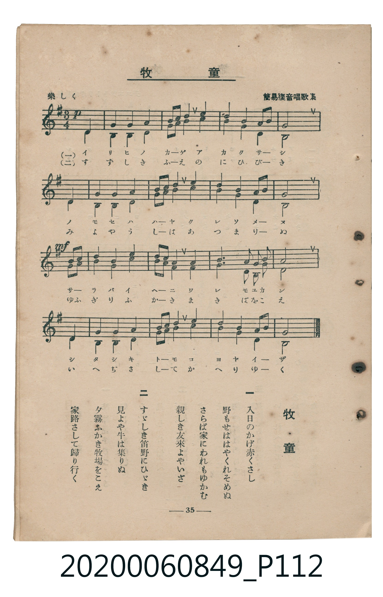

# 牧童

> Re:Shōka 使用 AI 協助辨識與重建樂譜，可能會有錯誤。歡迎回報。

- **鋼琴伴奏版**：<br><audio controls src="bokudo.mp3"></audio>

- 出處：簡易複音唱歌集
- 臺灣教育會公認《新定兒童唱歌》高等科女子用（2020.006.0849）

## 說明

原書資訊與歌詞全文（對應 P112.jpg，書頁 p. 35，高二重音第 2 首）：
調性與拍號：ト長調（1 升記號）、3/4 拍（楽しく，二部重音合唱，弱起第 3 拍進入）
出處註記：簡易複音唱歌集
註記：譜下歌詞第一段第 12 小節印為「ユカン」（底欄印為「ゆかむ」），第二段第 1 小節印為「すずしき」（底欄印為「すゞしき」）。


## 歌詞

```text
一
入日のかげ赤くさし
野もせははやくれそめぬ
さらば家にわれもゆかむ
親しき友來よやいざ

二
すゞしき笛野にひゞき
見よや牛は集りぬ
夕霧ふかき牧場をこえ
家路さして歸り行く
```

## ABC

<div class="abc-score" data-abc-src="bokudo.abc" aria-label="五線譜載入中"></div>

[下載 ABC 原始檔](bokudo.abc)

## TMD 檔案連結

- [主旋律 TMD 檔案](bokudo.tmd) [[在 TMD Studio 編輯](https://tmdlang.github.io/Tmd-TS/#tmd=s7IKdvYPcrWy4qpTUCpJTLdSSM7PyUlNLsnMz7MqzsjMK0nNjM_KTMmPL87Iz05Ugisry88pzU21ys4vyY9PzyzKKY43MjAyiDcwMIs3sDCxRCgszi8tSk61Kk7OyM_PiS9JrShJys_PRpePL0hMT7UKMDQ0QsgUFOWXpeYl5gF1FxSBXJIC1o5QkFqWmZIKki5OTsyLL0stykzLTE1BcmNqUTHYHxArSooS84qTizILQJ5DqMovKsnITy9KLMiotMrILC7JL8pMTsyJz07MQ_JuSUYq0Lfl-UVILgcqTM_MsypJzASGDSh8yhPjcxMz83IS84CO0NJSeN65_PnqpQpaWlyKtgqGBhZc9rYK7lw2xvomdiBDnrbvejFz6vs9s55vWPhsxuQXS9pfzt_8dMrGZ2t7Xs5uA9vzon3X88bFz6bOfNG06dmc5qeta16s6n3c0PVs2oan62Y9bZ0ENB-i43FD98vVM56v7Xy-fOLTpZufrp3wfMqK93s6QLGiB4wVPVCsvN_TqcTFpa-lYEstwKWgoPC0b_6z2TtebG5_saLrRUc70DEvVs572rri2bR2oAOebuh91t6pAIpavayC9Pd7eoCKXy5oVCjQUzA2BXKBzn6yq-dley_Q98_XrFEwUni5bBrQpcCAAZn-YtX-Zw3LQeZ2976YOR8o-ri54-XU7UBxoOmGCk97gfbOAMt0Pm5oBAauAlAlUOrZ0r2PG6c_buwH2gGyoHkFxI6nEzqAQQYUfLpn44ut20FWGoO0vGzY9LR1KdAUsJ_AcfNixW6g2bhiCOw6mIoXa-c82dEN8TvQyCc7Gp6t2woy29BI4emG_ufrG572bnjetOtxQ8_j5mWPm1Y_bt78uAHkzqe7pj5b04KQbWp73Nj9uKkBLAsMhR6Qcbt6YMZhmNY483HjLLBPgSkDm4FABU3zkBQAg6mJC-R4oCPBfm1d-mz60seN60D2Nk56sXUJMNAeN04FagFJv2zve9zU9Lhx9uPG9SDU1AKSbgKaO_dxU-PjxjUgRSDlTZ2PG4HJctvjxtWPm8AqgNpgvgEH1rJVEGc87e9-sq_tcVMH2DAgmgZxz64eiFkIBz9fMxtkP9DExk1gwV6IQUAjQZqfd4JcBYyLx01dUJc8XTL15Zzljxu3gn3TC8yDTxdsedw06XHj5MeNHWAV67a92A70CsiDjxuXPVu7A6j7xUKgh_pB0pRnCihQ0NLn4vIFFghWAZmJefmGDjW6hjXVICsUbCy07MAMbHlRAZJ-gC56sqPrReMmYMpV0IAkVmD0A1OqgraCCTQZ6MAzliYWg4AOAFlSo2CgoAvG1QW1CqbxQEYN0CRdMDYC84yBJpoCWWZgHohlDJYzhqoEQYhGsIk-hjUKIB4IP25aAtb0uHkViNc8CUz2QcSaVgPZe4D0JrDKRXBREG89mNwKVgES3Q61CKobYpMRkk2NMyH6G2eBedPBZC9UDGIOMI7BouugomCbGsG2N26G2QTWA7apcT_YJvxxsasHNS5IDHzSQ7o6N60WrBAR2o-bQWH3uGk3OHz6oSHeD_FzMygGIOEJEl0D5u0Fq1wI83NzD8zPsBCHhy8wL4HFW8Ah0gYNuenQ8ATHUmMTVBRsU-M-sPoueHiCbISY3QaOCUIhuqOTohCFhRosDE3AYQsLX5BDjIBhCQpRkBiWtPu4eSU4dCaA3QxLvzOgodkNlkMOTRB_ERAvA6ddkOhmuI9BqRYpLBtBaRcUNqBw2goNtW5oWILSHST0EKkQWGgC1U8C0pPBoqC4gIiD4oNASD6dPZvOaRNUjCAFZBMoA0EC4XHTWmiQdUADEpJkQUEFEl0BDkZIUl0Cz_TboOYiRRA4GHeAgwBsQuNUaIDBkuQysCgomuAqIQEOSn7QJAnKIghza5FLYiNySuJumpXExiAKTJjAimZQkAO50EiBRBGyapoWxxAx2hfGyJmAxKIYHhkkhj6ZQQ0uj0FKqVEeQ8RoURpDxMgsi8kOUmiYwULQSMEcFGxgAlZqAMMTGJaGoDIFR-oddgUynVMotUplSN6ndpkMEcMokXXtFECFsgKQVuYCAA)]
- [鋼琴伴奏 TMD 檔案](bokudo_piano.tmd) [[在 TMD Studio 編輯](https://tmdlang.github.io/Tmd-TS/#tmd=s7IKdvYPcrWy4qpTUCpJTLdSSM7PyUlNLsnMz7MqzsjMK0nNjM_KTMmPL87Iz05Ugisry88pzU21ys4vyY9PzyzKKY43MjAyiDcwMIs3sDCxRCgszi8tSk61Kk7OyM_PiS9JrShJys_PRpePL0hMT7UKMDQ0QsgUFOWXpeYl5gF1FxSBXJIC1o5QkFqWmZIKki5OTsyLL0stykzLTE1BcmNqUTHYHxArSooS84qTizILQJ5DqMovKsnITy9KLMiotMrILC7JL8pMTsyJz07MQ_JuYhFQc3pqbmpeiVVBZmJefnxicnJ-bkFiXiZIDKGwJAOoyKo8vwjJi0AT0zPzrEoSM4GBCArI8sT43MTMvJzEPKBrtbQUnncuf7566fs9HS-79zyfsOXJni1Pl_Y_7-x4v6dTQUuLS9FWwdDAgsveVsGdy8ZY38QOZPLT9l0vZk59v2fW8w0Ln82Y_GJJ-8v5m59O2fhsbc_L2W1gy1-073reuPjZ1JkvmjY9m9P8tHXNi1W9jxu6nk3b8HTdrKetk4CWQnQ8buh-uXrG87Wdz5dPfLp089O1E55PWQF0DyhO9YBxqgeKU6BrlLi4fIEOtwoABYGhQ42uYU01lwIQ2Fho2YEZ-loKtuhA4fmaNU92NLxY2PNkR9eLxk0vm1coaDzds_HF1u0KhgrPunsVtBVMFJ5u6H--vkFHAZQI9LIK0jWxGKSlD7akRsFAQReMqwtqFUzjgYwaoEm6YGwE5hkDTTQFsszAPBDLGCxnDFUJghCNYBN9DGsUQDwQfty0BKzpcfMqEK95Epjsg4g1rQay9wDpTWCVi-CiIN56MLkVrAIkuh1qEVQ3xCYjJJsaZ0L0N84C86aDyV6oGMScx40dYNF1UFGwTY1g2xs3w2wC6wHb1LgfbBP-uNjVgxoXJAY-6SFdnZtWC1aICO3HzaCwe9y0Gxw-_dAQ74f4uRkUA5DwBImuAfP2glUuhPm5uQfmZ1iIw8P3cRM4zJpawCHSBg256dDwBMdSYxNUFGxT4z6w-i54eIJshJjdBo4JQiG6o5OiEIWFGiwMTcBhCwtfkEOMgGEJClGQGJa0-7h5JTh0JoDdDEu_M6Ch2Q2WQw5NEH8REC8Dp12Q6Ga4j0GpFiksG0FpFxQ2oHDaCg21bmhYgtIdJPQQqfBx4wag-klAejJYFBQXEHFQfBAIyaezZ9M5bYKKEaSAbAJlIEggPG5aCw2yDmhAQpIsKKhAoivAwQhJqkvgmX4b1FykCAIH4w5wEIBNaJwKDTBYklwGFgVFE1wlJMBByQ-aJEFZBGFuLXJJbEROSdxNs5LYGESBCRNY0QwKciAXGimQKEJWTdPiGCJG-8IYOROQWBTDI4PE0CczqMHlMUgpNcpjiBgtSmOIGJllMdlBCg0zWAgaKZiDgg1MwEoNYHgCw9IQVKbgSL3DrkCmcwqlVqkMyfvULpMhYnhKZB8P5CLZBFokg0pLEAQGQrxCtGGsQrRpfCwSzwTEMY3HJgfUBKvhKNeKUAxSiKQazAWqQJKl0GJgqOjaKYACJtoHKARnG4HZylwA)]

## 分析

```text
================================================================================
📊 TMD Song Profile: [ 牧童 ]
================================================================================
⏱  Duration:       0:26 (26.7s), 16 measures total
🎼 Key & Tempo:    首調基準 G, != 108.0 BPM, <3/4>
   - 分析範圍：      由實際發聲的音符與和弦推測調性；播放脈絡另行呈現
🎤 人聲音域:    D4 (MIDI 62) – E5 (MIDI 76) [跨度: 14 個半音 / 1.2 個八度, 難度: moderate]
   - 最低音:  D4 in [Main #1 @ m.1, 0:01]
   - 最高音: E5 in [Main #1 @ m.3, 0:04]
   - 適合: soprano, mezzo-soprano, contralto, tenor, baritone, bass
🏛  結構:      Main (26.7s)
⚡ 編曲密度:        Peak 2 軌道同時演奏
🗝  調性診斷：       G 大調（純淨自然大調，未偵測到可信轉調）
   - 風格氣質:    純淨自然大調（陽光明朗、易唱易記，無明顯調外色彩）
   - 轉調歷程:    全曲維持單一推測調性（未偵測到可信轉調）
   - 核心骨幹音:  B, G, D, A, C
   - 調性數值:    G 大調 [相關度: 0.84, 穩定度: Moderate, 自然音純度: 100.0%]
   - 候選調性 (K-S): G 大調 (0.84), B 小調 (0.76), D 大調 (0.56)
   - 五度圈歷程:   +1
   - 各段落調性細節:
     • [Main #1]: G 大調 (r: 0.84, 自然音純度: 100.0%)

  [ 五度圈游移軌跡 ]
               C  
         F           [G ]*
      Bb               D  
      Eb               A  
         Ab           E  
            Db       B  
               F# 
     (* = active key center)

  [ 十二半音累積音高分佈 ]
     C  : ████████                   9.9%
     C# :                            0.0%
     D  : ███████████████           19.8%
     D# :                            0.0%
     E  : ███                        4.2%
     F  :                            0.0%
     F# : ██                         2.1%
     G  : █████████████████         21.4%
     G# :                            0.0%
     A  : █████████                 12.0%
     A# :                            0.0%
     B  : ████████████████████████  30.7%
--------------------------------------------------------------------------------
Assignment 軌道音域：
  - Piano1        : D4 – E5 (14 個半音 / 1.2 個八度, 53 個音符)
  - Piano2        : B3 – C5 (13 個半音 / 1.1 個八度, 50 個音符)
================================================================================
```


## 原書掃描頁




