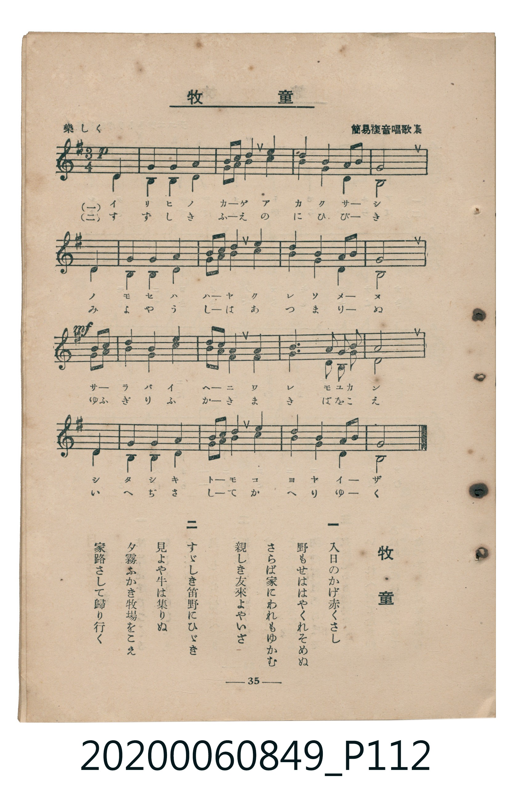

# 牧童

<audio controls src="bokudo.mp3"></audio>

- 臺灣教育會公認《新定兒童唱歌》高等科女子用（2020.006.0849）

## 說明

原書資訊與歌詞全文（對應 P112.jpg，書頁 p. 35，高二重音第 2 首）：
調性與拍號：ト長調（1 升記號）、3/4 拍（楽しく，二部重音合唱，弱起第 3 拍進入）
出處註記：簡易複音唱歌集

## 歌詞

```text
一
入日のかげ赤くさし
野もせははやくれそめぬ
さらば家にわれもゆかむ
親しき友來よやいざ

二
すゞしき笛野にひゞき
見よや牛は集りぬ
夕霧ふかき牧場をこえ
家路さして歸り行く
```

## ABC

```abc
X:1
T:牧童
M:3/4
L:1/16
Q:1/4=108
K:G
V:V1 name="Part1" snm="Par"
V:V2 name="Part2" snm="Par"
[V:V1]
!p! z4 z4 D4 | G4 G4 A4 | B3 c B4 A4 | d4 G4 A2 B2 |
E8 D4 | G4 G4 A4 | B3 c B4 A4 | d4 B4 A2 B2 |
!mf! G8 G2 A2 | B4 A4 c4 | B2 A2 G4 F4 | G6 A2 G2 F2 |
A8 D4 | G4 G4 A4 | B3 c B4 A4 | d4 B4 A2 B2 |
G8 z4 |
[V:V2]
!p! z4 z4 D4 | B,4 B,4 C4 | D3 E D4 D4 | F4 E4 C4 |
D8 D4 | B,4 B,4 C4 | D3 E D4 D4 | F4 G4 E4 |
!mf! G8 B,2 C2 | D4 D4 E4 | D2 C2 B,4 D4 | B,6 C2 B,2 A,2 |
D8 D4 | B,4 B,4 C4 | D3 E D4 D4 | F4 G4 E4 |
B,8 z4 |
```

## TMD 檔案連結

- [主旋律 TMD 檔案](bokudo.tmd) [[在 TMD Studio 編輯](https://tmdlang.github.io/Tmd-TS/#tmd=s7IKdvYPcrWy4qpTUCpJTLdSSM7PyUlNLsnMz7MqzsjMK0nNjM_KTMmPL87Iz05Ugisry88pzU21ys4vyY9PzyzKKY43MjAyiDcwMIs3sDCxRCgszi8tSk61Kk7OyM_PiS9JrShJys_PRsgXFOWXpeYl5gHVFBSB7EsBK0IoSC3LTEkFSaemZJbkF2Um5iC5IrWoGOxSsCXxJUWJecXJRZkFIOcjVJVkpAKdWp5fBLRWS0vheefy56uXKmhpcSnaKhgaWHDZ2yq4c9kY65vYgbS8aN_1vHHxs6kzXzRtejan-Wnrmhereh83dD2btuHpullPWycBNT-dsvHZ2p7HDd0vV894vrbz-fKJT5dufrp2wvMpK97v6QCFhB4wJPRAIfF-T6cSF5e-loIttQCXgoLC0775z2bveLG5_cWKrhcd7UDHvFg572nrimfT2oEOeLqh91l7p0KAoaGRXlZB-vs9PUDFLxc0KhToKRibArlAZz_Z1fOyvffl_M3P16xRMFJ4uWwa0KXv98wCmf5i1f5nDctB5nb3vpg5Hyj6uLnj5dTtQHGg6YYKT3uB9s4Ay3Q-bmgEhpwCUCVQ6tnSvY8bpz9u7AfaAbKgeQXEjqcTOoBBBhR8umfji63bQVYag7S8bNj0tHUp0BSwn9p3vZg59cWK3UCzgVY-37Dw2YzJL5a0g_SDw_vl7DYukMInOxrA6luXPpu-9HHjuseN3Y8bJ73YugRo8ePGqUAXgKRftvc9bmp63Dj7ceN6EGpqAUk39TxunPu4qfFx4xqQIpDyps7HjcCo3fa4cfXjJrAKoLamNpCpTWCLXixbBfZV79P-7if72h43dYANA6JpEPfs6oGYNfNx0zyIyudrZoPsB5rYuAks2AsxCGgkSPPzTpCrgP553NQFdcnTJVNfzln-uHEr2De9wET6dMGWx02THjdOftzYAVaxbtuL7UCvgDz4uHHZs7U7gLpfLAR6qB8kTXnCggIFLX0uLt_EzDyrgMSiEkOHGoMahWqQDQo2hmZadmAWMD1DovLphv7n6xtAWkDCNQoGCrpgCKOrC2oVTOOhnBpwcIE0A1MAMBaBjkfoNIQqgtFGME3ApAKiTaA0sowpFj0gVTUKZjA7YRCHI3b1UM0RyDIQR8BMgcHq3LRasCBICVpgdKK4A90WExR3gERhZpvD_YViHUwJWLoGbg7-0Hg6ezYdQwOWRGq4apHSmxG90psxTBWcYYIISqgRwFQENwxhKiLM4akMUyuhsEZPedRwDiyE4c7CkQTBVoCNx5sIMe1CMhgsBjYD7mAkJ8HF4B4BixhBUiORQYSeHGkURChuBUGUhKlrpwBKmwpAWpmLCwA)]
- [鋼琴伴奏 TMD 檔案](bokudo_piano.tmd) [[在 TMD Studio 編輯](https://tmdlang.github.io/Tmd-TS/#tmd=s7IKdvYPcrWy4tLSUnjeufz56qXv93S87N7zfMKWJ3u2PF3a_7yz4_2eTgUtLS5FWwVDAwsue1sFdy4bY30TO646BaUX7bueNy5-NnXmi6ZNz-Y0P21d82JV7-OGrmfTNjxdN-tp6ySgiU-nbHy2tudxQ_fL1TOer-18vnzi06Wbn66d8HzKCqBlRgZGBnoGBmZ6BhYmlkCrlLi4fBMz86wCMhPz8oM8HGoMahSquRSAwMbQTMsOzNLXUni6Z-OLrdufbuh_vr5BQUsfLFyjYKCgC4YwurqgVsE0Hsqp4YJpfr5mzZMdDS8W9iB0GkIVwWgjmCYFYzBtAqWRZUyx6AGpqlEwg9kJgzgcsauHao5AloE4AmYKDFbnptWCBUFK0AKjE8Ud6LaYoLgDJAoz2xzuLxTrYErA0jVwc_CHxtPZs-kYGrAkUsNVi5zifOiW4oxhquAME0RgQo0ApiO4YQhTEaEOT2eYWgmFNnrao4ZzYGEMdxaORAi2Amw83mSIaReSwWAxsBlwByM5CS4G9whYxAiSHokMIvQESaMgQnErCKIkTV07BVDqVADSylxcAA)]

## 分析

```text
================================================================================
📊 TMD Song Profile: [ 牧童 ]
================================================================================
⏱  Duration:       0:28 (28.3s), 17 measures total
🎼 Key & Tempo:    首調基準 G, != 108.0 BPM, <3/4>
   - 分析範圍：      由實際發聲的音符與和弦推測調性；播放脈絡另行呈現
🎤 人聲音域:    D4 (MIDI 62) – D5 (MIDI 74) [跨度: 12 個半音 / 1.0 個八度, 難度: easy]
   - 最低音:  D4 in [Main #1 @ m.1, 0:01]
   - 最高音: D5 in [Main #1 @ m.4, 0:05]
   - 適合: soprano, mezzo-soprano, contralto, tenor, baritone, bass
🏛  結構:      Main (28.3s)
⚡ 編曲密度:        Peak 2 軌道同時演奏
🗝  調性診斷：       G 大調（純淨自然大調，未偵測到可信轉調）
   - 風格氣質:    純淨自然大調（陽光明朗、易唱易記，無明顯調外色彩）
   - 轉調歷程:    全曲維持單一推測調性（未偵測到可信轉調）
   - 核心骨幹音:  D, B, G, A, C
   - 調性數值:    G 大調 [相關度: 0.88, 穩定度: Moderate, 自然音純度: 100.0%]
   - 候選調性 (K-S): G 大調 (0.88), B 小調 (0.77), D 大調 (0.77)
   - 五度圈歷程:   +1
   - 各段落調性細節:
     • [Main #1]: G 大調 (r: 0.88, 自然音純度: 100.0%)

  [ 五度圈游移軌跡 ]
               C  
         F           [G ]*
      Bb               D  
      Eb               A  
         Ab           E  
            Db       B  
               F# 
     (* = active key center)

  [ 十二半音累積音高分佈 ]
     C  : ███████                    7.6%
     C# :                            0.0%
     D  : ████████████████████████  25.8%
     D# :                            0.0%
     E  : ███████                    7.0%
     F  :                            0.0%
     F# : ████                       4.7%
     G  : ██████████████████        19.3%
     G# :                            0.0%
     A  : ████████████              13.0%
     A# :                            0.0%
     B  : █████████████████████     22.7%
--------------------------------------------------------------------------------
Assignment 軌道音域：
  - Part1         : D4 – D5 (12 個半音 / 1.0 個八度, 53 個音符)
  - Part2         : A3 – G4 (10 個半音 / 0.8 個八度, 50 個音符)
================================================================================
```


## 原書掃描頁




