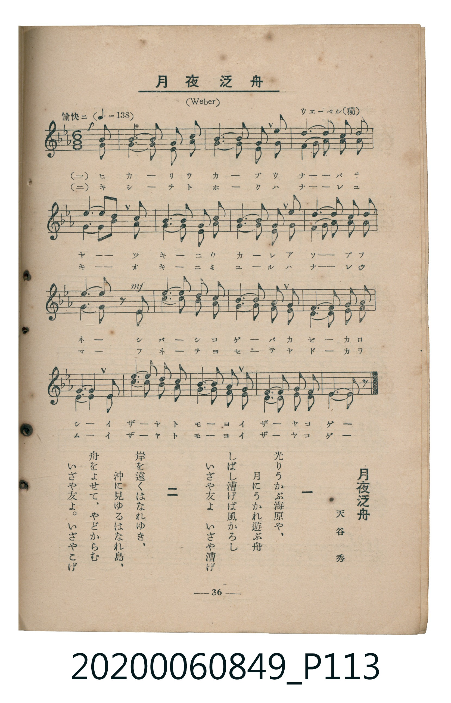

# 月夜泛舟

> Re:Shōka 使用 AI 協助辨識與重建樂譜，可能會有錯誤。歡迎回報。

- **鋼琴伴奏版**：<br><audio controls src="tsukiyo_hanshu.mp3"></audio>

- 詞：天谷秀
- 曲：ウエーベル（獨）（Weber）
- 臺灣教育會公認《新定兒童唱歌》高等科女子用（2020.006.0849）

## 說明

原書資訊與歌詞全文（對應 P113.jpg，書頁 p. 36，高二重音第 3 首）：
調性與拍號：變ロ長調（2 降記號）、6/8 拍（愉快ニ ♩.=138，二部重音合唱，弱起最後 1 八分音符進入）


## 歌詞

```text
一
光りうかぶ海原や、
月にうかれ遊ぶ舟
しばし漕げば風かろし
いざや友よ　いざや漕げ

二
岸を遠くはなれゆき、
沖に見ゆるはなれ島、
舟をよせて、やどからむ
いざや友よ。いざやこげ
```

## ABC

<div class="abc-score" data-abc-src="tsukiyo_hanshu.abc" aria-label="五線譜載入中"></div>

[下載 ABC 原始檔](tsukiyo_hanshu.abc)

## TMD 檔案連結

- [主旋律 TMD 檔案](tsukiyo_hanshu.tmd) [[在 TMD Studio 編輯](https://tmdlang.github.io/Tmd-TS/#tmd=s7IKdvYPcrWy4qpTUCpJTLdSSM7PyUlNLsnMz7MqzsjMK0nNjM_KTMmPL87Iz05Ugisry88pzU21ys4vyY9PzyzKKY43MjAyiDcwMIs3sDCxRCgszi8tSk61Kk7OyM_PiS9JrShJys_PRsgXFOWXpeYl5gHVFBSB7EsBK0IoSC3LTEkFSaemZJbkF2Um5iC5IrWoGOxSsCXxJUWJecXJRZkFIOcjVJVkpAKdWp5YklqELgjUUZaKZCDQ_PTMPKvc1MysTCyOhUqXpxYDzcqLz03NyU-pVOLS0lJ4Nqfj6ZI5zzbPftExX0FLi0vRVsHMksveVsFJh8vGTN_CDmTGi5Xz3u-Z9XTJyhcbtj9f3gA299nsTUCxx03LHjeteNy853HzzMfNq9_v6Xjeu-L9nk4gIzw1KbUIyASrftG-63nj4mdTZ75o2vRsTvPT1jUvVvU-buh6Nm3D03WznrZOer566dMpG5-t7Xnc0P1y9YznazufL5_4dOnmp2snPJ8CNLEDFE16wGjSA0UT2FgufS0FW2oBLgUFhad985_N3vFic_uLFV0vOtqBjgF6_GnrimfT2oEOeLqh91l7p0KAoaGxXlZB-vs9PUDFLxc0KhToKRibAblAZz_Z1fOyvffl_M3P16xRMFZ4uWwaOCxmgUx_sWr_s4blIHO7e1_MnA8UfbGu63Hz2pdTtwOlQD5UeDmz98WKGWDJzscNjcDgVwAqBko9a-l8un_14-ZuhUczV-rZGhpbAO0DWda8AmLf0wkdwOADCj7ds_HF1u3P5jQ83dejYKjwtHX10442sIOWvWzY9LR1KdBoLpBznuxoAPu5tfNxU9fjxrbHjd2PG7c927odGAqPm1qA1oOkgcnjceNqqHRTz8tGoNJtwKQCknvcOP1x4wYg-WzP1MeNk4Dsl4tWgNX1AgUhKloeN04Dmva0Hyja8bihAS4C0QNxya4esEs27XjcNOll44LHjf2PG9c_blwFtPBxE9BmYEKBOGbTNKBjXiwDmtX2uAnoXKiip5u3QVUAXQY0A2RV4-zHjcuAoiCvNK4EuwroUbCXMVzVBBd53DgZ5CqgIspTFBQoaOlzcfkmAnNfQGJRiaFDjUGNQjXIBgUbQzMtOzALmJAh8fZ0Q__z9Q0gLSDhGgUDBV0MXF1Qq2AaD2TUgEMPpBmY2oDR-WJhD0KnMVABCIJoIygbRNcAEwWEB6LB5oAgxEC4SpAuE6y6QDyY2VhcsauHLq6A6QSHR25aLZiDFh6dKC4xg-oC0aYw68BmwmwA0cjuRbgD2c-o7jAHORjZKyhueDp7Nh3cALMaBEHhUcNVi5TgjOiV4PBFqDGMD2agy6Lyceo1wSKLL-3R3EFw_cSnQuLiGSVBEesaIxADziOYFmnoEni4gCA8ReraKYASpQKQVubiAgA)]
- [鋼琴伴奏 TMD 檔案](tsukiyo_hanshu_piano.tmd) [[在 TMD Studio 編輯](https://tmdlang.github.io/Tmd-TS/#tmd=s7IKdvYPcrWy4tLSUng2p-PpkjnPNs9-0TH__Z6Ol917nk_Y8mTPlqdL-593drzf06mgpcWlaKtgZsllb6vgpMNlY6ZvYcdVp6D0YuW893tmPV2y8sWG7c-XNyiBxJ7N3gQUe9y07HHTisfNex43z3zcvBpo7PPeFUCjgIzw1KTUIiATrPpF-67njYufTZ35omnTsznNT1vXvFjV-7ih69m0DU_XzXraOun56qVPp2x8trbncUP3y9Uznq_tfL584tOlm5-unfB8CtDEDiMDIwM9AwMzPQMLE0uwsVy-iZl5VgGZiXn5QR4ONQY1CtVcCkBgY2imZQdm6WspPN2z8cXW7U839D9f36CgpQ8WrlEwUNDFwNUFtQqm8UBGDRdM8_M1a57saHixsAeh0xioAARBtBGUDaJrFAyhPBANNgcEIQbCVYJ0mWDVBeLBzMbiil09dHEFTCc4PHLTasEctPDoRHGJGVQXiDaFWQc2E2YDiEZ2L8IdyH5GdYc5yMHIXkFxw9PZs-ngBpjVIAgKjxquWuQk50O3JIcvSo1hfDADXRaVj1OvCRZZfKmP5g6C6yc-HRIX0yhJiljXGIEYcB7B1EhDl8DDBQThaVLXTgGULBWAtDIXFwA)]

## 分析

```text
================================================================================
📊 TMD Song Profile: [ 月夜泛舟 ]
================================================================================
⏱  Duration:       0:44 (44.3s), 17 measures total
🎼 Key & Tempo:    首調基準 B,, != 69.0 BPM, <6/8>
   - 分析範圍：      由實際發聲的音符與和弦推測調性；播放脈絡另行呈現
🎤 人聲音域:    F4 (MIDI 65) – G5 (MIDI 79) [跨度: 14 個半音 / 1.2 個八度, 難度: moderate]
   - 最低音:  F4 in [Main #1 @ m.1, 0:02]
   - 最高音: G5 in [Main #1 @ m.10, 0:23]
   - 適合: soprano, mezzo-soprano, tenor, baritone
🏛  結構:      Main (44.3s)
⚡ 編曲密度:        Peak 2 軌道同時演奏
🗝  調性診斷：       A# 大調（純淨自然大調，未偵測到可信轉調）
   - 風格氣質:    純淨自然大調（陽光明朗、易唱易記，無明顯調外色彩）
   - 轉調歷程:    全曲維持單一推測調性（未偵測到可信轉調）
   - 核心骨幹音:  F, D, A#, C, D#
   - 調性數值:    A# 大調 [相關度: 0.85, 穩定度: High, 自然音純度: 100.0%]
   - 候選調性 (K-S): A# 大調 (0.85), F 大調 (0.72), D 小調 (0.72)
   - 五度圈歷程:   -2
   - 各段落調性細節:
     • [Main #1]: A# 大調 (r: 0.85, 自然音純度: 100.0%)

  [ 五度圈游移軌跡 ]
               C  
         F            G  
     [Bb]*              D  
      Eb               A  
         Ab           E  
            Db       B  
               F# 
     (* = active key center)

  [ 十二半音累積音高分佈 ]
     C  : ████████████              14.7%
     C# :                            0.0%
     D  : █████████████████████     24.7%
     D# : ████████                   8.9%
     E  :                            0.0%
     F  : ████████████████████████  28.4%
     F# :                            0.0%
     G  : ███                        3.2%
     G# :                            0.0%
     A  :                            0.5%
     A# : ████████████████          19.5%
     B  :                            0.0%
--------------------------------------------------------------------------------
Assignment 軌道音域：
  - Part1         : F4 – G5 (14 個半音 / 1.2 個八度, 62 個音符)
  - Part2         : C4 – D#5 (15 個半音 / 1.2 個八度, 62 個音符)
================================================================================
```


## 原書掃描頁




