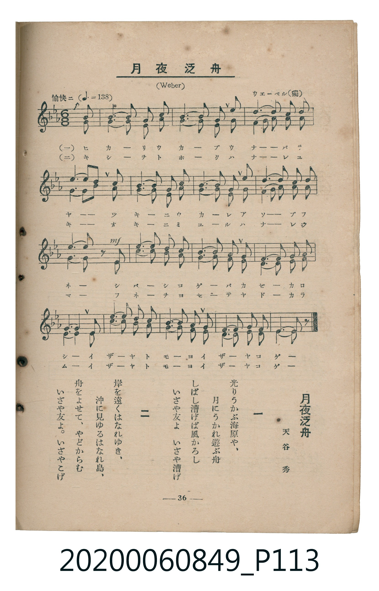

# 月夜泛舟

<audio controls src="tsukiyo_hanshu.mp3"></audio>

- 詞：天谷秀
- 曲：ウエーベル（獨）（Weber）
- 臺灣教育會公認《新定兒童唱歌》高等科女子用（2020.006.0849）

## 說明

原書資訊與歌詞全文（對應 P113.jpg，書頁 p. 36，高二重音第 3 首）：
調性與拍號：變ロ長調（2 降記號）、6/8 拍（愉快ニ ♩.=138，二部重音合唱，弱起最後 1 八分音符進入）

## 歌詞

```text
一
光りうかぶ海原や、
月にうかれ遊ぶ舟
しばし漕げば風かろし
いざや友よ　いざや漕げ

二
岸を遠くはなれゆき、
沖に見ゆるはなれ島、
舟をよせて、やどからむ
いざや友よ。いざやこげ
```

## ABC

```abc
X:1
T:月夜泛舟
C:曲：ウエーベル（獨）（Weber）
M:6/8
L:1/16
Q:3/8=92
K:Bb
V:V1 name="Part1" snm="Par"
V:V2 name="Part2" snm="Par"
[V:V1]
!p! z2 z2 z2 z2 z2 F2 | d4 d2 c4 c2 | B4 B2 F4 F2 | c4 d2 e4 c2 |
B4 c2 d4 F2 | d4 d2 c4 c2 | B4 B2 F4 F2 | c4 d2 e4 c2 |
!mf! B6 B2 z2 B2 | g4 g2 f4 f2 | e4 e2 d4 d2 | c4 c2 d4 c2 |
B4 A2 B4 B2 | g4 g2 f4 f2 | e4 e2 d4 d2 | c4 c2 d4 c2 |
B6 B4 z2 |
[V:V2]
!p! z2 z2 z2 z2 z2 F2 | B4 B2 F4 F2 | D4 D2 F4 F2 | F4 F2 F4 F2 |
D4 E2 F4 F2 | B4 B2 F4 F2 | D4 D2 F4 F2 | F4 F2 F4 F2 |
!mf! D6 D2 z2 B2 | e4 e2 d4 d2 | c4 c2 B4 B2 | F4 F2 F4 F2 |
D4 C2 D4 B2 | e4 e2 d4 d2 | c4 c2 B4 B2 | F4 F2 F4 F2 |
D6 D4 z2 |
```

## TMD 檔案連結

- [主旋律 TMD 檔案](tsukiyo_hanshu.tmd) [[在 TMD Studio 編輯](https://tmdlang.github.io/Tmd-TS/#tmd=s7IKdvYPcrWy4tLSUng2p-PpkjnPNs9-0TFfQUuLS9FWwdDYgsveVsFJh8vGTN_CjqtOQenFynnv98x6umTliw3bny9vUAKJPZu9CSj2uGnZ46YVj5v3PG6e-bh59fs9Hc97V7zf0wlkhKcmpRYBmWDVL9p3PW9c_GzqzBdNm57NaX7auubFqt7HDV3Ppm14um7W09ZJz1cvfTpl47O1PY8bul-unvF8befz5ROfLt38dO2E51OAJnYYGRgZ6BkYmOkZWJhYgo3l0tdSsKUW4FJQUHjaN__Z7B0vNre_WNH1oqMd6Bigx5-2rng2rR3ogKcbep-1dyoEGBoa62UVpL_f0wNU_HJBo0KBnoKxGZALdPaTXT0v23tfzt_8fM0aBWOFl8umgcNiFsj0F6v2P2tYDjK3u_fFzPlA0Rfruh43r305dTtQCuRDhZcze1-smAGW7Hzc0AgMfgWgYqDUs5bOp_tXP27uVng0c6WeLTCKgPaBLGteAbHv6YQOYPABBZ_u2fhi6_Zncxqe7utRMFR42rr6aUcb2EHLXjZsetq6FGg0F8g5T3Y0gP3c2vm4qetxY9vjxu7Hjduebd0ODIXHTS1A60HSwPTxuHE1VLqp52UjUOk2YFoByT1unP64cQOQfLZn6uPGSUD2y0UrwOp6gYIQFS2PG6cBTXvaDxTteNzQABeB6IG4ZFcP2CWbdjxumvSyccHjxv7HjesfN64CWvi4CWgzMKFAHLNpGtAxL5YBzWp73AR0LlTR083boCqALgOaAbKqcfbjxmVAUZBXGleCXQX0KNjLGK5qgos8bpwMchVQEeUpCgoUtPS5uHwTM_OsAhKLSgwdagxqFKpBNijYGJpp2YFZwIQMibenG_qfr28AaQEJ1ygYKOhi4OqCWgXTeCCjBhx6IM3A1AaMzhcLexA6jYEKQBBEG0HZILoGmCggPBANNgcEIQbCVYJ0mWDVBeLBzMbiil09dHEFTCc4PHLTasEctPDoRHGJGVQXiDaFWQc2E2YDiEZ2L8IdyH5GdYc5yMHIXkFxw9PZs-ngBpjVIAgKjxquWqQEZ0SvBIcvQo1hfDADXRaVj1OvCRZZfGmP5g6C6yc-FRIXzygJiljXGIEYcB7BtEhDl8DDBQThKVLXTgGUKBWAtDIXFwA)]
- [鋼琴伴奏 TMD 檔案](tsukiyo_hanshu_piano.tmd) [[在 TMD Studio 編輯](https://tmdlang.github.io/Tmd-TS/#tmd=s7IKdvYPcrWy4tLSUng2p-PpkjnPNs9-0TH__Z6Ol917nk_Y8mTPlqdL-593drzf06mgpcWlaKtgaGzBZW-r4KTDZWOmb2HHVaeg9GLlvPd7Zj1dsvLFhu3PlzcogcSezd4EFHvctOxx04rHzXseN8983LwaaO7z3hVAs4CM8NSk1CIgE6z6Rfuu542Ln02d-aJp07M5zU9b17xY1fu4oevZtA1P18162jrp-eqlT6dsfLa253FD98vVM56v7Xy-fOLTpZufrp3wfArQxA4jAyMDPQMDMz0DCxNLsLFcvomZeVYBmYl5-UEeDjUGNQrVXApAYGNopmUHZulrKTzds_HF1u1PN_Q_X9-goKUPFq5RMFDQxcDVBbUKpvFARg0XTPPzNWue7Gh4sbAHodMYqAAEQbQRlA2iaxQMoTwQDTYHBCEGwlWCdJlg1QXiwczG4opdPXRxBUwnODxy02rBHLTw6ERxiRlUF4g2hVkHNhNmA4hGdi_CHch-RnWHOcjByF5BccPT2bPp4AaY1SAICo8arlrkJOdDtySHL0qNYXwwA10WlY9TrwkWWXypj-YOgusnPh0SF9MoSYpY1xiBGHAewdRIQ5fAwwUE4WlS104BlCwVgLQyFxcA)]

## 分析

```text
================================================================================
📊 TMD Song Profile: [ 月夜泛舟 ]
================================================================================
⏱  Duration:       0:22 (22.2s), 17 measures total
🎼 Key & Tempo:    首調基準 B,, != 138.0 BPM, <6/8>
   - 分析範圍：      由實際發聲的音符與和弦推測調性；播放脈絡另行呈現
🎤 人聲音域:    F4 (MIDI 65) – G5 (MIDI 79) [跨度: 14 個半音 / 1.2 個八度, 難度: moderate]
   - 最低音:  F4 in [Main #1 @ m.1, 0:01]
   - 最高音: G5 in [Main #1 @ m.10, 0:11]
   - 適合: soprano, mezzo-soprano, tenor, baritone
🏛  結構:      Main (22.2s)
⚡ 編曲密度:        Peak 2 軌道同時演奏
🗝  調性診斷：       A# 大調（純淨自然大調，未偵測到可信轉調）
   - 風格氣質:    純淨自然大調（陽光明朗、易唱易記，無明顯調外色彩）
   - 轉調歷程:    全曲維持單一推測調性（未偵測到可信轉調）
   - 核心骨幹音:  F, D, A#, C, D#
   - 調性數值:    A# 大調 [相關度: 0.85, 穩定度: High, 自然音純度: 100.0%]
   - 候選調性 (K-S): A# 大調 (0.85), F 大調 (0.72), D 小調 (0.72)
   - 五度圈歷程:   -2
   - 各段落調性細節:
     • [Main #1]: A# 大調 (r: 0.85, 自然音純度: 100.0%)

  [ 五度圈游移軌跡 ]
               C  
         F            G  
     [Bb]*              D  
      Eb               A  
         Ab           E  
            Db       B  
               F# 
     (* = active key center)

  [ 十二半音累積音高分佈 ]
     C  : ████████████              14.7%
     C# :                            0.0%
     D  : █████████████████████     24.7%
     D# : ████████                   8.9%
     E  :                            0.0%
     F  : ████████████████████████  28.4%
     F# :                            0.0%
     G  : ███                        3.2%
     G# :                            0.0%
     A  :                            0.5%
     A# : ████████████████          19.5%
     B  :                            0.0%
--------------------------------------------------------------------------------
Assignment 軌道音域：
  - Part1         : F4 – G5 (14 個半音 / 1.2 個八度, 62 個音符)
  - Part2         : C4 – D#5 (15 個半音 / 1.2 個八度, 62 個音符)
================================================================================
```


## 原書掃描頁




