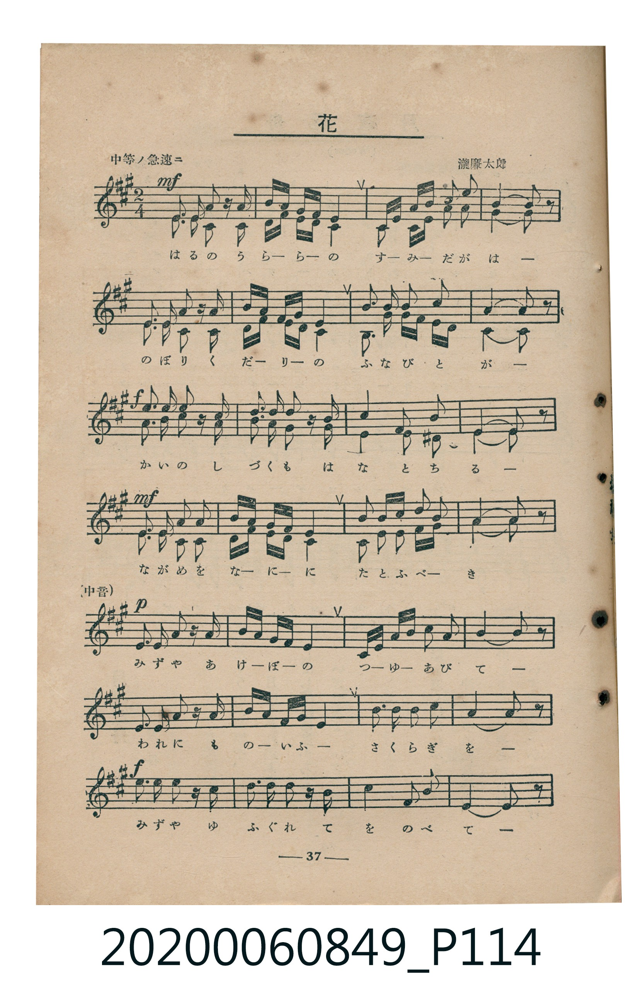
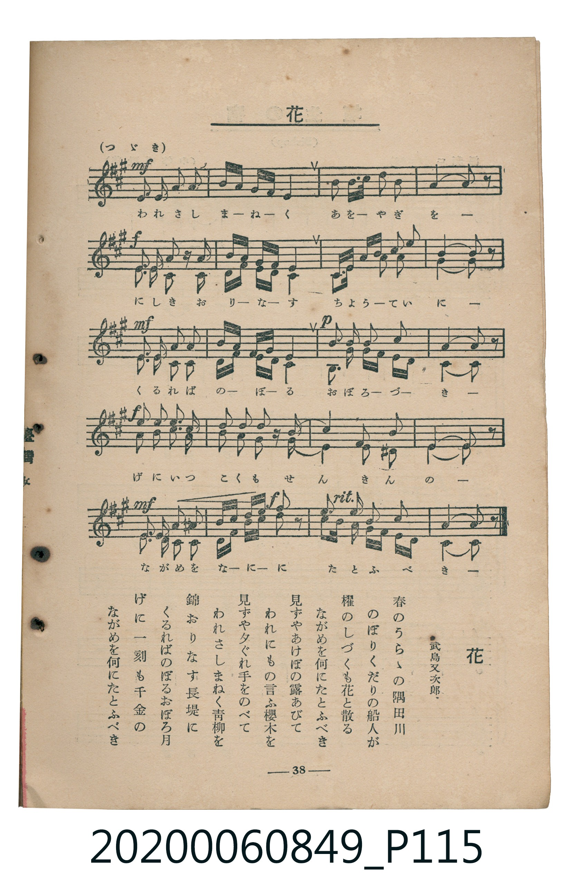

# 花

<audio controls src="hana.mp3"></audio>

- 詞：武島又次郎
- 曲：瀧廉太郎
- 臺灣教育會公認《新定兒童唱歌》高等科女子用（2020.006.0849）

## 說明

原書資訊與歌詞全文（對應 P114–P115.jpg，書頁 pp. 37–38，高二重音第 4 首）：
調性與拍號：イ長調（3 升記號）、2/4 拍（中等ノ急速ニ，二部重音合唱，中段中音齊唱）

## 歌詞

```text
春のうらゝの隅田川
のぼりくだりの船人が
櫂のしづくも花と散る
ながめを何にたとふべき

見ずやあけぼの露あびて
われにもの言ふ櫻木を
見ずや夕ぐれ手をのべて
われさしまねく青柳を

錦おりなす長堤に
くるればのぼるおぼろ月
げに一刻も千金の
ながめを何にたとふべき
```

## 原書掃描頁





## 分析

```text
================================================================================
📊 TMD Song Profile: [ 花 ]
================================================================================
⏱  Duration:       1:02 (62.6s), 48 measures total
🎼 Key & Tempo:    首調基準 A, != 92.0 BPM, <2/4>
   - 分析範圍：      由實際發聲的音符與和弦推測調性；播放脈絡另行呈現
🎤 人聲音域:    C#4 (MIDI 61) – F#5 (MIDI 78) [跨度: 17 個半音 / 1.4 個八度, 難度: challenging]
   - 最低音:  C#4 in [Main #1 @ m.1, 0:00]
   - 最高音: F#5 in [Main #1 @ m.46, 0:59]
   - 適合: soprano, mezzo-soprano, tenor, baritone
🏛  結構:      Main (62.6s)
⚡ 編曲密度:        Peak 2 軌道同時演奏
🗝  調性診斷：       C# 小調（流行色彩小調，未偵測到可信轉調）
   - 風格氣質:    流行小調（略帶和弦色彩音與裝飾副屬和弦）
   - 轉調歷程:    全曲維持單一推測調性（未偵測到可信轉調）
   - 核心骨幹音:  E, C#, F#, A, G#
   - 調性數值:    C# 小調 [相關度: 0.86, 穩定度: High, 自然音純度: 91.6%]
   - 候選調性 (K-S): C# 小調 (0.86), A 大調 (0.73), E 大調 (0.68)
   - 五度圈歷程:   -5
   - 各段落調性細節:
     • [Main #1]: C# 小調 (r: 0.86, 自然音純度: 91.6%, 調外音: C, D, F)

  [ 五度圈游移軌跡 ]
               C  
         F            G  
      Bb               D  
      Eb               A  
         Ab           E  
           [Db]*      B  
               F# 
     (* = active key center)

  [ 十二半音累積音高分佈 ]
     C  : █                          0.6%
     C# : ████████████████████████  25.9%
     D  : █████                      4.9%
     D# :                            0.3%
     E  : ████████████████████████  26.3%
     F  : ███                        2.9%
     F# : █████████████             14.1%
     G  :                            0.0%
     G# : ██████                     6.8%
     A  : ███████████               12.1%
     A# :                            0.0%
     B  : ██████                     6.1%
--------------------------------------------------------------------------------
Assignment 軌道音域：
  - Part1         : C#4 – F#5 (17 個半音 / 1.4 個八度, 194 個音符)
  - Part2         : F#3 – A4 (15 個半音 / 1.2 個八度, 192 個音符)
================================================================================
```

## ABC

```abc
X:1
T:花
C:曲：瀧廉太郎
M:2/4
L:1/16
Q:1/4=92
K:A
V:V1 name="Part1" snm="Par"
V:V2 name="Part2" snm="Par"
[V:V1]
!mf! e3 e c2 z e | a g f e e4 | c e a c b3 g | a4 a2 z2 |
e3 e c2 z e | a c b f g4 | c a f d c a f d | e4 e2 z2 |
!f! b3 b c2 z a | b3 b c2 z a | c4 b3 a | e4 e2 z2 |
!mf! e3 e a3 b | c a f d e4 | f2 a f e2 b2 | a4 a2 z2 |
!p! e3 e e2 z e | a g f e e4 | c e f a g3 e | f4 f2 z2 |
c3 c d2 z d | f e d c c4 | f2 f f f3 f | ^e4 e2 z2 |
!f! f3 f z ^e z e | f2 f f z ^e z e | f4 f2 a2 | c4 c2 z2 |
!mf! c3 c f3 g | a f c d c4 | d2 d f e2 e2 | e4 e2 z2 |
!f! e3 e c2 z e | a g f e e4 | c e a c b3 g | a4 a2 z2 |
!mf! e3 e c2 z e | a c b f g4 | !p! c a f d c a f d | e4 e2 z2 |
!f! b3 b c2 z a | b3 b c2 z a | c4 b3 a | e4 e2 z2 |
!mf! e3 e a3 b | !f! c e f d b2 z2 | c a b g a2 b2 | a4 a2 z2 |
[V:V2]
!mf! c3 c A2 z c | c e d c c4 | A c c e e3 e | c4 c2 z2 |
c3 c A2 z c | c e f d e4 | c2 f f e c ^d B | G4 G2 z2 |
!f! e3 e e2 z e | e3 e e2 z e | A4 F2 ^B2 | G4 G2 z2 |
!mf! c3 c c3 e | a c d B c4 | d2 d d c2 e2 | c4 c2 z2 |
!p! e3 e e2 z e | a g f e e4 | c e f a g3 e | f4 f2 z2 |
c3 c d2 z d | f e d c c4 | f2 f f f3 f | ^e4 e2 z2 |
!f! f3 f z ^e z e | f2 f f z ^e z e | f4 f2 a2 | c4 c2 z2 |
!mf! c3 c f3 g | a f c d c4 | d2 d f e2 e2 | e4 e2 z2 |
!f! c3 c A2 z c | c e d c c4 | A c c e e3 e | c4 c2 z2 |
!mf! c3 c A2 z c | c e f d e4 | !p! c2 f f e c ^d B | G4 G2 z2 |
!f! e3 e e2 z e | e3 e e2 z e | A4 F2 ^B2 | G4 G2 z2 |
!mf! c3 c c3 e | !f! a3 f d2 z2 | e c e e c f e d | c4 c2 z2 |
```

- [主旋律 TMD 檔案](hana.tmd)
- [鋼琴伴奏 TMD 檔案](hana_piano.tmd)
