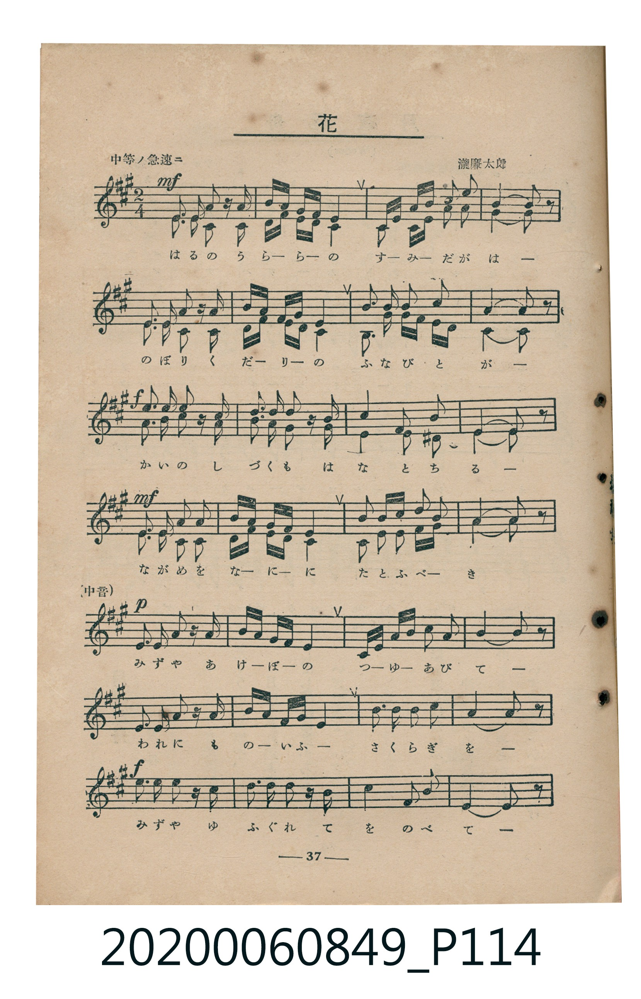
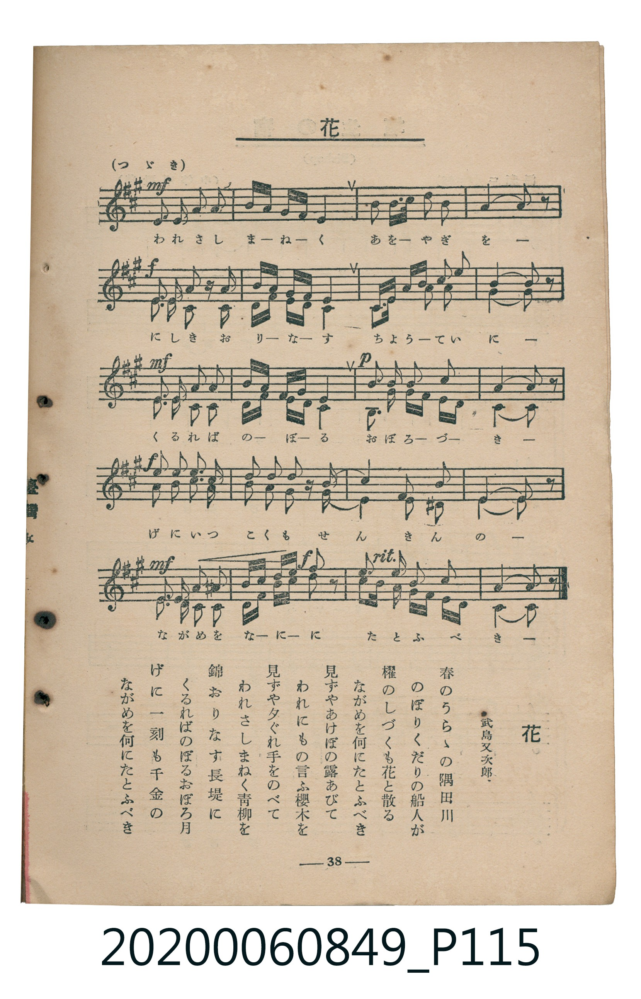

# 花

> Re:Shōka 使用 AI 協助辨識與重建樂譜，可能會有錯誤。歡迎回報。

- **鋼琴伴奏版**：<br><audio controls src="hana.mp3"></audio>

- 詞：武島又次郎
- 曲：瀧廉太郎
- 臺灣教育會公認《新定兒童唱歌》高等科女子用（2020.006.0849）

## 說明

原書資訊與歌詞全文（對應 P114.jpg–P115.jpg，書頁 pp. 37–38，高二重音第 4 首）：
調性與拍號：イ長調（3 升記號）、2/4 拍（中等ノ急速ニ，二部重音合唱，中段中音齊唱）


## 歌詞

```text
春のうらゝの隅田川
のぼりくだりの船人が
櫂のしづくも花と散る
ながめを何にたとふべき

見ずやあけぼの露あびて
われにもの言ふ櫻木を
見ずや夕ぐれ手をのべて
われさしまねく青柳を

錦おりなす長堤に
くるればのぼるおぼろ月
げに一刻も千金の
ながめを何にたとふべき
```

## ABC

<div class="abc-score" data-abc-src="hana.abc" aria-label="五線譜載入中"></div>

[下載 ABC 原始檔](hana.abc)

## TMD 檔案連結

- [主旋律 TMD 檔案](hana.tmd) [[在 TMD Studio 編輯](https://tmdlang.github.io/Tmd-TS/#tmd=s7IKdvYPcrWy4qpTUCpJTLdSSM7PyUlNLsnMz7MqzsjMK0nNjM_KTMmPL87Iz05Ugisry88pzU21ys4vyY9PzyzKKY43MjAyiDcwMIs3sDCxRCgszi8tSk61Kk7OyM_PiS9JrShJys_PRpePL0hMT7UKMDQ0QcgUFOWXpeYl5gF1FxSBXJIC1o5QkFqWmZIKki5OTsyLL0stykzLTE1BcmNqUTHYHxArSooS84qTizILQJ5DqMovKsnITy9KLMiotMrILC7JL8pMTsyJz07MQ_JuSUYq0LcFOYl5SPYDVaZn5lnlpmZmZSL5TEtL4UXXRgUtLS5FWwVLIy57WwVHLhsjfRM7kM4XK-e93zPr2dplTzdve9rf8WzNwpfNfWAzn83eBJR53rD86e7Op0tWwYRftO963rj42dSZL5o2PZvT_LR1zYtVvY8bup5N2_B03aynrZOer176dMrGZ2t7Hjd0v1w94_nazufLJz5duvnp2gnPp6x4v6cDFDN6wJjRA8XM-z2dSlxc-loKttQCXAoKCk_75j-bvePF5vYXK7pedLQDHQP059PWFc-mtQMd8HRD77P2TgVQ9OplFaQ_apgMZJqCmO_39AD1vVzQqFBQoKdgbA6UMrYACgL98WRXz8v23pfzNz9fs0bBROHlsmlApwMDCGTdi1X7nzUsB1nU3fti5nyg6OOmJS-nbgeKA60zVnjaC3TIDLBM5-OGRmDYKwBVAqWe7FgLDJ_HzX3PGpa-bJj_uLkbaBnIpuYVEMueTugABiZIcMfaZ-u2Akmg4Mu9XWDBTi6Q5c9mLH3cuO5xY9vjps7HTXOB7JezWp9P2fB0-1yQNFhuz-OmrseN_Y8bF4AZ61507Hyya9fjxh6wAaubwIqmP24EmtT_uKkJmF4eN654NnXx46ZuiBmrgGofNzU-bpr0ZO_Ux42rHzfOB6p43Lj1cePOx429YIe8WNb9uBHo85bHjUADJ4JsBbplziYwd_PjxmVgo5qAFvSATGgC2fpiRQPQkGerdz-bswJoOIoxT5cAbZoAVP2ssxsoB3Yj0DIUY4AqgM7e97hxLdDlL-dOejZ_M8gYkJKXPcseN3aB_Qt0_UxgdDxdsARoMcRDQO1AQ4EmbIAFENBWoFIgo_fZnA6IIqCdq5_saHjasRvo2qe9zS_bgb5aR1yIABVRnpahQEFLn4vLNxGYuQMyE_PyDR1qDGqqQTYo2BiaadmBWdiykAIwrQLdD0w4oJwMZr9YCExKXS8aNwGTmIKGicLTDf3P1zfowDODJhZTgLaDbKhRqM5Nq1UwjVfQBUIgZQikDIBkjYIRkDSPVzCLh8nqAgWNwTxDoKQxSD1YzAgqC6INQCJgk30Ma4Ahuh4sA4wIUJoFsuKBdBtQDzBdKzxu3oOgwbIQO4ARCxXbD6UXgMxo7IHKQsyEQJDLasBJg7jA2tVDUWDhCidgIAGDCimcQGEBw6CQqgFrAEGIRtRQgvgdmFCB4dEFDaV-sF8XQEOpC0sobQXrWQUmN4PJFVAZUEiRG0I7OilLTqDUBAkkMG0A9H4NsGwFiZiAaQNgoAATEtR5wJCDhBI8cMHBixlG3dAwakFKSdPBvl0KlekHhlMTVGY9WAYUNhA5UMg8blwICR9gaiQ7fJ7Onk3t7AbCOLIbJAkZg8MNEkj4khHEu6DoBxZiIFbTJGiCWAVNPqvhNCIZzYcGEChBAcs5EA-oBiLXS2JA7eoBBxSoDgTWaZDKFCw-BRhopIdVAe6SCRJOOEsmWJjiLpn2QwNrFjCYWqCppgns6YnQQAJijDy3BJof26ByoPQGyX0g2WXUCa6nrWvJCS6SCidQoBBVODX1QwKqCZiqwOkGGFDAbAYptiCBAMqSwLQDTjWwgJoKDV5QpuwEs_ogMuA0SY00taOZrDRFq_IJS3oCphJYOQ2SmQAOREhKW4YSFJA0Bsl8VE1HqzGDCNwmHqgiCiUxgZIIqAyH-HkfNDGthdIQlRA5cC4DhhYk74FCl_zktKMTUdftnIunLCcioGjZcoIU0aDwgRTDoFTTBfYxrC0AK9RnIoXUQqB8O5CGlU-glATKoBBZWLFPRlg97W2kLKzwJSqMEgpU8pPWhIIlLGBDE5zJgJ0AqKdhpRS0OIdX_iA5UGMLJAPSCQpkSGOCnJoPNajwN8qJTFnQZAIprWClFAyTWUqBcgskHUBSBYheAvbwZDAbFIyIVtRscHoDyUBUgoMIzEe0WskOIrxNcfISlDrYZZDSyBQciGawMIAHJXHJibSmFNj3QDasKQUiIa1zWImOmZxqkXt_RpT2_rqp0xwFFlLgKjEelNpgJRiQARZHLsdgpRksFwOzL0QBmDFEeoHkBhq-8AIi1PAygjCB4QKvEoAKwOEIUQI1AzXEyO8RQvqEoDYpRB7YsAfSIFkq9ArJTmbAVAbJbpDqD1ZPQrIfNM0AKfTiy0QdkrWGVNeQmnkRTODLi9AgAROQapRQ0qKsl4hctMESFmbhRkpzFT7yOdpXJDvQRnuMxKev0X4jsWlqtPeIEWJYeo_Yi3tSe480ankN0l4k2WFGqIrEaH6Be5JkNcHI71HCGm69UHVLya4psfcqKUlxoEQDK8VBSQiSBUGilLbCBl_XkhqpDJaaUFIZqMQCBSak2AfnTXDxBg5EohMYuX1MWLse0hSD8PA1xoA9TV07BVBnUwFIK3MBAA)]
- [鋼琴伴奏 TMD 檔案](hana_piano.tmd) [[在 TMD Studio 編輯](https://tmdlang.github.io/Tmd-TS/#tmd=s7IKdvYPcrWy4qpTUCpJTLdSSM7PyUlNLsnMz7MqzsjMK0nNjM_KTMmPL87Iz05Ugisry88pzU21ys4vyY9PzyzKKY43MjAyiDcwMIs3sDCxRCgszi8tSk61Kk7OyM_PiS9JrShJys_PRpePL0hMT7UKMDQ0QcgUFOWXpeYl5gF1FxSBXJIC1o5QkFqWmZIKki5OTsyLL0stykzLTE1BcmNqUTHYHxArSooS84qTizILQJ5DqMovKsnITy9KLMiotMrILC7JL8pMTsyJz07MQ_JuYhFQc3pqbmpeiVVBZmJefnxicnJ-bkFiXiZIDKGwJAOoyKogJxFZEGhkemaeVW5qZlYmUhBoaSm86Nr4fk_Hy-49zydsebJny9Ol_c87O97v6VTQ0uJStFWwNOKyt1Vw5LIx0jexAxn3YuW893tmPVu77OnmbU_7O56tWfiyuQ9s0bPZm4AyzxuWP93d-XTJKpjwi_ZdzxsXP5s680XTpmdzmp-2rnmxqvdxQ9ezaRuerpv1tHXS89VLn07Z-Gxtz-OG7perZzxf2_l8-cSnSzc_XTvh-ZQVQMeB4lUPGK96oHgFOk2Ji8s3EeibAFAwGDrUGNRUcykAgY2hmZYdmKWvpWCLDhSer1nzZEfDs3VbQa4Es18s7Hmyo-tF46aXzSsUNEwUnm7of76-QUcBlAr0sgrSNbGYoqUPtqFGoTo3rVbBNF5BFwiBlCGQMgCSNQpGQNI8XsEsHiarCxQ0BvMMgZLGIPVgMSOoLIg2AImATfYxrFF43LgeLPO4qRvIXgdkxQPpNqCex02dCo-b9yBosCzEjseNM6Fi-6H0ApAZjT1QWYiZEAhyWQ0X8YG1q4eiwMIVTsBAAgYVUjiBwgKGQSFVA9YAghCNqKEE8fvjRlB4dEFDqR_s1wXQUOrCEkpbwXpWgcnNYHIFVAYUUuSG0I5OypITKDVBAglMGwC9X6NgAhYxAdMGwEABJiSo84AhBwkleOCCgxczjLqhYdSClJKmg327FCrTDwynJqjMerAMKGwgcqCQedy4EBI-wNRIdvg8nT2b2tkNhHFkN0gSMgaHGySQ8CUjiHdB0f-4qRHEapoETRCroMlnNZxGJKP50AACJajHjTtBPKAaiFwviQG1qwccUB1Pdqx9OX8zsIyDZbspwEAjPawKcJdMkHDCWTLBwhR3ybQfGlizgMHUAk01TWBPT4QGEhBj5Lkl0PzYBpUDpTdI7gPJLqNOcD1tXUtOcJFUOIEChajCqakfElBNwFQFTjfAgAJmM0ixBQkEUJYEph1wqoEF1FRo8IIyZSeY1QeRAadJaqSpHc1kpSlalU9Y0hMwlcDKaZDMBHAgQlLaMpSggKQxSOajajpajRlEpgNZRKEkJlASAZXhED_vgyamtVAaohIiB85lwNCC5D1Q6JKfnHZ0Iuq6nXPxlOVEBBQtW06QIhoUPpBiGJRqusA-hrUFYIX6TKSQWgiUbwfSsPIJlJJAGRQiCyv2yQirp72NlIUVvkSFUUKBSn7SmlCwhAVsaIIz2ePGDVBPw0opaHEOr_xBcqDGFkgGpBMUyJDGBDk1H2pQ4W-UE5myoMkEUlrBSikYJrOUAuUWSDqApAoQvQTs4clgNigYEa2o2eD0BpKBqAQHEZiPaLWSHUR4m-LkJSh1sMsgpZEpOBDNYGEAD0rikhNpTSmw74FsWFMKREJa57ASHTM51SL3_owo7f11U6c5CiykwFViPCi1wUowIAMsjlyOwUozWC4GZl-IAjBjiPQCyQ00fOEFRKjhZQRhAsMFXiUAFYDDEaIEagZqiJHfI4T0CUFtUog8sGEPpEGyVOgVkp3MgKkMkt0g1R-snoRkP2iaAVLoxZeJOiRrDamuITXzIpjAlxehQQImINUooaRFWS8RuWiDJSzMwo2U5urLvV3AcbPRviIlgTbaYyQ-fY32G4lNU6O9R4wQw9J7xF7ck9p7pFHLa5D2IskOM0JVJEbzC9yTJKsJRn6PEtZw64WqW0p2TYm9V0lJigMlGlgpDkpCkCwIEqW0FTb4upbUSGWw1ISSykAlFigwIcU-OG-CizdwIBKdwMjtY8La9ZCmGISHrzGG0tP08UDqalpAe5rAUjdeIdowFkaB_AlkmcQjiUAZZiAJs_hckJAxiG0MVARiGED9RoxZpiARU6hGsAnIunCbBMzI0UYguzH1GYFEjMAiZDsLyiDRUbQNKhSNgyeoyHXWSEpXIAZQGcFkBcyfunYKoCwa7QMUBbKVuQA)]

## 分析

```text
================================================================================
📊 TMD Song Profile: [ 花 ]
================================================================================
⏱  Duration:       1:02 (62.6s), 48 measures total
🎼 Key & Tempo:    首調基準 A, != 92.0 BPM, <2/4>
   - 分析範圍：      由實際發聲的音符與和弦推測調性；播放脈絡另行呈現
🎤 人聲音域:    C#4 (MIDI 61) – F#5 (MIDI 78) [跨度: 17 個半音 / 1.4 個八度, 難度: challenging]
   - 最低音:  C#4 in [Main #1 @ m.3, 0:02]
   - 最高音: F#5 in [Main #1 @ m.46, 0:59]
   - 適合: soprano, mezzo-soprano, tenor, baritone
🏛  結構:      Main (62.6s)
⚡ 編曲密度:        Peak 2 軌道同時演奏
🗝  調性診斷：       E 調性不明確（流行色彩大調，未偵測到可信轉調）
   - 風格氣質:    流行大調（略帶和弦色彩音與裝飾副屬和弦）
   - 轉調歷程:    全曲維持單一推測調性（未偵測到可信轉調）
   - 核心骨幹音:  E, A, C#, B, D
   - 調性數值:    E 調性不明確 [相關度: 0.86, 穩定度: Ambiguous, 自然音純度: 92.8%]
   - 候選調性 (K-S): E 大調 (0.86), A 大調 (0.83), C# 小調 (0.71)
   - 五度圈歷程:   +4
   - 各段落調性細節:
     • [Main #1]: E 調性不明確 (r: 0.86, 自然音純度: 92.8%, 調外音: D, A#)

  [ 五度圈游移軌跡 ]
               C  
         F            G  
      Bb               D  
      Eb               A  
         Ab          [E ]*
            Db       B  
               F# 
     (* = active key center)

  [ 十二半音累積音高分佈 ]
     C  :                            0.0%
     C# : ██████████████            17.8%
     D  : █████                      6.9%
     D# :                            0.6%
     E  : ████████████████████████  31.2%
     F  :                            0.0%
     F# : ████                       4.7%
     G  :                            0.0%
     G# : ████                       4.7%
     A  : ██████████████            18.1%
     A# :                            0.3%
     B  : ████████████              15.7%
--------------------------------------------------------------------------------
Assignment 軌道音域：
  - Piano1        : C#4 – F#5 (17 個半音 / 1.4 個八度, 182 個音符)
  - Piano2        : B3 – E5 (17 個半音 / 1.4 個八度, 189 個音符)
================================================================================
```


## 原書掃描頁






