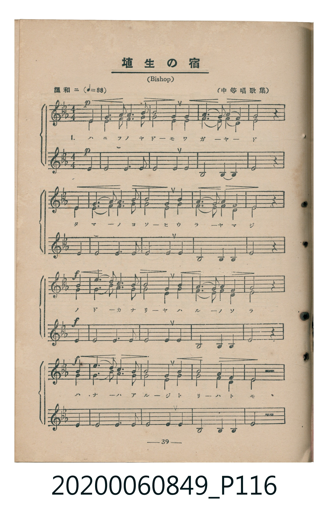
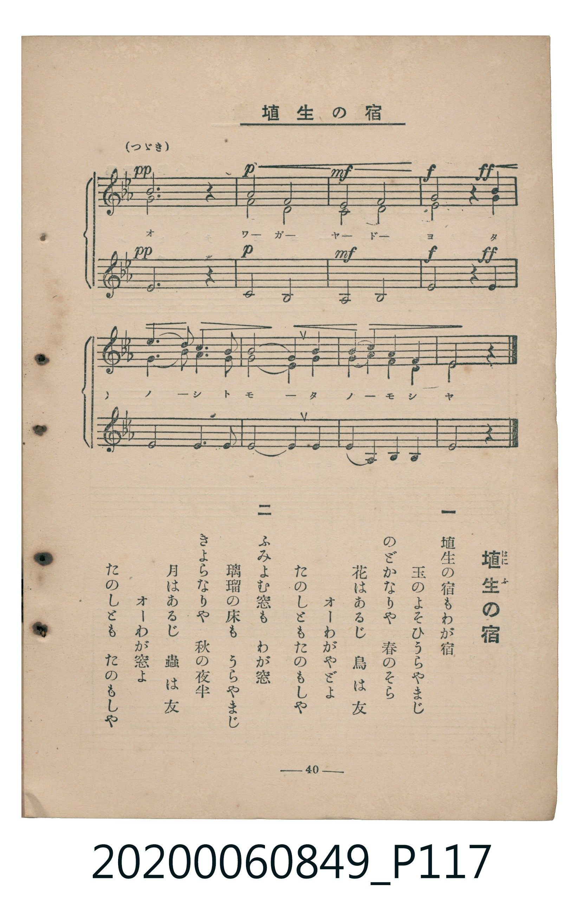

# 埴生の宿

<audio controls src="hanyu_no_yado.mp3"></audio>

- 詞：里見義
- 曲：Bishop
- 臺灣教育會公認《新定兒童唱歌》高等科女子用（2020.006.0849）

## 說明

原書資訊與歌詞全文（對應 P116–P117.jpg，書頁 pp. 39–40，高二重音第 5 首）：
調性與拍號：變ホ長調（3 降記號）、4/4 拍（溫和ニ ♩=88，三部重音合唱，弱起第 4 拍進入）
出處註記：（中等唱歌集）

## 歌詞

```text
一
埴生（はにふ）の宿もわが宿
玉のよそひうらやまじ
のどかなりや　春のそら
花はあるじ　鳥は友
オーわがやどよ
たのしともたのもしや

二
ふみよむ窓も　わが窓
瑠璃の床も　うらやまじ
きよらなりや　秋の夜半
月はあるじ　蟲は友
オーわが窓よ
たのしとも　たのもしや
```

## ABC

```abc
X:1
T:埴生の宿
C:曲：Bishop
M:4/4
L:1/16
Q:1/4=88
K:Eb
V:V1 name="Part1" snm="Par"
V:V2 name="Part2" snm="Par"
V:V3 name="Part3" snm="Par"
[V:V1]
!p! z4 z4 z4 E2 F2 | G6 A2 A6 B2 | B4 G4 z4 G2 F2 | A6 G2 A4 F4 |
G8 z4 E2 F2 | G6 A2 A6 B2 | B4 G4 z4 G2 F2 | A6 G2 A4 F4 |
!f! E8 z4 B4 | e6 d2 c6 B2 | B4 G4 z4 G2 F2 | A6 G2 A4 F4 |
!f! G8 z4 B4 | e6 d2 c6 B2 | B4 G4 z4 B4 | c4 A4 G4 F4 |
E8 z4 z4 | !pp! B12 z4 | !p! e8 d8 | !mf! c8 B8 |
!f! !ff! B8 z4 B4 | e6 d2 c6 B2 | B4 G4 z4 B4 | c2 A2 G2 A2 G4 F4 |
E12 z4 |
[V:V2]
!p! z4 z4 z4 E2 E2 | E6 F2 F6 G2 | G4 E4 z4 E2 D2 | F6 E2 F4 D4 |
E8 z4 E2 E2 | E6 F2 F6 G2 | G4 E4 z4 E2 D2 | F6 E2 F4 D4 |
!f! E8 z4 G4 | G6 B2 A6 G2 | G4 E4 z4 E2 D2 | F6 E2 F4 D4 |
!f! E8 z4 G4 | G6 B2 A6 G2 | G4 E4 z4 G4 | A4 F4 E4 D4 |
E8 z4 z4 | !pp! F12 z4 | !p! G8 F8 | !mf! E8 G8 |
!f! !ff! F8 z4 G4 | G6 B2 A6 G2 | G4 E4 z4 G4 | A2 F2 E2 F2 E4 D4 |
E12 z4 |
[V:V3]
!p! z4 z4 z4 E2 E2 | E8 E6 E2 | E8 z4 E2 E2 | B,8 B,4 B,4 |
E8 z4 E2 E2 | E8 E6 E2 | E8 z4 E2 E2 | B,8 B,4 B,4 |
!f! E8 z4 E4 | E8 E6 E2 | E8 z4 E2 E2 | B,8 B,4 B,4 |
!f! E8 z4 E4 | E8 E6 E2 | E8 z4 E4 | B,8 B,4 B,4 |
E8 z4 z4 | !pp! D12 z4 | !p! E8 B,8 | !mf! A,8 B,8 |
!f! !ff! D8 z4 E4 | E8 E6 E2 | E8 z4 E4 | A,6 A,2 B,4 B,4 |
E12 z4 |
```

## TMD 檔案連結

- [主旋律 TMD 檔案](hanyu_no_yado.tmd)
- [鋼琴伴奏 TMD 檔案](hanyu_no_yado_piano.tmd)

## 分析

```text
================================================================================
📊 TMD Song Profile: [ 埴生の宿 ]
================================================================================
⏱  Duration:       1:08 (68.2s), 25 measures total
🎼 Key & Tempo:    首調基準 E,, != 88.0 BPM, <4/4>
   - 分析範圍：      由實際發聲的音符與和弦推測調性；播放脈絡另行呈現
🎤 人聲音域:    D#4 (MIDI 63) – D#5 (MIDI 75) [跨度: 12 個半音 / 1.0 個八度, 難度: easy]
   - 最低音:  D#4 in [Main #1 @ m.1, 0:02]
   - 最高音: D#5 in [Main #1 @ m.10, 0:24]
   - 適合: soprano, mezzo-soprano, contralto, tenor, baritone, bass
🏛  結構:      Main (68.2s)
⚡ 編曲密度:        Peak 3 軌道同時演奏
🗝  調性診斷：       D# 大調（純淨自然大調，未偵測到可信轉調）
   - 風格氣質:    純淨自然大調（陽光明朗、易唱易記，無明顯調外色彩）
   - 轉調歷程:    全曲維持單一推測調性（未偵測到可信轉調）
   - 核心骨幹音:  D#, A#, G, F, G#
   - 調性數值:    D# 大調 [相關度: 0.95, 穩定度: High, 自然音純度: 100.0%]
   - 候選調性 (K-S): D# 大調 (0.95), D# 小調 (0.60), C 小調 (0.54)
   - 五度圈歷程:   -3
   - 各段落調性細節:
     • [Main #1]: D# 大調 (r: 0.95, 自然音純度: 100.0%)

  [ 五度圈游移軌跡 ]
               C  
         F            G  
      Bb               D  
     [Eb]*              A  
         Ab           E  
            Db       B  
               F# 
     (* = active key center)

  [ 十二半音累積音高分佈 ]
     C  : ██                         3.2%
     C# :                            0.0%
     D  : ████                       6.0%
     D# : ████████████████████████  38.1%
     E  :                            0.0%
     F  : ███████                   11.1%
     F# :                            0.0%
     G  : ██████████                15.3%
     G# : ██████                     9.3%
     A  :                            0.0%
     A# : ███████████               17.1%
     B  :                            0.0%
--------------------------------------------------------------------------------
Assignment 軌道音域：
  - Part1         : D#4 – D#5 (12 個半音 / 1.0 個八度, 78 個音符)
  - Part2         : D4 – A#4 (8 個半音 / 0.7 個八度, 78 個音符)
  - Part3         : G#3 – D#4 (7 個半音 / 0.6 個八度, 62 個音符)
================================================================================
```


## 原書掃描頁






