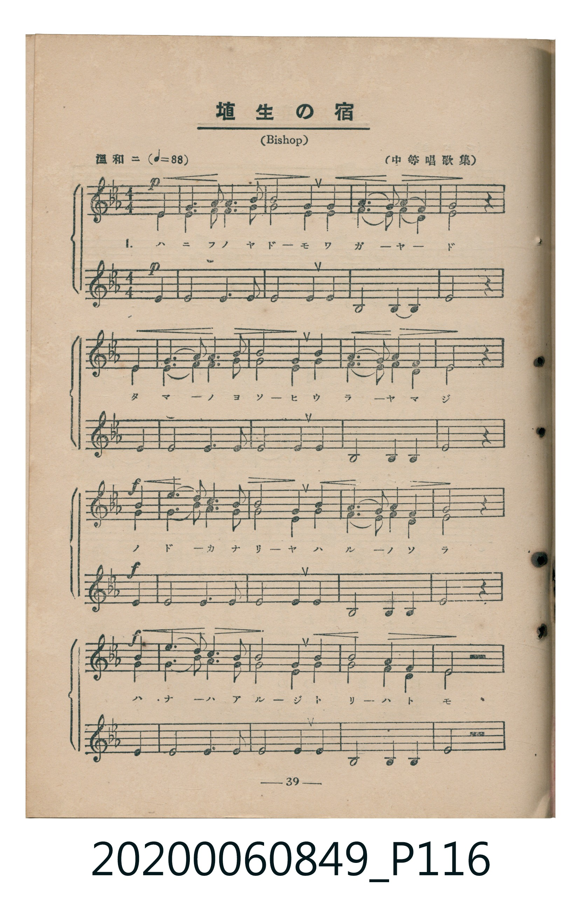
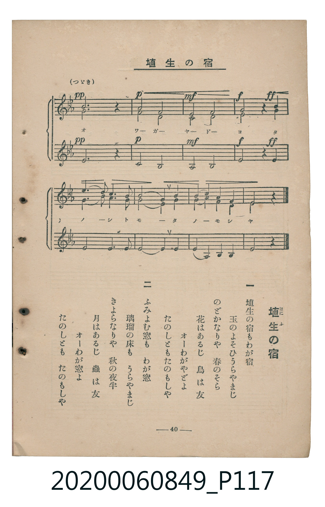

# 埴生の宿

> Re:Shōka 使用 AI 協助辨識與重建樂譜，可能會有錯誤。歡迎回報。

- **鋼琴伴奏版**：<br><audio controls src="hanyu_no_yado.mp3"></audio>

- 詞：里見義
- 曲：Henry Rowley Bishop
- 臺灣教育會公認《新定兒童唱歌》高等科女子用（2020.006.0849）

## 說明

原書資訊與歌詞全文（對應 P116–P117.jpg，書頁 pp. 39–40，高二重音第 5 首）：
調性與拍號：變ホ長調（3 降記號）、4/4 拍（溫和ニ ♩=88，三部重音合唱，弱起第 4 拍進入）
出處註記：（中等唱歌集）


## 歌詞

```text
一
埴生（はにふ）の宿もわが宿
玉のよそひうらやまじ
のどかなりや　春のそら
花はあるじ　鳥は友
オーわがやどよ
たのしともたのもしや

二
ふみよむ窓も　わが窓
瑠璃の床も　うらやまじ
きよらなりや　秋の夜半
月はあるじ　蟲は友
オーわが窓よ
たのしとも　たのもしや
```

## ABC

```abc
X:1
T:埴生の宿
C:曲：Henry Rowley Bishop
M:4/4
L:1/16
Q:1/4=88
K:Eb
V:V1 name="Part1" snm="Par"
V:V2 name="Part2" snm="Par"
V:V3 name="Part3" snm="Par"
[V:V1]
!p! z4 z4 z4 E4 | G6 A2 A6 B2 | B8 G4 G4 | A6 G2 A4 F4 |
w: 1.~ハ | ニ フ ノ ヤ | ド モ ワ | ガ ー ヤ ー
w: 2.~ふ | み よ む ま | ど も わ | が ー ま ー
!mp! G8 z4 E4 | G6 A2 A6 B2 | B8 G4 B4 | A6 G2 A4 F4 |
w: 1.~ド タ | マ ー ノ ヨ | ソ ヒ ウ | ラ ー ヤ マ
w: 2.~ど る | り ー の ゆ | か も う | ら ー や ま
!f! E8 z4 B4 | e6 d2 c6 B2 | B8 G4 B4 | A6 G2 A4 F4 |
w: 1.~ジ ノ | ド ー カ ナ | リ ヤ ハ | ル ー ノ ソ
w: 2.~じ き | よ ー ら な | り や あ | き ー の よ
!f! G8 z4 B4 | e6 d2 c6 B2 | B8 G4 B4 | B8 A4 F4 |
w: 1.~ラ ハ | ナ ー ハ ア | ル ジ ト | リ ハ ト
w: 2.~は つ | き ー は あ | る じ む | し は と
E8 z8 | !pp! B12 z4 | !p! A8 F8 | !mf! E8 F8 |
w: 1.~モ | オ | ワ ガ | ヤ ド
w: 2.~も | お | わ が | ま ど
!f! !ff! G8 z4 B4 | e6 d2 c6 B2 | B8 G4 B4 | B4 c4 A4 F4 |
w: 1.~ヨ タ | ノ ー シ ト | モ ー タ | ノ ー モ シ
w: 2.~よ た | の ー し と | も ー た | の ー も し
E8 z4 z4 |
w: 1.~ヤ
w: 2.~や
[V:V2]
!p! z4 z4 z4 E4 | E6 F2 F6 G2 | G8 E4 E4 | F6 E2 F4 D4 |
!mp! E8 z4 E4 | E6 F2 F6 G2 | G8 E4 G4 | F6 E2 F4 D4 |
!f! E8 z4 G4 | G6 B2 A6 G2 | G8 E4 G4 | F6 E2 F4 D4 |
!f! E8 z4 G4 | G6 B2 A6 G2 | G8 E4 G4 | G8 F4 D4 |
E8 z8 | !pp! F12 z4 | !p! F8 D8 | !mf! C8 D8 |
!f! !ff! E8 z4 G4 | G6 B2 A6 G2 | G8 E4 G4 | G4 A4 F4 D4 |
E8 z4 z4 |
[V:V3]
!p! z4 z4 z4 E4 | E8 E6 E2 | E8 E4 E4 | B,8 B,4 B,4 |
!mp! E8 z4 E4 | E8 E6 E2 | E8 E4 E4 | B,8 B,4 B,4 |
!f! E8 z4 E4 | E8 E6 E2 | E8 E4 E4 | B,8 B,4 B,4 |
!f! E8 z4 E4 | E8 E6 E2 | E8 E4 E4 | B,8 B,4 B,4 |
E8 z8 | !pp! D12 z4 | !p! C8 B,8 | !mf! A,8 B,8 |
!f! !ff! E8 z4 E4 | E8 E6 E2 | E8 E4 E4 | E4 A,4 B,4 B,4 |
E8 z4 z4 |
```

## TMD 檔案連結

- [主旋律 TMD 檔案](hanyu_no_yado.tmd) [[在 TMD Studio 編輯](https://tmdlang.github.io/Tmd-TS/#tmd=s7IKdvYPcrWy4qpTUCpJTLdSSM7PyUlNLsnMz7MqzsjMK0nNjM_KTMmPL87Iz05Ugisry88pzU21ys4vyY9PzyzKKY43MjAyiDcwMIs3sDCxRCgszi8tSk61Kk7OyM_PiS9JrShJys_PRpePL0hMT7UKMDQ0Q8gUFOWXpeYl5gF1FxSBXJIC1o5QkFqWmZIKki5OTsyLL0stykzLTE1BcmNqUTHYHxArSooS84qTizILQJ5DqMovKsnITy9KLMiotMrILC7JL8pMTsyJz07MQ_JuSUYq0LdpibmZOZXIWjPTM_OsclMzszKxeA0qXZ5aXJJalBefm5qTnwLUraWl8HT-ludT5j9uXPd03X4FLS0uRVsFCwsue1sFVx0uGxN9EzuQGS9Wznu_Z9bL9p4Xy7qf71sJNvfZ7E1AMY_UvKJKhaD88pzUSgWnTGDUFIBlX7Tvet64-NnUmS-aNj2b0_y0dc2LVb2PG7qeTdvwdN2sp62Tnq9e-nTKxmdrex43dL9cPeP52s7nyyc-Xbr56doJz6eseL-nAxSJesBI1ANF4vs9nUpcXPpaCrbUAlwKCgpP--Y_m73jxeb2Fyu6XnS0Ax0D9OjT1hXPprUDHfB0Q--z9k4FUEp41DAZSJnrZRWkv9_TA9TzckGjQkGBnoKxJVDKxAAoCPTDk109L9t7X87f_HzNGgVThZfLpgGdDQwjkFUvVu1_1rAcZEl374uZ84GiL9Z1PW6e_XLqdqAU0DZjhZcze1-smAGW7Hzc0AgMewWgYqDUs12rn07qedzcrfBo5kpbCwugbU92dL5sXgGx7emEDmBIAgWf7tn4Yut2kOVgnS8bNj1tXQo0DOzV9l0vZk59sWI30Aqg5UBTn-xYCwx0SBy8nN0GUgdS-GRHA1g9OFkAlT1uXP-4cfXjxq0gV4FTyeOmpsdN_Y8be4BskNLnfSCJx01ApXMfN2563Nj2uKnzcVPL48Z9jxtngFSApBtXPm7sfty46nFTF0iuoeHZjKVg8blA1eAQ6toItgtoOFDdDKCKl5uBKtY_7e8Gm9G06nHzHojFYMNXAm2EGA5KvY8bpz9uXAFyGoQLYkwHqoP4aVcPROXWx41A53c8bmp4vmoySE1DA8REIBfslYkLnk9qBnlzF9CVYGlsvukFmwH0NcI3z5cDHb3u6ZI5T3u7QIqezYGEHMI3L-YDgwabb8BOweoVkPWovgEqojzpQ4GClj4Xl28isFgISCwqMXSoMaipBlmgYGOhZQdmYMtvCsD0BUwjLxb2KGhAEpyCNjC9Pd3Q_3x9gw44t4CyiSYWnUD7QKbWKBgo6MJxdUGtgiGQrlEwBpK6QKNMwLQpUMQUzNIFy4BwDVTOGEwbIemCmpULMwxskY9hjUI8kAfDj5v7wVpAOQmk5XHzVCDug7KXgGU6ocY9bl4EJtdDdDStgYruAauEsCBmwXSAbWjaj7DdCM32xq0QHY0gNSC1HUDcAGE37gPLrITZ3tQEJqHubexB2A5UiWQ7XAfEdpC_asBJHnfc7eoBxx2JUYY_ckBsbJEDigt45KTVQtTB4-Zx8zykUIXFwwpweO-Fx8MksM-WQUMb4l_keACZAdKxAzkkwKYh4gGYTZFCcB00jNvAIQhJC_Awb2yDmgeJV7COphZoHEHCfAayTY29RIT5jk5ywtwwDmyNuYIZSYGOkiOwBDqyx1ZD2V3gwF0FD3RI0MKyC0wVLJog0YOIDpTshRToHUg2QW1tXAUOXEh0gEyCBC0o6EFBCwpM5GiCmAGSAWVERKCD3Ecg0J_Onk2zQIeJYE_pIIgc4EhpDxxEIG8tQgpYEB-Ueh83Qz2LFBEg9QhxUJkECwQkW0CBjRJ0kMACBSsosOEpHJxyIWUOSMd0uDhIPbDOgYiD8wGqLQRKlCmYAQ1uK-EN6OoCYGENC0hY0IGEa6FpGhK0YAcAS3ZgQoaFMZIwUBQ1uWOm9yZYYMK8BApIWGqCFewQUVCqggQirFAHiYKCBZ7y0Ar4x42wlIxkOrjYhgQspOCGBDeo-ICIwnINIo_A0vV8sOn403XrWnKCm-h0DZLHnq7BEYSUrmElNih7b4eyO1DSKaSeggYarPCAiEHqV7A-5KCH1ZbIQQwtr8EpG5JmQWkVOaVCzYQEH6zogNoNKdVB-kA6QMUNqj21SI0gowFvBEHC2wiaxo2RinOQDEQNRM4QTJtD0hxKRYtoBdGiJYDfhZBmGiEXQrMtbapNiHNM4TUj7RxIZhVDjANhIjgcCC49aFcsw0pYmHWQYhkmCnYPpPwCl8tmMD6yBFJ5DS-ZiQlS8ko3YoMUVrBhCVJI6YZcGhgPktIA4gkQiSoCUWMKC3QwA0wMQHlAqRuhyYVGDWk6OpHcZic1nEjjUgGevVGLBXj2h7sPWi6YYJPAVi4QE6xktnqICFYQCXYqrmCFlwy6dgqgwkEBSCtzAQA)]
- [鋼琴伴奏 TMD 檔案](hanyu_no_yado_piano.tmd) [[在 TMD Studio 編輯](https://tmdlang.github.io/Tmd-TS/#tmd=s7IKdvYPcrWy4qpTUCpJTLdSSM7PyUlNLsnMz7MqzsjMK0nNjM_KTMmPL87Iz05Ugisry88pzU21ys4vyY9PzyzKKY43MjAyiDcwMIs3sDCxRCgszi8tSk61Kk7OyM_PiS9JrShJys_PRpePL0hMT7UKMDQ0Q8gUFOWXpeYl5gF1FxSBXJIC1o5QkFqWmZIKki5OTsyLL0stykzLTE1BcmNqUTHIHwWZiXn58YnJyfm5BYl5mbmpeUiG5BeVZOSnFyUWZFRaZWQWl-QXZSYn5sRnJ-Yh-bYkIxXo2bTE3MycSiUuLS2Fp_O3PJ8y_3Hjuqfr9r_f0_Gye8_zCVue7NnydGn_886O93s6FbS0uBRtFSwsuOxtFVx1uGxM9E3sQOa9WDnv_Z5ZL9t7Xizrfr5vJdiOZ7M3AcU8UvOKKhWC8stzUisVnDKBAV4Aln3Rvut54-JnU2e-aNr0bE7z09Y1L1b1Pm7oejZtw9N1s562Tnq-eunTKRufre153ND9cvWM52s7ny-f-HTp5qdrJzyfsgLoPFDU6AGjRg8UNUDHKXFxeeaVFOVbBYBCJsjDocagpppLAQhsLLTswIwaherctFoFwzgFXSA0VzAD06ZAcVMwS1fBGMzXhYqA5E2A2AgsYghVYwCla7hqUaz0QbbSBM3KeAXjeAWT-HgFMyAGmhWvEG0YC6MgfJP4WAVToGy0KZABV2IAhGCbPBLzKkv98iMTU_B7EeQ8GK4uAFoNdjzIYyDPgLyD6WUQroHKGSN5GaILalYuzDCwRT6GNQrxQB4MP27uB2t53NwN1vK4eSoQ90HZS8AynVDjHjcvApPrITqa1kBF94BVQlgQs2A6wDY07UfYboRme-NWiI5GkBqQ2g4gboCwG_eBZVbCbG9qApNQ9zb2IGwHqkSyHa4DYjvIXzVc0FDGH56QJIQZnshJqBqYLMDq4MH5uHkeUkDAgm4FOIj2woNuEtgxy6ABBHEictCBzADp2IHseLBpiKB73NSF5Ol10GBpA3saEn3wYGpsg5oHiQqwjqYWaLBCgmkGsk2NvcjBRFRWI5DusIQTsltWQ9ld4PBYBQ8nSGjAEiVMFSxkISGKCEGURIwUTh1INkFtbVwFDg9ICIJMgoQGKLRAoQHyP3LIQswAyYCSOyKcQO4jLZxgIviKJEQYIcUw2FcglyxCCgsQH5RGHjdD3YcUdiD1CHFQZoW5G8kWUPig-BbiP1BIgMIHno7A6QOSGUE6psPFQeofN66AiINTG6otsAK0AFjwwPwO8y1IuBaaciChAdYDLW0xhYGiqIkKM1U1wfwPcwXI77A4gxVSEFFQ3EH8DSugQKIgn8DjF62wetwISy9IpoOLIEhYQAohSAiB8hVEFJY2ESkRlnrmg00nNfXgrtDAYYqUemClDyjdb4eyO1BSA6SYhPoTlqsgYpDiHawPObRghTVyqEDLHnD6gaQMUIpATg9QMyE-huUpqN2QEgqkD6QDlA9R7cFWbeKopkH1rAE4UQHrW1DlC0Sg-toIW3UNqqZhGL26BteToDobGjcUmARMoygG4W1CUM8kKANXWwQ5V8KUgBigcAOFH4gN9CuSdlgTCM1UkKuQnEiyGwk0mHTtFMCtMwUgAykVRPsAFaELGYGFlLkA)]

## 分析

```text
================================================================================
📊 TMD Song Profile: [ 埴生の宿 ]
================================================================================
⏱  Duration:       1:08 (68.2s), 25 measures total
🎼 Key & Tempo:    首調基準 E,, != 88.0 BPM, <4/4>
   - 分析範圍：      由實際發聲的音符與和弦推測調性；播放脈絡另行呈現
🎤 人聲音域:    D#4 (MIDI 63) – D#5 (MIDI 75) [跨度: 12 個半音 / 1.0 個八度, 難度: easy]
   - 最低音:  D#4 in [Main #1 @ m.1, 0:02]
   - 最高音: D#5 in [Main #1 @ m.10, 0:24]
   - 適合: soprano, mezzo-soprano, contralto, tenor, baritone, bass
🏛  結構:      Main (68.2s)
⚡ 編曲密度:        Peak 3 軌道同時演奏
🗝  調性診斷：       D# 大調（純淨自然大調，未偵測到可信轉調）
   - 風格氣質:    純淨自然大調（陽光明朗、易唱易記，無明顯調外色彩）
   - 轉調歷程:    全曲維持單一推測調性（未偵測到可信轉調）
   - 核心骨幹音:  D#, A#, G, F, G#
   - 調性數值:    D# 大調 [相關度: 0.96, 穩定度: High, 自然音純度: 100.0%]
   - 候選調性 (K-S): D# 大調 (0.96), D# 小調 (0.59), A# 大調 (0.56)
   - 五度圈歷程:   -3
   - 各段落調性細節:
     • [Main #1]: D# 大調 (r: 0.96, 自然音純度: 100.0%)

  [ 五度圈游移軌跡 ]
               C  
         F            G  
      Bb               D  
     [Eb]*              A  
         Ab           E  
            Db       B  
               F# 
     (* = active key center)

  [ 十二半音累積音高分佈 ]
     C  : ██                         3.6%
     C# :                            0.0%
     D  : ███                        5.1%
     D# : ████████████████████████  36.7%
     E  :                            0.0%
     F  : ███████                   10.4%
     F# :                            0.0%
     G  : ███████████               16.5%
     G# : ██████                     9.1%
     A  :                            0.0%
     A# : ████████████              18.6%
     B  :                            0.0%
--------------------------------------------------------------------------------
Assignment 軌道音域：
  - Part1         : D#4 – D#5 (12 個半音 / 1.0 個八度, 70 個音符)
  - Part2         : C4 – A#4 (10 個半音 / 0.8 個八度, 70 個音符)
  - Part3         : G#3 – D#4 (7 個半音 / 0.6 個八度, 62 個音符)
================================================================================
```


## 原書掃描頁






