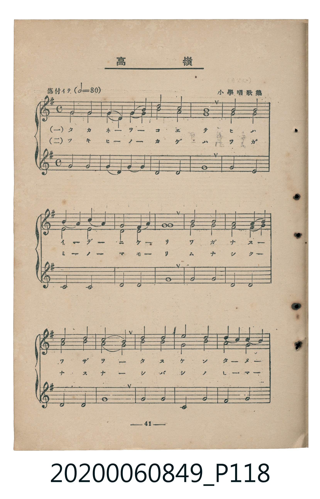
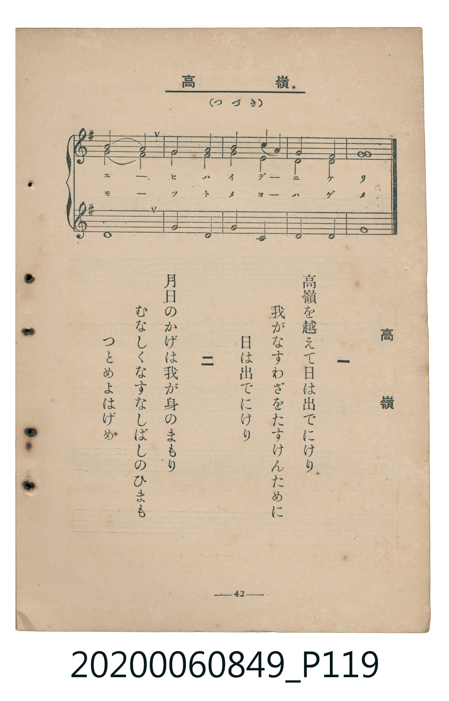

# 高嶺

> Re:Shoka 使用 AI 辨識樂譜，可能會有錯誤。歡迎回報。

<audio controls src="takane.mp3"></audio>

- 臺灣教育會公認《新定兒童唱歌》高等科女子用（2020.006.0849）

## 說明

原書資訊與歌詞全文（對應 P118–P119.jpg，書頁 pp. 41–42，高二重音第 6 首）：
調性與拍號：ホ短調（1 升記號）、4/4 拍（落付イテ 𝅗𝅥=80，三部重音合唱）
出處註記：小學唱歌集

## 歌詞

```text
一
高嶺を越えて日は出でにけり
我がなすわざをたすけんために
日は出でにけり

二
月日のかげは我が身のまもり
むなしくなすなしばしのひまも
つとめよはげめ
```

## ABC

```abc
X:1
T:高嶺
M:4/4
L:1/16
Q:1/4=160
K:G
V:V1 name="Part1" snm="Par"
V:V2 name="Part2" snm="Par"
V:V3 name="Part3" snm="Par"
[V:V1]
!mf! B8 B8 | E4 D4 E4 F4 | G8 F8 | E16 |
F8 F8 | G4 F4 G4 A4 | F8 E4 F4 | G16 |
A8 A8 | G8 F4 G4 | A8 F8 | G8 E8 |
A8 A8 | B8 A8 | G4 F4 E4 G4 | A8 F8 |
E8 F8 | G8 A4 G4 | F8 E8 | E16 |
[V:V2]
!mf! B8 B8 | E4 D4 E4 F4 | E8 D8 | C16 |
D8 D8 | E8 E8 | D8 C8 | G16 |
F8 F8 | E8 D8 | E8 D8 | E8 C8 |
F8 F8 | E8 F8 | E8 E8 | F8 ^D8 |
E8 D8 | E8 C8 | D8 C8 | E16 |
[V:V3]
!mf! E8 E8 | E4 D4 E4 F4 | B,8 B,8 | E16 |
E8 D8 | C8 C8 | D8 D8 | E16 |
D8 D8 | B,8 B,8 | C8 D8 | E16 |
D8 D8 | C8 D8 | B,8 C8 | B,16 |
E8 B,8 | E8 C8 | B,8 B,8 | E16 |
```

## TMD 檔案連結

- [主旋律 TMD 檔案](takane.tmd) [[在 TMD Studio 編輯](https://tmdlang.github.io/Tmd-TS/#tmd=s7IKdvYPcrWy4qpTUCpJTLdSSM7PyUlNLsnMz7MqzsjMK0nNjM_KTMmPL87Iz05Ugisry88pzU21ys4vyY9PzyzKKY43MjAyiDcwMIs3sDCxRCgszi8tSk61Kk7OyM_PiS9JrShJys_PRsgXFOWXpeYl5gHVFBSB7EsBK0IoSC3LTEkFSaemZJbkF2Um5iC5IrWoGOxSsCXxJUWJecXJRZkFIOcjVJVkpAKdmpdYUlqUqsSlpaXwcvWMp9t2KWhpcSnaKhiaGXDZ2yq4c9mY6JvYgTS9aN_1vHHxs6kzXzRtejan-Wnrmhereh83dD2btuHpullPWyc9X7306ZSNz9b2PG7oBpr1fG3n8-UTny7d_HTthOdTVrzf0wEKCz1gWOiBwuL9nk4lLi59LQVbagEuBQWFp33zn83e8WJz-4sVXS862oGOebFy3tPWFc-mtQMd8HRD77P2ToUAQ0OLRw2TgZSlXlZB-vs9PUA9Lxc0KhQU6CmYGAKlTIyAgkA_PNnV87K99-X8zc_XrFEwU3i5bBrQ2e_3zAJZ9WLV_mcNy0GWdPe-mDkfKPq4efbz-WuB4kCrDBWe9gIdMQMs0_m4oREYjApAlUCpFxP2Ptk943HTksfNbQof5rZOB-KlthYGQCuf7Oh82bwCYuXTCR3A4ARqBvurfdeLmVNfrNgNNBJo09MN_U_X7oCE9svZbVwgJU92NIAoSCw-bpr0YlvX48aOx43Lnk1f-rhxPdCEx43LHzeuftw48XFTF0jps46Jjxt7Hjeuetw483FT_-PGaUBtjxvng7ggRZNB7KZGoB6waqzGgG3e1QNWMKcDrGbd48bux41Ag9ZDLHixC6gYKLjvcVMT1ObHTQ1ga6c_bgRaC7Yfyt0AJoGqN0E0gFU3LnncuALkkiagf9aDzG5qBElQnmagQEFLn4vLNzEzzyogsajE0KHGoEahGmSDgo2Jlh2YAUypwEQADOQXC3tAykFiQEW5abUKxgq6YFyjYBavYBoPIs3jgTxDoBiQAZXQBcMaiAhEGBx6MJN39aCYbAhSY6hgBNOBbCjEICMgCcJwiwzRTNzRiWIiSC3UOSANYCchmwLyAsw8oDqgPJqBT2fPBhoITMGg3GBipADMMsDkidUCsOFIlhmBzIJ7BDVEuGqRwt6ISmEPNh7IB8mYIAIfLAIRxhf4YN1Qh4JVg41ADnykWES2C1_4IzsJzIYaimEUMhviCMxYQBgLVm2qjuEUFDuQPYEj5I1JDHnkMEINe2OQIJhASfi4ggkt7MGuRHY2sncwYhHZMnyBDzYQv0nISsAGQhyBL-zBypB8h-xpqBewBwYo5HXtFECBrwCklbm4AA)]
- [鋼琴伴奏 TMD 檔案](takane_piano.tmd) [[在 TMD Studio 編輯](https://tmdlang.github.io/Tmd-TS/#tmd=s7IKdvYPcrWy4tLSUni5esbTbbve7-l42b3n-YQtT_Zsebq0_3lnx_s9nQpaWlyKtgqGZgZc9rYK7lw2Jvomdlx1Ckov2nc9b1z8bOrMF02bns1pftq65sWq3scNXc-mbXi6btbT1knPVy99OmXjs7U9jxu6gRY8X9v5fPnEp0s3P1074fmUFUDLjAyMDPQMDMz0DCxMLIFWKXFx-SZm5lkFZCbm5Qd5ONQY1ChUcykAgY2Jlh2Yoa-l8HzNmic7Gl4s7FHQ0geLARXlptUqGCvognGNglm8gmk8iDSPB_IMgWJABlRCFwxrICIQYS5kk3f1oJhsCFJjqGAE04FsKMQgIyAJwnCLDNFM3NGJYiJILdQ5IA1gJyGbAvICzDygOqA8moFPZ8_GZSDYMCTDjUB64Q5HDQGuWuTQ9iE1tMEGIQxFCm9jkCCYQAlwMBOojECAm4BUgIkaiGqIFmSTkIWRLMMX6GAD8ZuErARsIMQR-EIerAzJd8iehnoBe2CAwl7XTgEU_ApAWpmLCwA)]

## 分析

```text
================================================================================
📊 TMD Song Profile: [ 高嶺 ]
================================================================================
⏱  Duration:       0:30 (30.0s), 20 measures total
🎼 Key & Tempo:    首調基準 G, != 160.0 BPM, <4/4>
   - 分析範圍：      由實際發聲的音符與和弦推測調性；播放脈絡另行呈現
🎤 人聲音域:    D4 (MIDI 62) – B4 (MIDI 71) [跨度: 9 個半音 / 0.8 個八度, 難度: easy]
   - 最低音:  D4 in [Main #1 @ m.2, 0:01]
   - 最高音: B4 in [Main #1 @ m.1, 0:00]
   - 適合: soprano, mezzo-soprano, contralto, tenor, baritone, bass
🏛  結構:      Main (30.0s)
⚡ 編曲密度:        Peak 3 軌道同時演奏
🗝  調性診斷：       E 小調（純淨自然小調，未偵測到可信轉調）
   - 風格氣質:    純淨自然小調（陰鬱抒情、旋律集中，無明顯調外色彩）
   - 轉調歷程:    全曲維持單一推測調性（未偵測到可信轉調）
   - 核心骨幹音:  E, D, F#, B, C
   - 調性數值:    E 小調 [相關度: 0.82, 穩定度: High, 自然音純度: 99.2%]
   - 候選調性 (K-S): E 小調 (0.82), E 大調 (0.54), G 大調 (0.49)
   - 五度圈歷程:   +4
   - 各段落調性細節:
     • [Main #1]: E 小調 (r: 0.82, 自然音純度: 99.2%, 調外音: D#)

  [ 五度圈游移軌跡 ]
               C  
         F            G  
      Bb               D  
      Eb               A  
         Ab          [E ]*
            Db       B  
               F# 
     (* = active key center)

  [ 十二半音累積音高分佈 ]
     C  : ████████                  10.0%
     C# :                            0.0%
     D  : ████████████              15.4%
     D# : █                          0.8%
     E  : ████████████████████████  30.8%
     F  :                            0.0%
     F# : ███████████               14.6%
     G  : ███████                    9.2%
     G# :                            0.0%
     A  : █████                      6.7%
     A# :                            0.0%
     B  : ██████████                12.5%
--------------------------------------------------------------------------------
Assignment 軌道音域：
  - Part1         : D4 – B4 (9 個半音 / 0.8 個八度, 46 個音符)
  - Part2         : C4 – B4 (11 個半音 / 0.9 個八度, 39 個音符)
  - Part3         : B3 – F#4 (7 個半音 / 0.6 個八度, 37 個音符)
================================================================================
```


## 原書掃描頁






