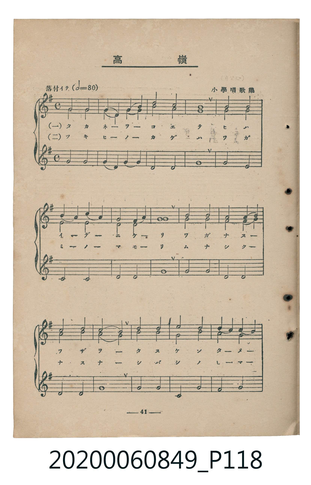
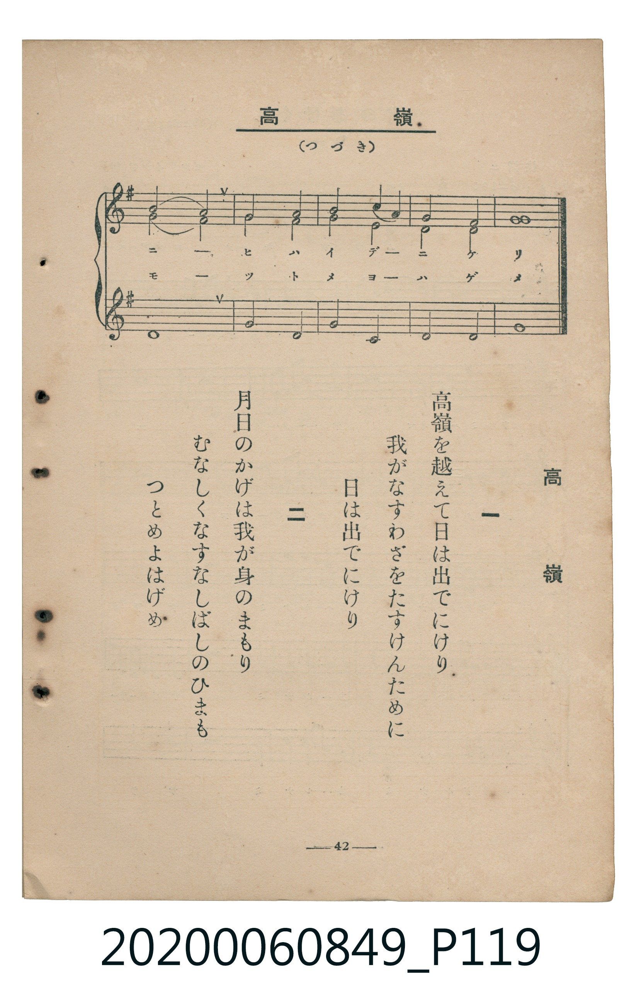

# 高嶺

> Re:Shōka 使用 AI 協助辨識與重建樂譜，可能會有錯誤。歡迎回報。

- **鋼琴伴奏版**：<br><audio controls src="takane.mp3"></audio>

- 出處：小學唱歌集
- 臺灣教育會公認《新定兒童唱歌》高等科女子用（2020.006.0849）

## 說明

原書資訊與歌詞全文（對應 P118.jpg–P119.jpg，書頁 pp. 41–42，高二重音第 6 首）：
調性與拍號：ト長調（1 升記號）、4/4 拍（落付イテ 𝅗𝅥=80，三部重音合唱）
出處註記：小學唱歌集


## 歌詞

```text
一
高嶺を越えて日は出でにけり
我がなすわざをたすけんために
日は出でにけり

二
月日のかげは我が身のまもり
むなしくなすなしばしのひまも
つとめよはげめ
```

## ABC

<div class="abc-score" data-abc-src="takane.abc" aria-label="五線譜載入中"></div>

[下載 ABC 原始檔](takane.abc)

## TMD 檔案連結

- [主旋律 TMD 檔案](takane.tmd) [[在 TMD Studio 編輯](https://tmdlang.github.io/Tmd-TS/#tmd=s7IKdvYPcrWy4qpTUCpJTLdSSM7PyUlNLsnMz7MqzsjMK0nNjM_KTMmPL87Iz05Ugisry88pzU21ys4vyY9PzyzKKY43MjAyiDcwMIs3sDCxRCgszi8tSk61Kk7OyM_PiS9JrShJys_PRpePL0hMT7UKMDS0QMgUFOWXpeYl5gF1FxSBXJIC1o5QkFqWmZIKki5OTsyLL0stykzLTE1BcmNqUTHYHxArSooS84qTizILQJ5DqMovKsnITy9KLMiotMrILC7JL8pMTsyJz07MQ_JuSUYq0Ld5iSWlRanIWjPTM_OsclMzszKRvKalpfBy9Yyn23YpaGlxKdoqGJoZcNnbKrhz2Zjom9iBdD9t3_Vi5tT3e2Y93dD_dO2Op1M2Plvb83J2G9joF-27njcufjZ15oumTc_mND9tXfNiVe_jhq5n0zY8XTfraeuk56uXQnQ8bugGWvR8befz5ROfLt38dO2E51NWvN_TAYoKPWBU6IGi4v2eTiUuLn0tBVtqAS4FBYWnffOfzd7xYnP7ixVdLzragY55sXLe09YVz6a1Ax3wdEPvs_ZOBVB86mUVpD9qmAxkWoKY7_f0APW9XNCoUFCgp2BiCJQyMQIKAv3xZFfPy_bel_M3P1-zRsFM4eWyaUCnA8MIZN2LVfufNSwHWdTd-2LmfKDo4-aOl1O3A8WB1hkqPO0FOmQGWKbzcUMjMJwVgCqBUi8m7H2ye8bjpiWPm9sUPsxtnQ7ES20tDIBWPtnR-bJ5BcTKpxM6gEEK1Az2Gzh2XqzYDTQSM464QEqe7GgAUZBoftw06cW2rseNHY8blz2bvvRx43qgCY8blz9uXP24ceLjpi6Q0mcdEx839jxuXPW4cebjpv7HjdOA2h43zgdxQYomg9hNjUA9YNVYjQHbvKsHrGBOB1jNuseN3Y8bgQath1jwYhdQMVBw3-OmJqjNj5sawNZOf9wItBZsP5S7AUwCVW-CaACrblzyuHEFyCVNQP-sB5nd1AiSoDzdQIGClj4Xl28iMOMEZCbm5Rs61BjUVINsULAx0bIDM7ClVgVgsgAG-4uFPRAGMO4UNEwVgLHzfH2DDjytaWLRCbQQZGqNgqGCLhjDWMZAlgmQZQwWMwKSIFgD5oPFwPp8DGuAgbgfyH_ctBos_7i5F8Rr3gTEe0D8ps1g2RVQ2Ta4SY-bJ4FV9iNMMwKJtoDVr0VR0wc3DWTL46ZNUFmQXphp68Eya8Cm4Q-qXT0UBZUxMDhMgBgSVObxcCZaCIFDzQgUkkhhtQTsk8fN7TAfNXeD3b0Rzl-F3U9AXheYtxOiEinE5kPNhIdS8zxwqC3CauYCsBzILJB7toPNXA81k0AS66Qo3EDBgQgYSGJDBBYisYHC1wgojxRs0IDYBvUCKPpBDoZ4AZL8dkJ5G8FyoEQHkYMEzUKMQIMFJlLQwk0EB0rzBBReHzxBQkycR0yQPZ09G0-QgYt9AkkNlIJguRLCAomhJD-YNDiCkcIMnLBgfkLObOBkCOJhJkKIWnhyQQqvRSimgTNpcweUtxDMWwE3DWQLIpOCZCGm1SKXbkZklW7AmpDC0s0sHkgAUxdSKgQHIiR_wFXiKd8gCYB6JRxa7qVuGUdegAEDSRdC1CiYgigwgVzMIYIUHHpAAiXHwlMYxOE40hcJRRxyHoQVb5imUaFwIy_AwIGAFB7QsEOEElgAQwFVijgQD5TJqFO8gXigACa6aMMWYISLNrTCC4mJL9mRWLzhTXwkFm6I3EiwaDMmr-EGanRTp2jDnWXRk93QLtzICzITUBiACcKFG5I81Qo31ACjrGgjHFiIVhtZgUUogMDhiFSuoVWeWIo1qIeoUqjBzKJykYYtqAgXaeBQQoQPUqDhS2xoRRqW3EVmgQYzicziTNdOAVSiKQBpZS4A)]
- [鋼琴伴奏 TMD 檔案](takane_piano.tmd) [[在 TMD Studio 編輯](https://tmdlang.github.io/Tmd-TS/#tmd=s7IKdvYPcrWy4qpTUCpJTLdSSM7PyUlNLsnMz7MqzsjMK0nNjM_KTMmPL87Iz05Ugisry88pzU21ys4vyY9PzyzKKY43MjAyiDcwMIs3sDCxRCgszi8tSk61Kk7OyM_PiS9JrShJys_PRpePL0hMT7UKMDS0QMgUFOWXpeYl5gF1FxSBXJIC1o5QkFqWmZIKki5OTsyLL0stykzLTE1BcmNqUTHYHxArSooS84qTizILQJ5DqMovKsnITy9KLMiotMrILC7JL8pMTsyJz07MQ_JuYhFQc3pqbmpeiVVBZmJefnxicnJ-bkFiXiZIDKGwJAOoyCovsaS0KBXZjsz0zDyr3NTMrEykMNDSUni5esbTbbve7-l42b3n-YQtT_Zsebq0_3lnx_s9nQpaWlyKtgqGZgZc9rYK7lw2JvomdiAjn7bvejFz6vs9s55u6H-6dsfTKRufre15ObsNbN-L9l3PGxc_mzrzRdOmZ3Oan7auebGq93FD17NpG56um_W0ddLz1UshOh43dANtf7628_nyiU-Xbn66dsLzKSuALgFFpB4wIvVAEQl0hxIXl28i0PUBIH8bOtQY1FRzKQCBjYmWHZihr6Vgiw4Unq9Z82RHw4uFPRDGy-YVChqmCkAXP1_foKMAimm9rIJ0TSw6tfTBptYoGCrogjGMZQxkmQBZxmAxIyAJgjVgPlgMrM_HsEbhcdN-IP9x02qw_OPmXhCveRMQ7wHxmzaDZVdAZdvgJj1ungRW2Y8wzQgk2gJWvxZFTR_cNJAtj5s2QWVBemGmrQfLrAGbhj-odvVQFFTGwOAwAWJIUJnHw5loIQQONSNQSCKF1RKwTx43t8N81NwNdvdGOH8Vdj8BeV1g3k6ISqQQmw81Ex5KzfPAobYIq5kLwHIgs0Du2Q42cz3UTAJJrJOicAMFByJgIIkNEViIxAYKXyOgPFKwQQNiG9QLoOgHORjiBUjy2wnlbQTLgRIdRA4SNAsxAg0WmEhBCzcRHCjNE1B4ffAECTFxHjFB9nT2bDxBZklEUgOlIFiuhLBAYijJDyYNjmCkMAMnLJifkDMbOBmCeJiJEKIWnlyQwmsRimngTNrcAeUtBPNWwE0D2YLIpCBZiGm1yKWbEVml264eSks3s3ggAUxdSKkQHIiQ_AFXiad8gyQA6pVwaLmXumUceQEGDCRdCFGjYAqiwARyMYcIUnDoAQmUHAtPYRCH40hfJBRxyHkQVrxhmkaFwo28AAMHAlJ4QMMOEUpgAQwFVCniQDxQJqNO8QbigQKY6KINW4ARLtrQCi8kJr5kR2LxhjfxkVi4IXIjwaLNmLyGWyfVijbcWRY92Q3two28IDMBhQGYIFy4IclTrXBDDTDKijbCgYVotZEVWIQCCByOSOUaWuWJpViDeogqhRrMLCoXadiCinCRBg4lRPggBRq-xIZWpGHJXWQWaDCTKC7OfDywlGdAH4CjG-qbeGDJAix9wAjkUYhPYd5GChhI3YfIUKAUBMmPyIphWsHKkXRCrUNRBA99IjRCbEExBdUxGG5FMZCQI0HhpmunAAq6aB_DWAU42wjMVuYCAA)]

## 分析

```text
================================================================================
📊 TMD Song Profile: [ 高嶺 ]
================================================================================
⏱  Duration:       0:30 (30.0s), 20 measures total
🎼 Key & Tempo:    首調基準 G, != 160.0 BPM, <4/4>
   - 分析範圍：      由實際發聲的音符與和弦推測調性；播放脈絡另行呈現
🎤 人聲音域:    F#4 (MIDI 66) – C5 (MIDI 72) [跨度: 6 個半音 / 0.5 個八度, 難度: easy]
   - 最低音:  F#4 in [Main #1 @ m.7, 0:09]
   - 最高音: C5 in [Main #1 @ m.3, 0:03]
   - 適合: soprano, mezzo-soprano, contralto, tenor, baritone, bass
🏛  結構:      Main (30.0s)
⚡ 編曲密度:        Peak 3 軌道同時演奏
🗝  調性診斷：       G 大調（純淨自然大調，未偵測到可信轉調）
   - 風格氣質:    純淨自然大調（陽光明朗、易唱易記，無明顯調外色彩）
   - 轉調歷程:    全曲維持單一推測調性（未偵測到可信轉調）
   - 核心骨幹音:  G, D, B, A, F#
   - 調性數值:    G 大調 [相關度: 0.89, 穩定度: High, 自然音純度: 100.0%]
   - 候選調性 (K-S): G 大調 (0.89), G 小調 (0.63), E 小調 (0.58)
   - 五度圈歷程:   +1
   - 各段落調性細節:
     • [Main #1]: G 大調 (r: 0.89, 自然音純度: 100.0%)

  [ 五度圈游移軌跡 ]
               C  
         F           [G ]*
      Bb               D  
      Eb               A  
         Ab           E  
            Db       B  
               F# 
     (* = active key center)

  [ 十二半音累積音高分佈 ]
     C  : ███                        5.8%
     C# :                            0.0%
     D  : ████████                  14.2%
     D# :                            0.0%
     E  : ████                       6.7%
     F  :                            0.0%
     F# : █████                      9.2%
     G  : ████████████████████████  43.7%
     G# :                            0.0%
     A  : █████                      9.6%
     A# :                            0.0%
     B  : ██████                    10.8%
--------------------------------------------------------------------------------
Assignment 軌道音域：
  - Piano1        : F#4 – C5 (6 個半音 / 0.5 個八度, 45 個音符)
  - Piano2        : D4 – A4 (7 個半音 / 0.6 個八度, 40 個音符)
  - Piano3        : C4 – G4 (7 個半音 / 0.6 個八度, 37 個音符)
================================================================================
```


## 原書掃描頁






