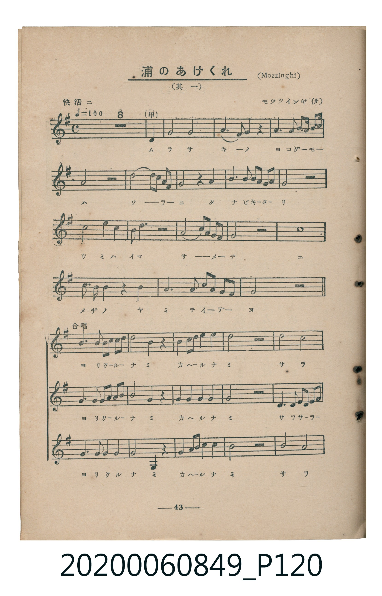
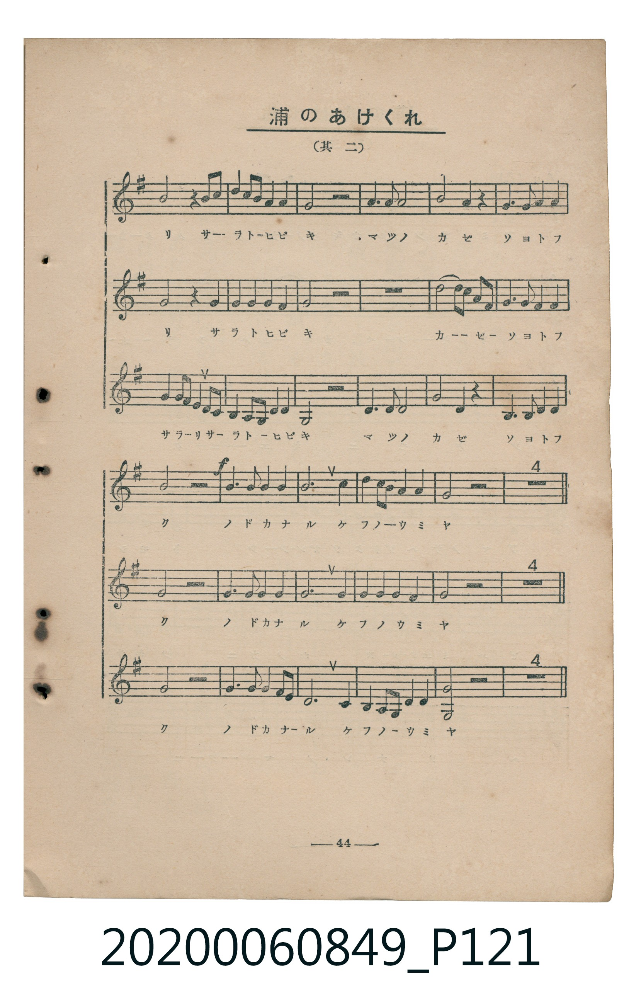
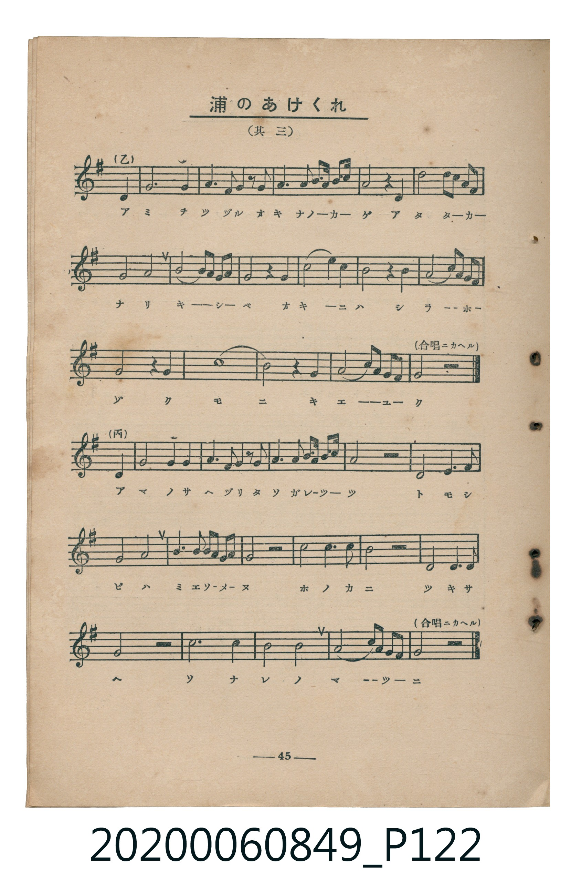
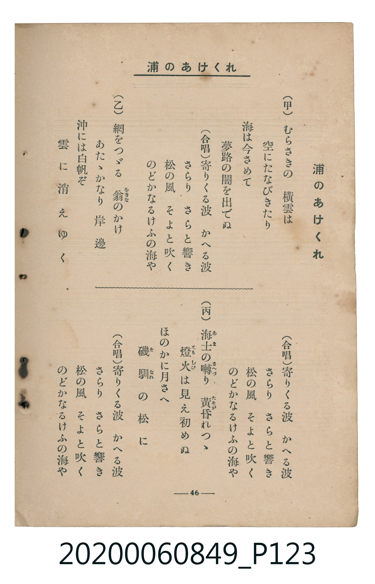

# 浦のあけくれ

<audio controls src="ura_no_akekure.mp3"></audio>

- 曲：モッツインギ（伊）（Joseph Mazzinghi）
- 臺灣教育會公認《新定兒童唱歌》高等科女子用（2020.006.0849）

## 說明

・出處：臺灣教育會公認《新定兒童唱歌》高等科女子用（2020.006.0849）
・調性與拍號：調號 ?= G，拍號 <4/4>，速度 != 160

## 歌詞

```text
（甲）
むらさきの　橫雲は
空にたなびきたり
海は今さめて
夢路の闇を出でぬ

（合唱）
寄りくる波　かへる波
さらり　さらと響き
松の風　そよと吹く
のどかなるけふの海や

（乙）
網をつゞる　翁のかげ
あたゝかなり　岸邊
沖には白帆ぞ
雲に消えゆく
（合唱ニカヘル）

（丙）
海士の囀り　黃昏れつゝ
燈火は見え初めぬ
ほのかに月さへ
磯馴の松に
（合唱ニカヘル）
```

## ABC

```abc
X:1
T:浦のあけくれ
C:曲：モッツインギ（伊）（Joseph Mazzinghi）
M:4/4
L:1/16
Q:1/4=160
K:G
V:V1 name="Part1" snm="Par"
V:V2 name="Part2" snm="Par"
V:V3 name="Part3" snm="Par"
[V:V1]
!mf! z4 z4 z4 D4 | G8 A8 | B6 A2 G4 z4 | c6 c2 c3 d e2 c2 |
A8 z4 z4 | d6 c B A4 G4 | F4 z4 G8 | A6 A2 A2 B A G2 F2 |
E8 z4 z4 | d8 e4 ^c4 | A2 B2 ^c4 z4 z4 | d6 e d ^c4 B4 |
A8 d8 | ^c4 A4 d4 z4 | B4 G4 ^c8 | d4 A4 B2 d ^c B2 A2 |
D8 z4 z4 | !f! B6 B2 A2 B2 c2 d2 | e4 c4 z4 A2 B2 | c2 d2 e2 f2 g4 z4 |
f8 e8 | d4 z4 e2 f2 g2 e2 | d4 c4 B4 z4 | !p! A6 A2 A4 d4 |
B4 G4 A6 A2 | A4 B4 c4 A4 | !f! B8 z4 d4 | d6 d2 d4 d4 |
d8 B4 d2 B2 | G4 A4 G8 |
[V:V2]
z4 z4 z4 z4 | z4 z4 z4 z4 | z4 z4 z4 z4 | z4 z4 z4 z4 |
z4 z4 z4 z4 | z4 z4 z4 z4 | z4 z4 z4 z4 | z4 z4 z4 z4 |
z4 z4 z4 z4 | z4 z4 z4 z4 | z4 z4 z4 z4 | z4 z4 z4 z4 |
z4 z4 z4 z4 | z4 z4 z4 z4 | z4 z4 z4 z4 | z4 z4 z4 z4 |
z4 z4 z4 z4 | !f! G6 G2 F2 G2 A2 B2 | c4 A4 z4 F2 G2 | A2 A2 A2 A2 G4 z4 |
D6 D2 E2 F2 G2 A2 | B4 z4 c2 c2 c2 c2 | B4 A4 G4 z4 | !p! z4 z4 F4 D2 B2 |
G4 G4 F6 F2 | F4 G4 A4 F4 | !f! G8 z4 G4 | F6 F2 G4 F4 |
G8 G4 G2 G2 | E4 F4 G8 |
[V:V3]
z4 z4 z4 z4 | z4 z4 z4 z4 | z4 z4 z4 z4 | z4 z4 z4 z4 |
z4 z4 z4 z4 | z4 z4 z4 z4 | z4 z4 z4 z4 | z4 z4 z4 z4 |
z4 z4 z4 z4 | z4 z4 z4 z4 | z4 z4 z4 z4 | z4 z4 z4 z4 |
z4 z4 z4 z4 | z4 z4 z4 z4 | z4 z4 z4 z4 | z4 z4 z4 z4 |
z4 z4 z4 z4 | !f! G6 G2 D4 D4 | C4 D4 z4 D4 | D4 D4 E4 z4 |
B8 A8 | B2 A2 G2 F2 E2 D2 C2 E2 | G4 D4 G,4 z4 | !p! F6 F2 F4 z4 |
G4 E4 D6 D2 | D4 G4 D4 D4 | !f! G8 z4 G4 | A6 A2 B4 A4 |
G8 E4 B,2 B,2 | C4 D4 G,8 |
```

## TMD 檔案連結

- [主旋律 TMD 檔案](ura_no_akekure.tmd)
- [鋼琴伴奏 TMD 檔案](ura_no_akekure_piano.tmd)

## 分析

```text
================================================================================
📊 TMD Song Profile: [ 浦のあけくれ ]
================================================================================
⏱  Duration:       0:45 (45.0s), 30 measures total
🎼 Key & Tempo:    首調基準 G, != 160.0 BPM, <4/4>
   - 分析範圍：      由實際發聲的音符與和弦推測調性；播放脈絡另行呈現
🎤 人聲音域:    D4 (MIDI 62) – G5 (MIDI 79) [跨度: 17 個半音 / 1.4 個八度, 難度: challenging]
   - 最低音:  D4 in [Main #1 @ m.1, 0:01]
   - 最高音: G5 in [Main #1 @ m.20, 0:29]
   - 適合: soprano, mezzo-soprano, tenor, baritone
🏛  結構:      Main (45.0s)
⚡ 編曲密度:        Peak 3 軌道同時演奏
🗝  調性診斷：       G 大調（純淨自然大調，未偵測到可信轉調）
   - 風格氣質:    純淨自然大調（陽光明朗、易唱易記，無明顯調外色彩）
   - 轉調歷程:    全曲維持單一推測調性（未偵測到可信轉調）
   - 核心骨幹音:  G, D, A, B, F#
   - 調性數值:    G 大調 [相關度: 0.89, 穩定度: Moderate, 自然音純度: 96.8%]
   - 候選調性 (K-S): G 大調 (0.89), D 大調 (0.85), B 小調 (0.59)
   - 五度圈歷程:   +1
   - 各段落調性細節:
     • [Main #1]: G 大調 (r: 0.89, 自然音純度: 96.8%, 調外音: C#)

  [ 五度圈游移軌跡 ]
               C  
         F           [G ]*
      Bb               D  
      Eb               A  
         Ab           E  
            Db       B  
               F# 
     (* = active key center)

  [ 十二半音累積音高分佈 ]
     C  : ███████                    6.7%
     C# : ███                        3.2%
     D  : █████████████████████     20.9%
     D# :                            0.0%
     E  : ███████                    7.1%
     F  :                            0.0%
     F# : ██████████                 9.6%
     G  : ████████████████████████  23.3%
     G# :                            0.0%
     A  : ██████████████████        17.5%
     A# :                            0.0%
     B  : ████████████              11.7%
--------------------------------------------------------------------------------
Assignment 軌道音域：
  - Part1         : D4 – G5 (17 個半音 / 1.4 個八度, 105 個音符)
  - Part2         : D4 – C5 (10 個半音 / 0.8 個八度, 53 個音符)
  - Part3         : G3 – B4 (16 個半音 / 1.3 個八度, 47 個音符)
================================================================================
```


## 原書掃描頁










