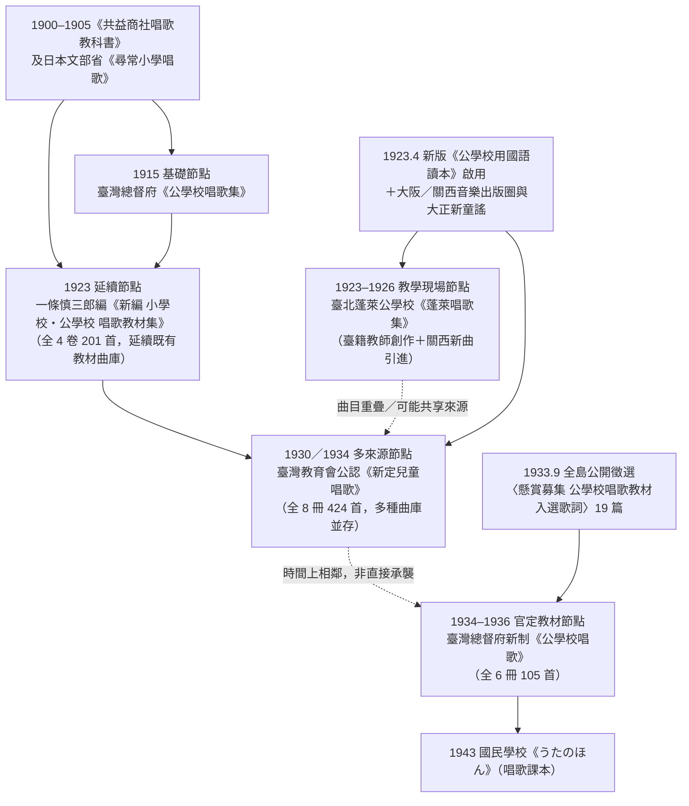

# 日治時期臺灣公學校唱歌教材的流動與變化

回顧日治時期臺灣公學校的音樂教材史，過去的討論往往集中在臺灣總督府於大正 4 年（1915）發行的[**《公學校唱歌集》**](kogakko_shokashu_1915/index.md)，以及昭和 9 年（1934）起陸續出版的官定[**《公學校唱歌》**](kogakko_shoka/grade_1/index.md)，容易讓人誤以為當時臺灣學童所唱的歌曲，全都單純來自總督府由上而下編定的一套單一官方課本。

然而，若檢視實際流傳下來的課本、教師參考書與手抄筆記本，會發現**日治時期臺灣校園裡的「唱歌」並非單一來源，而是由多種不同管道的曲庫共同構成**：

1. **日本文部省官定唱歌與明治時期民間唱歌教科書**：如文部省《幼稚園唱歌集》、《小學唱歌集》、《尋常小學唱歌》，以及明治 33–38 年間出版的[**《共益商社唱歌教科書》**](kyoeki_shoka/index.md)等日本內地既有教材。
2. **歐美民謠、英美歌曲與西洋古典樂曲的日語填詞改編（西洋曲）**：從明治《小學唱歌集》起便深植校園的歐洲民謠改編曲如[**〈來れ遊べ〉**](kyoeki_shoka/kan_2_854863/1_kitare_asobe/index.md)與[**〈胡蝶〉**](shokacho/vol_01/p156_kocho/index.md)（與〈蝶々〉同源之 *Hänschen klein* 變體），到畢業與離別常唱的蘇格蘭民謠[**〈螢の光〉**](shokacho/vol_03/p042_hotaru_no_hikari/index.md)／[**〈告別〉**](shintei_jido_shoka/grade_5_2020.006.0847.0005/4_19_kokubetsu/index.md)（*Auld Lang Syne*）、[**〈故郷の空〉**](shintei_jido_shoka/grade_6_2020.006.0847.0006/2_01_kokyo_no_sora/index.md)（*Comin' Thro' the Rye*）、英國歌劇名曲[**〈埴生の宿〉**](kogakko_shoka/grade_6/13_hanyu_no_yado/index.md)（*Home! Sweet Home!*）、源自美國學校歌的[**〈卒業の歌（あふげば尊し）〉**](kogakko_shokashu_1915/6_09_sotsugyo_no_uta/index.md)，乃至借用英國國歌旋律的[**〈軍艦〉**](shoka_kyozai_shu_1923/koto_1_2/37_gunkan/index.md)、美國歌曲改編的[**〈コロンブス〉**](kyoeki_shoka/kan_3_854864/11_koronbusu/index.md)／[**〈うたのけいこ〉**](shokacho/vol_01/p129_uta_no_keiko/index.md)，以及高年級／高等科引進的莫札特[**〈同窓會〉**](shoka_kyozai_shu_1923/koto_1_2/20_dosokai/index.md)、韋伯[**〈木靈〉**](shintei_jido_shoka/koto_girls_2020.006.0849/1_2_08_kodama/index.md)與[**〈月夜泛舟〉**](shintei_jido_shoka/koto_girls_2020.006.0849/2_4_03_tsukiyo_hanshu/index.md)等二部合唱曲。
3. **臺灣總督府與在臺教育者編纂的官定／準官定教材與國語讀本配歌**：如 1915 年總督府[**《公學校唱歌集》**](kogakko_shokashu_1915/index.md)、1923 年總督府編修官一條慎三郎編[**《新編 小學校・公學校 唱歌教材集》**](shoka_kyozai_shu_1923/analysis.md)，以及高橋二三四等在臺音樂教育家創作的臺灣地理風物歌曲（如[**《臺灣周遊唱歌》**](taiwan_shuyu_shoka/index.md)、[**《臺灣の歌》**](taiwan_no_uta/index.md)）與配合《公學校用國語讀本》韻文課文所譜寫的歌曲。
4. **大正至昭和初期日本內地的民間新童謠、新式唱歌集與中等音樂教科書**：透過教師自購或坊間書局流通進入臺灣校園的《大正幼年唱歌》、《幼年唱歌》、《新作唱歌》、《特選樂譜／新特選樂譜》、《小學唱歌五十曲集》、北村季晴《中等音樂教科書》與兒童雜誌《りす》等——特別是大阪／關西音樂教育出版圈（如山本壽、永井幸次）以及中山晉平、山田耕筰、室崎琴月、梁田貞等人的作品。
5. **臺灣第一線公學校教師（含臺籍訓導）的自編補充歌集與個人創作**：在官定歌本更新不及的時期，由各校教師自行選編或譜寫的教材與學藝會歌曲，例如臺北蓬萊公學校自編[**《蓬萊唱歌集》**](shokacho/horai_shokashu.md)中，臺籍訓導**郭水返**為國語讀本新課文譜曲的[**〈水グルマ〉**](shokacho/vol_07/p231_mizuguruma/index.md)、**陳英聲**創作的[**〈牛よ牛よ〉**](shokacho/vol_07/p246_ushi_yo_ushi_yo/index.md)，以及教師手抄[**《唱歌帖》**](shokacho/research_notes.md)中跨歌本摘錄的各類曲目。
6. **1930 年代全島公開懸賞募集的本土新詞與新創曲**：如 1933 年總督府向全臺教育現場與社會大眾公開徵選的[**〈懸賞募集 公學校唱歌教材入選歌詞〉**](kogakko_shoka/lyrics_contest/index.md)（自 210 篇投稿中選出 19 篇），經譜曲後編入 1934 年起發行的[**《公學校唱歌》**](kogakko_shoka/grade_1/index.md)與 1943 年國民學校[**《うたのほん》**](utanohon/ge_2006.006.0878/index.md)。

理解了「唱歌具有多重來源」之後，再把本資料庫已數位化的 **1915 年[**《公學校唱歌集》**](kogakko_shokashu_1915/index.md)**（69 首）、**1923 年[**《新編 小學校・公學校 唱歌教材集》**](shoka_kyozai_shu_1923/analysis.md)**（201 首）、**1920 年代中期[**《蓬萊唱歌集》**](shokacho/horai_shokashu.md)**（存見 45 首）、**1930 年[**《新定兒童唱歌》**](shintei_jido_shoka/index.md)**（424 首）與 **1934 年起發行的官定[**《公學校唱歌》**](kogakko_shoka/grade_1/index.md)**（105 首）放在同一張時間軸上交叉比對，就能更清楚觀察到這些不同來源的歌曲如何在各個時期流動、交會與重組：

下文的「四個節點」不是一條已經證實的單線演進，也不表示後一套歌本完全取代前一套歌本；它只是依照目前可見的出版物、教師抄本與曲目交集，將幾個重要的時間節點分開討論。這些材料更像是多條流路的交會：官定教材有自身的延續，學校補充歌集有自己的選曲，地方教師的創作與日本內地的出版物則可能在不同管道中流通。尤其《蓬萊唱歌集》與《新定兒童唱歌》之間，目前可以確認的是曲目與來源的重疊，至於是否存在直接編纂上的承襲，仍需更多文獻才能判定。

---

## 一、官定與準官定教材的延續（1915《公學校唱歌集》與 1923《唱歌教材集》）

大正 4 年（1915），臺灣總督府發行官定[**《公學校唱歌集》**](kogakko_shokashu_1915/index.md)（全一冊 69 首）；到了大正 11 年（1922）新臺灣教育令公布、1923 年啟用新版《公學校用國語讀本》後，原有歌本與新課文之間出現了配合上的落差。時任總督府編修官的一條慎三郎，於 1923 年 12 月由臺北杉田書店出版[**《新編 小學校・公學校 唱歌教材集》**](shoka_kyozai_shu_1923/analysis.md)（全 4 卷 201 首），成為這段教材轉換期的重要參考歌集。

這條脈絡呈現的是**官定與準官定教材的延續**：
- 一方面大量承接日本文部省《尋常小學唱歌》、明治時期[**《共益商社唱歌教科書》**](kyoeki_shoka/index.md)（如 E 大調 6/8 拍的[**〈樂しき我家〉**](shoka_kyozai_shu_1923/koto_1_2/23_tanoshiki_wagaya/index.md)）與 1915 年《公學校唱歌集》的經典曲目；
- 另一方面也收錄了可視為臺灣地方題材的歌曲，如[**〈カーレンさん（加令／八哥）〉**](shoka_kyozai_shu_1923/grade_1_2/20_karensan/index.md)、[**〈水牛〉**](shoka_kyozai_shu_1923/grade_3_4/44_suigyu/index.md)、[**〈鄭成功〉**](shoka_kyozai_shu_1923/grade_5_6/09_teiseiko/index.md)、[**〈新高山〉**](shoka_kyozai_shu_1923/koto_1_2/17_niitakayama/index.md)與[**〈臺灣の風景〉**](shoka_kyozai_shu_1923/grade_5_6/34_taiwan_no_fukei/index.md)。

但這部在 1923 年底出版的教材集，並未涵蓋 1923 年 4 月啟用的《公學校用國語讀本》全部新課文，也較少收錄 1920 年代日本內地興起的大正新童謠。這個落差為其他補充歌集留下了空間，但尚不能據此推定後來各歌集之間存在直接承襲。

---

## 二、教學現場的補充歌集與關西曲目引進（1923–1926《蓬萊唱歌集》）

面對新課綱與官方歌本之間的落差，第一線公學校教師開始編寫補充歌集。臺北市蓬萊公學校（原大稻埕女子公學校）約於 1923–1926 年間編印的[**《蓬萊唱歌集》**](shokacho/horai_shokashu.md)，後由教師楊金土於 1927 年初摘抄其中 45 首入[**《唱歌帖》**](shokacho/research_notes.md)。就目前可見的抄本曲目而言，它與 1915 年《公學校唱歌集》及 1923 年《唱歌教材集》沒有同曲重疊；這顯示其選曲可能具有補充性，但不能單憑重疊率判定編纂者的整體意圖。

《蓬萊唱歌集》留下了兩個值得與 1923 年《唱歌教材集》比較的方向：
1. **臺籍教師為國語讀本新課文與本土童謠譜曲**：目前材料顯示，蓬萊公學校臺籍訓導**郭水返**曾將 1923 年新版《公學校用國語讀本》卷三（二年級）第三課課文譜為 D 大調歌曲[**〈水グルマ〉**](shokacho/vol_07/p231_mizuguruma/index.md)；同校臺籍訓導**陳英聲**則將自己於 1922 年發表於《臺灣教育》的童謠譜為[**〈牛よ牛よ〉**](shokacho/vol_07/p246_ushi_yo_ushi_yo/index.md)。
2. **引進大阪／關西音樂教育出版圈與大正新童謠**：大量選入《大正幼年唱歌》、《新作唱歌》、《特選樂譜／新特選樂譜》與北村季晴《中等音樂教科書》，將中山晉平、山田耕筰、北原白秋、野口雨情、葛原しげる、室崎琴月，以及大阪天王寺師範**山本壽**、大阪音樂學校**永井幸次**等人的新式童謠與二部合唱曲帶進臺灣校園。

---

## 三、多種曲庫的並存與擴編（1930《新定兒童唱歌》）

昭和 5 年（1930），臺灣教育會委託位於大阪市西區的「日本教育唱歌研究會／日本唱歌出版社」編印全套 8 冊、共 424 首的[**《新定兒童唱歌》**](shintei_jido_shoka/index.md)。跨冊比對顯示，《新定兒童唱歌》同時收錄了前期官定教材、國語讀本配歌、補充曲目與合唱曲：
- **正課中可見 1915／1923 官定與準官定系統的延續**：其中包含文部省唱歌與一條慎三郎《唱歌教材集》中的傳統曲目（如〈カーレンサン〉、〈スヰギウ〉、〈小楠公〉、〈二宮尊德〉與 E 大調 6/8 拍的[**〈樂しき我家〉**](shintei_jido_shoka/grade_6_2020.006.0847.0006/3_04_tanoshiki_wagaya/index.md)）；同時也有部分舊詞重新譜曲，形成多組[**「同詞異曲」**](same_lyrics_songs.md)。這些曲目重疊可支持延續關係，但不必然代表每首歌都有直接的編纂承襲。
- **新課文配歌、補充教材與高等科合唱曲則與《蓬萊唱歌集》出現部分重疊**：那些未見於 1923 年《唱歌教材集》201 首之內、但在《蓬萊唱歌集》與《新定兒童唱歌》中都能找到的曲目——包括國語讀本課文歌[**〈水グルマ〉**](shintei_jido_shoka/grade_2_2020.006.0847.0002/1_03_mizuguruma/index.md)（另譜 F 大調新曲），以及[**〈ユフヒ〉**](shintei_jido_shoka/grade_2_2020.006.0847.0002/4_10_yuhi/index.md)、[**〈初鶯〉**](shintei_jido_shoka/grade_5_2020.006.0847.0005/4_18_hatsu_uguisu/index.md)、[**〈どんぶりこ〉**](shintei_jido_shoka/grade_4_2020.006.0847.0004/4_20_donburiko/index.md)、山本壽[**〈大日本〉**](shintei_jido_shoka/grade_3_2020.006.0847.0003/3_01_dainippon/index.md)、《特選樂譜》[**〈秋の湖上〉**](shintei_jido_shoka/koto_girls_2020.006.0849/2_2_03_aki_no_kojo/index.md)與北村季晴[**〈田舍の夕暮〉**](shintei_jido_shoka/koto_boys_2020.006.0848/2_2_07_inaka_no_yugure/index.md)——後來也被編入全臺流通的公認教材。這些重疊可能反映直接影響，也可能是共同取材的結果。

---

## 四、島內公開懸賞徵詞與本土題材增加（1934–1936《公學校唱歌》）

到了昭和 8 年（1933），臺灣總督府著手編纂新的官定課本[**《公學校唱歌》**](kogakko_shoka/grade_1/index.md)（昭和 9 年／1934 年起自低年級陸續發行，全 6 冊共 105 首）。這次編纂除了延續既有曲目，也透過對全島教育現場的[**「懸賞募集 公學校唱歌教材歌詞」**](kogakko_shoka/lyrics_contest/index.md)徵集新歌詞。

在全臺投稿的 210 篇作品中，委員會最終評選出 19 篇入選歌詞（刊於 1933 年 9 月《臺灣教育》第 374 號），作者涵蓋全島各地的師範生與公學校教師（包括新竹女子公學校臺籍教師**江尚文**、臺南師範學寮**增本光春**、鶯歌柑園公學校**木本森太郎**、花蓮港高女**岡本新市**、臺中**岡田與志松**、臺南**吉村守**等），並邀請專業作曲家譜曲後編入 1934–1936 年出版的《公學校唱歌》各冊正課（其中多首更沿用至 1943 年國民學校[**《うたのほん》**](utanohon/ge_2006.006.0878/index.md)）：
- **第一學年**：[**〈メジロ ノ コ（綠繡眼）〉**](kogakko_shoka/grade_1/3_mejiro_no_ko/index.md)、描寫檨仔樹與檳榔樹陣雨的[**〈ユフダチ ヤンダ〉**](kogakko_shoka/grade_1/4_yudachi_yanda/index.md)、香蕉與鳳梨猜拳的[**〈ジヤンケン〉**](kogakko_shoka/grade_1/9_janken/index.md)、江尚文作詞的[**〈カアレン（加令／八哥）〉**](kogakko_shoka/grade_1/11_karen/index.md)、榕樹下小麻雀的[**〈コスズメ〉**](kogakko_shoka/grade_1/13_kosuzume/index.md)；
- **第二、三學年**：[**〈タケノコ（筍）〉**](kogakko_shoka/grade_2/4_takenoko/index.md)、[**〈ペタコ（白頭翁）〉**](kogakko_shoka/grade_2/5_petako/index.md)、[**〈だいしゃ（台車）〉**](kogakko_shoka/grade_3/2_daisha/index.md)、[**〈牛車〉**](kogakko_shoka/grade_3/4_gyusha/index.md)、[**〈すゐれん（睡蓮）〉**](kogakko_shoka/grade_3/7_suiren/index.md)、[**〈おぢいさん〉**](kogakko_shoka/grade_3/13_ojiisan/index.md)、[**〈白さぎ（白鷺鷥）〉**](kogakko_shoka/grade_3/15_shirasagi/index.md)；
- **高學年**：描寫林投樹與木瓜的[**〈かげろふ〉**](kogakko_shoka/grade_4/6_kagerou/index.md)、[**〈赤嵌城〉**](kogakko_shoka/grade_5/12_sekikanjo/index.md)，以及六年級的[**〈胡蝶蘭〉**](kogakko_shoka/grade_6/3_kochoran/index.md)與[**〈せんだん並木（苦楝並木）〉**](kogakko_shoka/grade_6/18_sendan_namiki/index.md)。

因此，1934 年版的《公學校唱歌》一方面保留了部分早期教材曲目（如〈ミヅグルマ〉、〈大日本〉、〈樂しき我が家〉與文部省名曲），另一方面也透過島內公開徵選增加了描繪臺灣亞熱帶風物與日常生活的歌曲，使本土題材在官定學校唱歌教材中占有更明顯的位置。
