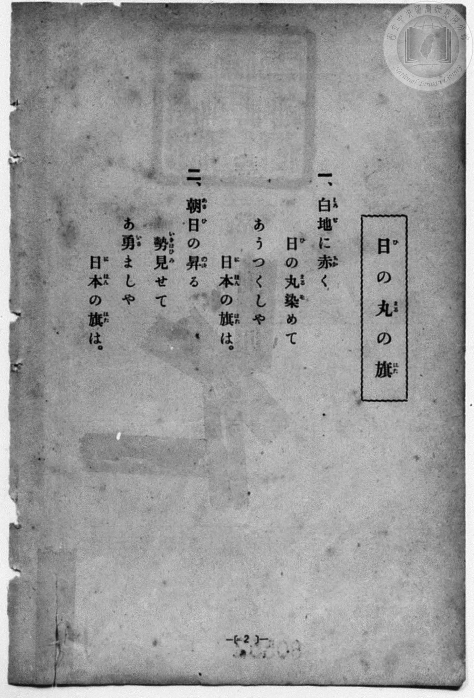
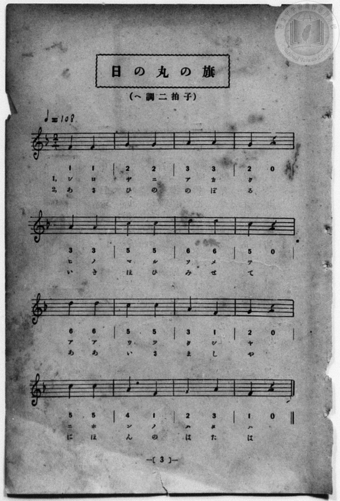

# 日の丸の旗

> Re:Shōka 使用 AI 協助辨識與重建樂譜，可能會有錯誤。歡迎回報。

<audio controls src="hinomaru_no_hata.mp3"></audio>

- 詞：文部省《尋常小學唱歌》
- 曲：文部省《尋常小學唱歌》
- 一條慎三郎 編《新編 小學校・公學校 唱歌教材集》（大正十二年十二月，索書號 0725-41）
- 臺灣總督府《公學校唱歌集》（大正四年三月，索書號 0725 26）

## 說明

原書資訊與歌詞全文（對應 P010.jpg–P011.jpg，原書 p. 2–3，尋常科第一、二學年第 1 首）：
調性與拍號：ヘ調二拍子（F 大調 2/4 拍），♩=108
註：第 14 小節五線譜為 A4–F4（3 1），下方簡譜誤植為「4 1」，依五線譜與原曲記為 3 1。


## 歌詞

```text
一、白地（しろぢ）に赤（あか）く
日（ひ）の丸（まる）染（そ）めて
あゝうつくしや
日本（にほん）の旗（はた）は。

二、朝日（あさひ）の昇（のぼ）る
勢（いきほひ）見（み）せて
あゝ勇（いさ）ましや
日本（にほん）の旗（はた）は。
```

## ABC

```abc
X:1
T:日の丸の旗
C:曲：文部省《尋常小學唱歌》
M:2/4
L:1/16
Q:1/4=108
K:F
V:V1 name="Piano" snm="Pia"
[V:V1]
F4 F4 | G4 G4 | A4 A4 | G4 z4 |
w: し ろ | ぢ に | あ か | く
A4 A4 | c4 c4 | d4 d4 | c4 z4 |
w: ひ の | ま る | そ め | て
d4 d4 | c4 c4 | A4 F4 | G4 z4 |
w: あ あ | う つ | く し | や
c4 c4 | A4 F4 | G4 A4 | F4 z4 |
w: に ほ | ん の | は た | は
F4 F4 | G4 G4 | A4 A4 | G4 z4 |
w: あ さ | ひ の | の ぼ | る
A4 A4 | c4 c4 | d4 d4 | c4 z4 |
w: い き | ほ ひ | み せ | て
d4 d4 | c4 c4 | A4 F4 | G4 z4 |
w: あ あ | い さ | ま し | や
c4 c4 | A4 F4 | G4 A4 | F4 z4 |
w: に ほ | ん の | は た | は
```

## TMD 檔案連結

- [主旋律 TMD 檔案](hinomaru_no_hata.tmd) [[在 TMD Studio 編輯](https://tmdlang.github.io/Tmd-TS/#tmd=s7IKdvYPcrWy4qpTUCpJTLdSSM7PyUlNLsnMz7MqzsjPTozPrsyvSsyML84ojTe0NDJWgqssy88pzU21Si9KTEmNN4w3QsgU55cWJadaFSdn5OfnxJekVpQk5edno8vHFySmp1oFGBgaIGQKivLLUvMS84C6C4oy80pSU8DaEQpSyzJTUkHSxcmJefFlqUWZaZmpKUiOSi0qBrsdYkVJUWJecXJRZgHIQwhV-UUlGflAhxdkVFplZBaX5BdlJifmxGcn5iUiFJVkpAK9l5lbALQkMUeJS0tL4dn0pY8b1z3ZsQNIPps-XUFLi0vRVsHQwILL3lbBjcvGSN_EDqT_yY6GZ4vmPmvte7Kj82Vzn8Lz7SseN3Q9m7YByFB4uqH_6dodzxYsfNy8-2nrGghb4emUjc_W9jybOvPZ3AkvZ7c9buh-v6fj6ZLlz9Yuftrb-GRXz9OdWyCMZ3M63u_peb5l0bPZO17MnK9gYG5kqmti-H5PJ9jtL1bOe79n1rNp7S-bVzyf0wi09-mG7qc7dkCshVgDNB2s9tnsTUSrfdG-63nj4uc79j6fu_jprjkgtTDHQxSiu3r2bKCTgQGAzb0KRmZg93LpaynYUgtwKSgoPO2bD7Jmc_uLFV0vOtqBzgKGx9PWFUA_gly2ofdZe6cCKM3pZRWkP2qYDGQagphAF0K0KhToKRgBJYxBIuDAeL584vM1a4BR-rgBHA_AgNm5BSiiYKjwctk0oDeAQQiy-sWq_c8aloMs7e4F-hMo-rh5BlAQFGXdvU_XTgA6wE0BGDhAMQVgSlEAioJ19zyaudIWlIhAhqzYDdQINt0ElFKer294smvK8-2zXqyd87xpl4KjCdBtbiZAo4wVQFEO1P1kR_ezaTufb1gIVPJi1ZJnS3qBCh839JgoGD5uANrQ82TfXLgZQOeB_bnpxYoZIPOApjxuaOICWQ3x4fOZe5_O2QA0_3Hj9MdNvY8bFwFtedy4-sXWJWDBpseNwDgGivSD9AAzBFgUmIyAQqCcAebue9wEUvRs_mQwdy5ItqnxceMykB6QGU1zHze2PW5cAjQGbE8L1LBnc9aAdax-3Lj7cRNQN8hUYE4DC65_3AgMVaDIeriTdwGTZ-OzOXNh7gC6bircNc9mgOIcyHjcuAfsgm5wCukG-ggo2vK4Eei73RDVL5aBEu7jxv1gnbNRXPq0G2IMUMNUsPQ-cp0M1EB5KocCBS19Li6PzLz83MSiUr98j8SSRKuAzMS8fIcag5pqkFUKNiZadmAGtkymgJymXyzsUdCwgKY3HVD-AGcKTSzagNaCjKwBpn5DIGkEhDXAVGQMZhvA2aZAWKNgBoQgNlAcrMvHsAYYqNMVgAkLKA5MW0C8GsxqAuJuMKtfIR5MbwLidWDWPqB6iNxcIKsRzFoGUgUx0wimfyqavnVAvAfEAuqGmNkCxBCbd4NVglj7gXg2kpkEQqwTGGLAoo2cEIOFBihkgPkOHmKoIqDQM0QLMZDvmsBubAPiJdBwAoUkyHctUN-tBvsLJDIZHgbrgXg-lIUZYhAzQaECCTtgSJNhZi0Xl66dAmpajPYxjFXAImoEFlXmAgA)]
- [鋼琴伴奏 TMD 檔案](hinomaru_no_hata_piano.tmd) [[在 TMD Studio 編輯](https://tmdlang.github.io/Tmd-TS/#tmd=s7IKdvYPcrWy4qpTUCpJTLdSSM7PyUlNLsnMz7MqzsjPTozPrsyvSsyML84ojTe0NDJWgqssy88pzU21Si9KTEmNN4w3QsgU55cWJadaFSdn5OfnxJekVpQk5edno8vHFySmp1oFGBgaIGQKivLLUvMS84C6C4oy80pSU8DaEQpSyzJTUkHSxcmJefFlqUWZaZmpKUiOSi0qBrsdYkVJUWJecXJRZgHIQ0pcWloKz6Yvfdy47smOHUDy2fTp7_d0vJw981ln98vuPc8nbHmyZ8vTpf3v93QqaGlxKdoqGBpYcNnbKrhx2Rjpm9iBbHmyo-HZornPWvue7Oh82dyn8Hz7iscNXc-mbQAyFJ5u6H-6dsezBQsfN-9-2roGwlZ4OmXjs7U9z6bOfDZ3wsvZbY8buoG2Pl2y_NnaxU97G5_s6nm6cwuE8WxOx_s9Pc-3LHo2e8eLmfMVDMyNTHVNDIHuAfvwxcp57_fMejat_WXziudzGoH2Pt3Q_XTHDoi1EGuApoPVPpu9iWi1L9p3PW9c_HzH3udzFz_dNQekFuZ4iEJ0V8-eDXQyMACwuVfByAzsXi6PzLz83MSiUr98j8SSRKuAzMS8_CAPhxqDmmouBSCwMdGyAzP0tRRs0YHC8zVrgEH9YmGPgoYFKFyfr2_QUQgwMLbQyypI18SiQUsfbFiNgiEQ1igYAWGNgjEQgtgGcLYpENYomAEhiA0UB-vyMaxReNw4XeFxUy9Q_HHjIiBeDWY1AXE3mNWvEA-mNwHxOjBrH1A9RG4ukNUIZi0DqYKYaQTTPxVN3zog3gNiAXVDzGwBYojNu8EqQaz9QDwbyUz8YbWrh5ywgoUDKEyMoeEGCitUEVC4GaKFFchfTWDXtQHxEmgIgcIQ5K8WqL9Wg30EEpkM9_16IJ4PZWGGFcRMUHhAQg0YxmSYWYs9-flgS35Av8UrRBvGgrwdD2SZxoOYKGKgIIELwBkmQIYJVAQWOKiiaBpwG4VqMcgwoA907RRQPRHtA1SMRdQILKrMBQA)]

## 分析

```text
================================================================================
📊 TMD Song Profile: [ 日の丸の旗 ]
================================================================================
⏱  Duration:       0:35 (35.6s), 32 measures total
🎼 Key & Tempo:    首調基準 F, != 108.0 BPM, <2/4>
   - 分析範圍：      由實際發聲的音符與和弦推測調性；播放脈絡另行呈現
🎤 人聲音域:    F4 (MIDI 65) – D5 (MIDI 74) [跨度: 9 個半音 / 0.8 個八度, 難度: easy]
   - 最低音:  F4 in [HinomaruNoHata[L1] #1 @ m.1, 0:00]
   - 最高音: D5 in [HinomaruNoHata[L1] #1 @ m.7, 0:06]
   - 適合: soprano, mezzo-soprano, contralto, tenor, baritone, bass
🏛  結構:      HinomaruNoHata[L1] (17.8s) -> HinomaruNoHata[L2] (17.8s)
⚡ 編曲密度:        Peak 1 軌道同時演奏
🗝  調性診斷：       F 調性不明確（純淨自然大調，未偵測到可信轉調）
   - 風格氣質:    純淨自然大調（陽光明朗、易唱易記，無明顯調外色彩）
   - 轉調歷程:    全曲維持單一推測調性（未偵測到可信轉調）
   - 核心骨幹音:  C, A, F, G, D
   - 調性數值:    F 調性不明確 [相關度: 0.77, 穩定度: Ambiguous, 自然音純度: 100.0%]
   - 候選調性 (K-S): F 大調 (0.77), C 大調 (0.76), A 小調 (0.73)
   - 五度圈歷程:   -1 -> -1
   - 各段落調性細節:
     • [HinomaruNoHata[L1] #1]: F 調性不明確 (r: 0.77, 自然音純度: 100.0%)
     • [HinomaruNoHata[L2] #1]: F 調性不明確 (r: 0.77, 自然音純度: 100.0%)

  [ 五度圈游移軌跡 ]
               C  
        [F ]*          G  
      Bb               D  
      Eb               A  
         Ab           E  
            Db       B  
               F# 
     (* = active key center)

  [ 十二半音累積音高分佈 ]
     C  : ████████████████████████  25.0%
     C# :                            0.0%
     D  : ██████████████            14.3%
     D# :                            0.0%
     E  :                            0.0%
     F  : █████████████████         17.9%
     F# :                            0.0%
     G  : █████████████████         17.9%
     G# :                            0.0%
     A  : ████████████████████████  25.0%
     A# :                            0.0%
     B  :                            0.0%
--------------------------------------------------------------------------------
Assignment 軌道音域：
  - Piano         : F4 – D5 (9 個半音 / 0.8 個八度, 56 個音符)
================================================================================
```


## 原書掃描頁






