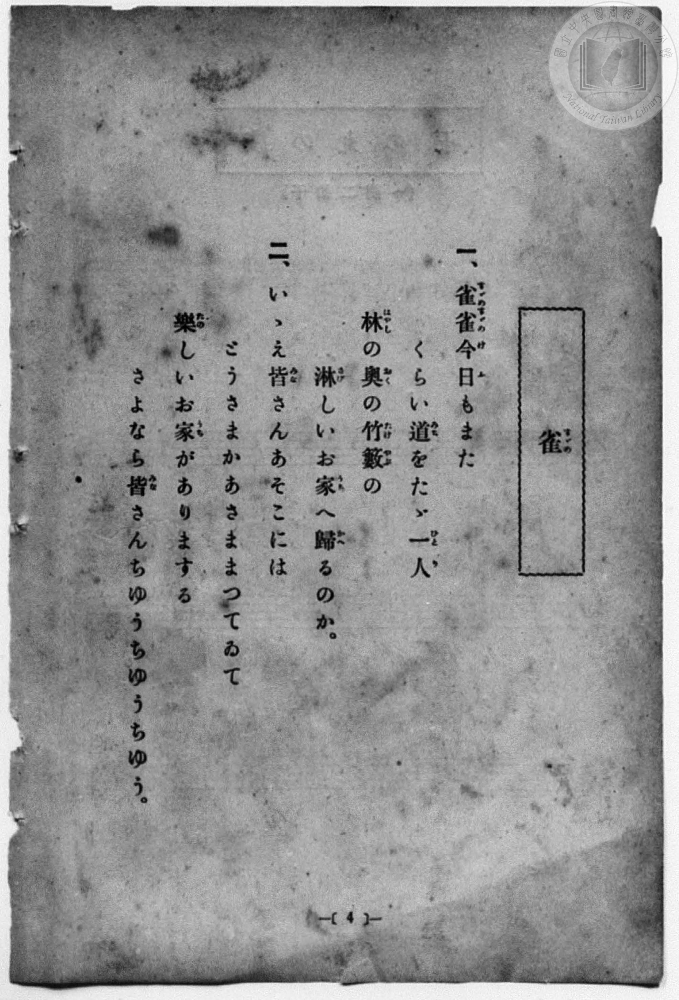
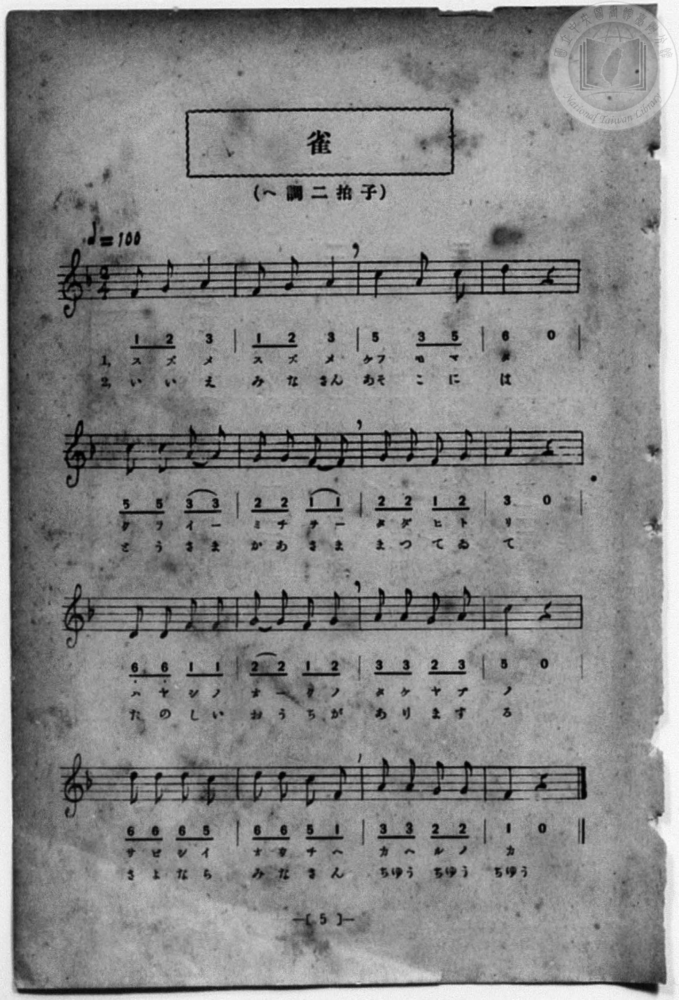

# 雀

> Re:Shōka 使用 AI 協助辨識與重建樂譜，可能會有錯誤。歡迎回報。

- **鋼琴伴奏版**：<br><audio controls src="suzume.mp3"></audio>
- **NEUTRINO 歌聲合成版**：<br><audio controls src="suzume_neutrino.mp3"></audio>

- 詞：文部省《尋常小學唱歌》
- 曲：文部省《尋常小學唱歌》
- 一條慎三郎 編《新編 小學校・公學校 唱歌教材集》（大正十二年十二月，索書號 0725-41）

## 說明

原書資訊與歌詞全文（對應 P012.jpg–P013.jpg，原書 p. 4–5，尋常科第一、二學年第 2 首）：
調性與拍號：ヘ調二拍子（F 大調 2/4 拍），♩=100


## 歌詞

```text
一、雀（すゞめ）雀（すゞめ）今日（けふ）もまた
くらい道（みち）をたゞ一人（ひとり）
林（はやし）の奥（おく）の竹籔（たけやぶ）の
淋（さび）しいお家（うち）へ歸（かへ）るのか。

二、いゝえ皆（みな）さんあそこには
とうさまかあさままつてゐて
樂（たの）しいお家（うち）がありまする
さよなら皆（みな）さんちゆうちゆうちゆう。
```

## ABC

<div class="abc-score" data-abc-src="suzume.abc" aria-label="五線譜載入中"></div>

[下載 ABC 原始檔](suzume.abc)

## TMD 檔案連結

- [主旋律 TMD 檔案](suzume.tmd) [[在 TMD Studio 編輯](https://tmdlang.github.io/Tmd-TS/#tmd=s7IKdvYPcrWy4qpTUCpJTLdSSM7PyUlNLsnMz7MqzsjPTozPrsyvSsyML84ojTe0NDJWgqssy88pzU21Si9KTEmNN4w3QsgU55cWJadaFSdn5OfnxJekVpQk5edno8vHFySmp1oFGBgi6Swoyi9LzUvMA-ouKMrMK0lNAWtHKEgty0xJBUkXJyfmxZelFmWmZaamIDkqtagY7HaIFSVFiXnFyUWZBSAPIVTlF5Vk5AMdXpBRaZWRWVySX5SZnJgTn52Yl4hQVJKRCvReYl5mbmIOstbM9Mw8q9z8vKRSYAApcWlpKbyc3aCgpcWlaKtgaGDAZW-r4MZlY6RvYgfS9GRHw7NFc5-19j3Z0fmyuU_h-fYVjxu6nk3bAGQoPN3Q_3TtjmcLFj5u3v20dQ2ErfB0ysZna3ueTZ35bO6El7PbHjd0v9_T8XTJ8mdrFz_tbXyyq-fpzi0QxrM5He_39DzfsujZ7B0vZs5XMDA3MtU1MXy_pxPs4Bcr573fM-vZtPaXzSuez2kE2vt0Q_fTHTsg1kKsAZoOVvts9ibi1HLpaynYUgtwKSgoPO2bD3L-5vYXK7pedLQD7QG6-2nrCqBbQP7e0PusvVMBlEz0sgrSHzVMBjKNQUygzyFaFQr0FEyAEqYgEbCjny-f-HzNGmDQP24AhxfQAzu3AEUUjBReLpsGDB6gV0FWv1i1_1nDcpCl3b3A8AOKPm6eARQEBW1379O1E4AOcFMABj1QTAEYowpAUbDunkczV9qCIhtkCsQeYCIAqn7cOPNx07zHTY1AZZgiT3Z3PZu-FCw48XHjVqDI46amx437HjfOBxn0uLH_cVPn48aWl42TwYr2P25cCFY0CagCaArQpie7doGlNj1uXPG4qQsoC9L5bN50sOj6x00tjxuBbKAp654uhVjVBTQXIvJ89c7nG6eABeeDnABSvA0iBTZlOyilPW6c-rhxM1h0OtAtQP1P1wEVAcXboM5p3PFs7Q6wSDeQDXYgkLEOxG1oggTJLmBiaQTpbpr7uLHj-aw2mH9WgQ2Y-rhp8uNGoNeBskDGaqDLIQGwAmwL0AHAMAGaCVQBYQPRkseNyx43TQCSYLeuaIL5Yx1et_aATGkChgHQCGBMdEPsAToAqGgVMLhxuG3h4yagESBT0BlALwKNoDztQ4GClj4XV3BpFagsDchMzMt3qDGoqQZZoWBjoWUHZmDLcgqQFP5iYY-ChgmoJHm-vkEHlE_AmUMTiwagRSDDahQMgfnAWEEXhWUKJI2BZI2CGZBlABIDq_YxrAEG10wgnqUATMRgtZh8UGoGMoGpGcjZBxaaD-THI4wxAom1QHEHVNt-IF4FiY3JUCFQmgCZ1DgZiFeDhdbDTcIfGLt6yAkMUyA0BsIaYFAYAQPEEM4yArJAgYMeGP1Af3aCfYLwxUKg2CQofz4QLwDiTaD0DBJp6sISFiuAuA3kd3iIdYO8jyKyD4iXAPEyoBkTwCLLiAyLHZ3khIVZPAhhhoExOJlAEgl6aKwHug0Up9OBeB3YjSDfgkMJygeFx0Soqm1gkXVYwgOkah3UnBaoOZAQAoZtYw8kcYDDEhIuM8Eh201ceDydPZus8ABDSKYA0aBwgYQGKFwMsYQGKO424_TFDng87wC7HRZCCF8gwgNoUlMHJH8AUxtKbgGKTAaLQIskcHgj2KgyEHNrubh07RQgxYwCkKXMBQA)]
- [鋼琴伴奏 TMD 檔案](suzume_piano.tmd) [[在 TMD Studio 編輯](https://tmdlang.github.io/Tmd-TS/#tmd=s7IKdvYPcrWy4qpTUCpJTLdSSM7PyUlNLsnMz7MqzsjPTozPrsyvSsyML84ojTe0NDJWgqssy88pzU21Si9KTEmNN4w3QsgU55cWJadaFSdn5OfnxJekVpQk5edno8vHFySmp1oFGBgi6Swoyi9LzUvMA-ouKMrMK0lNAWtHKEgty0xJBUkXJyfmxZelFmWmZaamIDkqtagY7HaIFSVFiXnFyUWZBSAPIVQlFgHF01NzU_NKrAoyE_Py4xOTk_NzCxLzMkFiSlxaWgovZze839PxcvbMZ53dL7v3PJ-w5cmeLU-X9r_f06mgpcWlaKtgaGDAZW-r4MZlY6RvYgcy_MmOhmeL5j5r7Xuyo_Nlc5_C8-0rHjd0PZu2AchQeLqh_-naHc8WLHzcvPtp6xoIW-HplI3P1vY8mzrz2dwJL2e3PW7oBtr6dMnyZ2sXP-1tfLKr5-nOLRDGszkd7_f0PN-y6NnsHS9mzlcwMDcy1TUxBLoH7LEXK-e93zPr2bT2l80rns9pBNr7dEP30x07INZCrAGaDlb7bPYm4tRyBZdWgSI5ABRIQR4ONQY11VwKQGBjoWUHZtQoGCoYKRgr6KKwTIGkMZCsUTADsgxAYmDVPoY1Co8bZwLxLIXHTY1gtZj8iY8btwKZj5uagJx9YKH5QH48whgjkFgLFHdAte0H4lVAPPVx02SoUNPjxrkgkxonA_FqsNB6uElQ95sCoTEQ1gBdbwT0gyGcZQRkgfyD7v5-oNM6wZYjLF4IFJsE5c8H4gVAvAmIV4BEmrqwOH8FELeBnAv3ZDfIxSgi-4B4CRAvA5oxASyyDN35ZvEghOlsY3BkQKIC3QPrgcaBQm46EK8DGwtyINhjUD7ICxOhqraBRdZh8QJI1TqoOS1QcyCeAgZHYw8kCsDeh3hlJjgwujG8AIaQ1AKiQV6BeADkFUMsHgCF0GacFu-Ah-YOsHUwTyEsRngBaFJTByThAOMUJRkBRSaDRRY-bmoDmQ4KIgQbVQZibi1qjvFBzjEmiBwTrxBtGIuVYRIP9CvEfUiipvFAlmk8GhMojVAL1BhtgqkAbjyqSphdCNtRjAR6Q9dOAeKTaB-gGiSeEZinzAUA)]

## 分析

```text
================================================================================
📊 TMD Song Profile: [ 雀 ]
================================================================================
⏱  Duration:       0:19 (19.2s), 16 measures total
🎼 Key & Tempo:    首調基準 F, != 100.0 BPM, <2/4>
   - 分析範圍：      由實際發聲的音符與和弦推測調性；播放脈絡另行呈現
🎤 人聲音域:    D4 (MIDI 62) – D5 (MIDI 74) [跨度: 12 個半音 / 1.0 個八度, 難度: easy]
   - 最低音:  D4 in [Suzume #1 @ m.9, 0:09]
   - 最高音: D5 in [Suzume #1 @ m.4, 0:03]
   - 適合: soprano, mezzo-soprano, contralto, tenor, baritone, bass
🏛  結構:      Suzume (19.2s)
⚡ 編曲密度:        Peak 1 軌道同時演奏
🗝  調性診斷：       F 大調（純淨自然大調，未偵測到可信轉調）
   - 風格氣質:    純淨自然大調（陽光明朗、易唱易記，無明顯調外色彩）
   - 轉調歷程:    全曲維持單一推測調性（未偵測到可信轉調）
   - 核心骨幹音:  A, G, F, C, D
   - 調性數值:    F 大調 [相關度: 0.71, 穩定度: Moderate, 自然音純度: 100.0%]
   - 候選調性 (K-S): F 大調 (0.71), C 大調 (0.66), D 小調 (0.65)
   - 五度圈歷程:   -1
   - 各段落調性細節:
     • [Suzume #1]: F 大調 (r: 0.71, 自然音純度: 100.0%)

  [ 五度圈游移軌跡 ]
               C  
        [F ]*          G  
      Bb               D  
      Eb               A  
         Ab           E  
            Db       B  
               F# 
     (* = active key center)

  [ 十二半音累積音高分佈 ]
     C  : ███████████████           16.1%
     C# :                            0.0%
     D  : ███████████████           16.1%
     D# :                            0.0%
     E  :                            0.0%
     F  : ███████████████████       19.6%
     F# :                            0.0%
     G  : ██████████████████████    23.2%
     G# :                            0.0%
     A  : ████████████████████████  25.0%
     A# :                            0.0%
     B  :                            0.0%
--------------------------------------------------------------------------------
Assignment 軌道音域：
  - Piano         : D4 – D5 (12 個半音 / 1.0 個八度, 49 個音符)
================================================================================
```


## 原書掃描頁






