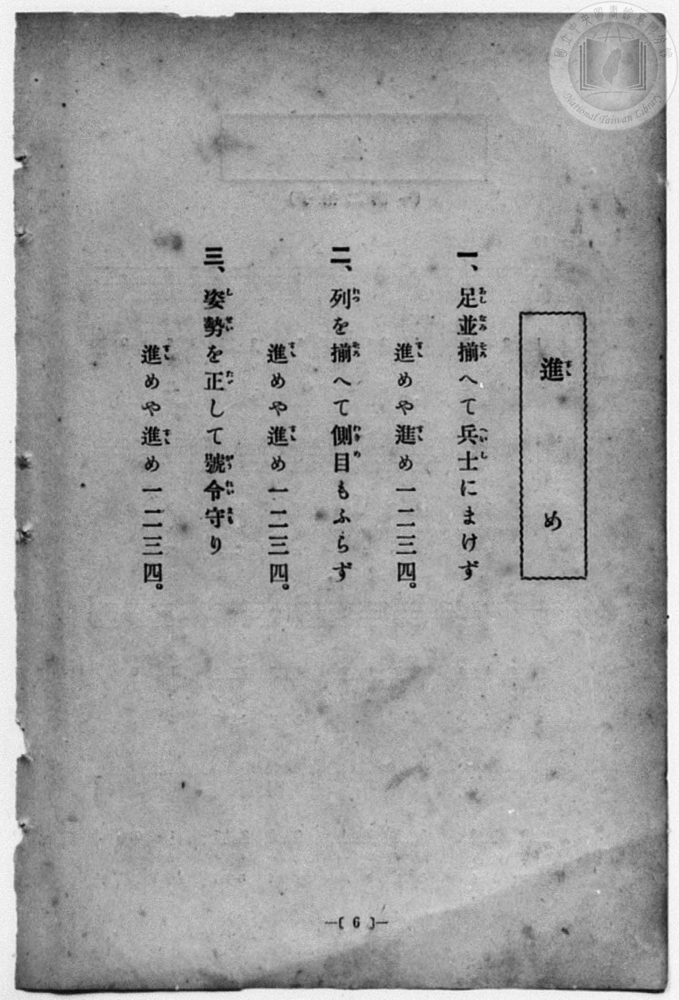
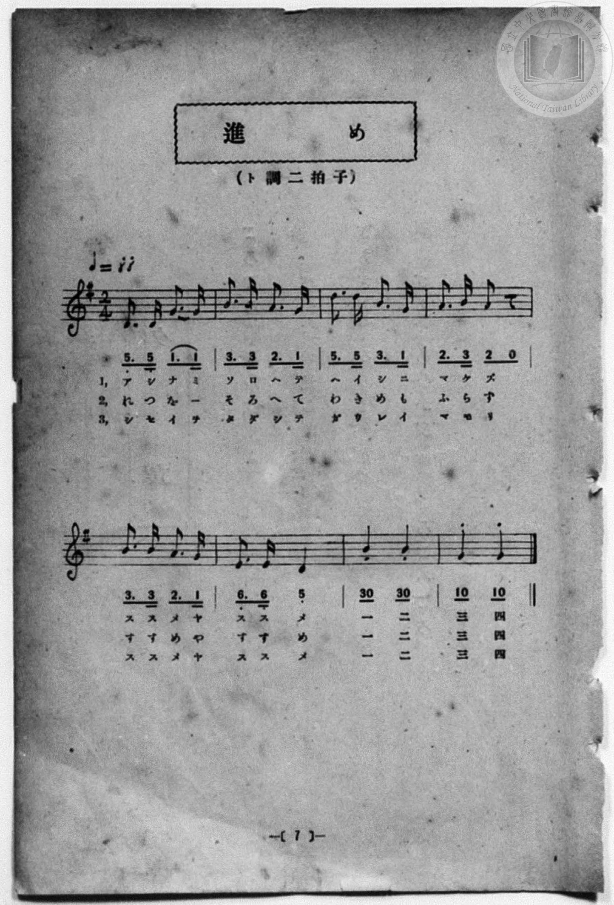

# 進め

> Re:Shōka 使用 AI 協助辨識與重建樂譜，可能會有錯誤。歡迎回報。

<audio controls src="susume.mp3"></audio>

- 一條慎三郎 編《新編 小學校・公學校 唱歌教材集》（大正十二年十二月，索書號 0725-41）

## 說明

原書資訊與歌詞全文（對應 P014.jpg–P015.jpg，原書 p. 6–7，尋常科第一、二學年第 3 首）：
調性與拍號：ト調二拍子（G 大調 2/4 拍），♩=88


## 歌詞

```text
一、足並（あしなみ）揃（そろ）へて兵士（へいし）にまけず
進（すゝ）めや進（すゝ）め一二三四。

二、列（れつ）を揃（そろ）へて側目（わきめ）もふらず
進（すゝ）めや進（すゝ）め一二三四。

三、姿勢（しせい）を正（たゞ）して號令（がうれい）守（まも）り
進（すゝ）めや進（すゝ）め一二三四。
```

## ABC

```abc
X:1
T:進め
M:2/4
L:1/16
Q:1/4=88
K:G
V:V1 name="Piano" snm="Pia"
[V:V1]
D3 D G3 G | B3 B A3 G | d3 d B3 G | A3 B A2 z2 |
w: あ し な み | そ ろ へ て | へ い し に | ま け ず
B3 B A3 G | E3 E D4 | B2 z2 B2 z2 | G2 z2 G2 z2 |
w: す す め や | す す め | いち に | さん し
D3 D G3 G | B3 B A3 G | d3 d B3 G | A3 B A2 z2 |
w: れ つ を _ | そ ろ へ て | わ き め も | ふ ら ず
B3 B A3 G | E3 E D4 | B2 z2 B2 z2 | G2 z2 G2 z2 |
w: す す め や | す す め | いち に | さん し
D3 D G3 G | B3 B A3 G | d3 d B3 G | A3 B A2 z2 |
w: し せ い を | た だ し て | が う れ い | ま も り
B3 B A3 G | E3 E D4 | B2 z2 B2 z2 | G2 z2 G2 z2 |
w: す す め や | す す め | いち に | さん し
```

## TMD 檔案連結

- [主旋律 TMD 檔案](susume.tmd) [[在 TMD Studio 編輯](https://tmdlang.github.io/Tmd-TS/#tmd=s7IKdvYPcrWy4qpTUCpJTLdSSM7PyUlNLsnMz7MqzsjPTozPrsyvSsyML84ojTe0NDJWgqssy88pzU21Si9KTEmNN4w3QsgU55cWJadaFSdn5OfnxJekVpQk5edno8vHFySmp1oFGBiaIGQKivLLUvMS84C6C4oy80pSU8DaEQpSyzJTUkHSxcmJefFlqUWZaZmpKUiOSi0qBrsdYkVJUWJecXJRZgHIQwhV-UUlGflAhxdkVFplZBaX5BdlJifmxGcn5iUiFJVkpAK9l5uZk1mSWFSpxKWlpfCyYdPjpkYFLS0uRVsFCwsue1sFdy4bI30TO5CuJzsani2a-6y178mOzpfNfQrPt6943ND1bNoGIEPh6Yb-p2t3PFuw8HHz7qetayBshadTNj5b2_Ns6sxncye8nN32uKH7_Z6Op0uWP1u7-Glv45NdPU93boEwns3peL-n5_mWRc9m73gxc76CgbmRqa6J4fs9nUpcXPpaCrbUAlwKCgpP--aDrNnc_mJF14uOdqATX6yc97R1xbNp7SD3beh91t6pAIo5vayC9EcNk4FMUxAT6EKIVoUCPQUzoIQ5SGRD99MdO54vn_h8zRpgED1uAPtr7Q6g14AiCsYKL5dNA3rj_Z5ZIKtfrNr_rGE5yNLuXqA_gaKPmzuAgqAg6O59unYC0AHuCsAgAoopAENeASgK1t3zaOZKW2CcgAyBWPNi2-YnO5YB1T9ubHrcOP1x46rHjfuBap_1N4MF5z5uAml93LjjceOyp61bny5eDRYHcluA6sFSqx837nvcOPFxI9hxwPgHq5j5uGkuSLqp8XFTC6Yg0Hqgc4Gp4Ons2Y8bmiBO2tUDdNLTDqCxHY-beh43LgGrnYTdMY1bns9eB1bZ_7ixF2gkWDHQF1sfNwHVUOyYHZ0gxyzf_7R7EVg5MHBmA30NddLaxWDB-Y-b5oGdBJRdBoyLJ7uBbgaKAx3fBvYCSP3TdcB0CRTcB3QeWHsXBW4D6qQ8AUOBgpY-F1dwaTGojArITMzLd6gxqKkGWaFgY2imZQdmYcs4CpB0-mJhj4KGCSjfPl_foANK7eAkrolFA9AmkGE1CqbxCrpACKQMwQxDoJgxmGWsYAQXMYUogsqARCByEDUGQFwDNs_HsEYBmHTBcsBIAOJVUPZ-oB5gkoHwmnqB7B1QmWVgGRivBawPwl4NltkH5U0E4llAFsjBUNuMgPJNPVD5JUD2JDAbKI_PrqZ-KA8oAywaIaqawHq2QnmdmHYZg-RhLpsNdilE7SSwzvlQmQVIqiA-g7mvDcmtLcg-A9oNTINw2_DH8q4ecmIZM0bNIPEOpKApABRoIGWgyITRNeBEAWLBaORongn1zEykYIR4DFMGEiXAMmoh1J-g2IX6GMie-rhpMlwCFHxokUwvu8CRTHu7arm4dO0UIDk92scwVgGJZ4TCMwbzlLkA)]
- [鋼琴伴奏 TMD 檔案](susume_piano.tmd) [[在 TMD Studio 編輯](https://tmdlang.github.io/Tmd-TS/#tmd=s7IKdvYPcrWy4qpTUCpJTLdSSM7PyUlNLsnMz7MqzsjPTozPrsyvSsyML84ojTe0NDJWgqssy88pzU21Si9KTEmNN4w3QsgU55cWJadaFSdn5OfnxJekVpQk5edno8vHFySmp1oFGBiaIGQKivLLUvMS84C6C4oy80pSU8DaEQpSyzJTUkHSxcmJefFlqUWZaZmpKUiOSi0qBrsdYkVJUWJecXJRZgHIQwhViUVA8fTU3NS8EquCzMS8_PjE5OT83ILEvEyQmBKXlpbCy4ZNj5sa3-_peDl75rPO7pfde55P2PJkz5anS_vf7-lU0NLiUrRVsLDgsrdVcOeyMdI3sQMZ_2RHw7NFc5-19j3Z0fmyuU_h-fYVjxu6nk3bAGQoPN3Q_3TtjmcLFj5u3v20dQ2ErfB0ysZna3ueTZ35bO6El7PbHjd0Ay19umT5s7WLn_Y2PtnV83TnFgjj2ZyO93t6nm9Z9Gz2jhcz5ysYmBuZ6poYAp2jxMUVXFoMio4AkHeCPBxqDGqquRSAwMbQTMsOzKpRMI1X0AVCIGUIZhgCxYzBLGMFI7iIKUQRVAYkApGDqDEA4hqweT6GNQqPG5vAco8bpwPxKih7P1DP48a5EF5TL5C9AyqzDCwD47WA9UHYq8Ey-6C8iUA8C8gCORhqmxFQvqkHKr8EyJ4EZgPl8dnV1A_lAWWaGqGqmsB6tkJ5nZh2GYPkYS6bDXYpRO0ksM75UJkFSKogPoO5rw3JrS3IPgPa_bipC24bNGIwI8EMElVAChppIH-ClIHCH0bXgOMRxILRyDEzE2r_TCSfQ9yCKQMJxZbHjQuhTgNFCNSRQPbUx02T4RIgH6PFC73sAscL7e2qRc1OPsjZyQQpN8UrRBvGgmIBgwGSM4C6GknYCMgwjYeo1DYGZkMwCeaBMiWQCbJb104BYn20D1AXEs8IhWcM5ilzAQA)]

## 分析

```text
================================================================================
📊 TMD Song Profile: [ 進め ]
================================================================================
⏱  Duration:       0:32 (32.7s), 24 measures total
🎼 Key & Tempo:    首調基準 G, != 88.0 BPM, <2/4>
   - 分析範圍：      由實際發聲的音符與和弦推測調性；播放脈絡另行呈現
🎤 人聲音域:    D4 (MIDI 62) – D5 (MIDI 74) [跨度: 12 個半音 / 1.0 個八度, 難度: easy]
   - 最低音:  D4 in [Susume[L1] #1 @ m.1, 0:00]
   - 最高音: D5 in [Susume[L1] #1 @ m.3, 0:02]
   - 適合: soprano, mezzo-soprano, contralto, tenor, baritone, bass
🏛  結構:      Susume[L1] (10.9s) -> Susume[L2] (10.9s) -> Susume[L3] (10.9s)
⚡ 編曲密度:        Peak 1 軌道同時演奏
🗝  調性診斷：       G 調性不明確（純淨自然大調，未偵測到可信轉調）
   - 風格氣質:    純淨自然大調（陽光明朗、易唱易記，無明顯調外色彩）
   - 轉調歷程:    全曲維持單一推測調性（未偵測到可信轉調）
   - 核心骨幹音:  B, D, G, A, E
   - 調性數值:    G 調性不明確 [相關度: 0.75, 穩定度: Ambiguous, 自然音純度: 100.0%]
   - 候選調性 (K-S): G 大調 (0.75), B 小調 (0.74), D 大調 (0.70)
   - 五度圈歷程:   +1 -> +1 -> +1
   - 各段落調性細節:
     • [Susume[L1] #1]: G 調性不明確 (r: 0.75, 自然音純度: 100.0%)
     • [Susume[L2] #1]: G 調性不明確 (r: 0.75, 自然音純度: 100.0%)
     • [Susume[L3] #1]: G 調性不明確 (r: 0.75, 自然音純度: 100.0%)

  [ 五度圈游移軌跡 ]
               C  
         F           [G ]*
      Bb               D  
      Eb               A  
         Ab           E  
            Db       B  
               F# 
     (* = active key center)

  [ 十二半音累積音高分佈 ]
     C  :                            0.0%
     C# :                            0.0%
     D  : ██████████████████        22.2%
     D# :                            0.0%
     E  : ██████                     7.4%
     F  :                            0.0%
     F# :                            0.0%
     G  : █████████████████         20.4%
     G# :                            0.0%
     A  : █████████████████         20.4%
     A# :                            0.0%
     B  : ████████████████████████  29.6%
--------------------------------------------------------------------------------
Assignment 軌道音域：
  - Piano         : D4 – D5 (12 個半音 / 1.0 個八度, 78 個音符)
================================================================================
```


## 原書掃描頁






