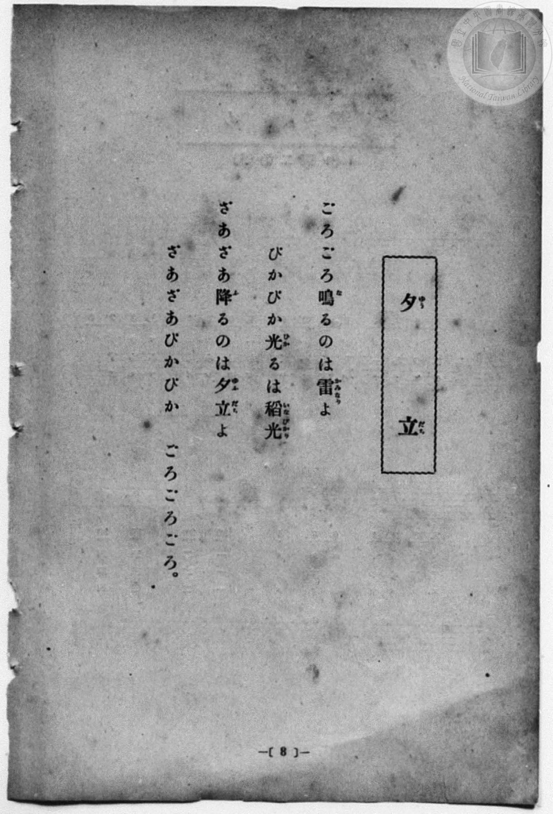
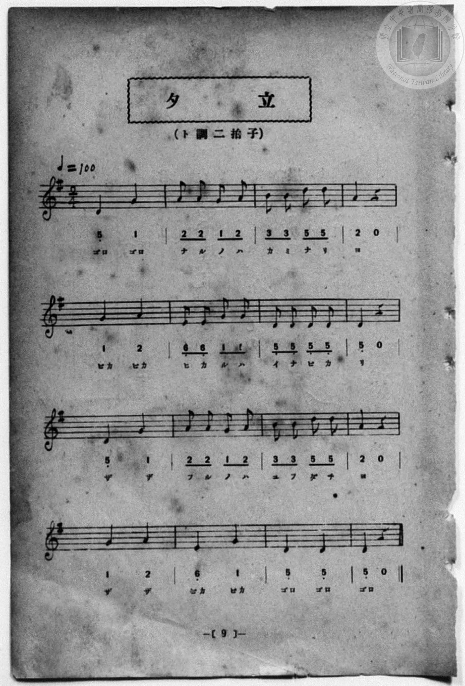

# 夕立

> Re:Shōka 使用 AI 協助辨識與重建樂譜，可能會有錯誤。歡迎回報。

- **鋼琴伴奏版**：<br><audio controls src="yudachi.mp3"></audio>
- **NEUTRINO 歌聲合成版**：<br><audio controls src="yudachi_neutrino.mp3"></audio>

- 一條慎三郎 編《新編 小學校・公學校 唱歌教材集》（大正十二年十二月，索書號 0725-41）

## 說明

原書資訊與歌詞全文（對應 P016.jpg–P017.jpg，原書 p. 8–9，尋常科第一、二學年第 4 首）：
調性與拍號：ト調二拍子（G 大調 2/4 拍），♩=100


## 歌詞

```text
ごろごろ鳴（な）るのは雷（かみなり）よ
ぴかぴか光（ひか）るは稻光（いなびかり）
ざあざあ降（ふ）るのは夕立（ゆふだち）よ
ざあざあぴかぴか　ごろごろごろ。
```

## ABC

<div class="abc-score" data-abc-src="yudachi.abc" aria-label="五線譜載入中"></div>

[下載 ABC 原始檔](yudachi.abc)

## TMD 檔案連結

- [主旋律 TMD 檔案](yudachi.tmd) [[在 TMD Studio 編輯](https://tmdlang.github.io/Tmd-TS/#tmd=s7IKdvYPcrWy4qpTUCpJTLdSSM7PyUlNLsnMz7MqzsjPTozPrsyvSsyML84ojTe0NDJWgqssy88pzU21Si9KTEmNN4w3QsgU55cWJadaFSdn5OfnxJekVpQk5edno8vHFySmp1oFGBiaIWQKivLLUvMS84C6C4oy80pSU8DaEQpSyzJTUkHSxcmJefFlqUWZaZmpKUiOSi0qBrsdYkVJUWJecXJRZgHIQwhV-UUlGflAhxdkVFplZBaX5BdlJifmxGcn5iUiFJVkpAK9l5dYUlqUiqw1Mz0zz6o0D-SOEqjtWloKT5dMfb66W0FLi0vRVsHQwIDL3lbBncvGSN_EDqT3yY6GZ4vmPmvte7Kj82Vzn8Lz7SseN3Q9m7YByFB4uqH_6dodzxYsfNy8-2nrGghb4emUjc_W9jybOvPZ3AkvZ7c9buh-v6fj6ZLlz9Yuftrb-GRXz9OdWyCMZ3M63u_peb5l0bPZO17MnK9gYG5kqmti-H5PpxIXl76Wgi21AJeCgsLTvvkgaza3v1jR9aKjHejEFyvnPW1d8WxaO8h9G3qftXcqgGJVL6sg_VHDZCDTHMQEuhCiVaFAT8ECKGEJEtnQ_XTHjufLJz5fswYYRI8bwP5auwPoNaCIgonCy2XTgN54v2cWyOoXq_Y_a1gOsrS7F-hPoOjj5g6gICgIunufrp0AdIA7MCaWA8UUgCGvABQF6-55NHOlLShSQKY8bpzyuKkXQr7cvAWo53HjKqCyx03djxvXPW5c_3L2drAgkLsfKPW4qQss2wHRvAUsASKftgKNBqrbBGTD9K9_vgIYhRDxFpDmxs0g9WAjIPqnPW5sgpAvZwJdB1S3FdlySDoCiTe1AaUeNy543LgQ2X6EfmS3PG5oQPYXlGxoAumhPN6hQEFLn4srsjQlMTkj0yogMzEv36HGoKYaZIeCjYWWHZiBLb0pQKL3xcIeBQ0TUHJ_vr5BB5RIwClDE4sGoE0gw2oUTOMVdBUMgbhGwQgIDYG4RsEYCE2BECSmq2AAkgUr96mBxi5QBM4Aia1SAAYwkF4HxOvBIiDefqhMF0ikqQOoFmRZDTiV4PbHrh5y_AHyAsixNQpm8SBkCIRg38ER1K9ovgFFLtg3UAZIbBPE_WAfQXzTAvFJ42awDMg3XUT6ZkcnfWJlGtgTIBLE24oeH01tENHGBUC8kJT4eDp7NsXxAfML2FtgAntkoHoCW9RgS3xQJsQvtVxcunYK0EykAGQqcwEA)]
- [鋼琴伴奏 TMD 檔案](yudachi_piano.tmd) [[在 TMD Studio 編輯](https://tmdlang.github.io/Tmd-TS/#tmd=s7IKdvYPcrWy4qpTUCpJTLdSSM7PyUlNLsnMz7MqzsjPTozPrsyvSsyML84ojTe0NDJWgqssy88pzU21Si9KTEmNN4w3QsgU55cWJadaFSdn5OfnxJekVpQk5edno8vHFySmp1oFGBiaIWQKivLLUvMS84C6C4oy80pSU8DaEQpSyzJTUkHSxcmJefFlqUWZaZmpKUiOSi0qBrsdYkVJUWJecXJRZgHIQwhViUVA8fTU3NS8EquCzMS8_PjE5OT83ILEvEyQGEJhflFJRj7QhwUZlVYZmcUl-UWZyYk58dmJeYlKXFpaCk-XTH2-uvv9no6Xs2c-6-x-2b3n-YQtT_Zsebq0__2eTgUtLS5FWwVDAwMue1sFdy4bI30TO5DZT3Y0PFs091lr35MdnS-b-xSeb1_xuKHr2bQNQIbC0w39T9fueLZg4ePm3U9b10DYCk-nbHy2tufZ1JnP5k54ObvtcQPI1qdLlj9bu_hpb-OTXT1Pd26BMJ7N6Xi_p-f5lkXPZu94MXO-goG5kamuiSHQPUpcXJGlKYnJGZlWASBfB3k41BjUVHMpAIGNhZYdmFGjYBqvoKtgCMQ1CkZAaAjENQrGQGgKhCAxXQUDkCxYuU-NwuPGKY-beoEicAZIbJXC46ZuIL0OiNeDRUC8_VCZLpBIUwdQLciyGi6o1SBbQebXKJjFg5AhEIIdBEdQ56E5YAvIdJADoAyQ2CaIlWBHQBzQArG8cTNYBuSALnQHkO73aWB7QSSItxXd101tENHGBUC8kAhfw6wHuwRMYPcyqr3YAgBbrECZEOtr0dKDD3J6MEFKD_EK0YaxMJZpPIhpiCxmAHUYRBiiwASLJlS1VDAXhBFKgf7RtVOAekkByFTmAgA)]

## 分析

```text
================================================================================
📊 TMD Song Profile: [ 夕立 ]
================================================================================
⏱  Duration:       0:19 (19.2s), 16 measures total
🎼 Key & Tempo:    首調基準 G, != 100.0 BPM, <2/4>
   - 分析範圍：      由實際發聲的音符與和弦推測調性；播放脈絡另行呈現
🎤 人聲音域:    D4 (MIDI 62) – D5 (MIDI 74) [跨度: 12 個半音 / 1.0 個八度, 難度: easy]
   - 最低音:  D4 in [Yudachi #1 @ m.1, 0:00]
   - 最高音: D5 in [Yudachi #1 @ m.3, 0:03]
   - 適合: soprano, mezzo-soprano, contralto, tenor, baritone, bass
🏛  結構:      Yudachi (19.2s)
⚡ 編曲密度:        Peak 1 軌道同時演奏
🗝  調性診斷：       D 大調（純淨自然大調，未偵測到可信轉調）
   - 風格氣質:    純淨自然大調（陽光明朗、易唱易記，無明顯調外色彩）
   - 轉調歷程:    全曲維持單一推測調性（未偵測到可信轉調）
   - 核心骨幹音:  D, G, A, E, B
   - 調性數值:    D 大調 [相關度: 0.87, 穩定度: Moderate, 自然音純度: 100.0%]
   - 候選調性 (K-S): D 大調 (0.87), G 大調 (0.76), D 小調 (0.63)
   - 五度圈歷程:   +2
   - 各段落調性細節:
     • [Yudachi #1]: D 大調 (r: 0.87, 自然音純度: 100.0%)

  [ 五度圈游移軌跡 ]
               C  
         F            G  
      Bb              [D ]*
      Eb               A  
         Ab           E  
            Db       B  
               F# 
     (* = active key center)

  [ 十二半音累積音高分佈 ]
     C  :                            0.0%
     C# :                            0.0%
     D  : ████████████████████████  35.7%
     D# :                            0.0%
     E  : █████                      7.1%
     F  :                            0.0%
     F# :                            0.0%
     G  : █████████████████         25.0%
     G# :                            0.0%
     A  : █████████████████         25.0%
     A# :                            0.0%
     B  : █████                      7.1%
--------------------------------------------------------------------------------
Assignment 軌道音域：
  - Piano         : D4 – D5 (12 個半音 / 1.0 個八度, 40 個音符)
================================================================================
```


## 原書掃描頁






