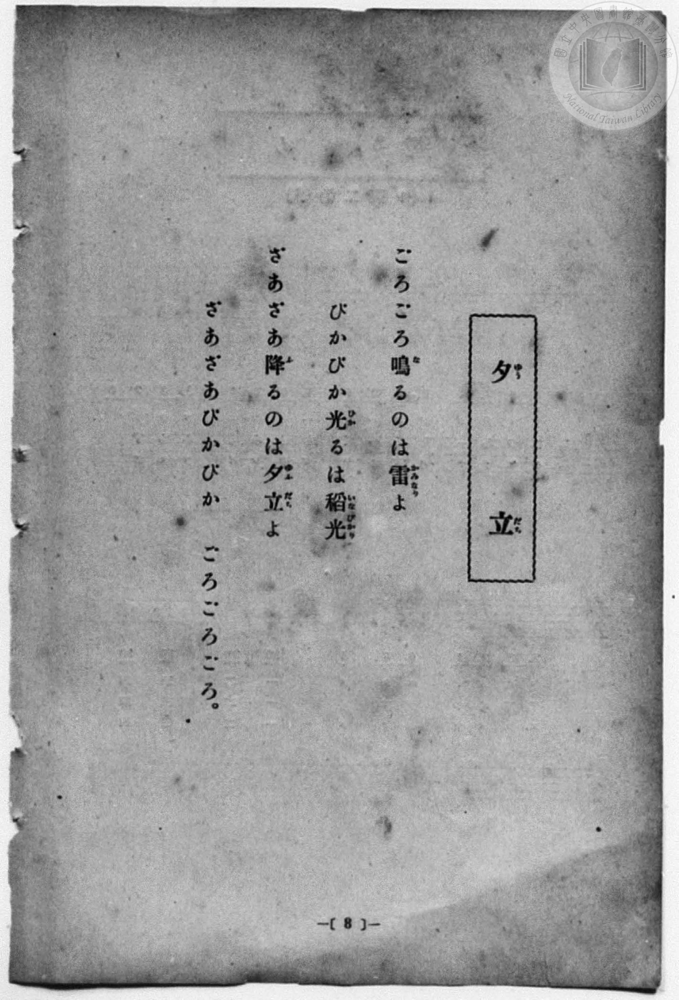
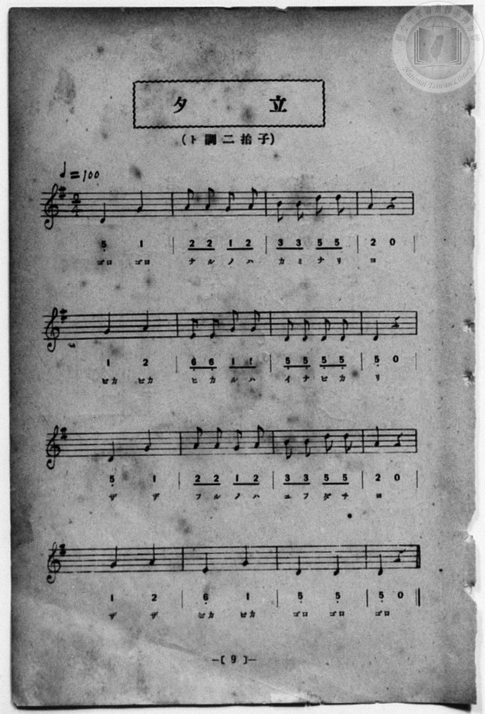

# 夕立

> Re:Shōka 使用 AI 協助辨識與重建樂譜，可能會有錯誤。歡迎回報。

<audio controls src="yudachi.mp3"></audio>

- 一條慎三郎 編《新編 小學校・公學校 唱歌教材集》（大正十二年十二月，索書號 0725-41）

## 說明

原書資訊與歌詞全文（對應 P016.jpg–P017.jpg，原書 p. 8–9，尋常科第一、二學年第 4 首）：
調性與拍號：ト調二拍子（G 大調 2/4 拍），♩=100


## 歌詞

```text
ごろごろ鳴（な）るのは雷（かみなり）よ
ぴかぴか光（ひか）るは稻光（いなびかり）
ざあざあ降（ふ）るのは夕立（ゆふだち）よ
ざあざあぴかぴか　ごろごろごろ。
```

## ABC

```abc
X:1
T:夕立
M:2/4
L:1/16
Q:1/4=100
K:G
V:V1 name="Piano" snm="Pia"
[V:V1]
D4 G4 | A2 A2 G2 A2 | B2 B2 d2 d2 | A4 z4 |
w: ごろ ごろ | な る の は | か み な り | よ
G4 A4 | E2 E2 G2 G2 | D2 D2 D2 D2 | D4 z4 |
w: ぴか ぴか | ひ か る は | い な び か | り
D4 G4 | A2 A2 G2 A2 | B2 B2 d2 d2 | A4 z4 |
w: ざ ざ | ふ る の は | ゆ ふ だ ち | よ
G4 A4 | E4 G4 | D4 D4 | D4 z4 |
w: ざ ざ | ぴか ぴか | ごろ ごろ | ごろ
```

## TMD 檔案連結

- [主旋律 TMD 檔案](yudachi.tmd) [[在 TMD Studio 編輯](https://tmdlang.github.io/Tmd-TS/#tmd=s7IKdvYPcrWy4qpTUCpJTLdSSM7PyUlNLsnMz7MqzsjPTozPrsyvSsyML84ojTe0NDJWgqssy88pzU21Si9KTEmNN4w3QsgU55cWJadaFSdn5OfnxJekVpQk5edno8vHFySmp1oFGBiaIWQKivLLUvMS84C6C4oy80pSU8DaEQpSyzJTUkHSxcmJefFlqUWZaZmpKUiOSi0qBrsdYkVJUWJecXJRZgHIQwhV-UUlGflAhxdkVFplZBaX5BdlJifmxGcn5iUiFJVkpAK9l5dYUlqUqsSlpaXwdMnU56u7FbS0uBRtFQwNDLjsbRXcuWyM9E3sQJqe7Gh4tmjus9a-Jzs6Xzb3KTzfvuJxQ9ezaRuADIWnG_qfrt3xbMHCx827n7augbAVnk7Z-Gxtz7OpM5_NnfBydtvjhu73ezqeLln-bO3ip72NT3b1PN25BcJ4Nqfj_Z6e51sWPZu948XM-QoG5kamuiaG7_d0KnFx6Wsp2FILcCkoKDztmw-yZnP7ixVdLzragU58sXLe09YVz6a1g9y3ofdZe6cCKOL0sgrSHzVMBjLNQUygCyFaFQr0FCyAEpYgkQ3dT3fseL584vM1a4BB9LgB7K-1O4BeA4oomCi8XDYN6I33e2aBrH6xav-zhuUgS7t7gf4Eij5u7gAKgoKgu_fp2glAB7gDY2I5UEwBGPIKQFGw7p5HM1fagiIFZMrjximPm3oh5MvNW4B6HjeuAip73NT9uHHd48b1L2dvBwsCufuBUo-busCyHRDNW8ASIPJpK9BooLpNQDZM__rnK4BRCBFvAWlu3AxSDzYCon_a48YmCPlyJtB1QHVbkS2HpCOQeFMbUOpx44LHjQuR7UfoR3bL44YGZH9ByYYmkB7K4x0KFLT0ubgiS1MSkzMyrQIyE_PyHWoMaqpBdijYWGjZgRnY0psCJHpfLOxR0DABJffn6xt0QIkEnDI0sWgA2gQyrEbBNF5BV8EQiGsUjIDQEIhrFIyB0BQIQWK6CgYgWbBynxpo7AJF4AyQ2CoFYAAD6XVAvB4sAuLth8p0gUSaOoBqQZbVgFMJbn_s6iHHHyAvgBxbo2AWD0KGQAj2HRxB_YrmG1Dkgn0DZYDENkHcD_YRxDctEJ80bgbLgHzTRaRvdnTSJ1amgT0BIkG8rejx0dQGEW1cAMQLSYmPp7NnUxwfML-AvQUmsEcGqiewRQ22xAdlQvxSy8Wla6cAzUQKQKYyFwA)]
- [鋼琴伴奏 TMD 檔案](yudachi_piano.tmd) [[在 TMD Studio 編輯](https://tmdlang.github.io/Tmd-TS/#tmd=s7IKdvYPcrWy4qpTUCpJTLdSSM7PyUlNLsnMz7MqzsjPTozPrsyvSsyML84ojTe0NDJWgqssy88pzU21Si9KTEmNN4w3QsgU55cWJadaFSdn5OfnxJekVpQk5edno8vHFySmp1oFGBiaIWQKivLLUvMS84C6C4oy80pSU8DaEQpSyzJTUkHSxcmJefFlqUWZaZmpKUiOSi0qBrsdYkVJUWJecXJRZgHIQwhViUVA8fTU3NS8EquCzMS8_PjE5OT83ILEvEyQmBKXlpbC0yVTn6_ufr-n4-Xsmc86u19273k-YcuTPVueLu1_v6dTQUuLS9FWwdDAgMveVsGdy8ZI38QOZP6THQ3PFs191tr3ZEfny-Y-hefbVzxu6Ho2bQOQofB0Q__TtTueLVj4uHn309Y1ELbC0ykbn63teTZ15rO5E17ObnvcALL16ZLlz9Yuftrb-GRXz9OdWyCMZ3M63u_peb5l0bPZO17MnK9gYG5kqmtiCHSPEhdXZGlKYnJGplUAyENBHg41BjXVXApAYGOhZQdm1CiYxivoKhgCcY2CERAaAnGNgjEQmgIhSExXwQAkC1buU6PwuHHK46ZeoAicARJbpfC4qRtIrwPi9WAREG8_VKYLJNLUAVQLsqyGC2o1yFaQ-TUKZvEgZAiEYAfBEdR5aA7YAjId5AAoAyS2CWIl2BEQB7RALG_cDJYBOaAL3QGk-30a2F4QCeJtRfd1UxtEtHEBEC8kwtcw68EuARPYvYxqL7YAwBYrUCbE-lq09OCDnB5MkNJDvEK0YSyMZRoPYhoiixlAHQYRhigwwaIJVS0VzAVhhFKgf3TtFKBeUgAylbkA)]

## 分析

```text
================================================================================
📊 TMD Song Profile: [ 夕立 ]
================================================================================
⏱  Duration:       0:19 (19.2s), 16 measures total
🎼 Key & Tempo:    首調基準 G, != 100.0 BPM, <2/4>
   - 分析範圍：      由實際發聲的音符與和弦推測調性；播放脈絡另行呈現
🎤 人聲音域:    D4 (MIDI 62) – D5 (MIDI 74) [跨度: 12 個半音 / 1.0 個八度, 難度: easy]
   - 最低音:  D4 in [Yudachi #1 @ m.1, 0:00]
   - 最高音: D5 in [Yudachi #1 @ m.3, 0:03]
   - 適合: soprano, mezzo-soprano, contralto, tenor, baritone, bass
🏛  結構:      Yudachi (19.2s)
⚡ 編曲密度:        Peak 1 軌道同時演奏
🗝  調性診斷：       D 大調（純淨自然大調，未偵測到可信轉調）
   - 風格氣質:    純淨自然大調（陽光明朗、易唱易記，無明顯調外色彩）
   - 轉調歷程:    全曲維持單一推測調性（未偵測到可信轉調）
   - 核心骨幹音:  D, G, A, E, B
   - 調性數值:    D 大調 [相關度: 0.87, 穩定度: Moderate, 自然音純度: 100.0%]
   - 候選調性 (K-S): D 大調 (0.87), G 大調 (0.76), D 小調 (0.63)
   - 五度圈歷程:   +2
   - 各段落調性細節:
     • [Yudachi #1]: D 大調 (r: 0.87, 自然音純度: 100.0%)

  [ 五度圈游移軌跡 ]
               C  
         F            G  
      Bb              [D ]*
      Eb               A  
         Ab           E  
            Db       B  
               F# 
     (* = active key center)

  [ 十二半音累積音高分佈 ]
     C  :                            0.0%
     C# :                            0.0%
     D  : ████████████████████████  35.7%
     D# :                            0.0%
     E  : █████                      7.1%
     F  :                            0.0%
     F# :                            0.0%
     G  : █████████████████         25.0%
     G# :                            0.0%
     A  : █████████████████         25.0%
     A# :                            0.0%
     B  : █████                      7.1%
--------------------------------------------------------------------------------
Assignment 軌道音域：
  - Piano         : D4 – D5 (12 個半音 / 1.0 個八度, 40 個音符)
================================================================================
```


## 原書掃描頁






