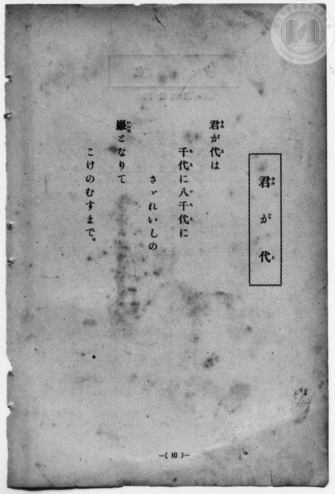
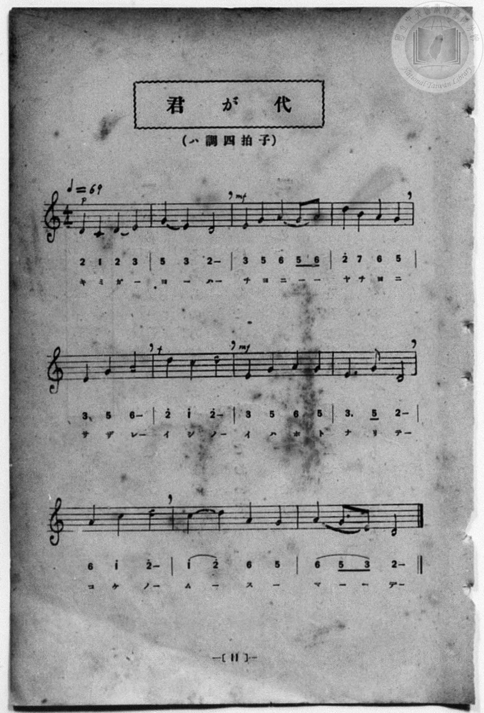

# 君が代

> Re:Shōka 使用 AI 協助辨識與重建樂譜，可能會有錯誤。歡迎回報。

<audio controls src="kimigayo.mp3"></audio>

- 詞：古歌
- 曲：林廣守
- 一條慎三郎 編《新編 小學校・公學校 唱歌教材集》（大正十二年十二月，索書號 0725-41）
- 臺灣總督府《公學校唱歌集》（大正四年三月，索書號 0725 26）

## 說明

原書資訊與歌詞全文（對應 P018.jpg–P019.jpg，原書 p. 10–11，尋常科第一、二學年第 5 首）：
調性與拍號：ハ調四拍子（律旋調 4/4 拍），♩=69


## 歌詞

```text
君（きみ）が代（よ）は
千（ち）代（よ）に八（や）千（ち）代（よ）に
さゞれいしの
巖（いはほ）となりて
こけのむすまで。
```

## ABC

```abc
X:1
T:君が代
C:曲：林廣守
M:4/4
L:1/16
Q:1/4=69
K:C
V:V1 name="Piano" snm="Pia"
[V:V1]
D4 C4 D4 E4 | G4 E4 D8 | E4 G4 A4 G2 A2 | d4 B4 A4 G4 |
w: き み が _ | よ _ は | ち よ に _ _ | や ち よ に
E4 G4 A8 | d4 c4 d8 | E4 G4 A4 G4 | E6 G2 D8 |
w: さ ざ れ | い し の | い は ほ と | な り て
A4 c4 d8 | c4 d4 A4 G4 | A4 G2 E2 D8 |
w: こ け の | む _ す _ | ま _ _ で
```

## TMD 檔案連結

- [主旋律 TMD 檔案](kimigayo.tmd) [[在 TMD Studio 編輯](https://tmdlang.github.io/Tmd-TS/#tmd=s7IKdvYPcrWy4qpTUCpJTLdSSM7PyUlNLsnMz7MqzsjPTozPrsyvSsyML84ojTe0NDJWgqssy88pzU21Si9KTEmNN4w3QsgU55cWJadaFSdn5OfnxJekVpQk5edno8vHFySmp1oFGBhaIGQKivLLUvMS84C6C4oy80pSU8DaEQpSyzJTUkHSxcmJefFlqUWZaZmpKUiOSi0qBrsdYkVJUWJecXJRZgHIQwhV-UUlGflAhxdkVFplZBaX5BdlJifmxGcn5iUiFJVkpAK9l5lbALQkMQddPDm1KDU3Pw8so6Wl8HTC7MeNPU92L1bQ0uJStFUws-Syt1Vw5rIx0TexA2l9sqPh2aK5z1r7nuzofNncp_B8-4rHDV3Ppm0AMhSebuh_unbHswULHzfvftq6BsJWeDpl47O1Pc-mznw2d8LL2W2PG7rf7-l4umT5s7WLn_Y2PtnV83TnFgjj2ZyO93t6nm9Z9Gz2jhcz5ysYmBuZ6poYvt_TCXb2i5Xz3u-Z9bR_CdA4sMCz2ZuAAs_mTX-6e_HTdR0QRe27njcufr5j7_O5i5_umgN0HNwlEIegO2H2bKD9QN9gs1zByAxsOZe-loIttQCXgoLC0775IGs2t79Y0fWiox3oLKDnnraueDatHeSyDb3P2jsVQGlKL6sg_VHDZCDTEsQEuhCiVaFAT8HQAChjCAyenqcbup_u2PF8-cTna9YAY-hxAzhY1-4A-gwoomCq8HLZNKBHgIEFsvzFqv3PGpaDrO3uBfoUKPq4uR8oCAwKoMjTtRNATtjX_Wx6N1BQARjzCkBhsPaeRzNX2gLTBNgLE2YD1T1u7H3cuB8oCUk2IJEmYDgCuevBinqbwYoWAoVQpVc_bV0N5rYAuXiUgUx53Dj1cdO8x009jxtbHjdOf9y4Dmz2dqCfgJqAQusfN-4GK1_xuHHV46aux43LIPomP26cCFT-uKnhcePMx437Hjcuf9zQBJKjPB6hQEFLn4vLOzM3Mz2xMt8qIDMxL9-hxqCmGmSJgo2Flh2YgS0BKUBi68XCHgUNE1Dmeb6-QQcU6-Co1sSiAWgVyLAaBSMFXQVDIAbRxkBcA4xjCAskAoI1YB5I1AxMm4F0xQGZ5nAhoCKwcT41wJDqBXKBMQkme-BmAKMBygYGMkK0cSFIBCwHjCIk1S1gEXTZGnCCwR0Gu3rICQNk_0HsB_vPEESAWdiCASYCYsODChEKU8FungZ2P1IoNEL8NR1MrsMQB4UMMAWCyRVQmVWQUGvqArKXwS0ikBY6weFgTFo4gDyG7mkEH-FtCMsYm7cng50-Ed17TQ1QNjDzIHl6H1x0OdyoWi4uXTsFWDZQALKVuQA)]
- [鋼琴伴奏 TMD 檔案](kimigayo_piano.tmd) [[在 TMD Studio 編輯](https://tmdlang.github.io/Tmd-TS/#tmd=s7IKdvYPcrWy4qpTUCpJTLdSSM7PyUlNLsnMz7MqzsjPTozPrsyvSsyML84ojTe0NDJWgqssy88pzU21Si9KTEmNN4w3QsgU55cWJadaFSdn5OfnxJekVpQk5edno8vHFySmp1oFGBhaIGQKivLLUvMS84C6C4oy80pSU8DaEQpSyzJTUkHSxcmJefFlqUWZaZmpKUiOSi0qBrsdYkVJUWJecXJRZgHIQ0pcWloKTyfMftzY82T34vd7Ol7Onvmss_tl957nE7Y82bPl6dL-93s6FbS0uBRtFcwsuextFZy5bEz0TexAxj_Z0fBs0dxnrX1PdnS-bO5TeL59xeOGrmfTNgAZCk839D9du-PZgoWPm3c_bV0DYSs8nbLx2dqeZ1NnPps74eXstscN3UBLny5Z_mzt4qe9jU929TzduQXCeDan4_2enudbFj2bvePFzPkKBuZGpromhkDngL32YuW893tmPe1fAjQOLPBs9iagwLN505_uXvx0XQdEUfuu542Ln-_Y-3zu4qe75gAdB3cJxCHoTpg9G2g_0DfYLFcwMgNbzuWdmZuZnliZbxWQmZiXH-ThUGNQU82lAAQ2Flp2YIa-loItOlB4vmYNMMReLOxR0DABBc_z9Q06CsDIttTLKkjXxKJBSx9sWI2CkYKugiEQg2hjIK5RMIWyQCIgWAPmgUTNwLQZSFcckGkOFwIqAhvnU6PwuLEXyH3cuB9M9sDNeNzUAWU_blyPEG1cCBIByz1uXI2kugUsgi5bw4U_DHb1kBMGyP6D2A_2nyGIALOwBQNMBMSGBxUiFKaC3TwN7H6kUGiE-Gs6mFyHIQ4KmceNu8HkCqjMKkioNXUB2cvgFhFIC53gcDAmLRxAHkP3NIKP8DaEZYzN25PBTp-I7r2mBij7ceNMJE_vg4suhxtVi54LfJBzgQkiF7zo63rZ3vtyduuzFU0vF614tmDPk11Tnu5a9qKj_emknqd7lkEKGaSkHg_yH4gAJvJ4EA0WAfoHzIGQUGUQeYjH0BWAjYCaAxEzRtIJMRNFI9QasBYUW6BqgV7WtVOA-VoByFbmAgA)]

## 分析

```text
================================================================================
📊 TMD Song Profile: [ 君が代 ]
================================================================================
⏱  Duration:       0:38 (38.3s), 11 measures total
🎼 Key & Tempo:    首調基準 C, != 69.0 BPM, <4/4>
   - 分析範圍：      由實際發聲的音符與和弦推測調性；播放脈絡另行呈現
🎤 人聲音域:    C4 (MIDI 60) – D5 (MIDI 74) [跨度: 14 個半音 / 1.2 個八度, 難度: moderate]
   - 最低音:  C4 in [Kimigayo #1 @ m.1, 0:00]
   - 最高音: D5 in [Kimigayo #1 @ m.4, 0:10]
   - 適合: soprano, mezzo-soprano, contralto, tenor, baritone, bass
🏛  結構:      Kimigayo (38.3s)
⚡ 編曲密度:        Peak 1 軌道同時演奏
🗝  調性診斷：       D 大調（流行色彩大調，未偵測到可信轉調）
   - 風格氣質:    流行大調（略帶和弦色彩音與裝飾副屬和弦）
   - 轉調歷程:    全曲維持單一推測調性（未偵測到可信轉調）
   - 核心骨幹音:  D, G, A, E, C
   - 調性數值:    D 大調 [相關度: 0.80, 穩定度: Moderate, 自然音純度: 90.9%]
   - 候選調性 (K-S): D 大調 (0.80), G 大調 (0.75), D 小調 (0.65)
   - 五度圈歷程:   +2
   - 各段落調性細節:
     • [Kimigayo #1]: D 大調 (r: 0.80, 自然音純度: 90.9%, 調外音: C)

  [ 五度圈游移軌跡 ]
               C  
         F            G  
      Bb              [D ]*
      Eb               A  
         Ab           E  
            Db       B  
               F# 
     (* = active key center)

  [ 十二半音累積音高分佈 ]
     C  : ██████                     9.1%
     C# :                            0.0%
     D  : ████████████████████████  34.1%
     D# :                            0.0%
     E  : ███████████               15.9%
     F  :                            0.0%
     F# :                            0.0%
     G  : ██████████████            19.3%
     G# :                            0.0%
     A  : ██████████████            19.3%
     A# :                            0.0%
     B  : ██                         2.3%
--------------------------------------------------------------------------------
Assignment 軌道音域：
  - Piano         : C4 – D5 (14 個半音 / 1.2 個八度, 40 個音符)
================================================================================
```


## 原書掃描頁






