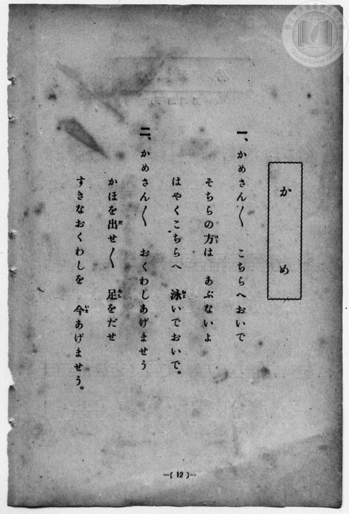
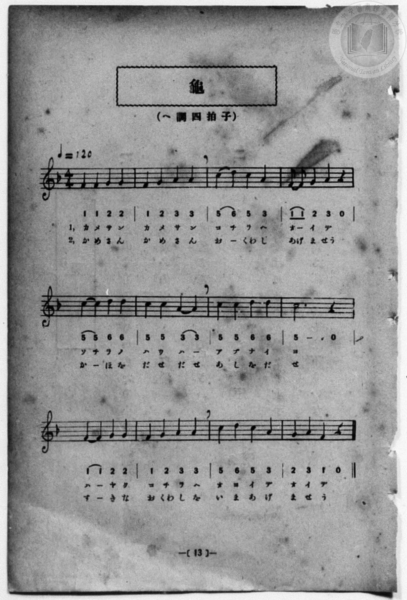

# 龜

> Re:Shōka 使用 AI 協助辨識與重建樂譜，可能會有錯誤。歡迎回報。

- **鋼琴伴奏版**：<br><audio controls src="kame.mp3"></audio>
- **NEUTRINO 歌聲合成版**：<br><audio controls src="kame_neutrino.mp3"></audio>

- 詞：臺灣總督府
- 曲：宮島慎三郎
- 一條慎三郎 編《新編 小學校・公學校 唱歌教材集》（大正十二年十二月，索書號 0725-41）
- 臺灣總督府《公學校唱歌集》（大正四年三月，索書號 0725 26）

## 說明

原書資訊與歌詞全文（對應 P020.jpg–P021.jpg，原書 p. 12–13，尋常科第一、二學年第 6 首）：
調性與拍號：ヘ調四拍子（F 大調 4/4 拍），♩=120
作曲：臺灣總督府國語學校助教授 宮島慎三郎


## 歌詞

```text
一、かめさんかめさん　こちらへおいで。
そちらの方（はう）は　あぶないよ。
はやくこちらへ　泳（およ）いでおいで。

二、かめさんかめさん　おくゎしあげませう
かほを出（だ）せ出せ　足（あし）を出（だ）せ。
すきなおくゎしを　今（いま）あげませう。
```

## ABC

```abc
X:1
T:龜
C:曲：宮島慎三郎
M:4/4
L:1/16
Q:1/4=120
K:F
V:V1 name="Piano" snm="Pia"
[V:V1]
F4 F4 G4 G4 | F4 G4 A4 A4 | c4 d4 c4 A4 | F2 F2 G4 A4 z4 |
w: 1.~か め さ ん | か め さ ん | こ ち ら へ | お _ い で
w: 2.~か め さ ん | か め さ ん | お _ くゎ し | あ げ ま せう
c4 c4 d4 d4 | c4 c4 A4 A4 | c4 c4 d4 d4 | c12 z4 |
w: 1.~そ ち ら の | は う は _ | あ ぶ な い | よ
w: 2.~か _ ほ を | だ せ だ せ | あ し を だ | せ
F8 G4 G4 | F4 G4 A4 A4 | c4 d4 c4 A4 | G4 A4 F4 z4 |
w: 1.~は や く | こ ち ら へ | お よ い で | お い で
w: 2.~す き な | お くゎ し を | い ま あ げ | ま せ う
F4 F4 G4 G4 | F4 G4 A4 A4 | c4 d4 c4 A4 | F2 F2 G4 A4 z4 |
w: 1.~か め さ ん | か め さ ん | こ ち ら へ | お _ い で
w: 2.~か め さ ん | か め さ ん | お _ くゎ し | あ げ ま せう
c4 c4 d4 d4 | c4 c4 A4 A4 | c4 c4 d4 d4 | c12 z4 |
w: 1.~そ ち ら の | は う は _ | あ ぶ な い | よ
w: 2.~か _ ほ を | だ せ だ せ | あ し を だ | せ
F8 G4 G4 | F4 G4 A4 A4 | c4 d4 c4 A4 | G4 A4 F4 z4 |
w: 1.~は や く | こ ち ら へ | お よ い で | お い で
w: 2.~す き な | お くゎ し を | い ま あ げ | ま せ う
```

## TMD 檔案連結

- [主旋律 TMD 檔案](kame.tmd) [[在 TMD Studio 編輯](https://tmdlang.github.io/Tmd-TS/#tmd=s7IKdvYPcrWy4qpTUCpJTLdSSM7PyUlNLsnMz7MqzsjPTozPrsyvSsyML84ojTe0NDJWgqssy88pzU21Si9KTEmNN4w3QsgU55cWJadaFSdn5OfnxJekVpQk5edno8vHFySmp1oFGBgZIGQKivLLUvMS84C6C4oy80pSU8DaEQpSyzJTUkHSxcmJefFlqUWZaZmpKUiOSi0qBrsdYkVJUWJecXJRZgHIQwhV-UUlGflAhxdkVFplZBaX5BdlJifmxGcn5iUiFJVkpAK9l5iXmZuYg6w1Mz0zz6okMbMc6ID8tLTM5EyQvJaWwst9cxS0tLgUbRUMjQy47G0V3LhsTPRN7EB6n-xoeLZo7rPWvic7Ol829yk8377icUPXs2kbgAyFpxv6n67d8WzBwsfNu5-2roGwFZ5O2fhsbc-zqTOfzZ3wcnbb44bu93s6ni5Z_mzt4qe9jU929TzduQXCeDan4_2enudbFj2bvePFzPkKBuZGpromhu_3dILd_WLlvPd7Zr1o3_W8cfHzHXufz138dNccsMyz2ZuAMk_XrXu6eRvcbRA9qKqBboU7DOIudBfNng10DtAAbG5RMDIDu4VLX0vBllqAS0FB4WnffJA1m9tfrOh60dEOdBbQr09bVzyb1g5y2YbeZ-2dCqAUppdVkP6oYTKQaQhiAl0I0apQoAeMLKCMoTFIbEP30x07ni-f-HzNGmCEPW4Ah_LaHUCfAUUUzBReLpsG9AgwyECWv1i1_1nDcpC13b1AnwJFHzfPAAoCgwIo8nTtBKAT3BSAwQMUUwCmAwWgKFh3z6OZK21BSQRoyJO9cyCRgBbgT-d0v1g1DxrgXStBqaCvQwEtprjAJoAd-rix-3ETkJz6uGkyCruh4XEjUGTh46bOx407Hjd2PW5sedy4_HFDE0jz48a5MLl1z6btBLr4ceP6x41tQHeCGCDNTY8btz1uXAXS1tQB17b-cRPQmH4Usxsanm3eDDaiC6gUbATYKmQ7wS7e1UPIxUAd_Y-b-h43Tgc7YNLjxn2PG2cDHQaxvftx4-7HTZOetu8CW7cAbNdsIBekqKHhxTaIM4A6p4OkMFTCvTHzcWMv2HNIFjZNAhrxZHcXWAPQ3fvAelBcAdVPeSKGAgUtfS4u70RgcROQmZiX71BjUFMNskDBxkLLDszAlnMUIMn0xcIeBQ0TUCHyfH2DDjC5G4KTuyYWDUBrQIbVKBgq6IKxERRDREAsYyiuUTAFkmZADKIhIoZACFNjABIBm-ZjWAOKEiAfGIcgsnEqmD0ZrAefDIgGJh-wWCeYvQMq0wXmtYDJ5UAyHmGbEbm2gcwEQUhMgxnToVJNQDwJiPeBRUExDLcTf-jv6iEn9EEhCgtdEEaIoIY-phoYRA_9uRghuQ7qtfVgHsg_EDYIQrwMEtkGJlfBQxso09SBZA-2cIeE4W6wXZOgpi2ABByYRLAR9oACGqIaIg-SAalAtYdASu8kN6WDIGkpHSYPUose1rBQBJaAYP_0Q_1DIDWDwxU5TROTzmfCw7sXTIJiCqEPJR0jIgNiHCQtQ4IfJgNN32ASkcRrubh07RRAxY8CEq3MBQA)]
- [鋼琴伴奏 TMD 檔案](kame_piano.tmd) [[在 TMD Studio 編輯](https://tmdlang.github.io/Tmd-TS/#tmd=s7IKdvYPcrWy4qpTUCpJTLdSSM7PyUlNLsnMz7MqzsjPTozPrsyvSsyML84ojTe0NDJWgqssy88pzU21Si9KTEmNN4w3QsgU55cWJadaFSdn5OfnxJekVpQk5edno8vHFySmp1oFGBgZIGQKivLLUvMS84C6C4oy80pSU8DaEQpSyzJTUkHSxcmJefFlqUWZaZmpKUiOSi0qBrsdYkVJUWJecXJRZgHIQ0pcWloKL_fNeb-n4-Xsmc86u19273k-YcuTPVueLu1_v6dTQUuLS9FWwdDIgMveVsGNy8ZE38QOZPKTHQ3PFs191tr3ZEfny-Y-hefbVzxu6Ho2bQOQofB0Q__TtTueLVj4uHn309Y1ELbC0ykbn63teTZ15rO5E17Obnvc0A209emS5c_WLn7a2_hkV8_TnVsgjGdzOt7v6Xm-ZdGz2TtezJyvYGBuZKprYgh0D9hXL1bOe79n1ov2Xc8bFz_fsff53MVPd80ByzybvQko83Tduqebt8HdBtGDqhroVrjDIO5Cd9Hs2UDnAA3A5hYFIzOwW7i8E4GxHZCZmJcf5OFQY1BTzaUABDYWWnZghr6Wgi06UHi-Zg0w8F4s7FHQMAGF1PP1DToKAQaGBnpZBemaWDRo6YMNq1EwVNAFYyMohoiAWMZQXKNgCiTNgBhEQ0QMgRCmxgAkAjbNx7BG4XFjN5D_uKkRRDZOBbMng_XgkwHRjxsXgsU6wewdUJkuMK8FTC4HkvEI24zItQ1kJgg-bux_3NQHZkyHSjUB8SQg3gcWnf24sQ1uJ_7Q39VDTuiDQhQWuiCMEEENfUw1MIge-nMxQnId1GvrwTyQfyBsEIR4GSSyDUyugoc2UKapA8kebOEOCcPdYLsmQU1bAAk4MIlgI-wBBTRENUQeJANSgWoPgZTeSW5KB0HSUjpMHqQWPaxhofi4CZI--6H-IZCaweGKnKaJSecz4eHdCyZBMYXQh5KOEZEBMQ6SliHBD5OBpm8wiUjitciljw9y6WMCLX2AgRavEG0Yq2AaD6RN42MRIlAKOx-kEkgbQP0EV2QCpEzwGIJFHsMMEpwCVwo1B-hhXTsFkJ-jfYAK4GwjMFuZCwA)]

## 分析

```text
================================================================================
📊 TMD Song Profile: [ 龜 ]
================================================================================
⏱  Duration:       0:48 (48.0s), 24 measures total
🎼 Key & Tempo:    首調基準 F, != 120.0 BPM, <4/4>
   - 分析範圍：      由實際發聲的音符與和弦推測調性；播放脈絡另行呈現
🎤 人聲音域:    F4 (MIDI 65) – D5 (MIDI 74) [跨度: 9 個半音 / 0.8 個八度, 難度: easy]
   - 最低音:  F4 in [Kame #1 @ m.1, 0:00]
   - 最高音: D5 in [Kame #1 @ m.3, 0:04]
   - 適合: soprano, mezzo-soprano, contralto, tenor, baritone, bass
🏛  結構:      Kame (24.0s) -> Kame (24.0s)
⚡ 編曲密度:        Peak 1 軌道同時演奏
🗝  調性診斷：       C 大調（純淨自然大調，未偵測到可信轉調）
   - 風格氣質:    純淨自然大調（陽光明朗、易唱易記，無明顯調外色彩）
   - 轉調歷程:    全曲維持單一推測調性（未偵測到可信轉調）
   - 核心骨幹音:  C, A, F, G, D
   - 調性數值:    C 大調 [相關度: 0.81, 穩定度: Moderate, 自然音純度: 100.0%]
   - 候選調性 (K-S): C 大調 (0.81), F 大調 (0.78), A 小調 (0.71)
   - 五度圈歷程:   +0 -> +0
   - 各段落調性細節:
     • [Kame #1]: C 大調 (r: 0.81, 自然音純度: 100.0%)
     • [Kame #2]: C 大調 (r: 0.81, 自然音純度: 100.0%)

  [ 五度圈游移軌跡 ]
              [C ]*
         F            G  
      Bb               D  
      Eb               A  
         Ab           E  
            Db       B  
               F# 
     (* = active key center)

  [ 十二半音累積音高分佈 ]
     C  : ████████████████████████  28.9%
     C# :                            0.0%
     D  : ███████████               13.3%
     D# :                            0.0%
     E  :                            0.0%
     F  : ███████████████           17.8%
     F# :                            0.0%
     G  : ███████████████           17.8%
     G# :                            0.0%
     A  : ██████████████████        22.2%
     A# :                            0.0%
     B  :                            0.0%
--------------------------------------------------------------------------------
Assignment 軌道音域：
  - Piano         : F4 – D5 (9 個半音 / 0.8 個八度, 86 個音符)
================================================================================
```


## 原書掃描頁






