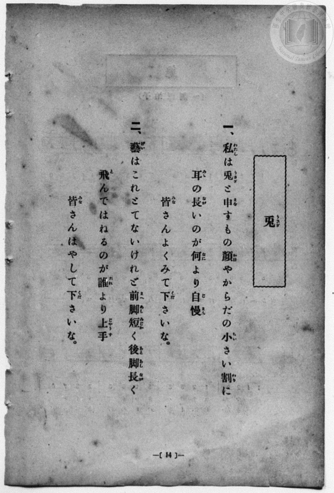
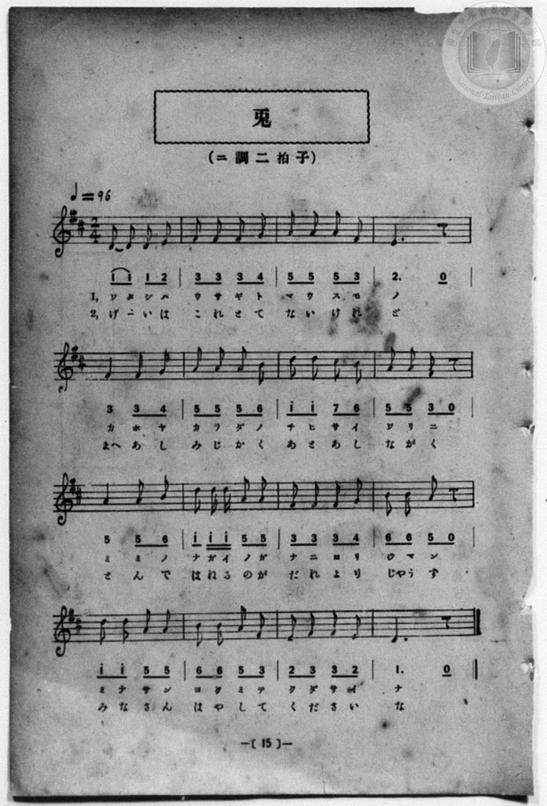

# 兎

> Re:Shōka 使用 AI 協助辨識與重建樂譜，可能會有錯誤。歡迎回報。

<audio controls src="usagi.mp3"></audio>

- 詞：石原和三郎
- 曲：田村虎藏
- 一條慎三郎 編《新編 小學校・公學校 唱歌教材集》（大正十二年十二月，索書號 0725-41）

## 說明

原書資訊與歌詞全文（對應 P022.jpg–P023.jpg，原書 p. 14–15，尋常科第一、二學年第 7 首）：
調性與拍號：ニ調二拍子（D 大調 2/4 拍），♩=96


## 歌詞

```text
一、私（わたし）は兎（うさぎ）と申（まを）すもの顏（かほ）やからだの小（ちひ）さい割（わり）に
耳（みゝ）の長（なが）いのが何（なに）より自慢（じまん）
皆（みな）さんよくみて下（くだ）さいな。

二、藝（げい）はこれとてないけれど前脚（まへあし）短（みじか）く後脚（あとあし）長（なが）く
飛（と）んではねるのが誰（たれ）より上手（じゃうず）
皆（みな）さんはやして下（くだ）さいな。
```

## ABC

```abc
X:1
T:兎
C:曲：田村虎藏
M:2/4
L:1/16
Q:1/4=96
K:D
V:V1 name="Piano" snm="Pia"
[V:V1]
D2 D2 D2 E2 | F2 F2 F2 G2 | A2 A2 A2 F2 | E6 z2 |
w: わ た し は | う さ ぎ と | ま を す も | の
F4 F2 G2 | A2 A2 A2 B2 | d2 d2 c2 B2 | A2 A2 F2 z2 |
w: か ほ や | か ら だ の | ち ひ さ い | わ り に
A4 A2 B2 | d2 d d A2 A2 | F2 F2 F2 G2 | B2 B2 A2 z2 |
w: み み の | な が い の が | な に よ り | じ ま ん
d2 d2 A2 A2 | B2 B2 A2 F2 | E2 F2 F2 E2 | D6 z2 |
w: み な さ ん | よ く み て | く だ さ い | な
D2 D2 D2 E2 | F2 F2 F2 G2 | A2 A2 A2 F2 | E6 z2 |
w: げ _ い は | こ れ と て | な い け れ | ど
F4 F2 G2 | A2 A2 A2 B2 | d2 d2 c2 B2 | A2 A2 F2 z2 |
w: まへ あ し | み じ か く | あ と あ し | な が く
A4 A2 B2 | d2 d d A2 A2 | F2 F2 F2 G2 | B2 B2 A2 z2 |
w: と ん で | は ね る の が | た れ よ り | じゃ う ず
d2 d2 A2 A2 | B2 B2 A2 F2 | E2 F2 F2 E2 | D6 z2 |
w: み な さ ん | は や し て | く だ さ い | な
```

## TMD 檔案連結

- [主旋律 TMD 檔案](usagi.tmd) [[在 TMD Studio 編輯](https://tmdlang.github.io/Tmd-TS/#tmd=s7IKdvYPcrWy4qpTUCpJTLdSSM7PyUlNLsnMz7MqzsjPTozPrsyvSsyML84ojTe0NDJWgqssy88pzU21Si9KTEmNN4w3QsgU55cWJadaFSdn5OfnxJekVpQk5edno8vHFySmp1oFGBgh6Swoyi9LzUvMA-ouKMrMK0lNAWtHKEgty0xJBUkXJyfmxZelFmWmZaamIDkqtagY7HaIFSVFiXnFyUWZBSAPIVTlF5Vk5AMdXpBRaZWRWVySX5SZnJgTn52Yl4hQVJKRCvReYl5mbmKOEpeWlsLT1j4FLS0uRVsFSzMue1sFFy4bI30TO5CGJzsani2a-6y178mOzpfNfQrPt6943ND1bNoGIEPh6Yb-p2t3PFuw8HHz7qetayBshadTNj5b2_Ns6sxncye8nN32uKH7_Z6Op0uWP1u7-Glv45NdPU93boEwns3peL-n5_mWRc9m73gxc76CgbmRqa6J4fs9nWDHvlg57_2eWc_nb37aN__ppB6IC8Ayz2ZvAslM2fBs7sQXM_teTO9X4uLS11KwpRbgUlBQANoKctfm9hcrul50tAP9BHTQ09YVz6a1gzy0ofdZe6cCKJb1sgrSHzVMBjKNQUyglyBaFQr0FAxNgDKGpiCxDd1Pd-x4vnzi8zVrgKH6uAEcFGt3AEMDKKJgrvBy2TSgz4H-Aln-YtX-Zw3LQdZ29wKDBij6uLkbKAgKte7ep2snAJ3gogAMVaCYAjCyFICiYN09j2autAVGI8gQiDXPlzcCFT9u6n_cOP9x43SgqseN64FRDhJsbHvcOPVxI5ANFFzxfMpmsOC-x02TwCIzHzc1PW5c93JhP1i8-3HjbpB4UwuI3QRUsAAoC0wFYNmFjxuBsQIUBBrY8rQTyAZb2tQFFlwN9lUDxIL9j5vmgkXXvZy6HSyy6nFjD1gEaPQ6IPvJ3qkw8dVgK4Fmdb1oX_WsdRFYfAbYlZOBUiBzn89qg5rbuArqhKbJID2NQE8DBZc92QFKhGDuArgbQaY3NEFCalcPMKReTAe6CqhqElASEkyPG4HG9ACDBmgG2DFATRPBIiufdva-aJkFDa_GHY8bgSEFCtzn89fC3AJ0JNBaoDn9T_f1wBQDlQFNgyrG8H4_yDUvF88Gi64A-3zy48blYKesfdwEjAFQ6LxYtQGsYD7QKfDQebKj61knxJszHjc1g-MWaCWeAAIaCorK6QQCCKif8hwFBQpa-lxcocWJ6ZlWAZmJefkONQY11SAbFGwMzbTswCxsGVkBkmteLOxR0DABFTzP1zfogHIfOMtpYtEAtAhkWI2CoYIuHBsBcY2CMZCEYROwiCmQhGGQaA1YJQwagETApvkY1igAEzWQDwx8MDkdTK4H6wEGOZg3FUz2gckVUJl9IF7TJLDYTDC7CSqzDsmmeIRNRiA5kHoQBEYGij2TwSb0wG0AxiBUZhWS6olwVSCZlRj24A_tXT3khDYo9EAQe9iagUUM40DRASLM4WLIoY8W3o3d8FDYDfYRyHcwcWAxBJZZACZBYQmSWQjmbUKKDageSNw1dYHFVmMJcVBehlsHiiJIFIOk9oN5M8Ak2OpGkGEgGYg6SESg6oFEBySiQKqJCfgdneQEPCjwQBAzmIEIFrrY0j5IMQiD5NFDHuRlSFBAPA8LX5i3QOEKEYV4EiEHCltguQQPbZAMJOggOQGUgtHDHhSAYNvAssBiD6oPlOqBxR9QvBvDNnAuhOQEdNuAhSBYKSRTziIu9J_Onk1WIQNP0oigRg5YRKECC3xIUQQqlHAUM9AghwQnOBGDgwWUiMEeBacnmCpY9oeIQTIDSsIHm4OrmMFpEyTowRkOVtSRY1MtF5eunQK42I_2MYxVQHCMwBxlLgA)]
- [鋼琴伴奏 TMD 檔案](usagi_piano.tmd) [[在 TMD Studio 編輯](https://tmdlang.github.io/Tmd-TS/#tmd=s7IKdvYPcrWy4qpTUCpJTLdSSM7PyUlNLsnMz7MqzsjPTozPrsyvSsyML84ojTe0NDJWgqssy88pzU21Si9KTEmNN4w3QsgU55cWJadaFSdn5OfnxJekVpQk5edno8vHFySmp1oFGBgh6Swoyi9LzUvMA-ouKMrMK0lNAWtHKEgty0xJBUkXJyfmxZelFmWmZaamIDkqtagY7HaIFSVFiXnFyUWZBSAPIVQlFgHF01NzU_NKrAoyE_Py4xOTk_NzCxLzMkFiSlxaWgpPW_ve7-l4OXvms87ul917nk_Y8mTPlqdL-9_v6VTQ0uJStFWwNOOyt1Vw4bIx0jexA5n9ZEfDs0Vzn7X2PdnR-bK5T-H59hWPG7qeTdsAZCg83dD_dO2OZwsWPm7e_bR1DYSt8HTKxmdre55Nnfls7oSXs9seN3QDLX26ZPmztYuf9jY-2dXzdOcWCOPZnI73e3qeb1n0bPaOFzPnKxiYG5nqmhgCnQP214uV897vmfV8_uanffOfTuqBuAAs82z2JpDMlA3P5k58MbPvxfR-JS6u0OLE9EyrAJDfgzwcagxqqrkUgMDG0EzLDsyqUTBU0IVjIyCuUTAGkjBsAhYxBZIwDBKtAauEQQOQCNg0H8MahcdN_UD-48b5YHI6mFwP1vO4sQ3Mmwom-8DkCqjMPhCvaRJYbCaY3QSVWYdkUzzCJiOQHEg9CD5ubEGxZzLYhB64DY8bl0FlViGpnghXBZJZiWEPNIBAHgZB7MFhBhYxjAOFIIgwh4shBxhaEDV2wx2-G-wIkINg4o-bOsEyC8AkyPsgmYVg3iakAITqgQR3UxdYbDWWQNr3uHEH3DpQqEJiBSS1H8ybASbBVjeCDAPJQNRBwg5VDyQEIWELUo0SViD_giBmyAARLECwpTCQYhAGyaMHFsiVENdD3AsLEphLQEEBEYW4CyEHCo7HTR3wAALJQHwLSW-gdIIeXCA_g20Dyz5uXA7VB0pbjxvXAsW7MWwDp3VIekO37XFTM1gpJOnPQg8wRMJBhA5yWCByGyy8IHkUlFtx5D9oKEFCAJxUwD4BJRWw28CxBlMFyxcQMUiSQ0leYHNw5T-cNkFCC5ysYWUAOTbVopRgPsglmAmiAItXiDaMxcowjY8Hhg7ExdjkTYAME6gIPnXIGoBsDIUgc-AWRpvGIxkJ9IKunQLYF9E-QDUIjhGYo8wFAA)]

## 分析

```text
================================================================================
📊 TMD Song Profile: [ 兎 ]
================================================================================
⏱  Duration:       0:40 (40.0s), 32 measures total
🎼 Key & Tempo:    首調基準 D, != 96.0 BPM, <2/4>
   - 分析範圍：      由實際發聲的音符與和弦推測調性；播放脈絡另行呈現
🎤 人聲音域:    D4 (MIDI 62) – D5 (MIDI 74) [跨度: 12 個半音 / 1.0 個八度, 難度: easy]
   - 最低音:  D4 in [Usagi[L1] #1 @ m.1, 0:00]
   - 最高音: D5 in [Usagi[L1] #1 @ m.7, 0:07]
   - 適合: soprano, mezzo-soprano, contralto, tenor, baritone, bass
🏛  結構:      Usagi[L1] (20.0s) -> Usagi[L2] (20.0s)
⚡ 編曲密度:        Peak 1 軌道同時演奏
🗝  調性診斷：       D 大調（純淨自然大調，未偵測到可信轉調）
   - 風格氣質:    純淨自然大調（陽光明朗、易唱易記，無明顯調外色彩）
   - 轉調歷程:    全曲維持單一推測調性（未偵測到可信轉調）
   - 核心骨幹音:  A, F#, D, B, E
   - 調性數值:    D 大調 [相關度: 0.87, 穩定度: Moderate, 自然音純度: 100.0%]
   - 候選調性 (K-S): D 大調 (0.87), F# 小調 (0.76), A 大調 (0.73)
   - 五度圈歷程:   +2 -> +2
   - 各段落調性細節:
     • [Usagi[L1] #1]: D 大調 (r: 0.87, 自然音純度: 100.0%)
     • [Usagi[L2] #1]: D 大調 (r: 0.87, 自然音純度: 100.0%)

  [ 五度圈游移軌跡 ]
               C  
         F            G  
      Bb              [D ]*
      Eb               A  
         Ab           E  
            Db       B  
               F# 
     (* = active key center)

  [ 十二半音累積音高分佈 ]
     C  :                            0.0%
     C# : █                          1.7%
     D  : █████████████████         20.0%
     D# :                            0.0%
     E  : ████████                  10.0%
     F  :                            0.0%
     F# : ████████████████████      23.3%
     G  : ████                       5.0%
     G# :                            0.0%
     A  : ████████████████████████  28.3%
     A# :                            0.0%
     B  : ██████████                11.7%
--------------------------------------------------------------------------------
Assignment 軌道音域：
  - Piano         : D4 – D5 (12 個半音 / 1.0 個八度, 110 個音符)
================================================================================
```


## 原書掃描頁






