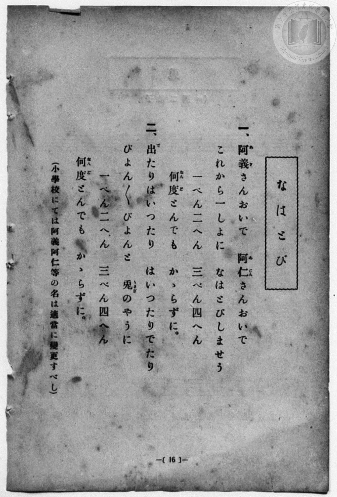
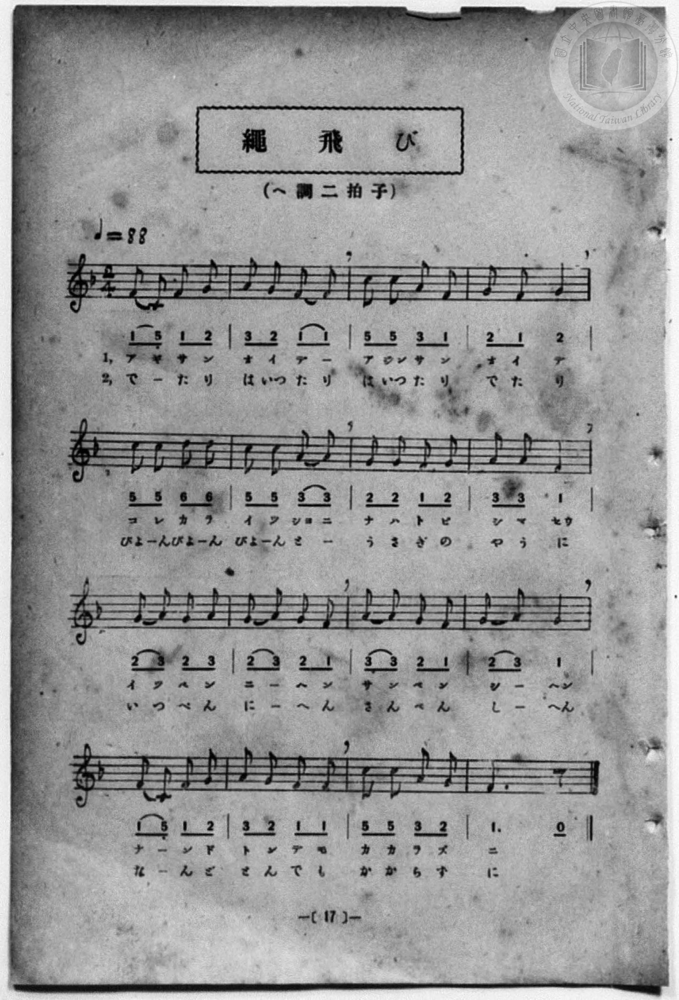

# 繩飛び

> Re:Shōka 使用 AI 協助辨識與重建樂譜，可能會有錯誤。歡迎回報。

- **NEUTRINO 歌聲合成版**：<br><audio controls src="nawatobi_neutrino.mp3"></audio>
- **鋼琴伴奏版**：<br><audio controls src="nawatobi.mp3"></audio>


- 詞：臺灣總督府
- 曲：宮島慎三郎
- 一條慎三郎 編《新編 小學校・公學校 唱歌教材集》（大正十二年十二月，索書號 0725-41）
- 臺灣總督府《公學校唱歌集》（大正四年三月，索書號 0725 26）

## 說明

原書資訊與歌詞全文（對應 P024.jpg–P025.jpg，原書 p. 16–17，尋常科第一、二學年第 8 首）：
調性與拍號：ヘ調二拍子（F 大調 2/4 拍），♩=88
作曲：臺灣總督府國語學校助教授 宮島慎三郎


## 歌詞

```text
一、阿義（あぎ）さんおいで　阿仁（あじん）さんおいで
これから一（いっ）しょに　なはとびしませう
一（いっ）ぺん二（に）へん　三（さん）べん四（し）へん
何度（なんど）とんでも　かゝらずに。

二、出（で）たりはいったり　はいったりでたり
ぴょんぴょんぴょんと　兎（うさぎ）のやうに
一（いっ）ぺん二（に）へん　三（さん）べん四（し）へん
何度（なんど）とんでも　かゝらずに。
（小學校にては阿義阿仁等の名は適當に變更すべし）
```

## ABC

```abc
X:1
T:繩飛び
C:曲：宮島慎三郎
M:2/4
L:1/16
Q:1/4=88
K:F
V:V1 name="Piano" snm="Pia"
[V:V1]
F2 C2 F2 G2 | A2 G2 F2 F2 | c2 c2 A2 F2 | G2 F2 G4 |
w: 1.~あ ぎ さ ん | お い で _ | あ じん さ ん | お い で
w: 2.~で _ た り | は いっ た り | は いっ た り | で た り
c2 c2 d2 d2 | c2 c2 A2 A2 | G2 G2 F2 G2 | A2 A2 F4 |
w: 1.~こ れ か ら | い っ しょ に | な は と び | し ま せう
w: 2.~ぴょ ん ぴょ ん | ぴょ ん と _ | う さ ぎ の | や う に
G2 A2 G2 A2 | G2 A2 G2 F2 | A2 A2 G2 F2 | G2 A2 F4 |
w: 1.~い っ ぺ ん | に _ へ ん | さ ん べ ん | し _ へん
w: 2.~い っ ぺ ん | に _ へ ん | さ ん べ ん | し _ へん
F2 C2 F2 G2 | A2 G2 F2 F2 | c2 c2 A2 G2 | F6 z2 |
w: 1.~な _ ん ど | と ん で も | か か ら ず | に
w: 2.~な _ ん ど | と ん で も | か か ら ず | に
F2 C2 F2 G2 | A2 G2 F2 F2 | c2 c2 A2 F2 | G2 F2 G4 |
w: 1.~あ ぎ さ ん | お い で _ | あ じん さ ん | お い で
w: 2.~で _ た り | は いっ た り | は いっ た り | で た り
c2 c2 d2 d2 | c2 c2 A2 A2 | G2 G2 F2 G2 | A2 A2 F4 |
w: 1.~こ れ か ら | い っ しょ に | な は と び | し ま せう
w: 2.~ぴょ ん ぴょ ん | ぴょ ん と _ | う さ ぎ の | や う に
G2 A2 G2 A2 | G2 A2 G2 F2 | A2 A2 G2 F2 | G2 A2 F4 |
w: 1.~い っ ぺ ん | に _ へ ん | さ ん べ ん | し _ へん
w: 2.~い っ ぺ ん | に _ へ ん | さ ん べ ん | し _ へん
F2 C2 F2 G2 | A2 G2 F2 F2 | c2 c2 A2 G2 | F6 z2 |
w: 1.~な _ ん ど | と ん で も | か か ら ず | に
w: 2.~な _ ん ど | と ん で も | か か ら ず | に
```

## TMD 檔案連結

- [主旋律 TMD 檔案](nawatobi.tmd) [[在 TMD Studio 編輯](https://tmdlang.github.io/Tmd-TS/#tmd=s7IKdvYPcrWy4qpTUCpJTLdSSM7PyUlNLsnMz7MqzsjPTozPrsyvSsyML84ojTe0NDJWgqssy88pzU21Si9KTEmNN4w3QsgU55cWJadaFSdn5OfnxJekVpQk5edno8vHFySmp1oFGBiZIGQKivLLUvMS84C6C4oy80pSU8DaEQpSyzJTUkHSxcmJefFlqUWZaZmpKUiOSi0qBrsdYkVJUWJecXJRZgHIQwhV-UUlGflAhxdkVFplZBaX5BdlJifmxGcn5iUiFJVkpAK9B_VETmZaKrL-zPTMPKuSxMxyoCvy09IykzMTc5S4tLQUnu9c-XLx7MeNmxW0tLgUbRUsLLjsbRXcuGyM9E3sQAY82dHwbNHcZ619T3Z0vmzuU3i-fcXjhq5n0zYAGQpPN_Q_Xbvj2YKFj5t3P21dA2ErPJ2y8dnanmdTZz6bO-Hl7LbHDd3v93Q8XbL82drFT3sbn-zqebpzC4TxbE7H-z09z7csejZ7x4uZ8xUMzI1MdU0M3-_pBDv-xcp57_fMetG-63nj4uc79j6fu_jprjlgmWezNwFlnq5b93TzNrjbIHpQVQPdCncYxF3oLpo9G-gcoAHY3KJgZAZ2C5e-loIttQCXgoLC0775IGs2t79Y0fWiox3oLKBfn7aueDatHeSyDb3P2jsVQGlNL6sg_VHDZCDTFMQEuhCiVaFAT8HQDChjaA4S29D9dMeO58snPl-zBhhhjxvAobx2B9BnQBEFC4WXy6YBPQIMMpDlL1btf9awHGRtdy_Qp0DRx80zgIKgCOnufbp2AtAJbgrA4AGKKQDTgQJQFKy759HMlbbAFAI048neOZA4QAvvp3O6X6yaBw3vrpWgRNDXoYAWUVxgE8DufDlj__N9K4EWPm5setzYB7TmcePUx02THzd2PW5sedy4_HFDA1DNk92NMDUzgLKYykAmPm6c_Lip53Fj9-OmTqDpYA1AucVg1dMfN7U_blwNNO5x46rHjesfN64ApnqQeOO-x43AHNAGdRSqtl1AS4DhAhZcDRbZAbK2oQHoE7AgyBVg8Z1ABjAxgQWnw1VCwmrq013LwBKrwG4G-hcovQLMXv64qQnsKKCr5wId_rhxFtiZTZBA2tUDDKSn7bvAupeD9c1_3AT0NNADIEdCuSADUEWABoMZkIDZAvI9yDpMBjA7NzxtBYY80II2kH-gsbDucRPQOKDI6sEWMECd4EwCK3uAoo3LgP6HpCVIanm-FuSFpxN6QeKNK59P3QZU9mJd17PZWx43zgQ5CuwWkFmU52goUNDS5-LySyxPLMlPyrQKyEzMy3eoMaipBlmiYGOhZQdmYCtKFCD59sXCHgUNE1Cp-nx9gw4o_4MzvSYWDUCrQIbVKBgqmMYDCSMg0xhIGgJhjYIpEBqDWSARIwVdhRqwch_DGmBiaALiPiCeqgAMaKAaYCYC4hYgXg5SCVUByme4FUGMMwKJg_jAtAZU1wVWtx6kDphMCAsuh_NAJuIPnV095IQOKCDMgBAWJMbgIIEECijAQIGEGjhAPzf1AOluIN0JdiXIzyB3g0oQILUaLLgK6qcVQLwZLDIdiPcBMagoQQshUF4DByMSE018BTTk2yBBDo6fdSCRJpD1INHVRATSjk5yAskInHIgQQNJQ5CggbBAYuiBBAuSXXCvgFwHzNhwPiTZAPMZXGQ6RAWIixo6VDAMb6gAyx4qZyyQGChIdBUMUIJlFchVYJeuBLsSmDjAPGA6b2oCiwBTFTRlAYszuF91FeJRQoQyc2q5uHTtFGDlkAIaW5kLAA)]
- [鋼琴伴奏 TMD 檔案](nawatobi_piano.tmd) [[在 TMD Studio 編輯](https://tmdlang.github.io/Tmd-TS/#tmd=s7IKdvYPcrWy4qpTUCpJTLdSSM7PyUlNLsnMz7MqzsjPTozPrsyvSsyML84ojTe0NDJWgqssy88pzU21Si9KTEmNN4w3QsgU55cWJadaFSdn5OfnxJekVpQk5edno8vHFySmp1oFGBiZIGQKivLLUvMS84C6C4oy80pSU8DaEQpSyzJTUkHSxcmJefFlqUWZaZmpKUiOSi0qBrsdYkVJUWJecXJRZgHIQ0pcWloKz3eufLl49uPGze_3dLycPfNZZ_fL7j3PJ2x5smfL06X97_d0KmhpcSnaKlhYcNnbKrhx2Rjpm9iBjH-yo-HZornPWvue7Oh82dyn8Hz7iscNXc-mbQAyFJ5u6H-6dsezBQsfN-9-2roGwlZ4OmXjs7U9z6bOfDZ3wsvZbY8buoGWPl2y_NnaxU97G5_s6nm6cwuE8WxOx_s9Pc-3LHo2e8eLmfMVDMyNTHVNDIHOAXvtxcp57_fMetG-63nj4uc79j6fu_jprjlgmWezNwFlnq5b93TzNrjbIHpQVQPdCncYxF3oLpo9G-gcoAHY3KJgZAZ2C5dfYnliSX5SplVAZmJefpCHQ41BTTWXAhDYWGjZgRn6Wgq26EDh-Zo1wAB8sbBHQcMEFFrP1zfoKADj3lQvqyBdE4sGLX2wYTUKhgqm8UDCCMg0BpKGQFijYAqExmAWSMRIQVehBqzcx7BG4XFjExD3AfFUhcdNk4FqHjd2AXELEC8HqYSqmAGSxKkIYpwRSBzEf9w4H6iuC6xuPUjd48bFhAWXw3kgE_GHzq4eckIHFBBmQAgLEmNwkEACBRRgoEBCDRygn5t6gHQ3kO4EuxLkZ5C7pz9uagdSq8GCq6B-WgHEm8Ei04F4HxADM08bWghtAesEByeciSa-AhrybZAgB8fPOpBIE8h6kOhqIgJpRyc5gWQETjmQoIGkIUjQQFggMfRAggXJLrhXQK573LgDzockm8eNO-Ei0yEqQFzU0KGCYXhDBZhzqZyxQGKgINFVMEAJllUgV4FduhLsSmDiAPOA6bypCSwCTFXQlPW4cRbcr7oK8SghQpk5tejFkA-2Ygjog3iFaMNYMGUaH4sqAKQw-abx8UArQCREA6o5JkDKBJc2sAZsNsGSApIyMMMQrA6bGFQvNlUo5pHiPXQFoGgFBqOunQIsJKN9gDIofCMwX5kLAA)]

## 分析

```text
================================================================================
📊 TMD Song Profile: [ 繩飛び ]
================================================================================
⏱  Duration:       0:43 (43.6s), 32 measures total
🎼 Key & Tempo:    首調基準 F, != 88.0 BPM, <2/4>
   - 分析範圍：      由實際發聲的音符與和弦推測調性；播放脈絡另行呈現
🎤 人聲音域:    C4 (MIDI 60) – D5 (MIDI 74) [跨度: 14 個半音 / 1.2 個八度, 難度: moderate]
   - 最低音:  C4 in [Nawatobi #1 @ m.1, 0:00]
   - 最高音: D5 in [Nawatobi #1 @ m.5, 0:06]
   - 適合: soprano, mezzo-soprano, contralto, tenor, baritone, bass
🏛  結構:      Nawatobi (21.8s) -> Nawatobi (21.8s)
⚡ 編曲密度:        Peak 1 軌道同時演奏
🗝  調性診斷：       F 大調（純淨自然大調，未偵測到可信轉調）
   - 風格氣質:    純淨自然大調（陽光明朗、易唱易記，無明顯調外色彩）
   - 轉調歷程:    全曲維持單一推測調性（未偵測到可信轉調）
   - 核心骨幹音:  F, G, A, C, D
   - 調性數值:    F 大調 [相關度: 0.78, 穩定度: Moderate, 自然音純度: 100.0%]
   - 候選調性 (K-S): F 大調 (0.78), C 大調 (0.64), A 小調 (0.51)
   - 五度圈歷程:   -1 -> -1
   - 各段落調性細節:
     • [Nawatobi #1]: F 大調 (r: 0.78, 自然音純度: 100.0%)
     • [Nawatobi #2]: F 大調 (r: 0.78, 自然音純度: 100.0%)

  [ 五度圈游移軌跡 ]
               C  
        [F ]*          G  
      Bb               D  
      Eb               A  
         Ab           E  
            Db       B  
               F# 
     (* = active key center)

  [ 十二半音累積音高分佈 ]
     C  : ████████████              15.9%
     C# :                            0.0%
     D  : ██                         3.2%
     D# :                            0.0%
     E  :                            0.0%
     F  : ████████████████████████  31.7%
     F# :                            0.0%
     G  : ████████████████████      27.0%
     G# :                            0.0%
     A  : █████████████████         22.2%
     A# :                            0.0%
     B  :                            0.0%
--------------------------------------------------------------------------------
Assignment 軌道音域：
  - Piano         : C4 – D5 (14 個半音 / 1.2 個八度, 116 個音符)
================================================================================
```


## 原書掃描頁






