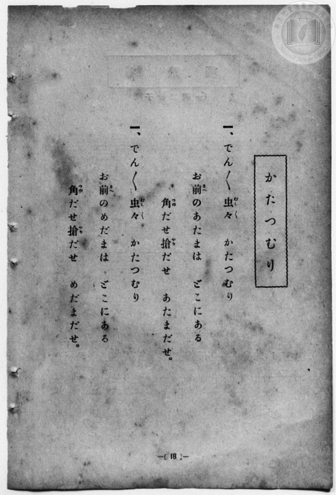
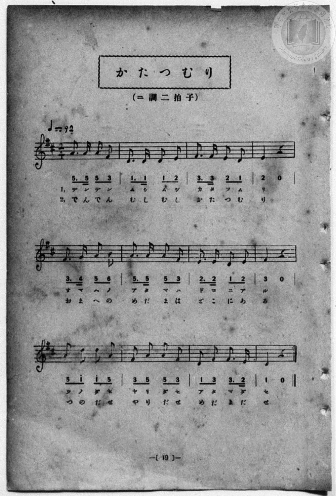

# かたつむり

> Re:Shōka 使用 AI 協助辨識與重建樂譜，可能會有錯誤。歡迎回報。

<audio controls src="katatsumuri.mp3"></audio>

- 詞：文部省《尋常小學唱歌》
- 曲：文部省《尋常小學唱歌》
- 一條慎三郎 編《新編 小學校・公學校 唱歌教材集》（大正十二年十二月，索書號 0725-41）
- 臺灣總督府《公學校唱歌》第一學年用（昭和九年三月第一版、昭和十一年二月第四版，索書號 0729 73）

## 說明

原書資訊與歌詞全文（對應 P026.jpg–P027.jpg，原書 p. 18–19，尋常科第一、二學年第 9 首）：
調性與拍號：ニ調二拍子（D 大調 2/4 拍），♩=92
註：原書左頁（p. 18）第二段歌詞編號誤植為「一、」。


## 歌詞

```text
一、でん／＼虫（むし）々（むし）　かたつむり
お前（まへ）のあたまは　どこにある
角（つの）だせ槍（やり）だせ　あたまだせ。

二、でん／＼虫（むし）々（むし）　かたつむり
お前（まへ）のめだまは　どこにある
角（つの）だせ槍（やり）だせ　めだまだせ。
```

## ABC

```abc
X:1
T:かたつむり
C:曲：文部省《尋常小學唱歌》
M:2/4
L:1/16
Q:1/4=92
K:D
V:V1 name="Piano" snm="Pia"
[V:V1]
A3 A A2 F2 | D3 D D2 E2 | F3 F E2 D2 | E4 z4 |
w: で ん で ん | む し む し | か た つ む | り
F3 G A2 B2 | A3 A A2 F2 | E3 E D2 E2 | F4 z4 |
w: お ま へ の | あ た ま は | ど こ に あ | る
A2 d2 d2 A2 | F2 A2 A2 F2 | D2 F2 F3 E | D4 z4 |
w: つ の だ せ | や り だ せ | あ た ま だ | せ
A3 A A2 F2 | D3 D D2 E2 | F3 F E2 D2 | E4 z4 |
w: で ん で ん | む し む し | か た つ む | り
F3 G A2 B2 | A3 A A2 F2 | E3 E D2 E2 | F4 z4 |
w: お ま へ の | め だ ま は | ど こ に あ | る
A2 d2 d2 A2 | F2 A2 A2 F2 | D2 F2 F3 E | D4 z4 |
w: つ の だ せ | や り だ せ | め だ ま だ | せ
```

## TMD 檔案連結

- [主旋律 TMD 檔案](katatsumuri.tmd) [[在 TMD Studio 編輯](https://tmdlang.github.io/Tmd-TS/#tmd=s7IKdvYPcrWy4qpTUCpJTLdSSM7PyUlNLsnMz7MqzsjPTozPrsyvSsyML84ojTe0NDJWgqssy88pzU21Si9KTEmNN4w3QsgU55cWJadaFSdn5OfnxJekVpQk5edno8vHFySmp1oFGBiZIWQKivLLUvMS84C6C4oy80pSU8DaEQpSyzJTUkHSxcmJefFlqUWZaZmpKUiOSi0qBrsdYkVJUWJecXJRZgHIQwhV-UUlGflAhxdkVFplZBaX5BdlJifmxGcn5iUiFJVkpAK9l5iXmZuYo8SlpaXwuLH7ceP8x41LHjc1PG7qUtDS4lK0VbA04rK3VXDhsjHSN7EDaX6yo-HZornPWvue7Oh82dyn8Hz7iscNXc-mbQAyFJ5u6H-6dsezBQsfN-9-2roGwlZ4OmXjs7U9z6bOfDZ3wsvZbY8but_v6Xi6ZPmztYuf9jY-2dXzdOcWCOPZnI73e3qeb1n0bPaOFzPnKxiYG5nqmhi-39MJdviLlfPe75n1bFr7y-YVz-c0Au19uqH76Y4dEGsh1gBNB6t9NnsT0WpftO963rj4-Y69z-cufrprDkgtzPFwhc_XrAF6HaR155bnU1YAffBsxtqnk3qe7JwLFAEGBtDtEDXPOzseNzRCZEHeAuoCKgB7Dqjg6ezZQAXovrRUMDcG-5JLX0vBllqAS0FB4WnffJA1m9tfrOh60dEO9AwwFJ-2rgCGDCgWNvQ-a-9UACVTvayC9EcNk4FMcxAT6EKIVoUCPQVDC6CMoSVIDByIz5dPhPgV6FFQ_EFCZc0aBUuFl8umAT0CDHqQ5S9W7X_WsBxkbXcv0KdA0cfN3UBBUGh09z5dOwHoBBcFYFIAiikAU5gCUBSsu-fRzJW2wLQHMmPFbqA-iFuebl_2ckEjUBPYTUCVIFcAzVq3FeIvYBoEWvNi1ZJnS3qfN-163NADcePjht7HDU1cIOOgAo3LHzdNfr-n__2ePS9mrgaaCEr1jdOBRj5uaEXlAhkoOQNkyuPGrqedQKd2PG7c97hxB0hd47rHjU1gdUCR9WBtKx83Tn7cuBok3tQN9svySWA9S4CqwXoWPG6c_Ww52KCmFqDZcEGwfrhxEBGoB3YBkyONPNAENBdoF7U8gDAO5gGgEZQnayhQ0NLn4vJOLEksKS7NLS3KtArITMzLd6gxqKkG2aNgY2imZQdmYctTCpAE_GJhj4KGCajger6-QQeUEcCpXxOLBqB1IMNqFEwVdIHQFEwbA3GNgiFYxBBMG4FFQOIgWRAPJFoDZoGgAZSuAZvmY1gDjIvlYBFghELZIBZIDzC-IDKN06FsEAss09gNlZkPxEvAekDyID1d2G0yoodN-MN7Vw854Q0JSxNweJuBbcaMAUjoGmHEAPbwhrgbmDKBeAeYtQ7q1yYkv-4Ds9ZDZVZCZUAhtxrMAqkFhQIkfLCHN06bmhqhMgsosolA-u4kN30bxsEIEA8SmiAWapoHsSDhbATPBdhDHJxuwH4H-RhEzob6qQXEA6ckNBmwr0ExAQk_WGiBZEAqcIU4GTaB4wImRsimWi4uXTsFpHIn2scwVgFdyAgspMwFAA)]
- [鋼琴伴奏 TMD 檔案](katatsumuri_piano.tmd) [[在 TMD Studio 編輯](https://tmdlang.github.io/Tmd-TS/#tmd=s7IKdvYPcrWy4qpTUCpJTLdSSM7PyUlNLsnMz7MqzsjPTozPrsyvSsyML84ojTe0NDJWgqssy88pzU21Si9KTEmNN4w3QsgU55cWJadaFSdn5OfnxJekVpQk5edno8vHFySmp1oFGBiZIWQKivLLUvMS84C6C4oy80pSU8DaEQpSyzJTUkHSxcmJefFlqUWZaZmpKUiOSi0qBrsdYkVJUWJecXJRZgHIQ0pcWloKjxu7HzfOf9y45HFTw-Omrvd7Ol7Onvmss_tl957nE7Y82bPl6dL-93s6FbS0uBRtFSyNuOxtFVy4bIz0TexAljzZ0fBs0dxnrX1PdnS-bO5TeL59xeOGrmfTNgAZCk839D9du-PZgoWPm3c_bV0DYSs8nbLx2dqeZ1NnPps74eXstscN3UBLny5Z_mzt4qe9jU929TzduQXCeDan4_2enudbFj2bvePFzPkKBuZGpromhkDngD34YuW893tmPZvW_rJ5xfM5jUB7n27ofrpjB8RaiDVA08Fqn83eRLTaF-27njcufr5j7_O5i5_umgNSC3M8XOHzNWuAXgdp3bnl-ZQVQB88m7H26aSeJzvnAkWAgQF0O0TN886Oxw2NEFmQt4C6gArAngMqeDp7NlABui8tFcyNwb7k8k4sSSwpLs0tLcq0CshMzMsP8nCoMaip5lIAAhtDMy07MEtfS8EWHShA7H-xsEdBwwQUF8_XN-goANOXuV5WQbomFg1a-mDDahRMFXSB0BRMGwNxjYIhWMQQTBuBRUDiIFkQDyRaA2aBoAGUrgGb5mNYA0xky8Eij5smQ9kgFkgPMNVBZBqnQ9kgFlimsRsqMx-Il4D1gORBerqw22RED5vwh_euHnLCGxKWJuDwNgPbjBkDkNA1wogB7OENcffjxn1AvAPMWgf1axOSX_eBWeuhMiuhMqCQWw1mgdSCQgESPtjDG6dNTY1QmQUU2UQgfXeSm74N42AEiAcJTRALNc2DWJBwNoLnAuwhDk43YL-DfAwiZ0P91ALigVMSmgzY16CYgIQfLLRAMiAVuEKcDJvAcQETI2RTLZZixwe52DGBljrAAIlXiDaMxcowjY8HmglxN0TYBEM-2jQeKoaqEtNIFIVAB-raKSC5MdoHqBBdyAgspMwFAA)]

## 分析

```text
================================================================================
📊 TMD Song Profile: [ かたつむり ]
================================================================================
⏱  Duration:       0:31 (31.3s), 24 measures total
🎼 Key & Tempo:    首調基準 D, != 92.0 BPM, <2/4>
   - 分析範圍：      由實際發聲的音符與和弦推測調性；播放脈絡另行呈現
🎤 人聲音域:    D4 (MIDI 62) – D5 (MIDI 74) [跨度: 12 個半音 / 1.0 個八度, 難度: easy]
   - 最低音:  D4 in [Katatsumuri[L1] #1 @ m.2, 0:01]
   - 最高音: D5 in [Katatsumuri[L1] #1 @ m.9, 0:10]
   - 適合: soprano, mezzo-soprano, contralto, tenor, baritone, bass
🏛  結構:      Katatsumuri[L1] (15.7s) -> Katatsumuri[L2] (15.7s)
⚡ 編曲密度:        Peak 1 軌道同時演奏
🗝  調性診斷：       D 大調（純淨自然大調，未偵測到可信轉調）
   - 風格氣質:    純淨自然大調（陽光明朗、易唱易記，無明顯調外色彩）
   - 轉調歷程:    全曲維持單一推測調性（未偵測到可信轉調）
   - 核心骨幹音:  F#, A, D, E, B
   - 調性數值:    D 大調 [相關度: 0.81, 穩定度: Moderate, 自然音純度: 100.0%]
   - 候選調性 (K-S): D 大調 (0.81), F# 小調 (0.74), A 大調 (0.72)
   - 五度圈歷程:   +2 -> +2
   - 各段落調性細節:
     • [Katatsumuri[L1] #1]: D 大調 (r: 0.81, 自然音純度: 100.0%)
     • [Katatsumuri[L2] #1]: D 大調 (r: 0.81, 自然音純度: 100.0%)

  [ 五度圈游移軌跡 ]
               C  
         F            G  
      Bb              [D ]*
      Eb               A  
         Ab           E  
            Db       B  
               F# 
     (* = active key center)

  [ 十二半音累積音高分佈 ]
     C  :                            0.0%
     C# :                            0.0%
     D  : ████████████████████      23.8%
     D# :                            0.0%
     E  : ███████████████           17.9%
     F  :                            0.0%
     F# : ████████████████████████  28.6%
     G  : █                          1.2%
     G# :                            0.0%
     A  : ██████████████████████    26.2%
     A# :                            0.0%
     B  : ██                         2.4%
--------------------------------------------------------------------------------
Assignment 軌道音域：
  - Piano         : D4 – D5 (12 個半音 / 1.0 個八度, 78 個音符)
================================================================================
```


## 原書掃描頁






