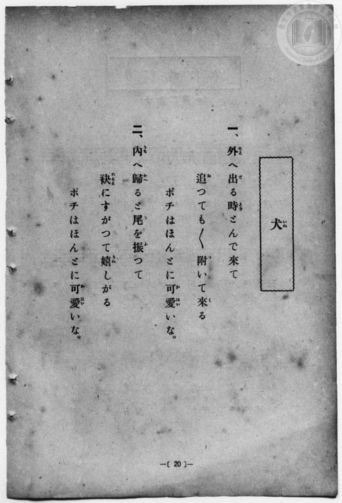
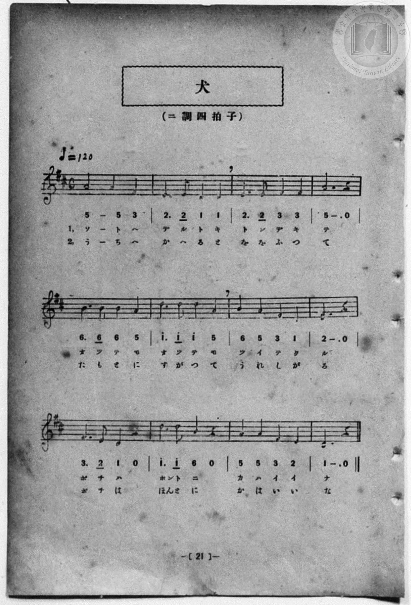

# 犬

> Re:Shōka 使用 AI 協助辨識與重建樂譜，可能會有錯誤。歡迎回報。

- **NEUTRINO 歌聲合成版**：<br><audio controls src="inu_neutrino.mp3"></audio>
- **鋼琴伴奏版**：<br><audio controls src="inu.mp3"></audio>


- 詞：文部省
- 曲：文部省
- 一條慎三郎 編《新編 小學校・公學校 唱歌教材集》（大正十二年十二月，索書號 0725-41）
- 臺灣總督府《公學校唱歌集》（大正四年三月，索書號 0725 26）

## 說明

原書資訊與歌詞全文（對應 P028.jpg–P029.jpg，原書 p. 20–21，尋常科第一、二學年第 10 首）：
調性與拍號：ニ調四拍子（D 大調 4/4 拍），♩=120（採自文部省《尋常小學唱歌》第一學年〈犬〉）


## 歌詞

```text
一、外（そと）へ出（で）る時（とき）とんで來（き）て
追（お）つても／＼附（つ）いて來（く）る
ポチはほんとに可愛（かはい）いな。

二、內（うち）へ歸（かへ）ると尾（を）を振（ふ）つて
袂（たもと）にすがつて嬉（うれ）しがる
ポチはほんとに可愛（かはい）いな。
```

## ABC

```abc
X:1
T:犬
C:曲：文部省
M:4/4
L:1/16
Q:1/4=120
K:D
V:V1 name="Piano" snm="Pia"
[V:V1]
A8 A4 F4 | E6 E2 D4 D4 | E6 E2 F4 F4 | A12 z4 |
w: 1.~そ と へ | で る と き | と ん で き | て
w: 2.~う ち へ | か へ る と | を を ふ っ | て
B6 B2 B4 A4 | d6 d2 d4 A4 | B4 A4 F4 D4 | E12 z4 |
w: 1.~お っ て も | お っ て も | つ い て く | る
w: 2.~た も と に | す が っ て | う れ し が | る
F6 E2 D4 z4 | d6 d2 B4 z4 | A4 A4 F4 E4 | D12 z4 |
w: 1.~ポ チ は | ほん と に | か は い い | な
w: 2.~ポ チ は | ほん と に | か は い い | な
A8 A4 F4 | E6 E2 D4 D4 | E6 E2 F4 F4 | A12 z4 |
w: 1.~そ と へ | で る と き | と ん で き | て
w: 2.~う ち へ | か へ る と | を を ふ っ | て
B6 B2 B4 A4 | d6 d2 d4 A4 | B4 A4 F4 D4 | E12 z4 |
w: 1.~お っ て も | お っ て も | つ い て く | る
w: 2.~た も と に | す が っ て | う れ し が | る
F6 E2 D4 z4 | d6 d2 B4 z4 | A4 A4 F4 E4 | D12 z4 |
w: 1.~ポ チ は | ほん と に | か は い い | な
w: 2.~ポ チ は | ほん と に | か は い い | な
```

## TMD 檔案連結

- [主旋律 TMD 檔案](inu.tmd) [[在 TMD Studio 編輯](https://tmdlang.github.io/Tmd-TS/#tmd=s7IKdvYPcrWy4qpTUCpJTLdSSM7PyUlNLsnMz7MqzsjPTozPrsyvSsyML84ojTe0NDJWgqssy88pzU21Si9KTEmNN4w3QsgU55cWJadaFSdn5OfnxJekVpQk5edno8vHFySmp1oFGBhZIGQKivLLUvMS84C6C4oy80pSU8DaEQpSyzJTUkHSxcmJefFlqUWZaZmpKUiOSi0qBrsdYkVJUWJecXJRZgHIQwhV-UUlGflAhxdkVFplZBaX5BdlJifmxGcn5iUiFJVkpAK9l5iXmZuYg6w1Mz0zzyo3Py-pFBhASlxaWgrPu9YoaGlxKdoqGBoZcNnbKrhw2Zjom9iBND3Z0fBs0dxnrX1PdnS-bO5TeL59xeOGrmfTNgAZCk839D9du-PZgoWPm3c_bV0DYSs8nbLx2dqeZ1NnPps74eXstscN3e_3dDxdsvzZ2sVPexuf7Op5unMLhPFsTsf7PT3Ptyx6NnvHi5nzFQzMjUx1TQzf7-kEO_jFynnv98x6Nq39ZfOK53MawWLPZm_CEHvRvut54-LnO_Y-n7v46a45QPfBHQNxC7orZs8GOgHoIWz2KxiZge3n0tdSsKUW4FJQUHjaNx9kzeb2Fyu6XnS0A50F9N_T1hVAv4BctqH3WXunAig56WUVpD9qmAxkWoKYQBdCtCoU6CkYGQBljIAh1PN0Q_fTHTueL5_4fM0aYCQ9bgCH7NodQJ8BRRQMDRReLpsG9AkwtEC2v1i1_1nDcpC93b1ArwJFHzd3AwWBYQEUebp2AtANLgrA8AGKKQAjXwEoCtbd82jmSltgugDKP-tb-KJ9FTzsQeEMdgQkGUCCGhjOEAdBnPK4oQOYuh43AA3q5AK5A-LUp0uATut43Dj3ceMKoMzjxh1P23eBRZaDuE3dz2Y2gbkrHjeCnAFiNE0Gyj7Z1wYWhwguA_ts_16wUBdYaAlQ9HETUHP_-z17Xs5sAUstAUu1AKVg-oGyIGtA-h83z33c3Pi4cf3jxt1gS4B2rn7av_5Zy2yw0m6wFNAgiBGrHjc0QXyyC-jZxqetQBcDVbU9blwI8cmztTtg-oAMkC1AI59u2AcSbJoEFpn0rGc9WM1WuJvBPlkE8fR8oAdgAbP6cePMx409EEVP1wDDEWxZUw9YdjpIinxvALVRnrahQEFLn4vLM6_UKiAzMS_focagphpkvoKNhZYdmIEtPylA0sqLhT0KGiag4uT5-gYdUCYAp3xNLBqAtoAMq1EwVdAFQxBtDMQ1CkZgvpGCIZAEYYQISB6iBqYLBA1AImDTfAxrFICJESoODDowuQOsA5joIKJN3XCZXqgMiAeSmQxVhZBZhmRPPMIeI5BcG9yehSj2dENFd4DtgrkDKNM0CWrPJKDYVrDMYpz24A_rXT3khLUZ2HwzMA0KwRoFwziwEJACsyCCMGlQUCNHAPbg7oJ6dzHUG8BED_UUbpklYPEWMAmWaeyHBhEk8LAH-Hxo8DXBI3A11LyZUJt6oEEKMRUWScBcBhabDlWDyyYCybuTnCAHhSEsMYNDDinIQeEMEQOFNizEQWENVIU7xJshCRxYSgB9sx7meiAbVF5AA2IFNHBgUpB0CFIMC3YQCZJZhTvAaW1RLReXrp0CsKxRQFDKXAA)]
- [鋼琴伴奏 TMD 檔案](inu_piano.tmd) [[在 TMD Studio 編輯](https://tmdlang.github.io/Tmd-TS/#tmd=s7IKdvYPcrWy4qpTUCpJTLdSSM7PyUlNLsnMz7MqzsjPTozPrsyvSsyML84ojTe0NDJWgqssy88pzU21Si9KTEmNN4w3QsgU55cWJadaFSdn5OfnxJekVpQk5edno8vHFySmp1oFGBhZIGQKivLLUvMS84C6C4oy80pSU8DaEQpSyzJTUkHSxcmJefFlqUWZaZmpKUiOSi0qBrsdYkVJUWJecXJRZgHIQ0pcWloKz7vWvN_T8XL2zGed3S-79zyfsOXJni1Pl_a_39OpoKXFpWirYGhkwGVvq-DCZWOib2IHMvnJjoZni-Y-a-17sqPzZXOfwvPtKx43dD2btgHIUHi6of_p2h3PFix83Lz7aesaCFvh6ZSNz9b2PJs689ncCS9ntz1u6Aba-nTJ8mdrFz_tbXyyq-fpzi0QxrM5He_39DzfsujZ7B0vZs5XMDA3MtU1MQS6B-yrFyvnvd8z69m09pfNK57PaQSLPZu9CUPsRfuu542Ln-_Y-3zu4qe75gDdB3cMxC3orpg9G-gEoIew2a9gZAa2n8szr9QqIDMxLz_Iw6HGoKaaSwEIbCy07MAMfS0FW3Sg8HzNGmB4vVjYo6BhAgqc5-sbdBSAsWypl1WQrolFg5Y-2LAaBVMFXTAE0cZAXKNgBOYbKRgCSRBGiIDkIWpgukDQACQCNs3HsEbhceNcqPjjxhVgcgdYx-PG5RDRpm64TC9UBsQDyUyGqkLILEOyJx5hjxFIrg1uz0IUe7qhojvAdsHcAZRpmgS1ZxJQbCtYZjFOe_CH9a4ecsLaDGy-GZgGhWCNgmEcWAhIgVkQQZg0KKiRIwB7cHdBvbsY6o3HTU1QT-GWWQIWbwGTYJnGfmgQQQIPe4DPhwZfEzwCV0PNmwm1qQcapBBTYZH0uKkHLDYdqgaXTQSSdyc5QQ4KQ1hiBoccUpCDwhkiBgptWIiDwhqoCneIN0MS-OPmRqBv1sNcD2TvBqVgWMqHBA5MCpIOQYphwQ4iQTKrcAc4rS2qRSpqfJCLGhNoUQMMhniFaMNYGAUMqHggyzSeOBEQwwDqoRoFE6CoCZIyQnwcxoDkodYBBWG6gBSIB9UM14rsAZARQB_r2ikAPR3tAxSEMY3ATGUuAA)]

## 分析

```text
================================================================================
📊 TMD Song Profile: [ 犬 ]
================================================================================
⏱  Duration:       0:48 (48.0s), 24 measures total
🎼 Key & Tempo:    首調基準 D, != 120.0 BPM, <4/4>
   - 分析範圍：      由實際發聲的音符與和弦推測調性；播放脈絡另行呈現
🎤 人聲音域:    D4 (MIDI 62) – D5 (MIDI 74) [跨度: 12 個半音 / 1.0 個八度, 難度: easy]
   - 最低音:  D4 in [Inu #1 @ m.2, 0:03]
   - 最高音: D5 in [Inu #1 @ m.6, 0:10]
   - 適合: soprano, mezzo-soprano, contralto, tenor, baritone, bass
🏛  結構:      Inu (24.0s) -> Inu (24.0s)
⚡ 編曲密度:        Peak 1 軌道同時演奏
🗝  調性診斷：       D 大調（純淨自然大調，未偵測到可信轉調）
   - 風格氣質:    純淨自然大調（陽光明朗、易唱易記，無明顯調外色彩）
   - 轉調歷程:    全曲維持單一推測調性（未偵測到可信轉調）
   - 核心骨幹音:  D, A, E, F#, B
   - 調性數值:    D 大調 [相關度: 0.86, 穩定度: Moderate, 自然音純度: 100.0%]
   - 候選調性 (K-S): D 大調 (0.86), A 大調 (0.79), F# 小調 (0.55)
   - 五度圈歷程:   +2 -> +2
   - 各段落調性細節:
     • [Inu #1]: D 大調 (r: 0.86, 自然音純度: 100.0%)
     • [Inu #2]: D 大調 (r: 0.86, 自然音純度: 100.0%)

  [ 五度圈游移軌跡 ]
               C  
         F            G  
      Bb              [D ]*
      Eb               A  
         Ab           E  
            Db       B  
               F# 
     (* = active key center)

  [ 十二半音累積音高分佈 ]
     C  :                            0.0%
     C# :                            0.0%
     D  : ████████████████████████  27.9%
     D# :                            0.0%
     E  : █████████████████         19.8%
     F  :                            0.0%
     F# : █████████████             15.1%
     G  :                            0.0%
     G# :                            0.0%
     A  : ██████████████████████    25.6%
     A# :                            0.0%
     B  : ██████████                11.6%
--------------------------------------------------------------------------------
Assignment 軌道音域：
  - Piano         : D4 – D5 (12 個半音 / 1.0 個八度, 72 個音符)
================================================================================
```


## 原書掃描頁






