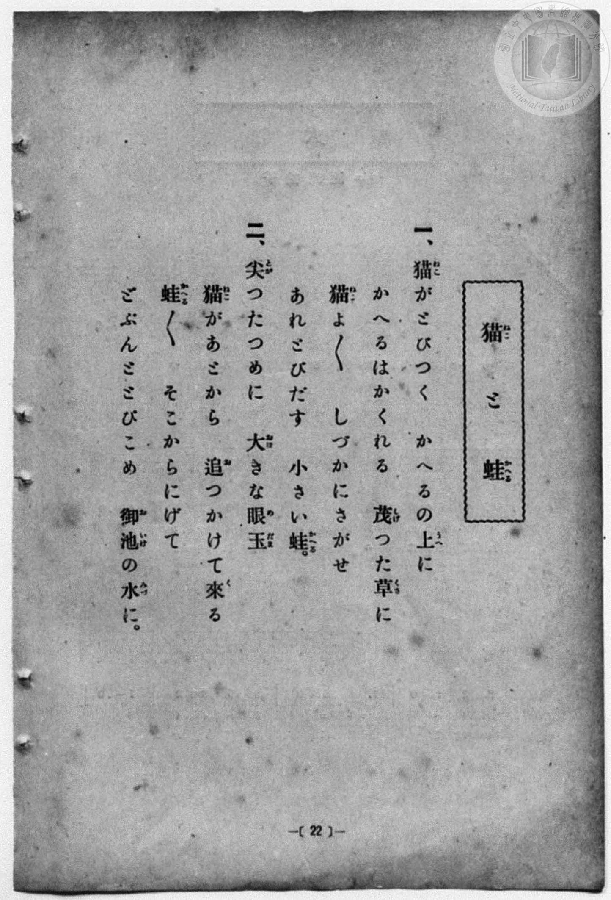
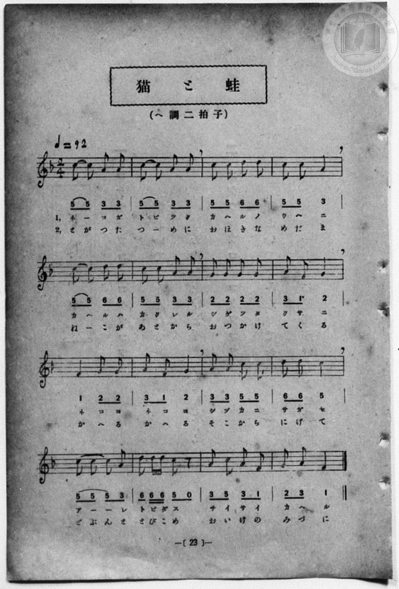

# 猫と蛙

> Re:Shōka 使用 AI 協助辨識與重建樂譜，可能會有錯誤。歡迎回報。

<audio controls src="neko_to_kaeru.mp3"></audio>

- 詞：臺灣總督府
- 曲：宮島慎三郎
- 一條慎三郎 編《新編 小學校・公學校 唱歌教材集》（大正十二年十二月，索書號 0725-41）
- 臺灣總督府《公學校唱歌集》（大正四年三月，索書號 0725 26）

## 說明

原書資訊與歌詞全文（對應 P030.jpg–P031.jpg，原書 p. 22–23，尋常科第一、二學年第 11 首）：
調性與拍號：ヘ調二拍子（F 大調 2/4 拍），♩=92
作曲：臺灣總督府國語學校助教授 宮島慎三郎


## 歌詞

```text
一、猫（ねこ）がとびつく　かへるの上（うへ）に
かへるはかくれる　茂（しげ）つた草（くさ）に
猫（ねこ）よ／＼　しづかにさがせ
あれとびだす　小（ちい）さい蛙（かへる）。

二、尖（とが）つたつめに　大（おほ）きな眼玉（めだま）
猫（ねこ）があとから　追（お）つかけて來（く）る
蛙（かへる）／＼　そこからにげて
どぶんととびこめ　御池（おいけ）の水（みづ）に。
```

## ABC

```abc
X:1
T:猫と蛙
C:曲：宮島慎三郎
M:2/4
L:1/16
Q:1/4=92
K:F
V:V1 name="Piano" snm="Pia"
[V:V1]
c2 c2 A2 A2 | c2 c2 A2 A2 | c2 c2 d2 d2 | c2 c2 A4 |
w: ね _ こ が | と び つ く | か へ る の | う へ に
c2 c2 d2 d2 | c2 c2 A2 A2 | G2 G2 G2 G2 | A2 F2 G4 |
w: か へ る は | か く れ る | し げ っ た | く さ に
F4 G2 G2 | A4 F2 G2 | A2 A2 c2 c2 | d2 d2 c4 |
w: ね こ よ | ね こ よ | し づ か に | さ が せ
c2 c2 c2 A2 | d2 d d c2 z2 | A2 c2 A2 F2 | G2 A2 F4 |
w: あ _ _ れ | と び だ す | ち い さ い | か へ る
c2 c2 A2 A2 | c2 c2 A2 A2 | c2 c2 d2 d2 | c2 c2 A4 |
w: と が っ た | つ _ め に | お ほ き な | め だ ま
c2 c2 d2 d2 | c2 c2 A2 A2 | G2 G2 G2 G2 | A2 F2 G4 |
w: ね _ こ が | あ と か ら | お っ か け | て く る
F4 G2 G2 | A4 F2 G2 | A2 A2 c2 c2 | d2 d2 c4 |
w: か へ る | か へ る | そ こ か ら | に げ て
c2 c2 c2 A2 | d2 d d c2 z2 | A2 c2 A2 F2 | G2 A2 F4 |
w: ど ぶ ん と | と び こ め | お い け の | み づ に
```

## TMD 檔案連結

- [主旋律 TMD 檔案](neko_to_kaeru.tmd) [[在 TMD Studio 編輯](https://tmdlang.github.io/Tmd-TS/#tmd=s7IKdvYPcrWy4qpTUCpJTLdSSM7PyUlNLsnMz7MqzsjPTozPrsyvSsyML84ojTe0NDJWgqssy88pzU21Si9KTEmNN4w3QsgU55cWJadaFSdn5OfnxJekVpQk5edno8vHFySmp1oFGBgbIGQKivLLUvMS84C6C4oy80pSU8DaEQpSyzJTUkHSxcmJefFlqUWZaZmpKUiOSi0qBrsdYkVJUWJecXJRZgHIQwhV-UUlGflAhxdkVFplZBaX5BdlJifmxGcn5iUiFJVkpAK9l5iXmZuYo8SlpaXwvGf148YVL2bPVNDS4lK0VbA04rK3VXDjsjHSN7EDaXuyo-HZornPWvue7Oh82dyn8Hz7iscNXc-mbQAyFJ5u6H-6dsezBQsfN-9-2roGwlZ4OmXjs7U9z6bOfDZ3wsvZbY8but_v6Xi6ZPmztYuf9jY-2dXzdOcWCOPZnI73e3qeb1n0bPaOFzPnKxiYG5nqmhi-39MJdvKLlfPe75n1on3X88bFz3fsfT538dNdc8Ayz2ZvAso8Xbfu6eZtcLdB9KCqBroV7jCIu9BdNHs20DlAA7C5RcHIDOwWLn0tBVtqAS4FBYWnffNB1mxuf7Gi60VHO9BZQL8-bV3xbFo7yGUbep-1dyqAkpFeVkH6o4bJQKYhiAl0IUSrQoGegpERUMbIGCS2ofvpjh3Pl098vmYNMMIeN4BDee0OoM-AIgqGhgovl00D-gQYZiDbX6za_6xhOcje7l6gV4Gij5tnAAVBMdLd-3TtBKAb3BSA4QMUUwAmBAWgKFh3z6OZK22BSQRoxpO9cyCRgBbgT-d0v1g1DxrgXStBqaCvQwEtprjAJoAdCkyAQNseN6593DgZaMfjxh5genzcuPlx45LHjf2PGxoeN3Y_btzxuAlIrnuyowusuA0oAla8GmQQkor1YHb_46YeELeh4UVPE1jD9MeNk8AagIbOf9EL9ApQsP9x41SEKegOaQImh_73e_aAnQDUvxRsNDC3TAW7cTbE5iaQVVAHL3jcOBOoGpgpwAYtfNzYAjYeqKEFmMPAglCXgsQbmiDBsKsHGAxPNwDjBygPNKkH7lAQ2dQIshRo6pLlYAVdjxt3gxX0Pm5c9XzOnud9YM-AlAHt3weUwuYZkIubwKZ3P24CWt3wYv9eiHEwy4AOm_i4cdmTfW2QsAEHQTc4tWA4HSlg5gItgBoKCptJQCMgAbPyceO2x01AOaCdkOCZDHIk0CP7Fj7buADmlxagtWAnrHu2YQtYcD8wqCGxAgohoFmU5zgoUNDS5-LyTczMswrITMzLd6gxqKkGWaBgY2imZQdmYcvnCpBM9WJhj4KGCajIe76-QQeUOcE5UhOLBqA9IMNqFEwVdMHYGIrxiZhBMaoaEKwBm-ZjWAMM1rVQMWBwgskesA5gEIN5m8HkEjDZD5XpBvN2gMgmCHsdVKYNIdO4GtUuI4SZIBseNy4Gk_OhOkE2gF3R1AjXDRLvAvN2g8leMLkKIgNVtwBM7oPbhT_Md_VQEubYwxMS5kZAEhnXgMUNoTz0MMcMwfUoYQsKaWAxAJcHyUwHy0zCEnZg1Y1TcYY6rhhuAvMgcQK2t6kTJdQhtkBcNBEqswzJfSAZYkJ9Ryc5oQ4KOxBEDVEQhIUqRASEYfFRA48jEI9ASm_qgPoJlzgkxJcihQIsVULCGpKOZ2MJcVjIIMcxPvG5SLGDGhMgG2GxDgp7IsIb2P6gJJXD0jUsLM3AIgbw8IbJg2IBku5hPPTwBqUvGISkZuRyBZR3gdUbkBcPlVkIlmkBk5AQBrGx5Rf08F4Jlt8GloeEIsgWVNsmQ8sMmG2QNA6xDZS6EaXYfjAPEu-I_FTLxaVrpwAq7KN9DGMV4GwjMFuZCwA)]
- [鋼琴伴奏 TMD 檔案](neko_to_kaeru_piano.tmd) [[在 TMD Studio 編輯](https://tmdlang.github.io/Tmd-TS/#tmd=s7IKdvYPcrWy4qpTUCpJTLdSSM7PyUlNLsnMz7MqzsjPTozPrsyvSsyML84ojTe0NDJWgqssy88pzU21Si9KTEmNN4w3QsgU55cWJadaFSdn5OfnxJekVpQk5edno8vHFySmp1oFGBgbIGQKivLLUvMS84C6C4oy80pSU8DaEQpSyzJTUkHSxcmJefFlqUWZaZmpKUiOSi0qBrsdYkVJUWJecXJRZgHIQ0pcWloKz3tWP25c8WL2zPd7Ol7Onvmss_tl957nE7Y82bPl6dL-93s6FbS0uBRtFSyNuOxtFdy4bIz0TexAxj_Z0fBs0dxnrX1PdnS-bO5TeL59xeOGrmfTNgAZCk839D9du-PZgoWPm3c_bV0DYSs8nbLx2dqeZ1NnPps74eXstscN3UBLny5Z_mzt4qe9jU929TzduQXCeDan4_2enudbFj2bvePFzPkKBuZGpromhkDngL32YuW893tmvWjf9bxx8fMde5_PXfx01xywzLPZm4AyT9ete7p5G9xtED2oqoFuhTsM4i50F82eDXQO0ABsblEwMgO7hcs3MTPPKiAzMS8_yMOhxqCmmksBCGwMzbTswCx9LQVbdKDwfM0aYOi9WNijoGECCqrn6xt0FAIMDM30sgrSNbFo0NIHG1ajYKqgC8bGUIxPxAyKUdWAYA3YNB_DGoXHjWuhYo8bJ4PJHrAOYJIA8zaDySVgsh8q0w3m7QCRTRD2OqhMG0KmcTWqXUYIM0E2PG5cDCbnQ3WCbAC7oqkRrhsk3gXm7QaTvWByFUQGqm4BmNwHtwt_mO_qoSTMsYcnJMyNgCQyrgGLG0J56GGOGYLrUcIWFNKPm8DhBJYHyUwHy0zCEnZg1Y1TcYY6rhhuAvMgcQK2t6kTJdQhtkBcNBEqswzJfSAZYkJ9Ryc5oQ4KOxBEDVEQhIUqRASEYfFRA48jEI9ASm_qgPoJlzgkxJcihQIsVULCGpKOZ2MJcVjIIMcxPvG5SLGDGhMgG2GxDgp7IsIbWG5Rksph6RoWlmZgEQN4eMPkQbEASfcwHnp4g9IXDEJSM3K5Asq7jxtnAnnxUJmFYJkWMAkJYRAbW35BD--VYPltYHlIKIJsQbVtMrTMgNkGSeMQ20CpG1GK7QfzIPGOyE-1yGW9D3JZbwEt6msUog1jgWohJA6eCRY5VN3YVChEG8XngvlQGi5vGo_FCKggfveA7cHqAgwVBphyECtg2oGBo2unAAqfaB-QEIxtBGYrcwEA)]

## 分析

```text
================================================================================
📊 TMD Song Profile: [ 猫と蛙 ]
================================================================================
⏱  Duration:       0:41 (41.7s), 32 measures total
🎼 Key & Tempo:    首調基準 F, != 92.0 BPM, <2/4>
   - 分析範圍：      由實際發聲的音符與和弦推測調性；播放脈絡另行呈現
🎤 人聲音域:    F4 (MIDI 65) – D5 (MIDI 74) [跨度: 9 個半音 / 0.8 個八度, 難度: easy]
   - 最低音:  F4 in [Main[L1] #1 @ m.8, 0:09]
   - 最高音: D5 in [Main[L1] #1 @ m.3, 0:03]
   - 適合: soprano, mezzo-soprano, contralto, tenor, baritone, bass
🏛  結構:      Main[L1] (20.9s) -> Main[L2] (20.9s)
⚡ 編曲密度:        Peak 1 軌道同時演奏
🗝  調性診斷：       C 調性不明確（純淨自然大調，未偵測到可信轉調）
   - 風格氣質:    純淨自然大調（陽光明朗、易唱易記，無明顯調外色彩）
   - 轉調歷程:    全曲維持單一推測調性（未偵測到可信轉調）
   - 核心骨幹音:  C, A, G, D, F
   - 調性數值:    C 調性不明確 [相關度: 0.78, 穩定度: Ambiguous, 自然音純度: 100.0%]
   - 候選調性 (K-S): C 大調 (0.78), A 小調 (0.77), F 大調 (0.67)
   - 五度圈歷程:   +0 -> +0
   - 各段落調性細節:
     • [Main[L1] #1]: C 調性不明確 (r: 0.78, 自然音純度: 100.0%)
     • [Main[L2] #1]: C 調性不明確 (r: 0.78, 自然音純度: 100.0%)

  [ 五度圈游移軌跡 ]
              [C ]*
         F            G  
      Bb               D  
      Eb               A  
         Ab           E  
            Db       B  
               F# 
     (* = active key center)

  [ 十二半音累積音高分佈 ]
     C  : ████████████████████████  33.3%
     C# :                            0.0%
     D  : █████████                 12.7%
     D# :                            0.0%
     E  :                            0.0%
     F  : ████████                  11.1%
     F# :                            0.0%
     G  : ███████████               15.9%
     G# :                            0.0%
     A  : ███████████████████       27.0%
     A# :                            0.0%
     B  :                            0.0%
--------------------------------------------------------------------------------
Assignment 軌道音域：
  - Piano         : F4 – D5 (9 個半音 / 0.8 個八度, 116 個音符)
================================================================================
```


## 原書掃描頁






