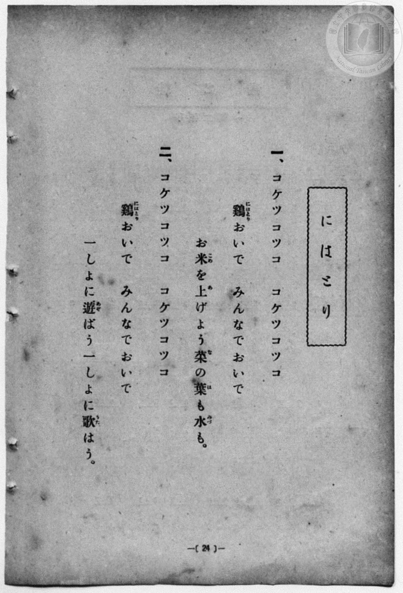
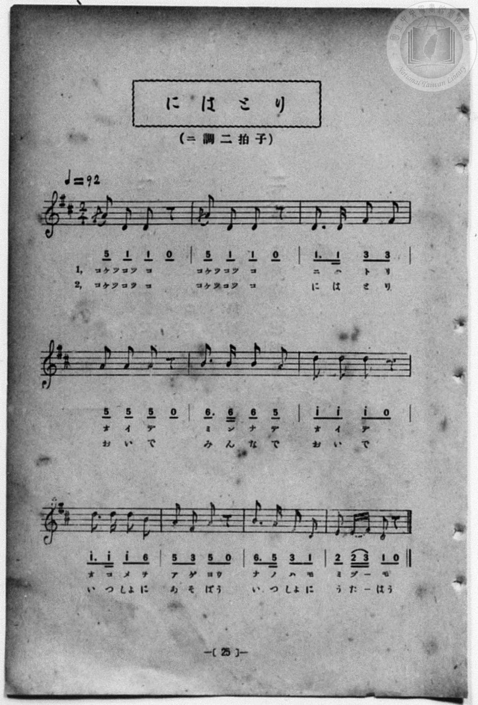

# 鶏

> Re:Shōka 使用 AI 協助辨識與重建樂譜，可能會有錯誤。歡迎回報。

- **鋼琴伴奏版**：<br><audio controls src="niwatori.mp3"></audio>
- **NEUTRINO 歌聲合成版**：<br><audio controls src="niwatori_neutrino.mp3"></audio>

- 一條慎三郎 編《新編 小學校・公學校 唱歌教材集》（大正十二年十二月，索書號 0725-41）

## 說明

原書資訊與歌詞全文（對應 P032.jpg–P033.jpg，原書 p. 24–25，尋常科第一、二學年第 12 首）：
原書曲名表記：にはとり
調性與拍號：ニ調二拍子（D 大調 2/4 拍），♩=92
註：第 1、2 小節首拍五線譜附有 F#4（3）裝飾音。


## 歌詞

```text
一、コケツコツコ　コケツコツコ
鷄（にはとり）おいで　みんなでおいで
お米（こめ）を上（あ）げよう菜（な）の葉（は）も水（みづ）も。

二、コケツコツコ　コケツコツコ
鷄（にはとり）おいで　みんなでおいで
一しよに遊（あそ）ばう一しよに歌（うた）はう。
```

## ABC

```abc
X:1
T:鶏
M:2/4
L:1/16
Q:1/4=92
K:D
V:V1 name="Piano" snm="Pia"
[V:V1]
A2 D2 D2 z2 | A2 D2 D2 z2 | D3 D F2 F2 | A2 A2 A2 z2 |
w: 1.~こけっ こっ こ | こけっ こっ こ | に は と り | お い で
w: 2.~こけっ こっ こ | こけっ こっ こ | に は と り | お い で
B3 B B2 A2 | d2 d2 d2 z2 | d3 d d2 B2 | A2 F2 A2 z2 |
w: 1.~み ん な で | お い で | お こ め を | あ げ よう
w: 2.~み ん な で | お い で | い っ しょ に | あ そ ばう
B3 A F2 D2 | E2 E F D2 z2 | A2 D2 D2 z2 | A2 D2 D2 z2 |
w: 1.~な の は も | み づ _ も | こけっ こっ こ | こけっ こっ こ
w: 2.~い っ しょ に | う た _ はう | こけっ こっ こ | こけっ こっ こ
D3 D F2 F2 | A2 A2 A2 z2 | B3 B B2 A2 | d2 d2 d2 z2 |
w: 1.~に は と り | お い で | み ん な で | お い で
w: 2.~に は と り | お い で | み ん な で | お い で
d3 d d2 B2 | A2 F2 A2 z2 | B3 A F2 D2 | E2 E F D2 z2 |
w: 1.~お こ め を | あ げ よう | な の は も | み づ _ も
w: 2.~い っ しょ に | あ そ ばう | い っ しょ に | う た _ はう
```

## TMD 檔案連結

- [主旋律 TMD 檔案](niwatori.tmd) [[在 TMD Studio 編輯](https://tmdlang.github.io/Tmd-TS/#tmd=s7IKdvYPcrWy4qpTUCpJTLdSSM7PyUlNLsnMz7MqzsjPTozPrsyvSsyML84ojTe0NDJWgqssy88pzU21Si9KTEmNN4w3QsgU55cWJadaFSdn5OfnxJekVpQk5edno8vHFySmp1oFGBgj6Swoyi9LzUvMA-ouKMrMK0lNAWtHKEgty0xJBUkXJyfmxZelFmWmZaamIDkqtagY7HaIFSVFiXnFyUWZBSAPIVTlF5Vk5AMdXpBRaZWRWVySX5SZnJgTn52Yl4hQVJKRCvReYl5mbmIOstbM9Mw8q9I8kDtKoLZraSm83NavoKXFpWirYGnEZW-r4MJlY6RvYgfS92RHw7NFc5-19j3Z0fmyuU_h-fYVjxu6nk3bAGQoPN3Q_3TtjmcLFj5u3v20dQ2ErfB0ysZna3ueTZ35bO6El7PbHjd0v9_T8XTJ8mdrFz_tbXyyq-fpzi0QxrM5He_39DzfsujZ7B0vZs5XMDA3MtU1MXy_p1OJi0tfS8GWWoBLQUHhad98kDWb21-s6HrR0Q504ouV8562rng2rR3kvg29z9o7FUAxqpdVkP6oYTKQaQxiAl0I0apQoKdgZAKUMTIFiW3ofrpjx_PlE5-vWQMMpMcNYJ-t3QH0HFBEwdBI4eWyaUCfvN8zC2H7s9mbnk7ofbFwxYsVM4ASjxtXP25c_7hxxeOmLpCiF6v2P2tYDnJcdy8wPEAqmruBgqCg6u59unYC0KEuCsCgBIopAGNIASgKtqLn0cyVtsC4A5mxYjdQH9gJQDcZgeLo-foGoFuAap_smvJ8-6wXa-e8nNnybE6ngpuyCdBEY6ARLxbPfbl438v5mx83NHGBjIF46XHT5sdNGx83t4AYELKhAVMQpOHl9hagWcg-Ahr7uLHrcWPL48blIG2N-x83TX7cuArEhYmDdAI5zzduBmue_LipEaStadKTHUD9QJEmsCmTHjcB2W0v-ueABVeBBde9mAj0OpC7Hqyl6dmGLWDu_seNSyEicM_s6qGXZ0Dh1jgd7NzVLxuhfnjcOBesfwPQD8gKgGkQrKDtcSMwsoEKgJYB80sTyCDKEz0UKGjpc3H5ZZYngkoKq4DMxLx8hxqDmmqQJQo2hmZadmAWtuymAEnbLxb2KGgYQ1OSDiiPgDOGJhYNQLtAhtUomCroKhhCsQEQYxMBsUB8YyAJwjVgvT6GNcAkAQzbiY8bFwNFwWwoA0jGg7USoWA12HRgmALxChCrqQthhxFt7cAfort6yA1RGIaEnxnYdjMwDRIFhmgcKEDhBFgZUqCCHAdMqmByOZI39kO80TQZyF4Fl8WpAykIqWUigSTYCQ4wE9ICDBwE4JAAs0ChBAlFUFpDD0VTsCgoRdYoGAFJIyAfnlLRghCSCoBFFdiLk6AeawKLg3iQwgopNEAhAJJcB04qIAUgxbBwAhZXcDH08AWFE0jFYiAGFhrtYA4o1SFsnAsmQUULko149YEUAkscMAkqceD21nJx6dopwMoKBTS2MhcA)]
- [鋼琴伴奏 TMD 檔案](niwatori_piano.tmd) [[在 TMD Studio 編輯](https://tmdlang.github.io/Tmd-TS/#tmd=s7IKdvYPcrWy4qpTUCpJTLdSSM7PyUlNLsnMz7MqzsjPTozPrsyvSsyML84ojTe0NDJWgqssy88pzU21Si9KTEmNN4w3QsgU55cWJadaFSdn5OfnxJekVpQk5edno8vHFySmp1oFGBgj6Swoyi9LzUvMA-ouKMrMK0lNAWtHKEgty0xJBUkXJyfmxZelFmWmZaamIDkqtagY7HaIFSVFiXnFyUWZBSAPIVQlFgHF01NzU_NKrAoyE_Py4xOTk_NzCxLzMkFiSlxaWgovt_W_39PxcvbMZ53dL7v3PJ-w5cmeLU-XAgU7FbS0uBRtFSyNuOxtFVy4bIz0TexAZj_Z0fBs0dxnrX1PdnS-bO5TeL59xeOGrmfTNgAZCk839D9du-PZgoWPm3c_bV0DYSs8nbLx2dqeZ1NnPps74eXstscN3UBLny5Z_mzt4qe9jU929TzduQXCeDan4_2enudbFj2bvePFzPkKBuZGpromhkDnKHFx-WWWJ5bkF2VaBYB8E-ThUGNQU82lAAQ2hmZadmBWjYKpgq6CIRQbADE2ERALxDcGkiBcA9brY1ij8Lhx8uPGiY8bFwNFwWwoA0jGg7USoWA12PTHjeuBeAWI1dSFsMOItnYgBQIMQ7xsBtZgBqZBosBAiAOFAZwAK0MKB5B5jxtbwORyJJv3Q2xumgxkr4LL4tSB5GtqmQj1I9jVYMeDWSCPQTwOilF0j5uCRUHxXqNgBCSNgHx4ekDzNSSsHzc1gl01CeqWJrA4iPe4qeNxYxuSB0COBkmuA0cISAFIMcxrjxuXwsXQgwTkNZCKxUA8_XFTO5gDiluEjXPB5AZUG_HqAyl83DgfTK5H0sdVi56HfJDzkAk8CxnGgxAKHW0YC3U4gqtgAmNgUWCCLI5QaRoPMRPkFl07BZhzon2Asih8IzBfmQsA)]

## 分析

```text
================================================================================
📊 TMD Song Profile: [ 鶏 ]
================================================================================
⏱  Duration:       0:26 (26.1s), 20 measures total
🎼 Key & Tempo:    首調基準 D, != 92.0 BPM, <2/4>
   - 分析範圍：      由實際發聲的音符與和弦推測調性；播放脈絡另行呈現
🎤 人聲音域:    D4 (MIDI 62) – D5 (MIDI 74) [跨度: 12 個半音 / 1.0 個八度, 難度: easy]
   - 最低音:  D4 in [Niwatori #1 @ m.1, 0:00]
   - 最高音: D5 in [Niwatori #1 @ m.6, 0:06]
   - 適合: soprano, mezzo-soprano, contralto, tenor, baritone, bass
🏛  結構:      Niwatori (13.0s) -> Niwatori (13.0s)
⚡ 編曲密度:        Peak 1 軌道同時演奏
🗝  調性診斷：       D 大調（純淨自然大調，未偵測到可信轉調）
   - 風格氣質:    純淨自然大調（陽光明朗、易唱易記，無明顯調外色彩）
   - 轉調歷程:    全曲維持單一推測調性（未偵測到可信轉調）
   - 核心骨幹音:  D, A, B, F#, E
   - 調性數值:    D 大調 [相關度: 0.91, 穩定度: High, 自然音純度: 100.0%]
   - 候選調性 (K-S): D 大調 (0.91), B 小調 (0.65), D 小調 (0.58)
   - 五度圈歷程:   +2 -> +2
   - 各段落調性細節:
     • [Niwatori #1]: D 大調 (r: 0.91, 自然音純度: 100.0%)
     • [Niwatori #2]: D 大調 (r: 0.91, 自然音純度: 100.0%)

  [ 五度圈游移軌跡 ]
               C  
         F            G  
      Bb              [D ]*
      Eb               A  
         Ab           E  
            Db       B  
               F# 
     (* = active key center)

  [ 十二半音累積音高分佈 ]
     C  :                            0.0%
     C# :                            0.0%
     D  : ████████████████████████  41.2%
     D# :                            0.0%
     E  : ███                        4.4%
     F  :                            0.0%
     F# : ████████                  13.2%
     G  :                            0.0%
     G# :                            0.0%
     A  : ███████████████           25.0%
     A# :                            0.0%
     B  : █████████                 16.2%
--------------------------------------------------------------------------------
Assignment 軌道音域：
  - Piano         : D4 – D5 (12 個半音 / 1.0 個八度, 70 個音符)
================================================================================
```


## 原書掃描頁






