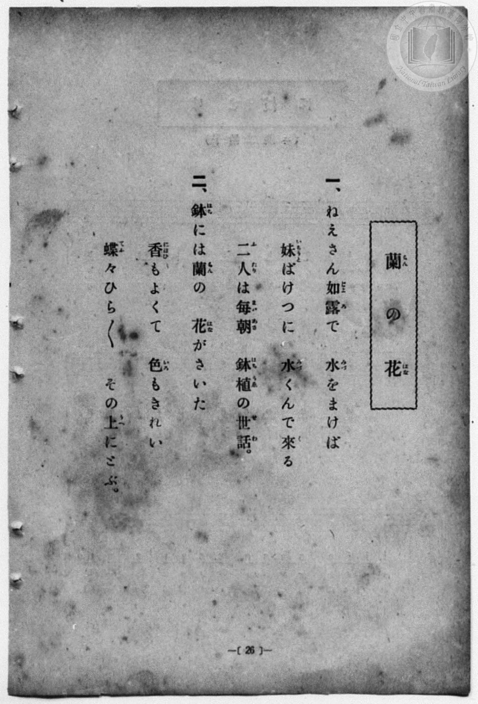
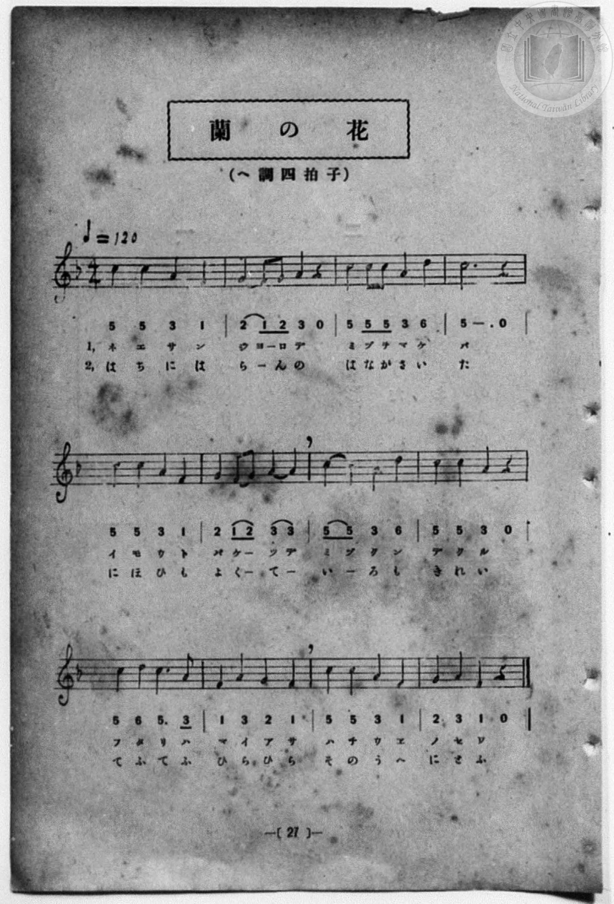

# 蘭の花

> Re:Shōka 使用 AI 協助辨識與重建樂譜，可能會有錯誤。歡迎回報。

<audio controls src="ran_no_hana.mp3"></audio>

- 詞：臺灣總督府
- 曲：宮島慎三郎
- 一條慎三郎 編《新編 小學校・公學校 唱歌教材集》（大正十二年十二月，索書號 0725-41）
- 臺灣總督府《公學校唱歌集》（大正四年三月，索書號 0725 26）

## 說明

原書資訊與歌詞全文（對應 P034.jpg–P035.jpg，原書 p. 26–27，尋常科第一、二學年第 13 首）：
調性與拍號：ヘ調四拍子（F 大調 4/4 拍），♩=120
作曲：臺灣總督府國語學校助教授 宮島慎三郎


## 歌詞

```text
一、ねえさん如露（じよろ）で　水（みづ）をまけば
妹（いもうと）ばけつに　水（みづ）くんで來（く）る
二人（ふたり）は毎朝（まいあさ）　鉢植（はちうゑ）の世話（せわ）。

二、鉢（はち）には蘭（らん）の　花（はな）がさいた
香（にほひ）もよくて　色（いろ）もきれい
蝶（てふ）々ひら／＼　その上（うへ）にとぶ。
```

## ABC

```abc
X:1
T:蘭の花
C:曲：宮島慎三郎
M:4/4
L:1/16
Q:1/4=120
K:F
V:V1 name="Piano" snm="Pia"
[V:V1]
c4 c4 A4 F4 | G4 F2 G2 A4 z4 | c4 c2 c2 A4 d4 | c12 z4 |
w: ね え さ ん | じょ _ ろ で | み づ を ま け | ば
c4 c4 A4 F4 | G4 F2 G2 A4 A4 | c4 c4 A4 d4 | c4 c4 A4 z4 |
w: い も う と | ば け _ つ に | み づ く ん | で く る
c4 d4 c6 A2 | F4 A4 G4 F4 | c4 c4 A4 F4 | G4 A4 F4 z4 |
w: ふ た り は | ま い あ さ | は ち う ゑ | の せ わ
c4 c4 A4 F4 | G4 F2 G2 A4 z4 | c4 c2 c2 A4 d4 | c12 z4 |
w: は ち に は | ら _ ん の | は な が さ い | た
c4 c4 A4 F4 | G4 F2 G2 A4 A4 | c4 c4 A4 d4 | c4 c4 A4 z4 |
w: に ほ ひ も | よ く _ て _ | い _ ろ も | き れ い
c4 d4 c6 A2 | F4 A4 G4 F4 | c4 c4 A4 F4 | G4 A4 F4 z4 |
w: て ふ て ふ | ひ ら ひ ら | そ の う へ | に と ぶ
```

## TMD 檔案連結

- [主旋律 TMD 檔案](ran_no_hana.tmd) [[在 TMD Studio 編輯](https://tmdlang.github.io/Tmd-TS/#tmd=s7IKdvYPcrWy4qpTUCpJTLdSSM7PyUlNLsnMz7MqzsjPTozPrsyvSsyML84ojTe0NDJWgqssy88pzU21Si9KTEmNN4w3QsgU55cWJadaFSdn5OfnxJekVpQk5edno8vHFySmp1oFGBibIGQKivLLUvMS84C6C4oy80pSU8DaEQpSyzJTUkHSxcmJefFlqUWZaZmpKUiOSi0qBrsdYkVJUWJecXJRZgHIQwhV-UUlGflAhxdkVFplZBaX5BdlJifmxGcn5iUiFJVkpAK9V5CTmAe0X0tL4cWMtY8b173o2qigpcWlaKtgaGTAZW-r4MZlY6JvYgfS9mRHw7NFc5-19j3Z0fmyuU_h-fYVjxu6nk3bAGQoPN3Q_3TtjmcLFj5u3v20dQ2ErfB0ysZna3ueTZ35bO6El7PbHjd0v9_T8XTJ8mdrFz_tbXyyq-fpzi0QxrM5He_39DzfsujZ7B0vZs5XMDA3MtU1MXy_pxPs5Bcr573fM-tF-67njYuf79j7fO7ip7vmgGWezd4ElHm6bt3TzdvgboPoQVUNdCvcYRB3obto9mygc4AGYHOLgpEZ2C1c-loKttQCXAoKCk_75oOs2dz-YkXXi452oLOAfn3auuLZtHaQyzb0PmvvVAAlI72sgvRHDZOBTFMQE-hCiFaFAj2g44AyRuYgsQ3dT3fseL584vM1a4AR9rgBHMprdwB9BhRRMDRWeLlsGtAnwDAD2f5i1f5nDctB9nb3Ar0KFH3cPAMoCAwLoMjTtROAbnBTAIYPUEwBmBAUgKJg3T2PZq60BaURoCFP9s6BxAJaiD-d0_1i1TxoiHetBCWDvg4FtKjiApsAdunjRmAS7HjcOPVx0-Sny5pezgGaCeTOeNzU8bgJZO3jxuWPGxqebdgCFt__uHEpSLBp0uPGfY8bJz5u3AAO0GU7wdItj5uaHje2PW5cAda5AaxiyePG1ViMaOwHWgk0_cm-NrB4P9jcbrDTdvU82bULLLr1ceP8x01dYA3rn63vezZnLlgcaHnL40agZVNBUg0NLzsXPVsCdC9Qav3jxoUgRzRNBOta92THtBcrN4KlZj9uAlvT0AQJgl09wCAAaoXrA-tYDWQDsyZIsAnopMkQY4CWAHMqTOUqsGAPKOBADpkPMu7lsplgaaD-3Y8bgQEJ1NwECkigVxuXgfR3QkIXGEzgoAUFVu_jJqApLeCEMXcbWHoZ0NtgV7YCTQE64f0eoKP3APU_bpwL9g8wOIDKgMG8A-beFY8bt4F8BTSF8iwCBQpa-lxcQYl5fvkewFLMKiAzMS_focagphpki4KNhZYdmIEtcypAcsKLhT0KGiagcur5-gYdUI4CZyNNLBqAdoEMq1EwVdAFY2MgNgTiGgUjMMsILGIAFoGoMQWLmMFFYBCsBmyaj2GNAjCBA_nANA4mp4LIpslgPeBU3g7WAowPIHc5kBUPldoPVr4UKDMJSO8D8yZC5TYgWQZWD7HMCCS3HqxyIZhcDSZBIkCZpk6oTZOBYuuQbILoWAXEPTAHNrZA5eZj2IQ_yHf1UD_IQRhVDSLIYSLoQQ5yPzB1g_3SBiZXIIUdJCSBBQM8lJBDHET2o0QTKF5gYt1YwhwSzrvB5Ca4zaAwh0Q6WGfjMmg4wtwHi3ck9Y0QXg88DogJ8x2d5IY5KBwhCdcYKAIKeVBYQsIePYQR8QLjoYf5VrCrQSkGWF5CfAdMWyAZSOoFx0kjJE5AqQw9tYLjqQmWxkEpFFhegsVA4Yce5qDQhNkJCVkQDyQDiQFQakdmg2TmgsUgJkNSxQ6oDCQGQWkEWI7Bbavl4tK1U4CXQNE-hrEKqAJGYAFlLgA)]
- [鋼琴伴奏 TMD 檔案](ran_no_hana_piano.tmd) [[在 TMD Studio 編輯](https://tmdlang.github.io/Tmd-TS/#tmd=s7IKdvYPcrWy4qpTUCpJTLdSSM7PyUlNLsnMz7MqzsjPTozPrsyvSsyML84ojTe0NDJWgqssy88pzU21Si9KTEmNN4w3QsgU55cWJadaFSdn5OfnxJekVpQk5edno8vHFySmp1oFGBibIGQKivLLUvMS84C6C4oy80pSU8DaEQpSyzJTUkHSxcmJefFlqUWZaZmpKUiOSi0qBrsdYkVJUWJecXJRZgHIQ0pcWloKL2asfdy47kXXxvd7Ol7Onvmss_tl957nE7Y82bPl6dL-93s6FbS0uBRtFQyNDLjsbRXcuGxM9E3sQOY_2dHwbNHcZ619T3Z0vmzuU3i-fcXjhq5n0zYAGQpPN_Q_Xbvj2YKFj5t3P21dA2ErPJ2y8dnanmdTZz6bO-Hl7LbHDd1AW58uWf5s7eKnvY1PdvU83bkFwng2p-P9np7nWxY9m73jxcz5CgbmRqa6JoZA94D99mLlvPd7Zr1o3_W8cfHzHXufz138dNccsMyz2ZuAMk_XrXu6eRvcbRA9qKqBboU7DOIudBfNng10DtAAbG5RMDIDu4UrKDHPL98jMS_RKiAzMS8_yMOhxqCmmksBCGwstOzADH0tBVt0oPB8zRpgCL5Y2KOgYQIKrufrG3QUAgwMLfSyCtI1sWjQ0gcbVqNgqqALxsZAbAjENQpGYJYRWMQALAJRYwoWMYOLwCBYDdg0H8MahceNa4H8x40dYHIqiGyaDNbzuHHG46Z2sJbHTb1A7nIgKx4qtR-sfClQZhKQ3gfmTYTKbUCyDKweYpkRSG49WOVCMLkaTIJEgDJNnVCbJgPF1iHZBNGxCoh7YA5sbIHKzcewCX-Q7-qhfpCDMKoaRJDDRNCDHOT-x01NYL-0gckVSGEHCcnHjUvgoYQc4iCyHyWaQPECE-vGEuaQcN4NJjfBbQaFOSTSwTobl0HDEeY-WLwjqW-E8HrgcUBMmO_oJDfMQeEISbjGQBFQyIPCEhL26CGMiBcYDz3Mt4JdDUoxj5u6IL4Dpi2QDCT1guOkERInoFSGnlrB8dQES-OgFPq4cTZYDBR-6GEOCk2YnZCQBfFAMpAYAKV2ZDZIZi5YDGIyJFXsgMpAYhCURh43boPbVotRAPkgF0Am0AIIGHTxCtGGsTAKGHDxIAOAXANUSROQJIIPlCVkAIRLrBFASXQ9IJOiDePRTIFbEm0KlIKaA_Surp0C3MfRPkBVqAJGYAFlLgA)]

## 分析

```text
================================================================================
📊 TMD Song Profile: [ 蘭の花 ]
================================================================================
⏱  Duration:       0:48 (48.0s), 24 measures total
🎼 Key & Tempo:    首調基準 F, != 120.0 BPM, <4/4>
   - 分析範圍：      由實際發聲的音符與和弦推測調性；播放脈絡另行呈現
🎤 人聲音域:    F4 (MIDI 65) – D5 (MIDI 74) [跨度: 9 個半音 / 0.8 個八度, 難度: easy]
   - 最低音:  F4 in [RanNoHana[L1] #1 @ m.1, 0:01]
   - 最高音: D5 in [RanNoHana[L1] #1 @ m.3, 0:05]
   - 適合: soprano, mezzo-soprano, contralto, tenor, baritone, bass
🏛  結構:      RanNoHana[L1] (24.0s) -> RanNoHana[L2] (24.0s)
⚡ 編曲密度:        Peak 1 軌道同時演奏
🗝  調性診斷：       C 調性不明確（純淨自然大調，未偵測到可信轉調）
   - 風格氣質:    純淨自然大調（陽光明朗、易唱易記，無明顯調外色彩）
   - 轉調歷程:    全曲維持單一推測調性（未偵測到可信轉調）
   - 核心骨幹音:  C, A, F, G, D
   - 調性數值:    C 調性不明確 [相關度: 0.78, 穩定度: Ambiguous, 自然音純度: 100.0%]
   - 候選調性 (K-S): C 大調 (0.78), A 小調 (0.78), F 大調 (0.73)
   - 五度圈歷程:   +0 -> +0
   - 各段落調性細節:
     • [RanNoHana[L1] #1]: C 調性不明確 (r: 0.78, 自然音純度: 100.0%)
     • [RanNoHana[L2] #1]: C 調性不明確 (r: 0.78, 自然音純度: 100.0%)

  [ 五度圈游移軌跡 ]
              [C ]*
         F            G  
      Bb               D  
      Eb               A  
         Ab           E  
            Db       B  
               F# 
     (* = active key center)

  [ 十二半音累積音高分佈 ]
     C  : ████████████████████████  39.8%
     C# :                            0.0%
     D  : ████                       6.8%
     D# :                            0.0%
     E  :                            0.0%
     F  : ██████████                15.9%
     F# :                            0.0%
     G  : ███████                   11.4%
     G# :                            0.0%
     A  : ████████████████          26.1%
     A# :                            0.0%
     B  :                            0.0%
--------------------------------------------------------------------------------
Assignment 軌道音域：
  - Piano         : F4 – D5 (9 個半音 / 0.8 個八度, 90 個音符)
================================================================================
```


## 原書掃描頁






