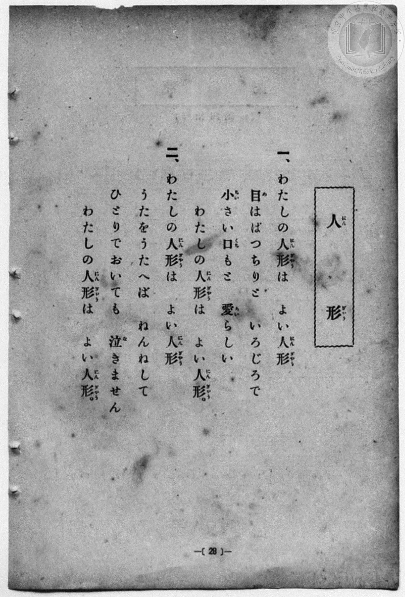
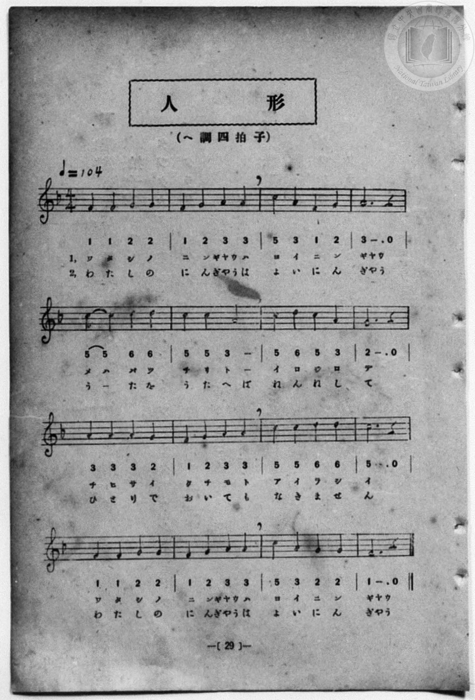

# 人形

> Re:Shōka 使用 AI 協助辨識與重建樂譜，可能會有錯誤。歡迎回報。

<audio controls src="ningyo.mp3"></audio>

- 詞：文部省
- 曲：文部省
- 一條慎三郎 編《新編 小學校・公學校 唱歌教材集》（大正十二年十二月，索書號 0725-41）
- 臺灣總督府《公學校唱歌集》（大正四年三月，索書號 0725 26）

## 說明

原書資訊與歌詞全文（對應 P036.jpg–P037.jpg，原書 p. 28–29，尋常科第一、二學年第 14 首）：
調性與拍號：ヘ調四拍子（F 大調 4/4 拍），♩=104（採自文部省《尋常小學唱歌》第一學年〈人形〉）


## 歌詞

```text
一、わたしの人形（にんぎやう）は　よい人形（にんぎやう）
目（め）はぱつちりと　いろじろで
小（ちひ）さい口（くち）もと　愛（あい）らしい
わたしの人形（にんぎやう）は　よい人形（にんぎやう）。

二、わたしの人形（にんぎやう）は　よい人形（にんぎやう）
うたをうたへば　ねんねして
ひとりでおいても　泣（な）きません
わたしの人形（にんぎやう）は　よい人形（にんぎやう）。
```

## ABC

```abc
X:1
T:人形
C:曲：文部省
M:4/4
L:1/16
Q:1/4=104
K:F
V:V1 name="Piano" snm="Pia"
[V:V1]
F4 F4 G4 G4 | F4 G4 A4 A4 | c4 A4 F4 G4 | A12 z4 |
w: わ た し の | に ん ぎゃう は | よ い に ん | ぎゃう
c4 c4 d4 d4 | c4 c4 A4 A4 | c4 d4 c4 A4 | G12 z4 |
w: め は ぱ っ | ち り と _ | い ろ じ ろ | で
A4 A4 A4 G4 | F4 G4 A4 A4 | c4 c4 d4 d4 | c12 z4 |
w: ち ひ さ い | く ち も と | あ い ら し | い
F4 F4 G4 G4 | F4 G4 A4 A4 | c4 A4 G4 G4 | F12 z4 |
w: わ た し の | に ん ぎゃう は | よ い に ん | ぎゃう
F4 F4 G4 G4 | F4 G4 A4 A4 | c4 A4 F4 G4 | A12 z4 |
w: わ た し の | に ん ぎゃう は | よ い に ん | ぎゃう
c4 c4 d4 d4 | c4 c4 A4 A4 | c4 d4 c4 A4 | G12 z4 |
w: う _ た を | う た へ ば | ね ん ね し | て
A4 A4 A4 G4 | F4 G4 A4 A4 | c4 c4 d4 d4 | c12 z4 |
w: ひ と り で | お い て も | な き ま せ | ん
F4 F4 G4 G4 | F4 G4 A4 A4 | c4 A4 G4 G4 | F12 z4 |
w: わ た し の | に ん ぎゃう は | よ い に ん | ぎゃう
```

## TMD 檔案連結

- [主旋律 TMD 檔案](ningyo.tmd) [[在 TMD Studio 編輯](https://tmdlang.github.io/Tmd-TS/#tmd=s7IKdvYPcrWy4qpTUCpJTLdSSM7PyUlNLsnMz7MqzsjPTozPrsyvSsyML84ojTe0NDJWgqssy88pzU21Si9KTEmNN4w3QsgU55cWJadaFSdn5OfnxJekVpQk5edno8vHFySmp1oFGBibIWQKivLLUvMS84C6C4oy80pSU8DaEQpSyzJTUkHSxcmJefFlqUWZaZmpKUiOSi0qBrsdYkVJUWJecXJRZgHIQwhV-UUlGflAhxdkVFplZBaX5BdlJifmxGcn5iUiFJVkpAK9V5qXnJNYXAy1RktL4cmuXU_3LlLQ0uJStFUwNDDhsrdVcOOyMdE3sQNpfbKj4dmiuc9a-57s6HzZ3KfwfPuKxw1dz6ZtADIUnm7of7p2x7MFCx83737augbCVng6ZeOztT3Pps58NnfCy9ltjxu63-_peLpk-bO1i5_2Nj7Z1fN05xYI49mcjvd7ep5vWfRs9o4XM-crGJgbmeqaGL7f0wl29ouV897vmfVsWvvL5hXP5zSCxZ7N3oQh9qJ91_PGxc937H0-d_HTXXOA7oM7BuIWdFfMng10AtBD2OxXMDID28-lr6VgSy3ApaCg8LRvPsiaze0vVnS96GgHOgvov6etK4B-AblsQ--z9k4FUPLRyypIf9QwGcg0BzGBLoRoVSjQUzCyAMoYWYLENnQ_3bHj-fKJz9esAUbS4wZwyK7dAfQZUETB0ETh5bJpQJ8AQwtk-4tV-581LAfZ290L9CpQ9HHzDKAgMCyAIk_XTgC6wU0BGD5AMQVg5CsARcG6ex7NXGkLTBdA-Wd9C1-0r4KHPSicwY6AJANIUAPDGeIgiFMeN3RAEtjjBqBZnVwgp0Bc-7ip_3Hj_MeN0x83roMoAdrwuHH146bJjxv7Hje1PG5sA-p43Lj-cUPD4yagVAseZSBzn89eB5JraoRqa9z4uHHJ48aFj5u6HjcCU20D0IjHTb2PG2eAyeXgSNnQDzZv4eNGYLoCapsKVPS0fzFYEOjAhSDBpiaI_mcts8HiQG4LWByoHuj8FpBB1PXO44YmSFDtAgYoDYIKyAKZ2DQJymjc8bhxAziE1oJVrwVbtgyidBPI96AwXP64EUgCjVkGChJgeGyGhNMqsOXAIN33uHE2UD9twgNoKOUZEQoUtPS5uHwTM_OsAjIT8_IdagxqqkEWKNiYaNmBGdhyvwIkZb9Y2KOgYQJKOs_XN-iAsiw4n2pi0QC0BmRYjYIhEBoBIYhlpGAMhDUKpkASxKsB0rpAaKBQA1btY1gDCj5gyM8H4ulAvA6oBhgoQNHJQBoYLM3AYAGy1oPEmzqArBa4PEglTAXI1HiYqUbUNhV_OO3qISecTIHQDAghLFg4mYHZNcCwwgynRrCLgZkdiBeD3bkQKNoFpFcA1YL4QF809QLpGWAaJLIcM2TA_gKHTdMksBpQSIBCagcQbwCLrIWGFJAGhh9IZBmRYbGjk5ywAPneGCPNIMIHIyxAPm_cBMRTwb4GiYDiGxQeTeDwAImAWKAQ6YT7ogVLaIBMWQENx-VgVSAWKD0sA5sGElkFxKBw3QfEs8FpZjJx4QGsc6iZh2BiQzEP1XJx6dopgEqiaB_DWAU42wjMVuYCAA)]
- [鋼琴伴奏 TMD 檔案](ningyo_piano.tmd) [[在 TMD Studio 編輯](https://tmdlang.github.io/Tmd-TS/#tmd=s7IKdvYPcrWy4qpTUCpJTLdSSM7PyUlNLsnMz7MqzsjPTozPrsyvSsyML84ojTe0NDJWgqssy88pzU21Si9KTEmNN4w3QsgU55cWJadaFSdn5OfnxJekVpQk5edno8vHFySmp1oFGBibIWQKivLLUvMS84C6C4oy80pSU8DaEQpSyzJTUkHSxcmJefFlqUWZaZmpKUiOSi0qBrsdYkVJUWJecXJRZgHIQ0pcWloKT3bterp30fs9HS9nz3zW2f2ye8_zCVue7NnydGn_-z2dClpaXIq2CoYGJlz2tgpuXDYm-iZ2IMOf7Gh4tmjus9a-Jzs6Xzb3KTzfvuJxQ9ezaRuADIWnG_qfrt3xbMHCx827n7augbAVnk7Z-Gxtz7OpM5_NnfBydtvjhm6grU-XLH-2dvHT3sYnu3qe7twCYTyb0_F-T8_zLYuezd7xYuZ8BQNzI1NdE0Oge8Aee7Fy3vs9s55Na3_ZvOL5nEaw2LPZmzDEXrTvet64-PmOvc_nLn66aw7QfXDHQNyC7orZs4FOAHoIm_0KRmZg-7l8EzPzrAIyE_PygzwcagxqqrkUgMDGRMsOzNDXUrBFBwrP16wBBtiLhT0KGiag0Hm-vkFHARjT5npZBemaWDRo6YMNq1EwBEIjIASxjBSMgbBGwRRIgng1QFoXCA0UasCqfQxrFB439Ss8bpwPxNOBeB1QzePG1UDRyUC673FT8-PGNiBrPUi8qQPIaoHLg1TCVIBMjYeZakRtU_GH064ecsLJFAjNgBDCgoWTGZhdAwwrzHBqBLv4ceNGIF4MdudCoGgXkF4BVAviA33R1AukZ4BpkMhyzJAB-wscNk2TwGpAIQEKqR1AvAEsshYaUkAaGH4gkWVEhsWOTnLCAuR7Y4w0gwgfjLAA-bxxExBPBfsaJAKKb1B4NIHDAyQCYoFCpBPuixYsoQEyZQU0HJeDVYFYoPSwDGwaSGQVEIPCdR8QzwanmcnEhQcwg1IzD8HEhmIeqkUuiHywFUQ1CtGGsUDV0abxIArOBZM4JBHhAFdggkczjAcxBItmvFajmEyqZmzuBoaJrp0CKFiifUDCMLYRmK3MBQA)]

## 分析

```text
================================================================================
📊 TMD Song Profile: [ 人形 ]
================================================================================
⏱  Duration:       1:13 (73.8s), 32 measures total
🎼 Key & Tempo:    首調基準 F, != 104.0 BPM, <4/4>
   - 分析範圍：      由實際發聲的音符與和弦推測調性；播放脈絡另行呈現
🎤 人聲音域:    F4 (MIDI 65) – D5 (MIDI 74) [跨度: 9 個半音 / 0.8 個八度, 難度: easy]
   - 最低音:  F4 in [Main[L1] #1 @ m.1, 0:00]
   - 最高音: D5 in [Main[L1] #1 @ m.5, 0:10]
   - 適合: soprano, mezzo-soprano, contralto, tenor, baritone, bass
🏛  結構:      Main[L1] (36.9s) -> Main[L2] (36.9s)
⚡ 編曲密度:        Peak 1 軌道同時演奏
🗝  調性診斷：       C 調性不明確（純淨自然大調，未偵測到可信轉調）
   - 風格氣質:    純淨自然大調（陽光明朗、易唱易記，無明顯調外色彩）
   - 轉調歷程:    全曲維持單一推測調性（未偵測到可信轉調）
   - 核心骨幹音:  A, G, C, F, D
   - 調性數值:    C 調性不明確 [相關度: 0.72, 穩定度: Ambiguous, 自然音純度: 100.0%]
   - 候選調性 (K-S): C 大調 (0.72), F 大調 (0.71), A 小調 (0.71)
   - 五度圈歷程:   +0 -> +0
   - 各段落調性細節:
     • [Main[L1] #1]: C 調性不明確 (r: 0.72, 自然音純度: 100.0%)
     • [Main[L2] #1]: C 調性不明確 (r: 0.72, 自然音純度: 100.0%)

  [ 五度圈游移軌跡 ]
              [C ]*
         F            G  
      Bb               D  
      Eb               A  
         Ab           E  
            Db       B  
               F# 
     (* = active key center)

  [ 十二半音累積音高分佈 ]
     C  : ██████████████████        21.7%
     C# :                            0.0%
     D  : ███████                    8.3%
     D# :                            0.0%
     E  :                            0.0%
     F  : ████████████████          18.3%
     F# :                            0.0%
     G  : ████████████████████      23.3%
     G# :                            0.0%
     A  : ████████████████████████  28.3%
     A# :                            0.0%
     B  :                            0.0%
--------------------------------------------------------------------------------
Assignment 軌道音域：
  - Piano         : F4 – D5 (9 個半音 / 0.8 個八度, 104 個音符)
================================================================================
```


## 原書掃描頁






