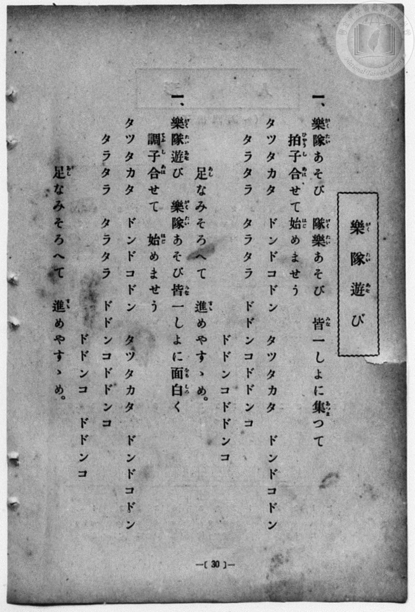
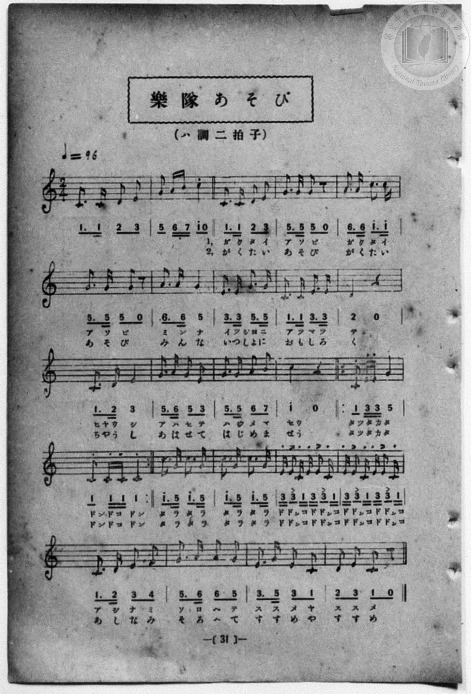

# 樂隊遊び

> Re:Shōka 使用 AI 協助辨識與重建樂譜，可能會有錯誤。歡迎回報。

- **NEUTRINO 歌聲合成版**：<br><audio controls src="gakutai_asobi_neutrino.mp3"></audio>
- **鋼琴伴奏版**：<br><audio controls src="gakutai_asobi.mp3"></audio>


- 一條慎三郎 編《新編 小學校・公學校 唱歌教材集》（大正十二年十二月，索書號 0725-41）

## 說明

原書資訊與歌詞全文（對應 P038.jpg–P039.jpg，原書 p. 30–31，尋常科第一、二學年第 15 首）：
原書曲名表記：左頁「樂隊遊び」、右頁「樂隊あそび」
調性與拍號：ハ調二拍子（C 大調 2/4 拍），♩=96
註：


## 歌詞

```text
1. 原書左頁（p. 30）第一段「隊樂あそび」為「樂隊あそび」之排印倒置，第二段編號誤植為「一、」。
2. 原書右頁（p. 31）首 2 小節為無歌詞前奏，第 15–16 小節（「タツタカタ ドンドコドン」）記有反覆記號 |: ... :|，本譜展開為 4 小節以對齊左頁歌詞全文。

一、樂隊（がくたい）あそび　隊樂（がくたい）あそび　皆（みな）一しよに集（あつま）つて
拍子（ひやうし）合（あは）せて始（はじ）めませう
タツタカタ　ドンドコドン　タツタカタ　ドンドコドン
タラタラ　タラタラ　ドドンコドドンコ　ドドンコドドンコ
足（あし）なみそろへて　進（すゝ）めやすゝめ。

二、樂隊遊（がくたいあそ）び　樂隊（がくたい）あそび皆（みな）一しよに面白（おもしろ）く
調子（てうし）合（あは）せて　始（はじ）めませう
タツタカタ　ドンドコドン　タツタカタ　ドンドコドン
タラタラ　タラタラ　ドドンコドドンコ　ドドンコ　ドドンコ
足（あし）なみそろへて　進（すゝ）めやすゝめ。
```

## ABC

```abc
X:1
T:樂隊遊び
M:2/4
L:1/16
Q:1/4=96
K:C
V:V1 name="Piano" snm="Pia"
[V:V1]
C3 C D2 E2 | G2 A B c2 z2 | C3 C D2 E2 | G3 G G2 z2 |
w: 1.~* * * * | * * * * | が く た い | あ そ び
w: 2.~* * * * | * * * * | が く た い | あ そ び
A3 A c3 c | G3 G G2 z2 | A3 A G4 | E3 E G3 G |
w: 1.~が く た い | あ そ び | み ん な | い つ しょ に
w: 2.~が く た い | あ そ び | み ん な | い つ しょ に
C3 C E3 E | D4 z4 | C3 D E4 | G3 A G2 E2 |
w: 1.~あ つ ま っ | て | ひゃ う し | あ は せ て
w: 2.~お も し ろ | く | ちゃ う し | あ は せ て
G3 G A2 B2 | c4 z4 | C2 E E G4 | C2 C C C4 |
w: 1.~は じ め ま | せう | たっ た か た | どん ど こ どん
w: 2.~は じ め ま | せう | たっ た か た | どん ど こ どん
C2 E E G4 | C2 C C C4 | c3 G c3 G | c3 G c3 G |
w: 1.~たっ た か た | どん ど こ どん | た ら た ら | た ら た ら
w: 2.~たっ た か た | どん ど こ どん | た ら た ら | た ら た ら
E E C2 E E C2 | E E C2 E E C2 | C3 D E2 F2 | G3 A A2 G2 |
w: 1.~ど どん こ ど どん こ | ど どん こ ど どん こ | あ し な み | そ ろ へ て
w: 2.~ど どん こ ど どん こ | ど どん こ ど どん こ | あ し な み | そ ろ へ て
E3 G E2 C2 | D2 E2 C2 z2 | C3 C D2 E2 | G2 A B c2 z2 |
w: 1.~す す め や | す す め | * * * * | * * * *
w: 2.~す す め や | す す め | * * * * | * * * *
C3 C D2 E2 | G3 G G2 z2 | A3 A c3 c | G3 G G2 z2 |
w: 1.~が く た い | あ そ び | が く た い | あ そ び
w: 2.~が く た い | あ そ び | が く た い | あ そ び
A3 A G4 | E3 E G3 G | C3 C E3 E | D4 z4 |
w: 1.~み ん な | い つ しょ に | あ つ ま っ | て
w: 2.~み ん な | い つ しょ に | お も し ろ | く
C3 D E4 | G3 A G2 E2 | G3 G A2 B2 | c4 z4 |
w: 1.~ひゃ う し | あ は せ て | は じ め ま | せう
w: 2.~ちゃ う し | あ は せ て | は じ め ま | せう
C2 E E G4 | C2 C C C4 | C2 E E G4 | C2 C C C4 |
w: 1.~たっ た か た | どん ど こ どん | たっ た か た | どん ど こ どん
w: 2.~たっ た か た | どん ど こ どん | たっ た か た | どん ど こ どん
c3 G c3 G | c3 G c3 G | E E C2 E E C2 | E E C2 E E C2 |
w: 1.~た ら た ら | た ら た ら | ど どん こ ど どん こ | ど どん こ ど どん こ
w: 2.~た ら た ら | た ら た ら | ど どん こ ど どん こ | ど どん こ ど どん こ
C3 D E2 F2 | G3 A A2 G2 | E3 G E2 C2 | D2 E2 C2 z2 |
w: 1.~あ し な み | そ ろ へ て | す す め や | す す め
w: 2.~あ し な み | そ ろ へ て | す す め や | す す め
```

## TMD 檔案連結

- [主旋律 TMD 檔案](gakutai_asobi.tmd) [[在 TMD Studio 編輯](https://tmdlang.github.io/Tmd-TS/#tmd=s7IKdvYPcrWy4qpTUCpJTLdSSM7PyUlNLsnMz7MqzsjPTozPrsyvSsyML84ojTe0NDJWgqssy88pzU21Si9KTEmNN4w3QsgU55cWJadaFSdn5OfnxJekVpQk5edno8vHFySmp1oFGBhbIGQKivLLUvMS84C6C4oy80pSU8DaEQpSyzJTUkHSxcmJefFlqUWZaZmpKUiOSi0qBrsdYkVJUWJecXJRZgHIQwhV-UUlGflAhxdkVFplZBaX5BdlJifmxGcn5iUiFJVkpAK9B_VETmZaqhKXlpbCsxVNL2d1vWzsety4WUFLi0vRVsHSjMveVsGZy8ZI38QOpP3JjoZni-Y-a-17sqPzZXOfwvPtKx43dD2btgHIUHi6of_p2h3PFix83Lz7aesaCFvh6ZSNz9b2PJs689ncCS9ntz1u6H6_p-PpkuXP1i5-2tv4ZFfP051bIIxnczre7-l5vmXRs9k7Xsycr2BgbmSqa2L4fk-nEheXvpaCLbUAl4KCwtO--SBrNre_WNH1oqMd6MQXK-c9bV3xbFo7yH0bep-1dyqAolAvqyD9UcNkINMSxAS6EKJVoUBPwdgAKGMMdGHP0w3dT3fseL584vM1a4CB9LgB7LO1O4CeA4ooGJoqvFw2DeiT93tmIWx_NnvT0wm9LxaueLFiBlDi6fZlLxc0Pm7oQY6Jxw29QMOe9m9Glnrc2PS4cS5EFmTci1X7nzUsB3mjuxcYckCzHjf3AwVBgdrd-3TtBKCXnBWAgQ4UUwDGpQJQFOyYnkczV9oCYxlkxordUMcZ6kHdB3EQUC_Yq0ANEM89W7cV6BKgM4COQXbJ86ZdWF34ZGf3s75JT3s3PG2Y9HzvOlAcA80BOm3dVmCyAbr3xaolz5ZAtUMCD-zrJpBjjOCOAQcB1DGgRAEMUAUjUKJ7vr4BqPd5y0JoJHb2Pl3aD7EFGPDAGDI0gyoD6gZa8bhp_-PmFhDZtBpIKjxu7nzcvBlENoFJILsBFDzAWHk2p_Npf--LZW1ANihJ1lgp6OnpKVjVAI1_NmfNi7Vznm6c-nJaN9B-BROoJU92LwUmn5d7uyDBh5yyQH4CeQriSUhIgdzU2PO4sf9x4_zHjS1Ae5HCrgESyvjVPJ_VBlaw_3HjKqAUyPDG6Y-bgCKrgRkOLAVUvORx4z6wRiBjGcgR8JTxuHHT46aWx41tQG1AFU8nALMhRM96sIbZQA1Pl4OyLVDkcSMwqQJDqhFoHFiqDWQWWpACHYUtUBuIUQY3biWUhGpD4oLUgbVB9cDYuKXACXzbZpi_QN4EBhY4yOY-bup93LgD6EdQcDdsAquZ-bhpLtSboJABcUFsWPTt6oFHHzCXosUOJGrANoCcRDCW8UXf3EXPZ-4Fy3Y9bgI5HOhYsN5-aLaHxeAy_NEHdMdQjEFULvUiEWgQ5bUIFCho6XNxuSdml5YkZjoW5ydlWgVkJublO9QY1FSDLFKwMTTTsgOzsNVhCpDiSkEDVpTpgGodcFWjACluXyzs0cSiD2gtyMwaBUMFXSA0BJaFugrGQFyjYAokzRTMFQzjgAwDkBA42WK3H7nCAlqloGGB4RAyrNcFkiAabDvQMSARM4iDgIrjsKkCm-djWKMAzChgOWAqB-L5YFYL2BxgvENl5gLxZiArHiqOrgOiB6cOiF1G9LELGlCwQIB4HGQUKLhAgQYLCkRgwmRqwMEKgqAgAutCCqb9EOuaJgPZq-CmQjwAcsYSIAaWGO1Q7moUN4Ik90HZi8Eyy6BGgFyNZBU4lMiyqguqqQkkCWX3gmX6MawikEA7wUkTVsWSlDSNoKGJSJqQOEBNrKDYMQeLQBMp9iAH1pTNUD-2wX2FmlzWA_FsMAsUoCCZ9VCZGUD_N4JZoIAHyYBKXzyhvpAOthEKeFDrc_ZsYPBDGkLARhukyUNWbBjDUzs4pIGkIRgiixBQgxQZwJp0MdiD84G4G54bIZ4F1jaTwZIrgRiUbKECMHnyNSNF0EC5AG-kQaNrX8_T3i7SYwmS-k0RDOxioFiCxRaIxiKCHFNgfY-bOlHY-GVAHgd7GuR_WEggCRClBjmuBswN-LPYrimUlm0mYJfAyjZQSQZiw-oXUzANiSNYJQ3ioVe6sBJlOhCDinhIoQ-SmQsNk14gewdYBlbWzITqmQkra5pglSdIBkqCZdCrXXrYVsvFpWungNw2U8DCV-YCAA)]
- [鋼琴伴奏 TMD 檔案](gakutai_asobi_piano.tmd) [[在 TMD Studio 編輯](https://tmdlang.github.io/Tmd-TS/#tmd=s7IKdvYPcrWy4qpTUCpJTLdSSM7PyUlNLsnMz7MqzsjPTozPrsyvSsyML84ojTe0NDJWgqssy88pzU21Si9KTEmNN4w3QsgU55cWJadaFSdn5OfnxJekVpQk5edno8vHFySmp1oFGBhbIGQKivLLUvMS84C6C4oy80pSU8DaEQpSyzJTUkHSxcmJefFlqUWZaZmpKUiOSi0qBrsdYkVJUWJecXJRZgHIQwhViUVA8fTU3NS8EquCzMS8_PjE5OT83ILEvEyQmBKXlpbCsxVNL2d1vWzsety4-f2ejpezZz7r7H7Zvef5hC1P9mx5urT__Z5OBS0tLkVbBUszLntbBWcuGyN9EzuQJU92NDxbNPdZa9-THZ0vm_sUnm9f8bih69m0DUCGwtMN_U_X7ni2YOHj5t1PW9dA2ApPp2x8trbn2dSZz-ZOeDm77XFDN9DSp0uWP1u7-Glv45NdPU93boEwns3peL-n5_mWRc9m73gxc76CgbmRqa6JIdA5Slxc7onZpSWJmY7F-UmZVgEgrwV5ONQY1FRzKQCBjaGZlh2YVaNgqKALhIYKRkDSGIhrFEyBpJmCuYJhHJBhABLiwqtWF0iCaLBSoE6QiBlEN1BxHDZVYPN8DGsUHjf2gOUeN_YD8XwwqwVszuPGJqjMXCDeDGTFQ8XRdUD04NQBscuIPnZBAwoWCBCPg4wCBRco0GBBgQhMmEwNOFhBEBREYF1IwbQfYl3TZCB7FdxUiAdAzlgCxNMfN7VDuatR3AiS3AdlLwbLLIMaAXI1klXgUCLLqi6opiaQJJTdC5bpx7AKJTUZQQMAkZogwYaavkABag4WgaYr7KG06XFTM9RZbXCHoMbweiCeDWaBwgAksx4qMwPo5EYwCxRWIJnZIGNwB9RCOtiGFFbG8OQDDgcgaQiGyCIE1CAF1XxQUgBZPx-Iu-HJG-KUlaDYB0muBGJQOoAKwOTJ14wUfAPlAliQQhKSKYKBXQwUpLCgBdFYRJCDFazvcVMnChu_DMiVYBeCHAtzNpIAUWqQA3bA3IAlZ5uANcNyNigfg9iwAtEUTEOCFVargHjotQQsP00HYlCZBCmlQDJzod7oBbJ3gGVgOW0mVM9MWE5rgpX2IBkoCZZBryfoYVsttkraB7mSNkHU0fEK0YaxoGCMjwdxIG5FEoczTIAME2QRqEqQOKpKFDMN8BgJYpjGQ1nYFYKchCGAz0CYBmzqMJ0K9zUwzHTtFJCDLdoHqAJDzAgspswFAA)]

## 分析

```text
================================================================================
📊 TMD Song Profile: [ 樂隊遊び ]
================================================================================
⏱  Duration:       1:05 (65.0s), 52 measures total
🎼 Key & Tempo:    首調基準 C, != 96.0 BPM, <2/4>
   - 分析範圍：      由實際發聲的音符與和弦推測調性；播放脈絡另行呈現
🎤 人聲音域:    C4 (MIDI 60) – C5 (MIDI 72) [跨度: 12 個半音 / 1.0 個八度, 難度: easy]
   - 最低音:  C4 in [GakutaiAsobi #1 @ m.1, 0:00]
   - 最高音: C5 in [GakutaiAsobi #1 @ m.2, 0:01]
   - 適合: soprano, mezzo-soprano, contralto, tenor, baritone, bass
🏛  結構:      GakutaiAsobi (32.5s) -> GakutaiAsobi (32.5s)
⚡ 編曲密度:        Peak 1 軌道同時演奏
🗝  調性診斷：       C 大調（純淨自然大調，未偵測到可信轉調）
   - 風格氣質:    純淨自然大調（陽光明朗、易唱易記，無明顯調外色彩）
   - 轉調歷程:    全曲維持單一推測調性（未偵測到可信轉調）
   - 核心骨幹音:  C, G, E, A, D
   - 調性數值:    C 大調 [相關度: 0.93, 穩定度: High, 自然音純度: 100.0%]
   - 候選調性 (K-S): C 大調 (0.93), E 小調 (0.62), G 大調 (0.60)
   - 五度圈歷程:   +0 -> +0
   - 各段落調性細節:
     • [GakutaiAsobi #1]: C 大調 (r: 0.93, 自然音純度: 100.0%)
     • [GakutaiAsobi #2]: C 大調 (r: 0.93, 自然音純度: 100.0%)

  [ 五度圈游移軌跡 ]
              [C ]*
         F            G  
      Bb               D  
      Eb               A  
         Ab           E  
            Db       B  
               F# 
     (* = active key center)

  [ 十二半音累積音高分佈 ]
     C  : ████████████████████████  37.5%
     C# :                            0.0%
     D  : ████                       6.2%
     D# :                            0.0%
     E  : █████████████             20.3%
     F  : █                          1.0%
     F# :                            0.0%
     G  : ████████████████          25.5%
     G# :                            0.0%
     A  : █████                      7.8%
     A# :                            0.0%
     B  : █                          1.6%
--------------------------------------------------------------------------------
Assignment 軌道音域：
  - Piano         : C4 – C5 (12 個半音 / 1.0 個八度, 194 個音符)
================================================================================
```


## 原書掃描頁






