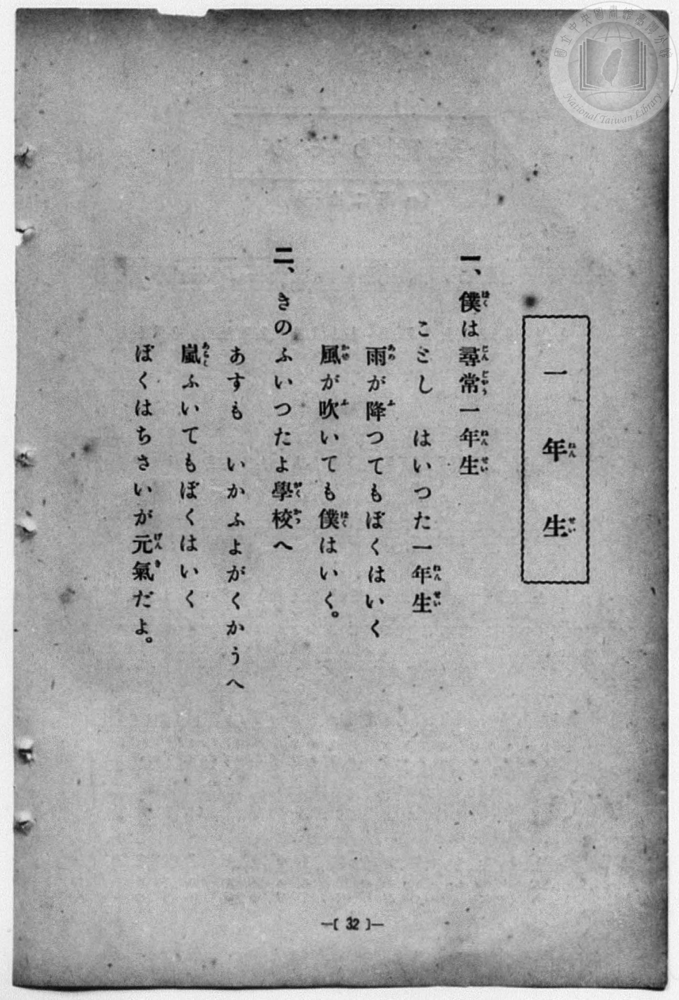
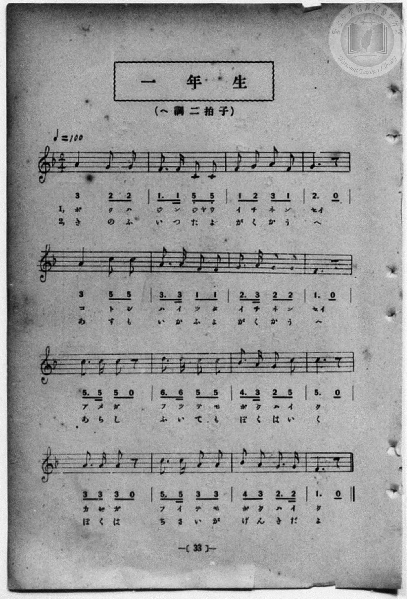

# 一年生

> Re:Shōka 使用 AI 協助辨識與重建樂譜，可能會有錯誤。歡迎回報。

<audio controls src="ichinensei.mp3"></audio>

- 一條慎三郎 編《新編 小學校・公學校 唱歌教材集》（大正十二年十二月，索書號 0725-41）
- 臺灣教育會公認《新定兒童唱歌》尋常科第一學年用（2020.006.0847.0001）

## 說明

曲目說明
中文解釋：描寫剛成為一年級學生的孩子，帶著期待開始學校生活。
原書資訊（對應 P040.jpg–P041.jpg，原書 p. 32–33）：
調性與拍號：ヘ調 二拍子，♩=100


## 歌詞

```text
一、僕（ぼく）は尋常（じんじやう）一年生（ねんせい）
ことし　はいつた一年生（ねんせい）
雨（あめ）が降（ふ）つてもぼくはいく
風（かぜ）が吹（ふ）いても僕（ぼく）はいく。

二、きのふいつたよ學校（がくかう）へ
あすも　いかふよがくかうへ
嵐（あらし）ふいてもぼくはいく
ぼくはちさいが元氣（げんき）だよ。
```

## ABC

```abc
X:1
T:一年生
M:2/4
L:1/16
Q:1/4=100
K:F
V:V1 name="Piano" snm="Pia"
[V:V1]
A3 G G4 | F3 F C2 C2 | F2 G2 A2 F2 | G6 z2 |
w: 1.~ボ ク ハ | ジ ン ジャ ウ | イ チ ネ ン | セイ
w: 2.~き の ふ | い つ た よ | が く か う | へ
A3 c c4 | A3 A F2 F2 | G3 A G2 G2 | F6 z2 |
w: 1.~コ ト シ | ハ イ ツ タ | イ チ ネ ン | セイ
w: 2.~あ す も | い か ふ よ | が く か う | へ
c2 c2 c2 z2 | d3 d c2 c2 | B3 A G2 c2 | c6 z2 |
w: 1.~ア メ ガ | フ ツ テ モ | ボ ク ハ イ | ク
w: 2.~あ ら し | ふ い て も | ぼ く は い | く
A2 A2 A2 z2 | c3 c A2 A2 | B2 A2 G3 G | F6 z2 |
w: 1.~カ ゼ ガ | フ イ テ モ | ボ ク ハ イ | ク
w: 2.~ぼ く は | ち さ い が | げ ん き だ | よ
A3 G G4 | F3 F C2 C2 | F2 G2 A2 F2 | G6 z2 |
w: 1.~ボ ク ハ | ジ ン ジャ ウ | イ チ ネ ン | セイ
w: 2.~き の ふ | い つ た よ | が く か う | へ
A3 c c4 | A3 A F2 F2 | G3 A G2 G2 | F6 z2 |
w: 1.~コ ト シ | ハ イ ツ タ | イ チ ネ ン | セイ
w: 2.~あ す も | い か ふ よ | が く か う | へ
c2 c2 c2 z2 | d3 d c2 c2 | B3 A G2 c2 | c6 z2 |
w: 1.~ア メ ガ | フ ツ テ モ | ボ ク ハ イ | ク
w: 2.~あ ら し | ふ い て も | ぼ く は い | く
A2 A2 A2 z2 | c3 c A2 A2 | B2 A2 G3 G | F6 z2 |
w: 1.~カ ゼ ガ | フ イ テ モ | ボ ク ハ イ | ク
w: 2.~ぼ く は | ち さ い が | げ ん き だ | よ
```

## TMD 檔案連結

- [主旋律 TMD 檔案](ichinensei.tmd) [[在 TMD Studio 編輯](https://tmdlang.github.io/Tmd-TS/#tmd=s7IKdvYPcrWy4qpTUCpJTLdSSM7PyUlNLsnMz7MqzsjPTozPrsyvSsyML84ojTe0NDJWgqssy88pzU21Si9KTEmNN4w3QsgU55cWJadaFSdn5OfnxJekVpQk5edno8vHFySmp1oFGJgYIGQKivLLUvMS84C6C4oy80pSU8DaEQpSyzJTUkHSxcmJefFlqUWZaZmpKUiOSi0qBrsdYkVJUWJecXJRZgHIQwhV-UUlGflAhxdkVFplZBaX5BdlJifmxGcn5iUiFJVkpAK9B_VETmZaqhKXlpbCkx0NT3dueT5lvoKWFpeirYKhgQGXva2CG5eNkb6JHUgzUMWzRXOftfY92dH5srlP4fn2FY8bup5N2wBkKDzd0P907Y5nCxY-bt79tHUNhK3wdMrGZ2t7nk2d-WzuhJez2x43dL_f0_F0yfJnaxc_7W18sqsHaCWE8WxOx_s9Pc-3LHo2e8eLmfMVDMyNTHVNDN_v6QQ7_EX7rueNi4EGvWja9GxOM9CGF6t6IbY_XTfraeuk56uXQiwD2vF0Q_fTHTueL5_4fM0akLfW7gD7bAXQbiMDIwM9AwMzPQMLE3MgwwBig76WwrPZm57PXvdi1apnM_q4FBSA4bH22bT2F8sXv2wHOnrWs_7-p-tXP-2c_axjwvOmXdDQ2jILaDgwzJ7Panm6duXTtROAfni6Y9uLidOfzZn_dF_ry2ndT5d3QwIDqOzZlt2PG5pApj_tmw_y6Ob2Fyu6QEGyofdZe6cCKM3oZRWkP2qYDGQagpggA8FqFQr0FIyNgDLGxkAnA10EMubFqv3PGpa_6Gh_1t0LDDWg6OPmGUBBBVCIdvdCHPRo5kpbUGxq6XMBPcoFdPrjhsanzVOB9j5u3PO4sR9o3uPG9ZBQAwvOeNw0GUy2PG5sA8rC0wZYdi1YdvbjxhagFNfjRiBnxePG6Y8bGoCmAEUfNy553Dgfn56Xs0Fx8bix6XFTI9jynpcze8EiW8FcoP5lj5uaIK6DGdrP9XIRRFv348Y5EG1PJ-xE0gZUBNKG6TWIflDQcwEDBuj7x429jxvXAfXBnfu4qQMSTWCtPWB7gfaAfP-4cQfQl0DXzAS5CeRLoB6g3FagHmSlIHVPtwJDHOIzoL7pYN0QS7B5CIm_8HHjVLBoz9PW5mcbFoNNmQQONWDIAE1ZALIN6ANQLPomZuZZBWQm5uU71BjUVINSgoKNoZmWHZhVo2CsoAuERkAIonWBIoZg2lDBNB5IgQmIGEgFSDWIXQNXD4IGIBGweT6GNQqPm-eARR83rQey--HmPm7aARFv3gxiP25eDFa0DCq5BCzVCCZ7ocogMrshklhsMwJKN4IUA5U3rgPirQjbGlug4kuAeD7Yqg6oTA9YHOQyYGyAyTaoDMSFyPagBJMpEMIsgIgYg4MDOUiMwTQIw4ISayA1gXwH8mUHkL0d4WxogIG8_LgZ5IXHTfuRQggSRiSGUBM0JGYClULYqCHUDQ051BCChBHRIQQKGRgGSyiYgRWZwUVrFEyQQggiAgtPbCG0COzHhWCHrYGb-rh5KjQcWoAY5KzHzSCV2BIeJFhAZq0nEDzAPAj25nSEPdDEBAomYJYEqwGpBMnsQQoekMmQoATJwJI71gQEwxALIF43hYtCggfEgiQkIwIJaDXYSSCnYA0ecALCDB5IUCAnM0LBA7YBmltA6mDBA4oYkNhUqPchqQYkMwls8mSwGCihgugFYHtA6QvVnlouLl07BVAppYBEKwMA)]
- [鋼琴伴奏 TMD 檔案](ichinensei_piano.tmd) [[在 TMD Studio 編輯](https://tmdlang.github.io/Tmd-TS/#tmd=s7IKdvYPcrWy4qpTUCpJTLdSSM7PyUlNLsnMz7MqzsjPTozPrsyvSsyML84ojTe0NDJWgqssy88pzU21Si9KTEmNN4w3QsgU55cWJadaFSdn5OfnxJekVpQk5edno8vHFySmp1oFGJgYIGQKivLLUvMS84C6C4oy80pSU8DaEQpSyzJTUkHSxcmJefFlqUWZaZmpKUiOSi0qBrsdYkVJUWJecXJRZgHIQwhV-UUlGflAhxdkVFplZBaX5BdlJifmxGcn5iUqcWlpKTzZ0fB055bnU-a_39PxcvbMZ53dL7v3PJ-w5cmeLU-X9r_f06mgpcWlaKtgaGDAZW-r4MZlY6RvYgcyHqjz2aK5z1r7nuzofNncp_B8-4rHDV3Ppm0AMhSebuh_unbHswULHzfvftq6BsJWeDpl47O1Pc-mznw2d8LL2W2PG7qBtj5dsvzZ2sVPexuf7OoBOgXCeDan4_2enudbFj2bvePFzPkKBuZGpromhkD3gL32on3X88bFQINeNG16NqcZaMOLVb0Q25-um_W0ddLz1UshlgHteLqh--mOHc-XT3y-Zg3Iu2t3gH28Ami3kYGRgZ6BgZmegYWJOZBhALGByzcxM88qIDMxLz_Iw6HGoKaaSwEIbAzNtOzArBoFYwVdIDQCQhCtCxQxBNOGCqbxQApMQMRAKkCqQewauHoQNACJgM3zMaxReNw8Byz6uGk9kN0PN_dx0w6IePNmEPtx82KwomVQySVgqUYw2QtVBpHZDZHEYpsRULoRpBiovHEdEG9F2NbYAhVfAsTzwVZ1QGV6wOIglz1u7AaTbVAZiAuR7UEJJlMghFkAETEGBwdykBiDaRCGBSXWQGoC-Q7kyw4gezvC2dAAA3n5cTPIC4-b9iOFECSMSAyhJmhIzAQqhbBRQ6gbGnKoIQQJI6JDCBQyMAyWUDADKzKDi9YomCCFEEQEFp7YQmgR2I8LwQ5bAzf1cfNUaDi0ADHIWY-bQSqxJTxIsIDMWk8geB43dYK9OR1hDzQxgYLpcSMolUICDySzByl4QCZDghIkA0vuWBMQDEMsgHjdFC4KCR4QC5KQjAgkoNVgJ4GcgjV4wAkIM3ggQYGczAgFD9gGaG4BqYMFDyhiQGJTod6HpBqQzCSwyZPBYqCECqIXgO0BpS9Ue2qRCykf5ELKAl5GRRvGAtVGm8aDKDgXTGLwIIpApkP8QJRyNKOx6waKKUSboOiG8IjWjGo1bs3AMNG1UwAFS7QPSBjGNgKzlbkA)]

## 分析

```text
================================================================================
📊 TMD Song Profile: [ 一年生 ]
================================================================================
⏱  Duration:       0:38 (38.4s), 32 measures total
🎼 Key & Tempo:    首調基準 F, != 100.0 BPM, <2/4>
   - 分析範圍：      由實際發聲的音符與和弦推測調性；播放脈絡另行呈現
🎤 人聲音域:    C4 (MIDI 60) – D5 (MIDI 74) [跨度: 14 個半音 / 1.2 個八度, 難度: moderate]
   - 最低音:  C4 in [Main #1 @ m.2, 0:01]
   - 最高音: D5 in [Main #1 @ m.10, 0:10]
   - 適合: soprano, mezzo-soprano, contralto, tenor, baritone, bass
🏛  結構:      Main (19.2s) -> Main (19.2s)
⚡ 編曲密度:        Peak 1 軌道同時演奏
🗝  調性診斷：       F 調性不明確（純淨自然大調，未偵測到可信轉調）
   - 風格氣質:    純淨自然大調（陽光明朗、易唱易記，無明顯調外色彩）
   - 轉調歷程:    全曲維持單一推測調性（未偵測到可信轉調）
   - 核心骨幹音:  C, G, A, F, A#
   - 調性數值:    F 調性不明確 [相關度: 0.80, 穩定度: Ambiguous, 自然音純度: 100.0%]
   - 候選調性 (K-S): F 大調 (0.80), C 大調 (0.79), A 小調 (0.65)
   - 五度圈歷程:   -1 -> -1
   - 各段落調性細節:
     • [Main #1]: F 調性不明確 (r: 0.80, 自然音純度: 100.0%)
     • [Main #2]: F 調性不明確 (r: 0.80, 自然音純度: 100.0%)

  [ 五度圈游移軌跡 ]
               C  
        [F ]*          G  
      Bb               D  
      Eb               A  
         Ab           E  
            Db       B  
               F# 
     (* = active key center)

  [ 十二半音累積音高分佈 ]
     C  : ████████████████████████  26.7%
     C# :                            0.0%
     D  : ███                        3.4%
     D# :                            0.0%
     E  :                            0.0%
     F  : ███████████████████       20.7%
     F# :                            0.0%
     G  : ████████████████████      22.4%
     G# :                            0.0%
     A  : ████████████████████      22.4%
     A# : ████                       4.3%
     B  :                            0.0%
--------------------------------------------------------------------------------
Assignment 軌道音域：
  - Piano         : C4 – D5 (14 個半音 / 1.2 個八度, 96 個音符)
================================================================================
```


## 原書掃描頁






