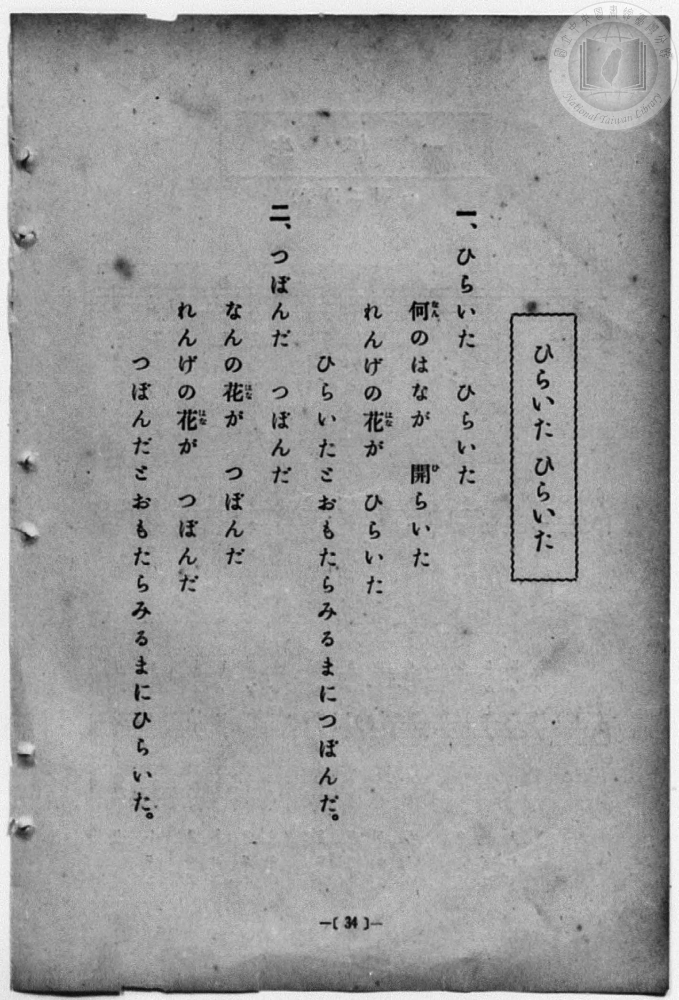
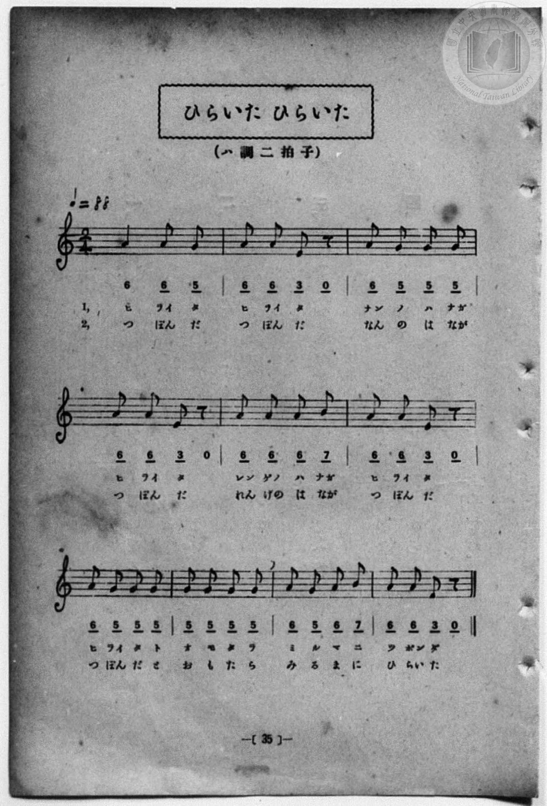

# ひらいた ひらいた

> Re:Shōka 使用 AI 協助辨識與重建樂譜，可能會有錯誤。歡迎回報。

- **鋼琴伴奏版**：<br><audio controls src="hiraita_hiraita.mp3"></audio>
- **NEUTRINO 歌聲合成版**：<br><audio controls src="hiraita_hiraita_neutrino.mp3"></audio>

- 一條慎三郎 編《新編 小學校・公學校 唱歌教材集》（大正十二年十二月，索書號 0725-41）

## 說明

曲目說明
中文解釋：傳統童謠遊戲歌，描寫蓮花盛開又合攏的景象。
原書資訊（對應 P042.jpg–P043.jpg，原書 p. 34–35）：
調性與拍號：ハ調 二拍子，♩=88


## 歌詞

```text
一、ひらいた　ひらいた
何（なん）のはなが　開（ひ）らいた
れんげの花（はな）が　ひらいた
ひらいたとおもたらみるまにつぼんだ。

二、つぼんだ　つぼんだ
なんの花（はな）が　つぼんだ
れんげの花（はな）が　つぼんだ
つぼんだとおもたらみるまにひらいた。
```

## ABC

<div class="abc-score" data-abc-src="hiraita_hiraita.abc" aria-label="五線譜載入中"></div>

[下載 ABC 原始檔](hiraita_hiraita.abc)

## TMD 檔案連結

- [主旋律 TMD 檔案](hiraita_hiraita.tmd) [[在 TMD Studio 編輯](https://tmdlang.github.io/Tmd-TS/#tmd=s7IKdvYPcrWy4qpTUCpJTLdSSM7PyUlNLsnMz7MqzsjPTozPrsyvSsyML84ojTe0NDJWgqssy88pzU21Si9KTEmNN4w3QsgU55cWJadaFSdn5OfnxJekVpQk5edno8vHFySmp1oFGJgg6Swoyi9LzUvMA-ouKMrMK0lNAWtHKEgty0xJBUkXJyfmxZelFmWmZaamIDkqtagY7HaIFSVFiXnFyUWZBSAPIVSVZKQCXV6Qk1gZn5iXEp-emJtajJDNL8pMz8yzys3PSyoFhgGyRElGPtC_BRmVVhmZxSVAhcmJOfHZiXmJSlxaWgqPGzc9bup83NjyuHE-KkdLi0vRVsHCgsveVsGZy8ZI38QOZOqTHQ3PFs191tr3ZEfny-Y-hefbVzxu6Ho2bQOQofB0Q__TtTueLVj4uHn309Y1ELbC0ykbn63teTZ15rO5E17Obnvc0P1-T8fTJcufrV38tLfxya6epzu3QBjP5nS839PzfMuiZ7N3vJg5X8HA3MhU18Tw_Z5OJS59LYVnszc9n73uxapVz2b0cSkoKDzZsfbZtPYXyxe_bAcaOetp0-bnWzc-X730xZoFLxu7nnVsAloLNO9Zf__T9atfTF73omvj89mzX07rftrf8XRCx7Mp_c9ntTybuf7FxoWPG5pAJj7tmw-yenP7ixVdIEdu6H3W3qkAinC9rIL0Rw2TgUxjEBNoLEStQoGegrEJUMbYFOhMoCtAxrxYtf9Zw_IXHe3PunuB_gCKPm7uBwoqgPzY3ft07QSg_kczV9oCg1dLnwvoNy5guD5uaESOgccNDchcrid7pwKd9Lhx1eOmyUCrHjeue9y4HsRt7AEqBfoKLLsJJAXX87ipB6j6ceMkoGqg78EqQHrA-kHaUGxAsb1xxePGrsdNTSA2SHD_46bux437Hjeufty45HHjHrC5C0DhxgX0FdjtyMJAkxFcoMkgV-N2BLJSwk5GMRjJUnxORg7XJnCg-yYCc0xAZmJevkONQU01KN4UbCy07MCMGgUzBV0gNgWzzBSMFQzALFMwrAGr8TGsUXjcPAmo7nHzysdNSxQeN-0HKgIJIQmA9D1u7nrcvBlI9QFxP5jbtAZmihFQvnEJyBSwR4DUApAWoBCSANgUcCACqXVAvB7MbewBmgJ3MMKZIGiOLIbiYAzXrQG7rmkTugOxqEZxM7oDwVEH5ILiDsWNWFQjnA0NUygNCXFTYj3wuLkDbPMqIGsRVGQl2OXA8qx5NRDPA-JusEgLEM-BREQDPr8AExLYyV1A85qANNCkpk6wCND0pm4gvQ-IV4NFNoHkgAkLrAxkZi0Xl66dAihxKSDRylwA)]
- [鋼琴伴奏 TMD 檔案](hiraita_hiraita_piano.tmd) [[在 TMD Studio 編輯](https://tmdlang.github.io/Tmd-TS/#tmd=s7IKdvYPcrWy4qpTUCpJTLdSSM7PyUlNLsnMz7MqzsjPTozPrsyvSsyML84ojTe0NDJWgqssy88pzU21Si9KTEmNN4w3QsgU55cWJadaFSdn5OfnxJekVpQk5edno8vHFySmp1oFGJgg6Swoyi9LzUvMA-ouKMrMK0lNAWtHKEgty0xJBUkXJyfmxZelFmWmZaamIDkqtagY7HaIFSVFiXnFyUWZBSAPIVQlFgHF01NzU_NKrAoyE_Py4xOTk_NzCxLzMkFiCIX5RSUZ-UAfFmRUWmVkFpfkF2UmJ-bEZyfmJSpxaWkpPG7c9Lip83Fjy-PG-Sic93s6Xs6e-ayz-2X3nucTtjzZs-Xp0v73ezoVtLS4FG0VLCy47G0VnLlsjPRN7EC2PdnR8GzR3GetfU92dL5s7lN4vn3F44auZ9M2ABkKTzf0P12749mChY-bdz9tXQNhKzydsvHZ2p5nU2c-mzvh5ey2xw3dQEufLln-bO3ip72NT3b1PN25BcJ4Nqfj_Z6e51sWPZu948XM-QoG5kamuiaGQOcocXH5JmbmWQWAAiHIw6HGoKaaSwEIbCy07MCMGgUzBV0gNgWzzBSMFQzALFMwrAGr8TGsUXjcPAmo7nHzysdNSxQeN-0HKgIJIQmA9D1u7nrcvBlI9QFxP5jbtAZmihFQvnEJyJTGPY-bJgOpBSAtQCEkAbApjasg3HVAvB7MbewBmgJ3MMKZIGiOLIbiYAzXrQG7rmkTugOxqEZxM7oDm3og3EnobsSiGuFsaJhCaUiImxLrgcfNHWCbVwFZi6AiK8EuB6bM5tVAPA-Iu8EiLUA8BxIRDfj88rhxBdjJXUDzmoA00KSmTrAI0PSmbiC9D4hXg0U2geSAiR-sDGRmLXLa8kFOWyaItBWvbQwhoGzjeARL2xzIQVaIkETXgqoKrBFKw3gY2qBO1LVTALky2scwVgHONgKzlbkA)]

## 分析

```text
================================================================================
📊 TMD Song Profile: [ ひらいた ひらいた ]
================================================================================
⏱  Duration:       0:27 (27.3s), 20 measures total
🎼 Key & Tempo:    首調基準 C, != 88.0 BPM, <2/4>
   - 分析範圍：      由實際發聲的音符與和弦推測調性；播放脈絡另行呈現
🎤 人聲音域:    E4 (MIDI 64) – B4 (MIDI 71) [跨度: 7 個半音 / 0.6 個八度, 難度: easy]
   - 最低音:  E4 in [Main #1 @ m.2, 0:02]
   - 最高音: B4 in [Main #1 @ m.5, 0:06]
   - 適合: soprano, mezzo-soprano, contralto, tenor, baritone, bass
🏛  結構:      Main (13.6s) -> Main (13.6s)
⚡ 編曲密度:        Peak 1 軌道同時演奏
🗝  調性診斷：       A 小調（純淨自然小調，未偵測到可信轉調）
   - 風格氣質:    純淨自然小調（陰鬱抒情、旋律集中，無明顯調外色彩）
   - 轉調歷程:    全曲維持單一推測調性（未偵測到可信轉調）
   - 核心骨幹音:  A, G, E, B
   - 調性數值:    A 小調 [相關度: 0.60, 穩定度: Moderate, 自然音純度: 100.0%]
   - 候選調性 (K-S): A 小調 (0.60), A 大調 (0.52), D 大調 (0.45)
   - 五度圈歷程:   +3 -> +3
   - 各段落調性細節:
     • [Main #1]: A 小調 (r: 0.60, 自然音純度: 100.0%)
     • [Main #2]: A 小調 (r: 0.60, 自然音純度: 100.0%)

  [ 五度圈游移軌跡 ]
               C  
         F            G  
      Bb               D  
      Eb              [A ]*
         Ab           E  
            Db       B  
               F# 
     (* = active key center)

  [ 十二半音累積音高分佈 ]
     C  :                            0.0%
     C# :                            0.0%
     D  :                            0.0%
     D# :                            0.0%
     E  : █████                     11.1%
     F  :                            0.0%
     F# :                            0.0%
     G  : ████████████████          33.3%
     G# :                            0.0%
     A  : ████████████████████████  50.0%
     A# :                            0.0%
     B  : ███                        5.6%
--------------------------------------------------------------------------------
Assignment 軌道音域：
  - Piano         : E4 – B4 (7 個半音 / 0.6 個八度, 70 個音符)
================================================================================
```


## 原書掃描頁






