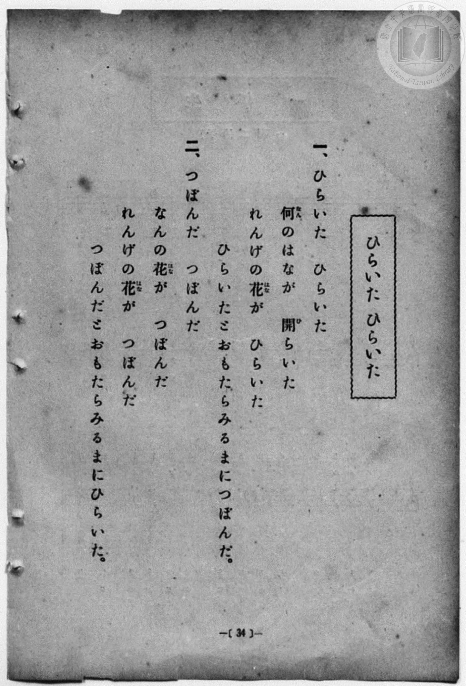
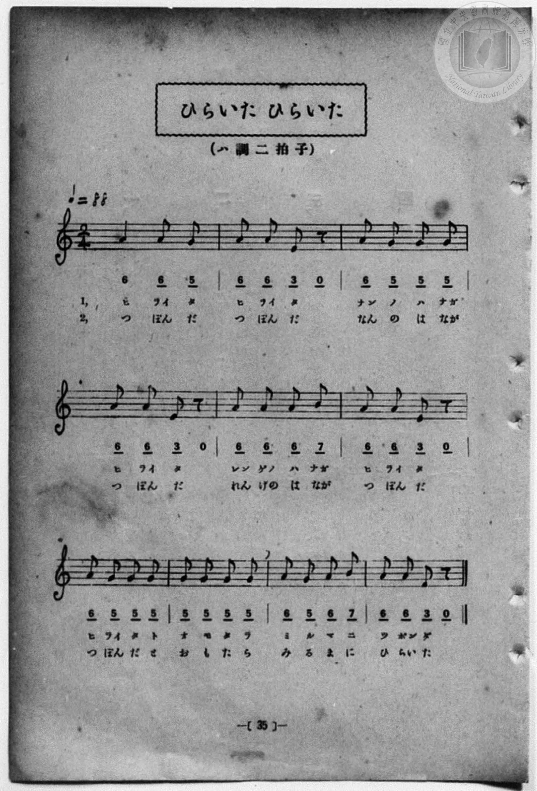

# ひらいた ひらいた

> Re:Shōka 使用 AI 協助辨識與重建樂譜，可能會有錯誤。歡迎回報。

<audio controls src="hiraita_hiraita.mp3"></audio>

- 一條慎三郎 編《新編 小學校・公學校 唱歌教材集》（大正十二年十二月，索書號 0725-41）

## 說明

曲目說明
中文解釋：傳統童謠遊戲歌，描寫蓮花盛開又合攏的景象。
原書資訊（對應 P042.jpg–P043.jpg，原書 p. 34–35）：
調性與拍號：ハ調 二拍子，♩=88


## 歌詞

```text
一、ひらいた　ひらいた
何（なん）のはなが　開（ひ）らいた
れんげの花（はな）が　ひらいた
ひらいたとおもたらみるまにつぼんだ。

二、つぼんだ　つぼんだ
なんの花（はな）が　つぼんだ
れんげの花（はな）が　つぼんだ
つぼんだとおもたらみるまにひらいた。
```

## ABC

```abc
X:1
T:ひらいた ひらいた
M:2/4
L:1/16
Q:1/4=88
K:C
V:V1 name="Piano" snm="Pia"
[V:V1]
A4 A2 G2 | A2 A2 E2 z2 | A2 G2 G2 G2 | A2 A2 E2 z2 |
w: ヒ ライ タ | ヒ ライ タ | ナン ノ ハ ナガ | ヒ ライ タ
A2 A2 A2 B2 | A2 A2 E2 z2 | A2 G2 G2 G2 | G2 G2 G2 G2 |
w: レン ゲノ ハ ナガ | ヒ ライ タ | ヒ ライ タ ト | オ モ タ ラ
A2 G2 A2 B2 | A2 A2 E2 z2 | A4 A2 G2 | A2 A2 E2 z2 |
w: ミ ル マ ニ | ツ ボン ダ | つ ぼん だ | つ ぼん だ
A2 G2 G2 G2 | A2 A2 E2 z2 | A2 A2 A2 B2 | A2 A2 E2 z2 |
w: なん の は なが | つ ぼん だ | れん げの は なが | つ ぼん だ
A2 G2 G2 G2 | G2 G2 G2 G2 | A2 G2 A2 B2 | A2 A2 E2 z2 |
w: つ ぼん だ と | お も た ら | み る ま に | ひ らい た
```

## TMD 檔案連結

- [主旋律 TMD 檔案](hiraita_hiraita.tmd) [[在 TMD Studio 編輯](https://tmdlang.github.io/Tmd-TS/#tmd=s7IKdvYPcrWy4qpTUCpJTLdSSM7PyUlNLsnMz7MqzsjPTozPrsyvSsyML84ojTe0NDJWgqssy88pzU21Si9KTEmNN4w3QsgU55cWJadaFSdn5OfnxJekVpQk5edno8vHFySmp1oFGJgg6Swoyi9LzUvMA-ouKMrMK0lNAWtHKEgty0xJBUkXJyfmxZelFmWmZaamIDkqtagY7HaIFSVFiXnFyUWZBSAPIVSVZKQCXV6Qk1gZn5iXEp-emJtarMSlpaXwuHHT46bOx40tjxvno3K0tLgUbRUsLLjsbRWcuWyM9E3sQMY92dHwbNHcZ619T3Z0vmzuU3i-fcXjhq5n0zYAGQpPN_Q_Xbvj2YKFj5t3P21dA2ErPJ2y8dnanmdTZz6bO-Hl7LbHDd3v93Q8XbL82drFT3sbn-zqebpzC4TxbE7H-z09z7csejZ7x4uZ8xUMzI1MdU0M3-_pVOLS11J4NnvT89nrXqxa9WxGH5eCgsKTHWufTWt_sXzxy3agkbOeNm1-vnXj89VLX6xZ8LKx61nHJqC1QPOe9fc_Xb_6xeR1L7o2Pp89--W07qf9HU8ndDyb0v98VsuzmetfbFz4uKEJZOLTvvkgqze3v1jRBXLkht5n7Z0KoCjTyypIf9QwGcg0BjGBxkLUKhToKRibAGWMTYHOBLoCZMyLVfufNSx_0dH-rLsX6A-g6OPmfqCgAsiP3b1P104A6n80c6UtMHi19LmAfuMChuvjhkbkGHjc0IDM5XqydyrQSY8bVz1umgy06nHjuseN60Hcxh6gUqCvwLKbQFJwPY-beoCqHzdOAqoG-h6sAqQHrB-kDcUGFNsbVzxu7Hrc1ARigwT3P27qfty473Hj6seNSx437gGbuwAUblxAX4HdjiwMNBnBBZoMcjVuRyArJexkFIORLMXnZORwbQIHum9iZp5VQGZiXr5DjUFNNSjeFGwstOzAjBoFMwVdIDYFs8wUjBUMwCxTMKwBq_ExrFF43DwJqO5x88rHTUsUHjftByoCCSEJgPQ9bu563LwZSPUBcT-Y27QGZooRUL5xCcgUsEeA1AKQFqAQkgDYFHAgAql1QLwezG3sAZoCdzDCmSBojiyG4mAM160Bu65pE7oDsahGcTO6A8FRB-SC4g7FjVhUI5wNDVMoDQlxU2I98Li5A2zzKiBrEVRkJdjlwPKseTUQzwPibrBICxDPgUREAz6_ABMS2MldQPOagDTQpKZOsAjQ9KZuIL0PiFeDRTaB5IAJC6wMZGYtF5eunQIocUX7GMYqwNlGYLYyAA)]
- [鋼琴伴奏 TMD 檔案](hiraita_hiraita_piano.tmd) [[在 TMD Studio 編輯](https://tmdlang.github.io/Tmd-TS/#tmd=s7IKdvYPcrWy4qpTUCpJTLdSSM7PyUlNLsnMz7MqzsjPTozPrsyvSsyML84ojTe0NDJWgqssy88pzU21Si9KTEmNN4w3QsgU55cWJadaFSdn5OfnxJekVpQk5edno8vHFySmp1oFGJgg6Swoyi9LzUvMA-ouKMrMK0lNAWtHKEgty0xJBUkXJyfmxZelFmWmZaamIDkqtagY7HaIFSVFiXnFyUWZBSAPIVQlFgHF01NzU_NKrAoyE_Py4xOTk_NzCxLzMkFiSlxaWgqPGzc9bup83NjyuHE-Cuf9no6Xs2c-6-x-2b3n-YQtT_Zsebq0__2eTgUtLS5FWwULCy57WwVnLhsjfRM7kI1PdjQ8WzT3WWvfkx2dL5v7FJ5vX_G4oevZtA1AhsLTDf1P1-54tmDh4-bdT1vXQNgKT6dsfLa259nUmc_mTng5u-1xQzfQ0qdLlj9bu_hpb-OTXT1Pd26BMJ7N6Xi_p-f5lkXPZu94MXO-goG5kamuiSHQOUpcXL6JmXlWASD_BXk41BjUVHMpAIGNhZYdmFGjYKagC8SmYJaZgrGCAZhlCoY1YDU-hjUKj5snAdU9bl75uGmJwuOm_UBFICEkAZC-x81dj5s3A6k-IO4Hc5vWwEwxAso3LgGZ0rjncdNkILUApAUohCQANqVxFYS7DojXg7mNPUBT4A5GOBMEzZHFUByM4bo1YNc1bUJ3IBbVKG5Gd2BTD4Q7Cd2NWFQjnA0NUygNCXFTYj3wuLkDbPMqIGsRVGQl2OXAlNm8GojnAXE3WKQFiOdAIqIBn18eN64AO7kLaF4TkAaa1NQJFgGa3tQNpPcB8WqwyCaQHDDxg5WBzKxFTls-yGnLBJG24rWNIQSUbRyPYGmbAznIChGS6FpQVYE1QmkYD0Mb1Im6dgogV0b7GMYqwNlGYLYyFwA)]

## 分析

```text
================================================================================
📊 TMD Song Profile: [ ひらいた ひらいた ]
================================================================================
⏱  Duration:       0:27 (27.3s), 20 measures total
🎼 Key & Tempo:    首調基準 C, != 88.0 BPM, <2/4>
   - 分析範圍：      由實際發聲的音符與和弦推測調性；播放脈絡另行呈現
🎤 人聲音域:    E4 (MIDI 64) – B4 (MIDI 71) [跨度: 7 個半音 / 0.6 個八度, 難度: easy]
   - 最低音:  E4 in [Main[L1] #1 @ m.2, 0:02]
   - 最高音: B4 in [Main[L1] #1 @ m.5, 0:06]
   - 適合: soprano, mezzo-soprano, contralto, tenor, baritone, bass
🏛  結構:      Main[L1] (13.6s) -> Main[L2] (13.6s)
⚡ 編曲密度:        Peak 1 軌道同時演奏
🗝  調性診斷：       A 小調（純淨自然小調，未偵測到可信轉調）
   - 風格氣質:    純淨自然小調（陰鬱抒情、旋律集中，無明顯調外色彩）
   - 轉調歷程:    全曲維持單一推測調性（未偵測到可信轉調）
   - 核心骨幹音:  A, G, E, B
   - 調性數值:    A 小調 [相關度: 0.60, 穩定度: Moderate, 自然音純度: 100.0%]
   - 候選調性 (K-S): A 小調 (0.60), A 大調 (0.52), D 大調 (0.45)
   - 五度圈歷程:   +3 -> +3
   - 各段落調性細節:
     • [Main[L1] #1]: A 小調 (r: 0.60, 自然音純度: 100.0%)
     • [Main[L2] #1]: A 小調 (r: 0.60, 自然音純度: 100.0%)

  [ 五度圈游移軌跡 ]
               C  
         F            G  
      Bb               D  
      Eb              [A ]*
         Ab           E  
            Db       B  
               F# 
     (* = active key center)

  [ 十二半音累積音高分佈 ]
     C  :                            0.0%
     C# :                            0.0%
     D  :                            0.0%
     D# :                            0.0%
     E  : █████                     11.1%
     F  :                            0.0%
     F# :                            0.0%
     G  : ████████████████          33.3%
     G# :                            0.0%
     A  : ████████████████████████  50.0%
     A# :                            0.0%
     B  : ███                        5.6%
--------------------------------------------------------------------------------
Assignment 軌道音域：
  - Piano         : E4 – B4 (7 個半音 / 0.6 個八度, 70 個音符)
================================================================================
```


## 原書掃描頁






