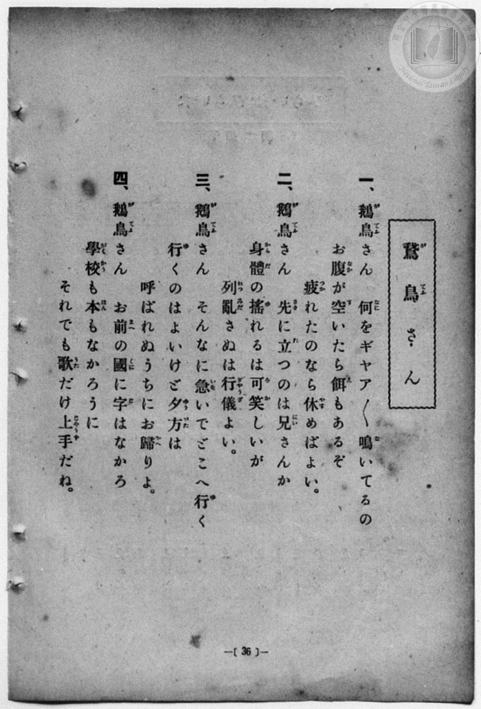
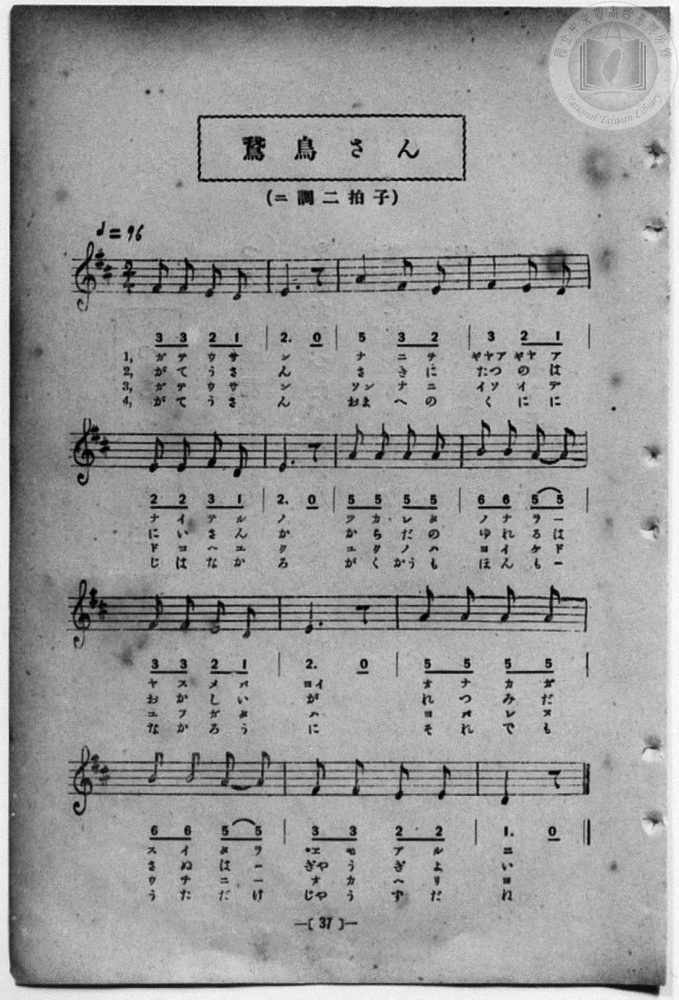

# 鵞鳥さん

> Re:Shōka 使用 AI 協助辨識與重建樂譜，可能會有錯誤。歡迎回報。

- **NEUTRINO 歌聲合成版**：<br><audio controls src="gachosan_neutrino.mp3"></audio>
- **鋼琴伴奏版**：<br><audio controls src="gachosan.mp3"></audio>


- 一條慎三郎 編《新編 小學校・公學校 唱歌教材集》（大正十二年十二月，索書號 0725-41）

## 說明

曲目說明
中文解釋：對著成群結隊搖擺前進、嘎嘎大叫的鵝說話的童趣歌曲。
原書資訊（對應 P044.jpg–P045.jpg，原書 p. 36–37）：
調性與拍號：ニ調 二拍子，♩=96


## 歌詞

```text
一、鵝鳥（がてう）さん　何（なに）をギヤア／＼鳴（な）いてるの
お腹（なか）が空（す）いたら餌（ゑ）もあるぞ
疲（つか）れたのなら休（やす）めばよい。

二、鵝鳥（がてう）さん　先（さき）に立（た）つのは兄（にい）さんか
身體（からだ）の搖（ゆ）れるは可笑（をか）しいが
列（れつ）亂（みだ）さぬは行儀（ぎやうぎ）よい。

三、鵝鳥（がてう）さん　そんなに急（いそ）いでどこへ行（い）く
行（い）くのはよいけど夕方（ゆふがた）は
呼（よ）ばれぬうちにお歸（かへ）りよ。

四、鵝鳥（がてう）さん　お前（まへ）の國（くに）に字（じ）はなかろ
學校（がくかう）も本（ほん）もなかろうに
それでも歌（うた）だけ上手（じやうず）だね。
```

## ABC

```abc
X:1
T:鵞鳥さん
M:2/4
L:1/16
Q:1/4=96
K:D
V:V1 name="Piano" snm="Pia"
[V:V1]
F2 F2 E2 D2 | E4 z4 | A4 F2 E2 | F4 E2 D2 |
w: 1.~ガ テ ウ サ | ン | ナ ニ ヲ | ギャア ギャ ア
w: 2.~が て う さ | ん | さ き に | たつ の は
w: 3.~ガ テ ウ サ | ン | ソン ナ ニ | イソ イ デ
w: 4.~が て う さ | ん | おま へ の | く に に
E2 E2 F2 D2 | E4 z4 | A2 A2 A2 A2 | B2 B2 A2 A2 |
w: 1.~ナ イ テ ル | ノ | ツ カ レ タ | ノ ナ ラ _
w: 2.~に い さ ん | か | か ら だ の | ゆ れ る は
w: 3.~ド コ ヘ イ | ク | イ ク ノ ハ | ヨ イ ケ ド
w: 4.~じ は な か | ろ | がく かう も _ | ほ ん も _
F2 F2 E2 D2 | E4 z4 | A2 A2 A2 A2 | B2 B2 A2 A2 |
w: 1.~ヤ ス メ バ | ヨイ | オ ナ カ ガ | ス イ タ ラ
w: 2.~を か し い | が | れ つ み だ | さ ぬ は _
w: 3.~ユ フ ガ タ | ハ | ヨ バ レ ヌ | ウ チ ニ _
w: 4.~な か ろ う | に | そ れ で も | う た だ け
F2 F2 E2 E2 | D4 z4 | F2 F2 E2 D2 | E4 z4 |
w: 1.~ヱ モ ア ル | ゾ | ガ テ ウ サ | ン
w: 2.~ぎや う ぎ よ | い | が て う さ | ん
w: 3.~オ カ ヘ リ | ヨ | ガ テ ウ サ | ン
w: 4.~じや う ず だ | ね | が て う さ | ん
A4 F2 E2 | F4 E2 D2 | E2 E2 F2 D2 | E4 z4 |
w: 1.~ナ ニ ヲ | ギャア ギャ ア | ナ イ テ ル | ノ
w: 2.~さ き に | たつ の は | に い さ ん | か
w: 3.~ソン ナ ニ | イソ イ デ | ド コ ヘ イ | ク
w: 4.~おま へ の | く に に | じ は な か | ろ
A2 A2 A2 A2 | B2 B2 A2 A2 | F2 F2 E2 D2 | E4 z4 |
w: 1.~ツ カ レ タ | ノ ナ ラ _ | ヤ ス メ バ | ヨイ
w: 2.~か ら だ の | ゆ れ る は | を か し い | が
w: 3.~イ ク ノ ハ | ヨ イ ケ ド | ユ フ ガ タ | ハ
w: 4.~がく かう も _ | ほ ん も _ | な か ろ う | に
A2 A2 A2 A2 | B2 B2 A2 A2 | F2 F2 E2 E2 | D4 z4 |
w: 1.~オ ナ カ ガ | ス イ タ ラ | ヱ モ ア ル | ゾ
w: 2.~れ つ み だ | さ ぬ は _ | ぎや う ぎ よ | い
w: 3.~ヨ バ レ ヌ | ウ チ ニ _ | オ カ ヘ リ | ヨ
w: 4.~そ れ で も | う た だ け | じや う ず だ | ね
```

## TMD 檔案連結

- [主旋律 TMD 檔案](gachosan.tmd) [[在 TMD Studio 編輯](https://tmdlang.github.io/Tmd-TS/#tmd=s7IKdvYPcrWy4qpTUCpJTLdSSM7PyUlNLsnMz7MqzsjPTozPrsyvSsyML84ojTe0NDJWgqssy88pzU21Si9KTEmNN4w3QsgU55cWJadaFSdn5OfnxJekVpQk5edno8vHFySmp1oFGJiYIGQKivLLUvMS84C6C4oy80pSU8DaEQpSyzJTUkHSxcmJefFlqUWZaZmpKUiOSi0qBrsdYkVJUWJecXJRZgHIQwhV-UUlGflAhxdkVFplZBaX5BdlJifmxGcn5iUiFJVkpAK9l5iXmZuYo8SlpaXwcuu8l5uXPm6c-rhpsoKWFpeirYKlGZe9rYILl42RvokdSOeTHQ3PFs191tr3ZEfny-Y-hefbVzxu6Ho2bQOQofB0Q__TtTueLVj4uHn309Y1ELbC0ykbn63teTZ15rO5E17Obnvc0P1-T8fTJcufrV38tLfxya6epzu3QBjP5nS839PzfMuiZ7N3vJg5X8HA3MhU18Tw_Z5OJS59LYVnszc9n73uxapVz2b0cSkoKDzZsfbZtPYXyxe_bAcaOevpht4XE6c_65jwfN-S51snvJzV9WzCtGeTdz3t7H3ZsOlxQ-PTGX0gtGT50_7Vz2e1vNw6F2jWi5Ubgeznq5e-2LYY5MzZQJVNINOf9s0HOWNz-4sVXSAHb-h91t6pAIpOvayC9EcNk4FMUxAT6GSIWoUCPQVjM6CMsTnQyUAXgYx5sWr_s4blLzran3X3Av0EFH3c3A0UVAD5t7v36doJQP2PZq60BQa1lj4X0J9cwDAGuhboPGBsAG1-3NjzuHHZ48Y2oKGQyHnc0PBk71Sw1KrHjatB4k2THjete9y85HHTovd7-t_v2fNy8xaIArCuFpAJTd2PG9dxPW7setG6E6YZGHBA6Z7nK3eBRWbCVM9_3NT5ckkPSLBpItiCpseNTWAj5nE9n7YJrHoJVH8T0IHzgWaDTGzqfLIHqAGoDWgK2LimxseNGx43AdW3gIKWC-hxgt572gpMCUCpqY8be8Hiq5-vBiUboD1gLtBmoG3rn7a2gAVXA81GaG_s5nqxa_XL1VPAct1AJz1uXACWXgdMEWC3gS0DOhvkn_VP-9c_XwNx8yRYiEwHh0IP19OO6WAJoBuXACWe7GoCG7ofZiLQgWuARrxY2PO0pQEs1Qf2eRuQAbYD4e0dnQS9_bhxLtgDoFh91gBRBjRsLixWlj9uXPm4EahgB9BCiCxYqp8LjQ8JHqjtjROB2p4umfpsGjjam4Bu2wq2HhKW67meTtwDlgCGOZAPjCugHNBXQHULwWHb9WztDmhYNgIZQF91gYwG-erp7NlE-KoLmAfBsvugBjSuezoHEp9Ap4ITcOPqp2vBQd04A-IqSPJ83NTLBSlHYKYDNQCdAYnApmdz1oDFdwNtgqVSqDaw-1cDkzswSIHaloNUr4UEElAC4vUFwLB5sqPrWSfELTNgUTcLJrsW5ElQtvRNzMyzCshMzMt3qDGoqQblbAUbCy07MKNGwRgIjRQMgSwjBV0FAyCuUTAFkiBRkKwuRBas2sewRuFx0xqFx81tQHoZEG8FqnncvBmu83FzF5AGlhNAvAnEB2XtxcCsDRIFs4HUIphxRkAFjT1ADDSqEWhk41SwlskI44AiQI2NvUC8GswHZtYlYKF1QLweZpAxQXc17YVwQQ4EOQ8kBCxy9oLdtQQo1A4zy4Swo7qAyQHsiB1gh4CE-sH81RB3ckHD1ggIjTHCFgJrFMyAEMxChC3IcWDXAO1tBnsYWFEhwrYFKAu0ohno06b9UFmIh1aCVCAFKsghQNVAt4NcDhLpRnI_MHaaOoH0Apjzm0DhBvRzE1AGNVSbgeqaNgPpGWCXgdSuRwpVoFuBfIg7-sEuWgEV3QjWixymQBOAZgNTOdgFIN29SG4C5Q-QBDjMm5qgorvB7ofyYcGKPclCgxUpMEHO2AmkFwLxBIjjQG5DuB7oEnCIA0MLmHqQwq9pEiSUGqeDwxGSIhD6QKkDaHjjfnAYIocWMM00g8IcEUOghAGLP2DYAB0Cjr_mHpSwgYQJKERA_ofEICJs5kLtXA4OCXg4wBMQNERAGdYQpg0pwwLDABwlQOcCEwrIIaDIWQTOidBk1gRKz0j6wIkI6JFGoFOBkQZxBqh-gOYJYHw3dYAFW1A1gnMiKBQawdkMHs7gdAtMAc2roCGBogscBiBz50NT5USw2aBSDSoxCxLUQHItXGstF5eunQKofFNAopUB)]
- [鋼琴伴奏 TMD 檔案](gachosan_piano.tmd) [[在 TMD Studio 編輯](https://tmdlang.github.io/Tmd-TS/#tmd=s7IKdvYPcrWy4qpTUCpJTLdSSM7PyUlNLsnMz7MqzsjPTozPrsyvSsyML84ojTe0NDJWgqssy88pzU21Si9KTEmNN4w3QsgU55cWJadaFSdn5OfnxJekVpQk5edno8vHFySmp1oFGJiYIGQKivLLUvMS84C6C4oy80pSU8DaEQpSyzJTUkHSxcmJefFlqUWZaZmpKUiOSi0qBrsdYkVJUWJecXJRZgHIQwhV-UUlGflAhxdkVFplZBaX5BdlJifmxGcn5iUiFCUWATWnp-am5pVYFWQm5uXHJyYn5-cWJOZlgsSUuLS0FF5unfdy89LHjVMfN01-v6fj5eyZzzq7X3bveT5hy5M9W54u7X-_p1NBS4tL0VbB0ozL3lbBhcvGSN_EDmTJkx0NzxbNfdba92RH58vmPoXn21c8buh6Nm0DkKHwdEP_07U7ni1Y-Lh599PWNRC2wtMpG5-t7Xk2deazuRNezm573NANtPTpkuXP1i5-2tv4ZFfP051bIIxnczre7-l5vmXRs9k7Xsycr2BgbmSqa2IIdI4SF5dvYmaeVQDIS0EeDjUGNdVcCkBgY6FlB2bUKBgDoZGCIZBlpKCrYADENQqmQBIkCpLVhciCVfsY1ig8blqj8Li5DUgvA-KtQDWPmzfDdT5u7gLSj5u7gXgTiN-07nHz4sdNi0CiYDaQWgQzzgiooLEHiIFGNQKNbJwK1jIZYRxQBKixsReIV4P58x83LgELrQPi9TCDjAm6q2kvhAtyIMh5IKElQFGwu5YAhdphZpkQdlTX48Z9YEfsADsEJNQP5q-GuJMLGrZGQGiMEbYQWKNgBoRgFiJsQY4DuwZobzPYw8DEggjbFqAs0IpmoE-b9kNlIR5aCVKBFKgghwBVA90OcjlIpBvJ_cDYaeoE0gtgzm8ChRvQz01AGdRQbQaqa9oMpGeAXQZSux4pVIFuBfIh7ugHu2gFVHQjWC9ymAJNAJr9uHEV2AUg3b1IbuoBhSFQAhzmTU1Q0d1g90P5sGDFnmShwYoUmCBn7ATSC4F4AsRxILchXA90CTjEgaEFTD1I4dc0CRJKjdPB4QhJEQh9oNQBNLxxPzgMkUMLmGaaQWGOiCFQwoDFHzBsgA4Bx19zD0rYQMIEFCIg_0NiEBE2c6F2LgeHBDwc4AkIGiKgDGsI04aUYYFhAI4SoHOBCQXkEFDkLALnRGgyawKlZyR94EQE9Egj0KnASIM4o-9xEyhNgfIEML6bOsCCLagawTkRFAqN4GwGD2dwugWmgOZV0JBA0QUOA5C586GpciLY7BkIC2dBghpIroVrrUUu3nyQizcTePFmqG2sYBqvDQoaIGUeD9QKFwTyIGwQhrgEpgosgqYDImYSr22IogGnDciKELowLAcqB_lE104B5JloH8NYBTjbCIltjMQ2AbOVuQA)]

## 分析

```text
================================================================================
📊 TMD Song Profile: [ 鵞鳥さん ]
================================================================================
⏱  Duration:       0:35 (35.0s), 28 measures total
🎼 Key & Tempo:    首調基準 D, != 96.0 BPM, <2/4>
   - 分析範圍：      由實際發聲的音符與和弦推測調性；播放脈絡另行呈現
🎤 人聲音域:    D4 (MIDI 62) – B4 (MIDI 71) [跨度: 9 個半音 / 0.8 個八度, 難度: easy]
   - 最低音:  D4 in [Main #1 @ m.1, 0:00]
   - 最高音: B4 in [Main #1 @ m.8, 0:08]
   - 適合: soprano, mezzo-soprano, contralto, tenor, baritone, bass
🏛  結構:      Main (17.5s) -> Main (17.5s)
⚡ 編曲密度:        Peak 1 軌道同時演奏
🗝  調性診斷：       A 大調（純淨自然大調，未偵測到可信轉調）
   - 風格氣質:    純淨自然大調（陽光明朗、易唱易記，無明顯調外色彩）
   - 轉調歷程:    全曲維持單一推測調性（未偵測到可信轉調）
   - 核心骨幹音:  E, A, F#, D, B
   - 調性數值:    A 大調 [相關度: 0.85, 穩定度: High, 自然音純度: 100.0%]
   - 候選調性 (K-S): A 大調 (0.85), D 大調 (0.62), F# 小調 (0.60)
   - 五度圈歷程:   +3 -> +3
   - 各段落調性細節:
     • [Main #1]: A 大調 (r: 0.85, 自然音純度: 100.0%)
     • [Main #2]: A 大調 (r: 0.85, 自然音純度: 100.0%)

  [ 五度圈游移軌跡 ]
               C  
         F            G  
      Bb               D  
      Eb              [A ]*
         Ab           E  
            Db       B  
               F# 
     (* = active key center)

  [ 十二半音累積音高分佈 ]
     C  :                            0.0%
     C# :                            0.0%
     D  : ██████████                12.5%
     D# :                            0.0%
     E  : ████████████████████████  29.2%
     F  :                            0.0%
     F# : █████████████████         20.8%
     G  :                            0.0%
     G# :                            0.0%
     A  : ████████████████████████  29.2%
     A# :                            0.0%
     B  : ███████                    8.3%
--------------------------------------------------------------------------------
Assignment 軌道音域：
  - Piano         : D4 – B4 (9 個半音 / 0.8 個八度, 84 個音符)
================================================================================
```


## 原書掃描頁






