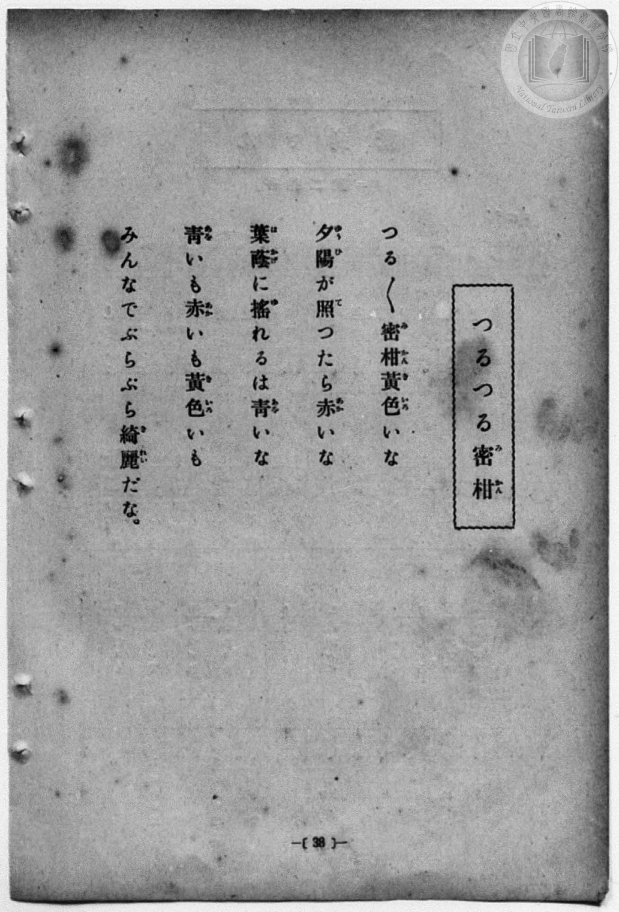
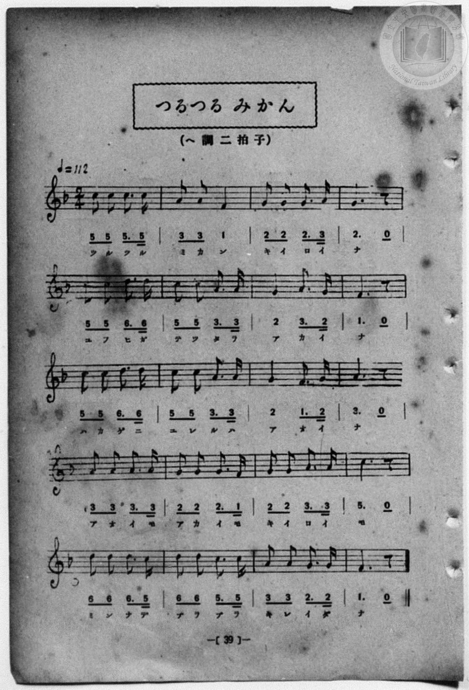

# つるつる 密柑

> Re:Shōka 使用 AI 協助辨識與重建樂譜，可能會有錯誤。歡迎回報。

- **鋼琴伴奏版**：<br><audio controls src="tsurutsuru_mikan.mp3"></audio>
- **NEUTRINO 歌聲合成版**：<br><audio controls src="tsurutsuru_mikan_neutrino.mp3"></audio>

- 一條慎三郎 編《新編 小學校・公學校 唱歌教材集》（大正十二年十二月，索書號 0725-41）

## 說明

曲目說明
中文解釋：描寫滑溜溜的橘子在夕陽與綠葉間呈現紅、黃、綠各種美麗色澤。
原書資訊（對應 P046.jpg–P047.jpg，原書 p. 38–39）：
調性與拍號：ヘ調 二拍子，♩=112


## 歌詞

```text
つる／＼密柑（みかん）黄色（きいろ）いな
夕陽（ゆふひ）が照（て）つたら赤（あか）いな
葉蔭（はかげ）に搖（ゆ）れるは青（あを）いな
青（あを）いも赤（あか）いも黄色（きいろ）いも
みんなでぶらぶら綺麗（きれい）だな。
```

## ABC

```abc
X:1
T:つるつる 密柑
M:2/4
L:1/16
Q:1/4=112
K:F
V:V1 name="Piano" snm="Pia"
[V:V1]
c2 c2 c3 c | A2 A2 F4 | G2 G2 G3 A | G4 z4 |
w: ツ ル ツ ル | ミ カ ン | キ イ ロ イ | ナ
c2 c2 d3 d | c2 c2 A3 A | G4 A3 G | F4 z4 |
w: ユ フ ヒ ガ | テ ツ タ ラ | ア カ イ | ナ
c2 c2 d3 d | c2 c2 A3 A | G4 F3 G | A4 z4 |
w: ハ カ ゲ ニ | ユ レ ル ハ | ア ヲ イ | ナ
A2 A2 A3 A | G2 G2 G3 F | G2 G2 A3 A | c4 z4 |
w: ア ヲ イ モ | ア カ イ モ | キ イ ロ イ | モ
d2 d2 d3 c | d2 d2 c3 c | A2 A2 G3 G | F4 z4 |
w: ミ ン ナ デ | ブ ラ ブ ラ | キ レ イ ダ | ナ
```

## TMD 檔案連結

- [主旋律 TMD 檔案](tsurutsuru_mikan.tmd) [[在 TMD Studio 編輯](https://tmdlang.github.io/Tmd-TS/#tmd=s7IKdvYPcrWy4qpTUCpJTLdSSM7PyUlNLsnMz7MqzsjPTozPrsyvSsyML84ojTe0NDJWgqssy88pzU21Si9KTEmNN4w3QsgU55cWJadaFSdn5OfnxJekVpQk5edno8vHFySmp1oFGJiYIWQKivLLUvMS84C6C4oy80pSU8DaEQpSyzJTUkHSxcmJefFlqUWZaZmpKUiOSi0qBrsdYkVJUWJecXJRZgHIQwhV-UUlGflAhxdkVFplZBaX5BdlJifmxGcn5iUiFJVkpAK9l5dYUlqUiqw1Mz0zz6o0D-SOEqjtWloKjxuXPG7qhpAKT9e3PZs_UUFLi0vRVsHQ0IjL3lbBjcvGSN_EDmTQkx0NzxbNfdba92RH58vmPoXn21c8buh6Nm0DkKHwdEP_07U7ni1Y-Lh599PWNRC2wtMpG5-t7Xk2deazuRNezm573ND9fk_H0yXLn61d_LS38cmunqc7t0AYz-Z0vN_T83zLomezd7yYOV_BwNzIVNfE8P2eTiUufS2FZ7M3PZ-97sWqVc9m9HEpKCg82bH22bT2F8sXv2wHGjnrWX__0_Wrn-2e-GzXHCB6Pqvl2coZT9dOeDpnxdMlU1_O3Puio_35tgUvJna-nDb56cSO5_37nm9pfdzQ-HJ3M5AESj2d0PJ8xbrn-_pe7pr-onPTs31LHjc0gWx62jcf5KTN7S9WdIEcv6H3WXunAij-9bIK0h81TAYyzUFMoPMhahUK9BSMLYAyxpZA5wNdBzLmxar9zxqWA53xrLsX6D-g6OPmGUBBBZDfu3uBbgXqfzRzpS0o3LX0uYCe5oJEy_s9_e_37IHEDdABjxv3P27sftw0GWj2y90tQLeCBXsfN7Y8buoFCoIYjau4IP4GyTW1PW7c-rgRqA4o1_O8dTlYwzIwd8njxvmPmzpfbF0CFmwCGo0wAhhcL6asBUusB9nZOAkst_rZhGkQc0Hcph5wAlr_ci5QFmxEE0QZ2Agsok1NWGxrasLpl6YmYEDsB3oYaN7jxuWPG7cBHQwhn2_bBYwuqB6gQxpbwHoWgFQCYw8UjL6JwGQfkJmYl-9QY1BTDYoKBRtDMy07MKtGwVRBF45BZI2CMZAGYUOwiC5QxAhIwjBIDiICggYwNWDTfAxrFB43twD5j5tXg0kQG8IDycwHsZsgMpvhpj9uWgsWXwIWB7EhPJCOLgx70JxtBhY2QxIBOR3VkRARI6AIzEvYnL0MbP1UMDkJ6og1YEe0wb3yuGk_1EMrwQ5fBDUH4ikqOxviWJCzIXLYnd0Pt_5x0yao47rBjoB4aA2YhDoPqBrF2c1QHYScDUsSqI5EJAlDJBGEGkiSwupssBMg1kMiHsRbBHcczEOoMriTCcxDGA4HhTMMQ1I3jIeZ3iFeIZRMwGkYnHph4fW4uR3siGlg9kowCWIjkgnY4ZCYgHupAUeI13Jx6dopgHKtApBWBgA)]
- [鋼琴伴奏 TMD 檔案](tsurutsuru_mikan_piano.tmd) [[在 TMD Studio 編輯](https://tmdlang.github.io/Tmd-TS/#tmd=s7IKdvYPcrWy4qpTUCpJTLdSSM7PyUlNLsnMz7MqzsjPTozPrsyvSsyML84ojTe0NDJWgqssy88pzU21Si9KTEmNN4w3QsgU55cWJadaFSdn5OfnxJekVpQk5edno8vHFySmp1oFGJiYIWQKivLLUvMS84C6C4oy80pSU8DaEQpSyzJTUkHSxcmJefFlqUWZaZmpKUiOSi0qBrsdYkVJUWJecXJRZgHIQwhV-UUlGflAhxdkVFplZBaX5BdlJifmxGcn5iUiFCUWATWnp-am5pVYFWQm5uXHJyYn5-cWJOZlgsSUuLS0FB43Lnnc1A0hFZ6ub3s2f-L7PR0vZ8981tn9snvP8wlbnuzZ8nRp__s9nQpaWlyKtgqGhkZc9rYKblw2RvomdiDLnuxoeLZo7rPWvic7Ol829yk8377icUPXs2kbgAyFpxv6n67d8WzBwsfNu5-2roGwFZ5O2fhsbc-zqTOfzZ3wcnbb44ZuoK1Plyx_tnbx097GJ7t6nu7cAmE8m9Pxfk_P8y2Lns3e8WLmfAUDcyNTXRNDoHuUuLh8EzPzrAJAXgvycKgxqKnmUgACG0MzLTswq0bBVEEXjkFkjYIxkAZhQ7CILlDECEjCMEgOIgKCBjA1YNN8DGsUHje3APmPm1eDSRAbwgPJzAexmyAym-GmP25aCxZfAhYHsSE8kI4uDHvQnG0GFjZDEgE5HdWREBEjoAjMS9icvQxs_VQwOQnqiDVgR7TBvfK4aT_UQyvBDl8ENQfiKSo7G-JYkLMhctid3Q-3_nHTJqjjusGOgHhoDZiEOg-oGsXZzVAdhJwNSxKojkQkCUMkEYQaSJLC6mywEyDWQyIexFsEdxzMQ6gyuJMJzEMYDgeFMwxDUjeMh5neIV4hlEzAaRicemHh9bi5HeyIaWD2SjAJYiOSCdjhkJiAe6kBR4jXImdaH-RMawLPs4baxmCMzDKN1zaPh5IwngHU5RB1JvHaoHjCpQUkRqEG3C6ByxghaQGbD7UETCH8hG4HMFR07RRAARPtYxirAGQrcwEA)]

## 分析

```text
================================================================================
📊 TMD Song Profile: [ つるつる 密柑 ]
================================================================================
⏱  Duration:       0:21 (21.4s), 20 measures total
🎼 Key & Tempo:    首調基準 F, != 112.0 BPM, <2/4>
   - 分析範圍：      由實際發聲的音符與和弦推測調性；播放脈絡另行呈現
🎤 人聲音域:    F4 (MIDI 65) – D5 (MIDI 74) [跨度: 9 個半音 / 0.8 個八度, 難度: easy]
   - 最低音:  F4 in [Main #1 @ m.2, 0:01]
   - 最高音: D5 in [Main #1 @ m.5, 0:04]
   - 適合: soprano, mezzo-soprano, contralto, tenor, baritone, bass
🏛  結構:      Main (21.4s)
⚡ 編曲密度:        Peak 1 軌道同時演奏
🗝  調性診斷：       C 大調（純淨自然大調，未偵測到可信轉調）
   - 風格氣質:    純淨自然大調（陽光明朗、易唱易記，無明顯調外色彩）
   - 轉調歷程:    全曲維持單一推測調性（未偵測到可信轉調）
   - 核心骨幹音:  G, A, C, D, F
   - 調性數值:    C 大調 [相關度: 0.76, 穩定度: Moderate, 自然音純度: 100.0%]
   - 候選調性 (K-S): C 大調 (0.76), A 小調 (0.66), F 大調 (0.61)
   - 五度圈歷程:   +0
   - 各段落調性細節:
     • [Main #1]: C 大調 (r: 0.76, 自然音純度: 100.0%)

  [ 五度圈游移軌跡 ]
              [C ]*
         F            G  
      Bb               D  
      Eb               A  
         Ab           E  
            Db       B  
               F# 
     (* = active key center)

  [ 十二半音累積音高分佈 ]
     C  : ██████████████████████    23.6%
     C# :                            0.0%
     D  : █████████████             13.6%
     D# :                            0.0%
     E  :                            0.0%
     F  : ███████████               11.4%
     F# :                            0.0%
     G  : ████████████████████████  25.7%
     G# :                            0.0%
     A  : ████████████████████████  25.7%
     A# :                            0.0%
     B  :                            0.0%
--------------------------------------------------------------------------------
Assignment 軌道音域：
  - Piano         : F4 – D5 (9 個半音 / 0.8 個八度, 62 個音符)
================================================================================
```


## 原書掃描頁






