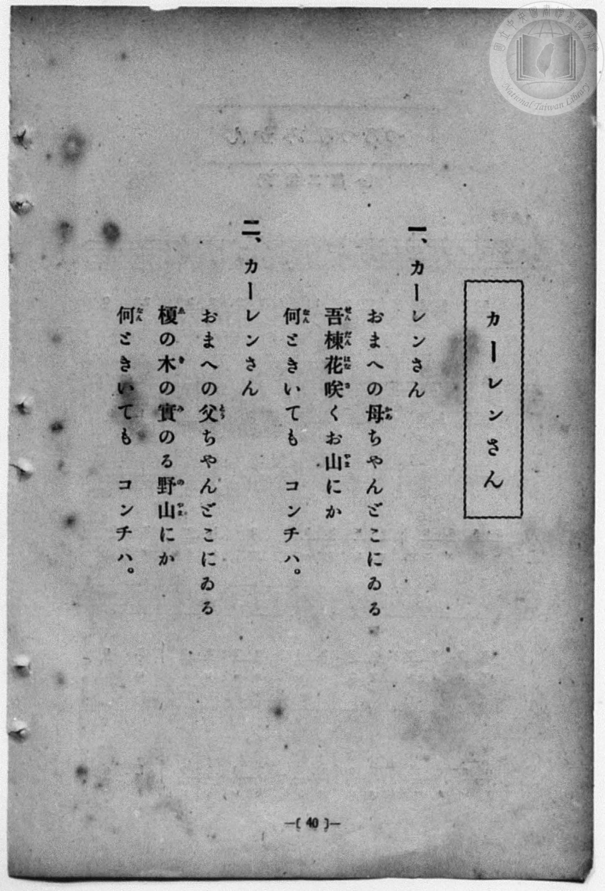
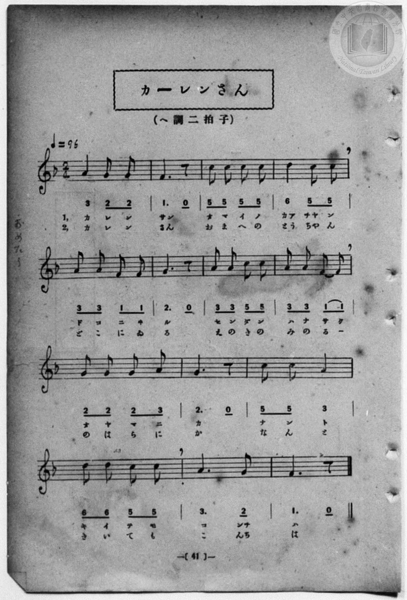

# カーレンさん

> Re:Shōka 使用 AI 協助辨識與重建樂譜，可能會有錯誤。歡迎回報。

<audio controls src="karensan.mp3"></audio>

- 一條慎三郎 編《新編 小學校・公學校 唱歌教材集》（大正十二年十二月，索書號 0725-41）
- 臺灣教育會公認《新定兒童唱歌》尋常科第一學年用（2020.006.0847.0001）

## 說明

曲目說明
中文解釋：描寫與高砂族（原住民）孩童「カーレンさん」親切問候對話的歌曲。

原書資訊與歌詞全文（對應 P048.jpg–P049.jpg，原書 p. 40–41）：
調性與拍號：ヘ調 二拍子，♩=96


## 歌詞

```text
一、カーレンさん
おまへの母（かあ）ちやんどこにゐる
苦楝（せんだん）花（はな）咲（さ）くお山（やま）にか
何（なん）ときいても　コンチハ。

二、カーレンさん
おまへの父（とう）ちやんどこにゐる
榎（ゑ）の木（き）の實（み）のる野山（のやま）にか
何（なん）ときいても　コンチハ。
```

## ABC

```abc
X:1
T:カーレンさん
M:2/4
L:1/16
Q:1/4=96
K:F
V:V1 name="Piano" snm="Pia"
[V:V1]
A4 G2 G2 | F6 z2 | c2 c2 c2 c2 | d4 c2 c2 |
w: 1.~カ レ ン | サン | オ マ ヘ ノ | カア チャ ン
w: 2.~カ レ ン | さん | お ま へ の | とう ちや ん
A2 A2 F2 F2 | G6 z2 | A2 A2 c2 c2 | A2 A2 F2 F2 |
w: 1.~ド コ ニ ヰ | ル | セ ン ダ ン | ハ ナ サ ク
w: 2.~ど こ に ゐ | る | ゑ の き の | み の る _
G2 G2 G2 A2 | G6 z2 | c2 c2 A4 | d2 d2 c2 c2 |
w: 1.~オ ヤ マ ニ | カ | ナ ン ト | キ イ テ モ
w: 2.~の は ら に | か | な ん と | き い て も
A6 G2 | F6 z2 | A4 G2 G2 | F6 z2 |
w: 1.~コ ンチ | ハ | カ レ ン | サン
w: 2.~こ んち | は | カ レ ン | さん
c2 c2 c2 c2 | d4 c2 c2 | A2 A2 F2 F2 | G6 z2 |
w: 1.~オ マ ヘ ノ | カア チャ ン | ド コ ニ ヰ | ル
w: 2.~お ま へ の | とう ちや ん | ど こ に ゐ | る
A2 A2 c2 c2 | A2 A2 F2 F2 | G2 G2 G2 A2 | G6 z2 |
w: 1.~セ ン ダ ン | ハ ナ サ ク | オ ヤ マ ニ | カ
w: 2.~ゑ の き の | み の る _ | の は ら に | か
c2 c2 A4 | d2 d2 c2 c2 | A6 G2 | F6 z2 |
w: 1.~ナ ン ト | キ イ テ モ | コ ンチ | ハ
w: 2.~な ん と | き い て も | こ んち | は
```

## TMD 檔案連結

- [主旋律 TMD 檔案](karensan.tmd) [[在 TMD Studio 編輯](https://tmdlang.github.io/Tmd-TS/#tmd=s7IKdvYPcrWy4qpTUCpJTLdSSM7PyUlNLsnMz7MqzsjPTozPrsyvSsyML84ojTe0NDJWgqssy88pzU21Si9KTEmNN4w3QsgU55cWJadaFSdn5OfnxJekVpQk5edno8vHFySmp1oFGJhYIGQKivLLUvMS84C6C4oy80pSU8DaEQpSyzJTUkHSxcmJefFlqUWZaZmpKUiOSi0qBrsdYkVJUWJecXJRZgHIQwhV-UUlGflAhxdkVFplZBaX5BdlJifmxGcn5iUiFJVkpAK9V5CTmJyqxKWlpfC4afXj5j2Pm9c8bt78uHHq46bJClpaXIq2CpZmXPa2Cm5cNkb6JnYg7U92NDxbNPdZa9-THZ0vm_sUnm9f8bih69m0DUCGwtMN_U_X7ni2YOHj5t1PW9dA2ApPp2x8trbn2dSZz-ZOeDm77XFD9_s9HU-XLH-2dvHT3sYnu3qe7twCYTyb0_F-T8_zLYuezd7xYuZ8BQNzI1NdE8P3ezrBTn_Rvut542KgQS-aNj2b0wy04cWqXojtT9fNeto66fnqpRDLgHY83dD9dMeO58snPl-zBuhooFuA1jyfsgJot5GBkYGegYGZnoGFiTmQYQCxQV9L4dnsTc9nr3uxatWzGX1cCgoKT3asfTat_cXyxS_bgY6e9ay__-n61S862l-unvF8QdOz6f0gn_TNf7K3_9mGiUBDnq5dCXTD44YezAB93ND7Ytmqpx3tT6f2P22Y-XRD74uVG5_PagEFzexNjxuauLT0uUBusKUWAHkA6DhQWG5uf7GiC-huoGUvVs572roC6CuQ0zf0PmvvVAClU72sgvRHDZOBTEsQExgNEK0KBXoKJgZAGXA0AMMAZOqLVfufNSwHmdfdC4wnoOjj5hlAQQVQHHb3Pl07Aaj_0cyVtsDkAwnGhscNjZhhApJ73Nj1uHHf48YdjxvXPVvfC3TV48bux41NQNseNy583NQCCrvGlY8bgeTqx00THjd1g53QvezZ0rlg1bPBKhYASaCeF10bwYLrHzeuAkXIpE1g7lSwcf1Ay55uBCsAmtu4Dyy4Gmgf2JF7gYqASldBDHrcuOJxY-_jRqC6ZY-bmh43NDxu2gxyeXPj4-Z-UHyBNe0CpjUifPa8YxvYcKCZbQR89mxZH9iBoPQECpM5oCQLdAqE-3T9MjB3P4QL1POyvQ_qJxCXcm8B9VCe9qBAAZSmvROLUvOKE_OsAjIT8_IdagxqqkGWKNhYaNmBGTUKxgq6CkZAWKNgCGTpKhgAWaZQWKNgBhQBs8CqfQxrQOUVUAwY4EC8GajicdNWEAOkNR7MXQWUmAfEM4C4DywCDOFFYD1Afy6GaIMYZ4TFOEgRCDeusQuI9wHxDiBeBxYBRSRIDzgigQZMBhoH94wx0BuGQJYR3DMgMYhn4LIIzzR3Ag3YDKS7gXgDyPhmkHtgftkNdtXj5gaY65r7gRjopKatQLwe2R-NK4F4MhCvBspMAOvuRjJpItj5wPiHe2M_RASsCu4BUEwYAZ2J7AGQ40GxhBwHoEBeAg3obkggIywDORDs7A6ELrATQQ5YD1QL9DTQmSARJCc2As0EhiUwfJEdZAaEsNADKUVJKEgOWgvEIAe1AfEisIMgaQKSvqFBB7ULyUWg4ADGYeMyoIYmsCsgcQ_OnwvBAuvh2mq5uHTtFGBpWgGNrQwA)]
- [鋼琴伴奏 TMD 檔案](karensan_piano.tmd) [[在 TMD Studio 編輯](https://tmdlang.github.io/Tmd-TS/#tmd=s7IKdvYPcrWy4qpTUCpJTLdSSM7PyUlNLsnMz7MqzsjPTozPrsyvSsyML84ojTe0NDJWgqssy88pzU21Si9KTEmNN4w3QsgU55cWJadaFSdn5OfnxJekVpQk5edno8vHFySmp1oFGJhYIGQKivLLUvMS84C6C4oy80pSU8DaEQpSyzJTUkHSxcmJefFlqUWZaZmpKUiOSi0qBrsdYkVJUWJecXJRZgHIQwhV-UUlGflAhxdkVFplZBaX5BdlJifmxGcn5iUqcWlpKTxuWv24ec_j5jWPmzc_bpz6uGny-z0dL2fPfNbZ_bJ7z_MJW57s2fJ0af_7PZ0KWlpcirYKlmZc9rYKblw2RvomdiBrnuxoeLZo7rPWvic7Ol829yk8377icUPXs2kbgAyFpxv6n67d8WzBwsfNu5-2roGwFZ5O2fhsbc-zqTOfzZ3wcnbb44ZuoKVPlyx_tnbx097GJ7t6nu7cAmE8m9Pxfk_P8y2Lns3e8WLmfAUDcyNTXRNDoHPAXnzRvut542KgQS-aNj2b0wy04cWqXojtT9fNeto66fnqpRDLgHY83dD9dMeO58snPl-zBuhooFuA1jyfsgJot5GBkYGegYGZnoGFiTmQYQCxgcs7sSg1rzgxzyogMzEvP8jDocagpppLAQhsLLTswIwaBWMFXQUjIKxRMASydBUMgCxTKKxRMAOKgFlg1T6GNaAgB4oBgxyINwNVPG7aCmKAtMaDuauAEvOAeAYQ94FFVj9uWgTW0_i4eTFEG8Q4IyzGgWMRYVxjFxDvA-IdQLwOLLLicWMbSE_jwsdNLUADJgONg3vGGOgNQyDLCO4ZkBjEM3BZhGeaO4EGbAbS3UC8AWR8M8g9ML_sBrvqcXMDzHXN_UAMdFLTViBej-yPxpVAPBmIVwNlJoB1dyOZNBHs_MeNvXBv7IeIgFXBPQCKCSOgM5E9AHI8KJaQ4wAUyEugAd0NCWSEZSAHgp3dgdAFdiLIAeuBaoGeBjoTJILkxEagmcCwBIYvsoPMgBAWeiClKAkFyUFrgRjkoDYgXgR2ECRNgDJmcyM06KB2IbkIFBzAOGxcBtTQBHYFJO6BLgHGL1hgPVxbLXqS9kFO0ibwJG0YrxBtGAthgAIQzjcBMkyADHR1pvFoCmEMqEKQfLRpPDalUBUwk5GVQmwHuVrXTgHm8GgfoC4UvhGYr8wFAA)]

## 分析

```text
================================================================================
📊 TMD Song Profile: [ カーレンさん ]
================================================================================
⏱  Duration:       0:35 (35.0s), 28 measures total
🎼 Key & Tempo:    首調基準 F, != 96.0 BPM, <2/4>
   - 分析範圍：      由實際發聲的音符與和弦推測調性；播放脈絡另行呈現
🎤 人聲音域:    F4 (MIDI 65) – D5 (MIDI 74) [跨度: 9 個半音 / 0.8 個八度, 難度: easy]
   - 最低音:  F4 in [Karensan #1 @ m.2, 0:01]
   - 最高音: D5 in [Karensan #1 @ m.4, 0:03]
   - 適合: soprano, mezzo-soprano, contralto, tenor, baritone, bass
🏛  結構:      Karensan (17.5s) -> Karensan (17.5s)
⚡ 編曲密度:        Peak 1 軌道同時演奏
🗝  調性診斷：       C 調性不明確（純淨自然大調，未偵測到可信轉調）
   - 風格氣質:    純淨自然大調（陽光明朗、易唱易記，無明顯調外色彩）
   - 轉調歷程:    全曲維持單一推測調性（未偵測到可信轉調）
   - 核心骨幹音:  A, C, G, F, D
   - 調性數值:    C 調性不明確 [相關度: 0.75, 穩定度: Ambiguous, 自然音純度: 100.0%]
   - 候選調性 (K-S): C 大調 (0.75), F 大調 (0.74), A 小調 (0.70)
   - 五度圈歷程:   +0 -> +0
   - 各段落調性細節:
     • [Karensan #1]: C 調性不明確 (r: 0.75, 自然音純度: 100.0%)
     • [Karensan #2]: C 調性不明確 (r: 0.75, 自然音純度: 100.0%)

  [ 五度圈游移軌跡 ]
              [C ]*
         F            G  
      Bb               D  
      Eb               A  
         Ab           E  
            Db       B  
               F# 
     (* = active key center)

  [ 十二半音累積音高分佈 ]
     C  : █████████████████████     23.1%
     C# :                            0.0%
     D  : ███████                    7.7%
     D# :                            0.0%
     E  :                            0.0%
     F  : █████████████████         19.2%
     F# :                            0.0%
     G  : █████████████████████     23.1%
     G# :                            0.0%
     A  : ████████████████████████  26.9%
     A# :                            0.0%
     B  :                            0.0%
--------------------------------------------------------------------------------
Assignment 軌道音域：
  - Piano         : F4 – D5 (9 個半音 / 0.8 個八度, 78 個音符)
================================================================================
```


## 原書掃描頁






