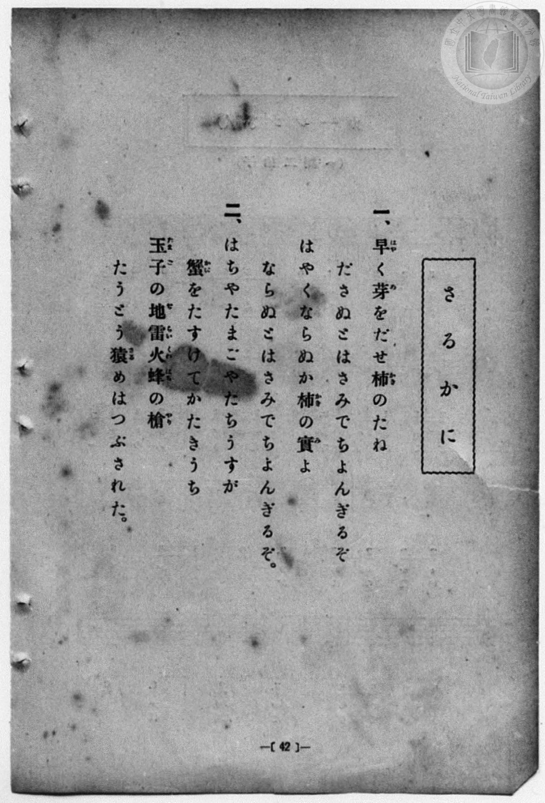
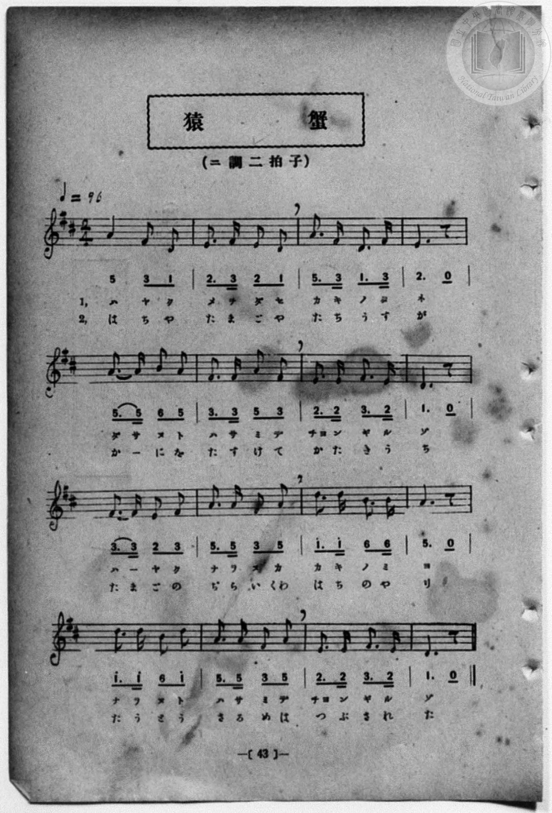

# さるかに

> Re:Shōka 使用 AI 協助辨識與重建樂譜，可能會有錯誤。歡迎回報。

<audio controls src="sarukani.mp3"></audio>

- 詞：石原和三郎
- 曲：納所辨次郎
- 一條慎三郎 編《新編 小學校・公學校 唱歌教材集》（大正十二年十二月，索書號 0725-41）
- 臺灣教育會公認《新定兒童唱歌》尋常科第一學年用（2020.006.0847.0001）

## 說明

曲目說明
中文解釋：日本民間故事，描寫猴子與螃蟹的衝突和因果報應。
原書資訊（對應 P050.jpg–P051.jpg，原書 p. 42–43）：
調性與拍號：ニ調 二拍子，♩=96


## 歌詞

```text
一、早（はや）く芽（め）をだせ柿（かき）のたね
ださぬとはさみでちよんぎるぞ
はやくならぬか柿（かき）の實（み）よ
ならぬとはさみでちよんぎるぞ。

二、はちやたまごやたちうすが
蟹（かに）をたすけてかたきうち
玉子（たまご）の地雷火（ぢらいくわ）蜂（はち）の槍（やり）
たうとう猿（さる）めはつぶされた。
```

## ABC

```abc
X:1
T:さるかに
C:曲：納所辨次郎
M:2/4
L:1/16
Q:1/4=96
K:D
V:V1 name="Piano" snm="Pia"
[V:V1]
A4 F2 D2 | E3 F E2 D2 | A3 F D3 F | E6 z2 |
w: 1.~ハ ヤ ク | メ ヲ ダ セ | カ キ ノ タ | ネ
w: 2.~は ち や | た ま ご や | た ち う す | が
A3 A B2 A2 | F3 F A2 F2 | E3 E F3 E | D6 z2 |
w: 1.~ダ サ ヌ ト | ハ サ ミ デ | チョ ン ギ ル | ゾ
w: 2.~か _ に を | た す け て | か た き う | ち
F3 F E2 F2 | A3 A F2 A2 | d3 d B2 B2 | A6 z2 |
w: 1.~ハ _ ヤ ク | ナ ラ ヌ カ | カ キ ノ ミ | ヨ
w: 2.~た ま ご の | ぢ ら い くわ | は ち の や | り
d3 d B2 d2 | A3 A F2 A2 | E3 E F3 E | D6 z2 |
w: 1.~ナ ラ ヌ ト | ハ サ ミ デ | チョ ン ギ ル | ゾ
w: 2.~た う と う | さ る め は | つ ぶ さ れ | た
```

## TMD 檔案連結

- [主旋律 TMD 檔案](sarukani.tmd) [[在 TMD Studio 編輯](https://tmdlang.github.io/Tmd-TS/#tmd=s7IKdvYPcrWy4qpTUCpJTLdSSM7PyUlNLsnMz7MqzsjPTozPrsyvSsyML84ojTe0NDJWgqssy88pzU21Si9KTEmNN4w3QsgU55cWJadaFSdn5OfnxJekVpQk5edno8vHFySmp1oFGJgaIGQKivLLUvMS84C6C4oy80pSU8DaEQpSyzJTUkHSxcmJefFlqUWZaZmpKUiOSi0qBrsdYkVJUWJecXJRZgHIQwhV-UUlGflAhxdkVFplZBaX5BdlJifmxGcn5iUiFJVkpAK9l5iXmZuYgy6alp-TnZNflKrEpaWl8Lhx6uOm7seNQLRaQUuLS9FWwdKMy95WwYXLxkjfxA6k98mOhmeL5j5r7Xuyo_Nlc5_C8-0rHjd0PZu2AchQeLqh_-naHc8WLHzcvPtp6xoIW-HplI3P1vY8mzrz2dwJL2e3PW7ofr-n4-mS5c_WLn7a2_hkV8_TnVsgjGdzOt7v6Xm-ZdGz2TtezJyvYGBuZKprYvh-TyfY3S9Wznu_Z9bz-Zuf9s1_OqkH4gKwzLPZm0AyW3qfdTa82Lfi2ZqFMJkX7bueNy4GWv6iadOzOc1AV71Y1Qtx8dN1s562Tnq-einEgUB3Pd3Q_XTHjufLJz5fswboUaD7gU57PmUF0L1GBkYGegYGZnoGFibmQIYBxFX6WgpAu5_PXvdi1apnM_q4FBQUnuxY-2xa-4vli1-2Az0669n0pc_mrHm2YeLLaZOfTW19sgso2POsv__p-tXPe7Y8XTvhRUf7i3nNL-bvfD6r5cXCuc9XNQL99nT2gmfz5jxdsPFZe-fjhiaQuUBPg4Jlc_uLFV2gANzQC5RTACU7vayC9EcNk4FMQxATaD5ErUKBnoKJEVDGxBjoWKBbQMa8WLX_WcNyoKXPunuBYQwUfdzcDRRUAIV_dy_QQUD9j2autAVGvZY-F9CHXMCgeNzQ-Gz6SqC1jxvXP25qARr3uLH_RddekEhTI4jbNOlx44LHjbOfzd8PVgZMRL1gZeseN85_3LiWCyw99XHjmseNK0CmgNj7Hzcuf9y48HET0JTJjxv7wMlvHlApyBKgDY8bVz1uApoB1NONafDT9cvAIkBxoP0dQG1w1QRsAAUpF9DDQG-BFQLlgdYBnbnvceMUGHvh48a2x40zHzf2cAFjB2b3aphngSqAchMfNy4DiwO5vWANC7me93WCgxGoAWok1L1zNrycvf05yAig1CKwW8G-bOoHKngxpwkavo0LIeqfLQd6FOjulsdNwBjvBPoPaBzQBqDn2p73QEIDlGPBLoJ4ZMnjxm1gwR6QYqAvQVHom5iZZxWQmZiX71BjUFMNSgUKNoZmWnZgVo2CqYIuGBoDsSEQ1ygYQfkgGiICUWMM5oFomBoINACpAZvmY1ij8Li5Hyr-uHkJiGxaDzbjcfNCqOgmIG4Ay-yGyDSthsg0rQXK9EHZ-8F6epHsiUfYYwSUawSZC1bbCDIZGFIQ0xrnQ0X3AfEUrDILgbgNyp4JlunBsAcleEwVzMAkyBhQQIECAcQDsWGBYQSVMQKKQAIKe_CAvA5y1FYgG2Tt4-YOaABBAg4iA3Lq4-Z2qEzj4-bl0NDbDFSwDspeDQ69fXjCqBseRqAwBiZdtJCYCcQTwaxlUBmIDpAKYJqGstvAMpD4wxJGsBABhQMkRGChBuJBQs0wDiwEpEAhCcKIpEdKIuqCiq6EhR448WBLRJAwBOlZgSeAMBJLIyhwQTKLoOZ1AtmgBATJq1BJSNqDpCSQBngaa4I4EEsooYYAmIctoEhLTBjBQcvEBAurNiAGhSkkE4FkpkIt6wbiRrAMNL4aQbEH4m9DUtWDlASRbarl4tK1UwAVWApAWpkLAA)]
- [鋼琴伴奏 TMD 檔案](sarukani_piano.tmd) [[在 TMD Studio 編輯](https://tmdlang.github.io/Tmd-TS/#tmd=s7IKdvYPcrWy4qpTUCpJTLdSSM7PyUlNLsnMz7MqzsjPTozPrsyvSsyML84ojTe0NDJWgqssy88pzU21Si9KTEmNN4w3QsgU55cWJadaFSdn5OfnxJekVpQk5edno8vHFySmp1oFGJgaIGQKivLLUvMS84C6C4oy80pSU8DaEQpSyzJTUkHSxcmJefFlqUWZaZmpKUiOSi0qBrsdYkVJUWJecXJRZgHIQwhV-UUlGflAhxdkVFplZBaX5BdlJifmxGcn5iUqcWlpKTxunPq4qftxIxCtfr-n4-Xsmc86u19273k-YcuTPVueLu1_v6dTQUuLS9FWwdKMy95WwYXLxkjfxA5kwZMdDc8WzX3W2vdkR-fL5j6F59tXPG7oejZtA5Ch8HRD_9O1O54tWPi4effT1jUQtsLTKRufre15NnXms7kTXs5ue9zQDbT06ZLlz9Yuftrb-GRXz9OdWyCMZ3M63u_peb5l0bPZO17MnK9gYG5kqmtiCHQO2HMvVs57v2fW8_mbn_bNfzqpB-ICsMyz2ZtAMlt6n3U2vNi34tmahTCZF-27njcuBlr-omnTsznNQFe9WNULcfHTdbOetk56vnopxIFAdz3d0P10x47nyyc-X7MG6FGg-4FOez5lBdC9RgZGBnoGBmZ6BhYm5kCGAcRVXL6JmXlWAZmJeflBHg41BjXVXApAYGNopmUHZtUomCrogqExEBsCcY2CEZQPoiEiEDXGYB6IhqmBQAOQGrBpPoY1Co-b-6Hij5uXgMim9WAzHjcvhIpuAuIGsMxuiEzTaohM01qgTB-UvR-spxfJnniEPUZAuUaQuWC1jSCTHze1QExrnA8V3QfEU7DKLATiNih7JlimB8MelOAxVTADkyBjQAEFCgQQD8SGBYYRVMYIKAIJKOzBA_I6yFFbgWyQtY-bO6ABBAk4iAzIqY-b26EyjY-bl0NDbzNQwTooezU49PbhCaNueBiBwvhx0yS0kJgJxBPBrGVQGYgOkIrHjZDQB4UVSAYSf1jCCBYioHCAhAgs1EA8SKgZxoGFgBQoJEEYkfRISURdUNGVsNADJx5siQgShiA9K_AEEEZiaQQFLkhmEdS8TiAblIAeN_Y_bgI5C5H2ICkJpAGexpogDsQSSqghAOZhCyjSEhNGcNAyMcHCqg2IQWEKyUQgmalQy7qBuBEsA42vRlDsgfjbkFT1ICVBZJtqkcsrH-TyygJeXEUbxgLVQkggzzQehYsqCeFBlED8ARc0waoBahpUB1QcFOhoulEVoNmHYjQWzSRbDQwWXTsFUMhE-4CEYWwjMFuZCwA)]

## 分析

```text
================================================================================
📊 TMD Song Profile: [ さるかに ]
================================================================================
⏱  Duration:       0:20 (20.0s), 16 measures total
🎼 Key & Tempo:    首調基準 D, != 96.0 BPM, <2/4>
   - 分析範圍：      由實際發聲的音符與和弦推測調性；播放脈絡另行呈現
🎤 人聲音域:    D4 (MIDI 62) – D5 (MIDI 74) [跨度: 12 個半音 / 1.0 個八度, 難度: easy]
   - 最低音:  D4 in [Main #1 @ m.1, 0:00]
   - 最高音: D5 in [Main #1 @ m.11, 0:12]
   - 適合: soprano, mezzo-soprano, contralto, tenor, baritone, bass
🏛  結構:      Main (20.0s)
⚡ 編曲密度:        Peak 1 軌道同時演奏
🗝  調性診斷：       D 大調（純淨自然大調，未偵測到可信轉調）
   - 風格氣質:    純淨自然大調（陽光明朗、易唱易記，無明顯調外色彩）
   - 轉調歷程:    全曲維持單一推測調性（未偵測到可信轉調）
   - 核心骨幹音:  A, D, F#, E, B
   - 調性數值:    D 大調 [相關度: 0.83, 穩定度: Moderate, 自然音純度: 100.0%]
   - 候選調性 (K-S): D 大調 (0.83), A 大調 (0.79), F# 小調 (0.68)
   - 五度圈歷程:   +2
   - 各段落調性細節:
     • [Main #1]: D 大調 (r: 0.83, 自然音純度: 100.0%)

  [ 五度圈游移軌跡 ]
               C  
         F            G  
      Bb              [D ]*
      Eb               A  
         Ab           E  
            Db       B  
               F# 
     (* = active key center)

  [ 十二半音累積音高分佈 ]
     C  :                            0.0%
     C# :                            0.0%
     D  : █████████████████████     24.2%
     D# :                            0.0%
     E  : █████████████████         19.2%
     F  :                            0.0%
     F# : ████████████████████      22.5%
     G  :                            0.0%
     G# :                            0.0%
     A  : ████████████████████████  27.5%
     A# :                            0.0%
     B  : ██████                     6.7%
--------------------------------------------------------------------------------
Assignment 軌道音域：
  - Piano         : D4 – D5 (12 個半音 / 1.0 個八度, 51 個音符)
================================================================================
```


## 原書掃描頁






