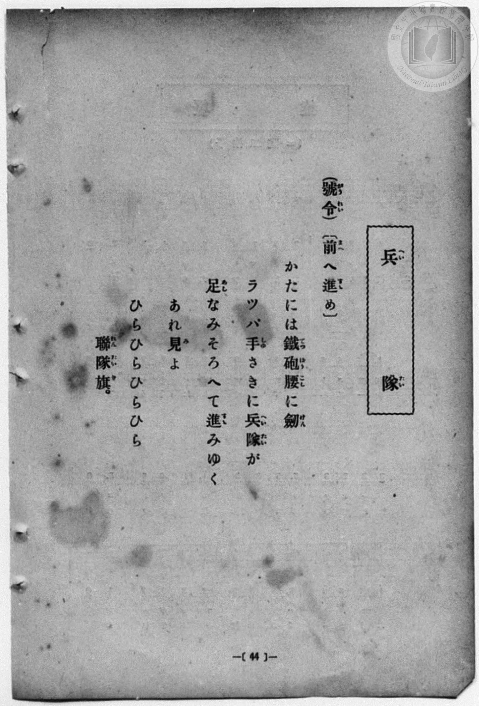
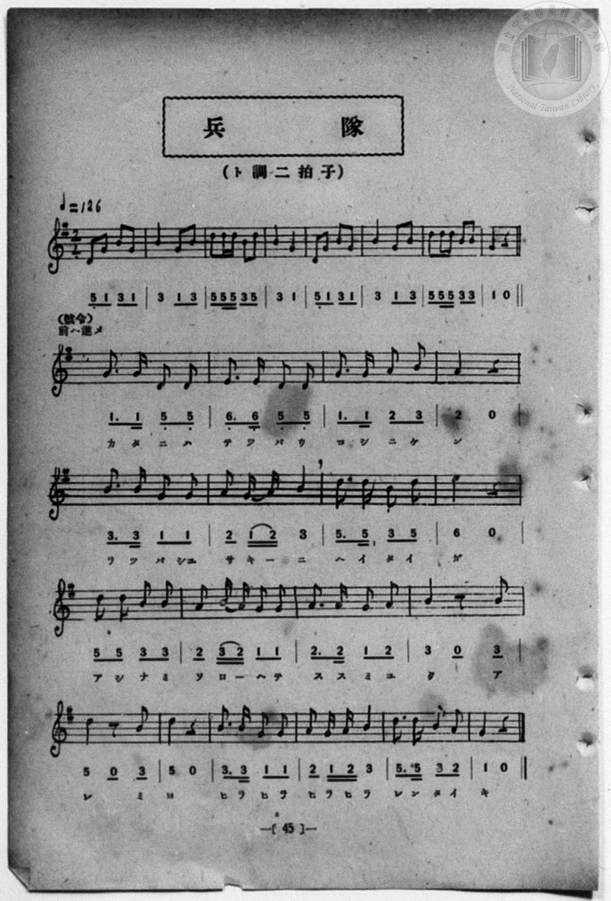

# 兵隊

> Re:Shōka 使用 AI 協助辨識與重建樂譜，可能會有錯誤。歡迎回報。

<audio controls src="heitai.mp3"></audio>

- 一條慎三郎 編《新編 小學校・公學校 唱歌教材集》（大正十二年十二月，索書號 0725-41）

## 說明

曲目說明
中文解釋：模仿喇叭吹奏與口令，描寫士兵扛槍佩劍、隨著聯隊旗齊步前進的進行曲。
原書資訊（對應 P052.jpg–P053.jpg，原書 p. 44–45）：
調性與拍號：ト調 二拍子，♩=126


## 歌詞

```text
（號令（がうれい））〔前（まへ）へ進（すゝ）め〕
かたには鐵砲（てつぱう）腰（こし）に劍（けん）
ラツパ手（しゆ）さきに兵隊（へいたい）が
足（あし）なみそろへて進（すゝ）みゆく
あれ見（み）よ
ひらひらひらひら
聯隊旗（れんたいき）。
```

## ABC

```abc
X:1
T:兵隊
M:2/4
L:1/16
Q:1/4=126
K:G
V:V1 name="Piano" snm="Pia"
[V:V1]
D2 G2 B2 G2 | B4 G2 B2 | d d d2 B2 d2 | B4 G4 |
w: _ _ _ _ | _ _ _ | _ _ _ _ _ | _ _
D2 G2 B2 G2 | B4 G2 B2 | d d d2 B2 B2 | G4 z4 |
w: _ _ _ _ | _ _ _ | _ _ _ _ _ | _
G3 G D2 D2 | E3 E D2 D2 | G3 G A2 B2 | A4 z4 |
w: カ タ ニ ハ | テ ツ パ ウ | コ シ ニ ケ | ン
B3 B G2 G2 | A4 G A B2 | d3 d B2 d2 | e4 z4 |
w: ラ ツ パ シュ | サ キ _ ニ | ヘ イ タ イ | ガ
d2 d2 B2 B2 | A4 B A G G | A3 A G2 A2 | B4 z2 B2 |
w: ア シ ナ ミ | ソ ロ _ ヘ テ | ス ス ミ ユ | ク ア
d4 z2 B2 | d4 z4 | B3 B G2 G2 | A4 G A B2 |
w: レ ミ | ヨ | ヒ ラ ヒ ラ | ヒ ラ ヒ ラ
d3 d B2 A2 | G4 z4 |
w: レ ン タ イ | キ
```

## TMD 檔案連結

- [主旋律 TMD 檔案](heitai.tmd) [[在 TMD Studio 編輯](https://tmdlang.github.io/Tmd-TS/#tmd=s7IKdvYPcrWy4qpTUCpJTLdSSM7PyUlNLsnMz7MqzsjPTozPrsyvSsyML84ojTe0NDJWgqssy88pzU21Si9KTEmNN4w3QsgU55cWJadaFSdn5OfnxJekVpQk5edno8vHFySmp1oFGJgi6Swoyi9LzUvMA-ouKMrMK0lNAWtHKEgty0xJBUkXJyfmxZelFmWmZaamIDkqtagY7HaIFSVFiXnFyUWZBSAPIVTlF5Vk5AMdXpBRaZWRWVySX5SZnJgTn52Yl4hQVJKRCvRebmZOZkliUaUSl5aWwtPWrS9ndSloaXEp2ioYGplx2dsquHPZGOmb2IG0PdnR8GzR3GetfU92dL5s7lN4vn3F44auZ9M2ABkKTzf0P12749mChY-bdz9tXQNhKzydsvHZ2p5nU2c-mzvh5ey2xw3d7_d0PF2y_NnaxU97G5_s6nm6cwuE8WxOx_s9Pc-3LHo2e8eLmfMVDMyNTHVNDN_v6VTi0tdSeDZ70_PZ616sWvVsRh-XgoLCkx1rn01rf7F88ct2oJGznq1Y-GT3_qfT2p_2r306YefTpf0vOoDsxU92LwGa-qy__-n61U8XrwZ68Fnn7GfLe5_sXfm0q_dxQ-PLWSteTJz-onE90OPPpk9_ubfr2dqlTzt7XzZsej6rBUi-WNgDtPtxQxPI1qd980HO29z-YkUXyCMbep-1dyqA4lgvqyD9UcNkINMYxARaClGrUKCnYGIClDExBXoF6FKQMS9W7X_WsBzowmfdvUC_AkUfN3cABRVA4dDd-3TtBKD-RzNX2oLiQEufCxgAXEDrgErB_ul43NjzuLHtcROQbAGb2vm4YQrQ0WCpfY8bd4BEGncAXQ8Wmfm4aS5IpKnxccNUrseN3Y8b5z9uXP0Y6OkJW58vgCha9rhxyePGjUBzgUpftG4AC05-3DgdbNZqYGiBRSY-bpoMFOF63LzycXPL4-aJzzpBUQpU97gJpPNx49THjb0gDeC0BJbaAXQm2EqQY4Fu53qxbTNYoglm_KrHjfsfN8593ATUCVS9DN3lQNmmtseN_UDHNwG9_WIZxM79YF91AEU3PW4CqkInueDxClIODK4moIdA7gA6ERxoTeDQ9U3MzLMKyEzMy3eoMaipBsWQgo2hmZYdmAVMfMCgBaYoSOoCmmQBSuzP1zeAInnCakisPG7oAap63DwD6PTHzQsfN4AsUACaDjKiRsE0XkFXwRCIjaF0DZgFgjBRoCIwhPBANKoaEKwBG-djWKMAMg8ZQ0RAEFkEBHGpgZhHrvsgIjB3GVDZfQjzYFHwbM4aYEECDHxDc3joI4UvxCGGEH-AiRoFM4hpQApZFKbSCO4JEAu7Jx43rQaLPG7ar_C4uRvEau4H63nc3AaRaW4B4olgNcsgMk2boXq2w_Q0bYTqgchgeA8W1sZgx0FCH-YokENhoQ_imyKlDjPcDm9eieG87Y-bl0JduBWq4XHTWrAikCtBmmZARZeAfQxhQXSsweVykEtQ0wTM5cZAliEQwkRAPBCJnLZAxoF1IQX5ImjggRzWBSbnQx2xF-bsZoizZ4CjASSzE-rwnVDVj5thkbEeySaI2ShOR3EEigjYlyRHDMR7uLPF42bkkIR7rXkFhs2PmydBPbsSyoZEKkIGIYeQgZgOSmnoMQgKMlQ31XJx6dopgAo_BSCtzAUA)]
- [鋼琴伴奏 TMD 檔案](heitai_piano.tmd) [[在 TMD Studio 編輯](https://tmdlang.github.io/Tmd-TS/#tmd=s7IKdvYPcrWy4qpTUCpJTLdSSM7PyUlNLsnMz7MqzsjPTozPrsyvSsyML84ojTe0NDJWgqssy88pzU21Si9KTEmNN4w3QsgU55cWJadaFSdn5OfnxJekVpQk5edno8vHFySmp1oFGJgi6Swoyi9LzUvMA-ouKMrMK0lNAWtHKEgty0xJBUkXJyfmxZelFmWmZaamIDkqtagY7HaIFSVFiXnFyUWZBSAPIVTlF5Vk5AMdXpBRaZWRWVySX5SZnJgTn52Yl4hQlFgE1JyempuaV2JVkJmYlx-fmJycn1uQmJcJElPi0tJSeNq69eWsrvd7Ol7Onvmss_tl957nE7Y82bPl6dL-93s6FbS0uBRtFQyNzLjsbRXcuWyM9E3sQOY_2dHwbNHcZ619T3Z0vmzuU3i-fcXjhq5n0zYAGQpPN_Q_Xbvj2YKFj5t3P21dA2ErPJ2y8dnanmdTZz6bO-Hl7LbHDd1AW58uWf5s7eKnvY1PdvU83bkFwng2p-P9np7nWxY9m73jxcz5CgbmRqa6JoZA9yhxcfkmZuZZBYB8E-ThUGNQU82lAAQ2hmZadmBWjYJpvIKugiEQG0PpGjALBGGiQEVgCOGBaFQ1IFgDNs7HsEYBZB4yhoiAILIICOJSAzGPXPdBRGDuMqCy-xDmQd0HscgQ4k4wUaNgBlENpJBFYSqN4I4EsbA78nHTarDI46b9Co-bu0Gs5n6wnsfNbRCZ5hYgnghWswwi07QZqmc7TE_TRqgeiAwW50PC0hjsOEjowhwFcigsdEF8U6TYN8Pt8OaVGM7b_rh5KdSFW6EaHjetBSsCuRKkaQZUdAnYxxAWRMcaXC4HuQQ1zmEuNwayDIEQJgLigUjktAMyDqwLKcgXQQMP5LAuMDkf6oi9MGc3Q5w9AxwNIJmdUIfvhKp-3AyLjPVINkHMRnE6iiNQRMC-JDliIN7DnewfNyOHJNxrzSswbH7cPAnq2ZVQNiRSETIIOYQMxHRQSkOPQVCQobqpFrlg8kEumEzg5ZJhvLZxPJTEwgPmKQiJJkembgMcOk3i47UN0Q0yBQoagbgghnk8bt0weezugJpNrGYYH0ZjdTrQS0A-Kougg7CZCIwiXTsFUCxF-xjGKgDZylwA)]

## 分析

```text
================================================================================
📊 TMD Song Profile: [ 兵隊 ]
================================================================================
⏱  Duration:       0:24 (24.8s), 26 measures total
🎼 Key & Tempo:    首調基準 G, != 126.0 BPM, <2/4>
   - 分析範圍：      由實際發聲的音符與和弦推測調性；播放脈絡另行呈現
🎤 人聲音域:    D4 (MIDI 62) – E5 (MIDI 76) [跨度: 14 個半音 / 1.2 個八度, 難度: moderate]
   - 最低音:  D4 in [Main #1 @ m.1, 0:00]
   - 最高音: E5 in [Main #1 @ m.16, 0:14]
   - 適合: soprano, mezzo-soprano, contralto, tenor, baritone, bass
🏛  結構:      Main (24.8s)
⚡ 編曲密度:        Peak 1 軌道同時演奏
🗝  調性診斷：       G 大調（純淨自然大調，未偵測到可信轉調）
   - 風格氣質:    純淨自然大調（陽光明朗、易唱易記，無明顯調外色彩）
   - 轉調歷程:    全曲維持單一推測調性（未偵測到可信轉調）
   - 核心骨幹音:  B, G, D, A, E
   - 調性數值:    G 大調 [相關度: 0.81, 穩定度: Moderate, 自然音純度: 100.0%]
   - 候選調性 (K-S): G 大調 (0.81), B 小調 (0.76), D 大調 (0.67)
   - 五度圈歷程:   +1
   - 各段落調性細節:
     • [Main #1]: G 大調 (r: 0.81, 自然音純度: 100.0%)

  [ 五度圈游移軌跡 ]
               C  
         F           [G ]*
      Bb               D  
      Eb               A  
         Ab           E  
            Db       B  
               F# 
     (* = active key center)

  [ 十二半音累積音高分佈 ]
     C  :                            0.0%
     C# :                            0.0%
     D  : ███████████████████       23.9%
     D# :                            0.0%
     E  : ███                        4.3%
     F  :                            0.0%
     F# :                            0.0%
     G  : ███████████████████       25.0%
     G# :                            0.0%
     A  : ████████████              15.8%
     A# :                            0.0%
     B  : ████████████████████████  31.0%
--------------------------------------------------------------------------------
Assignment 軌道音域：
  - Piano         : D4 – E5 (14 個半音 / 1.2 個八度, 84 個音符)
================================================================================
```


## 原書掃描頁






