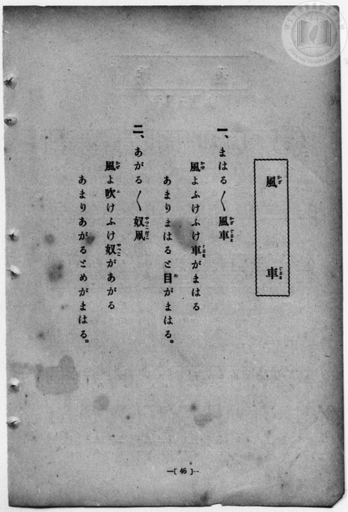
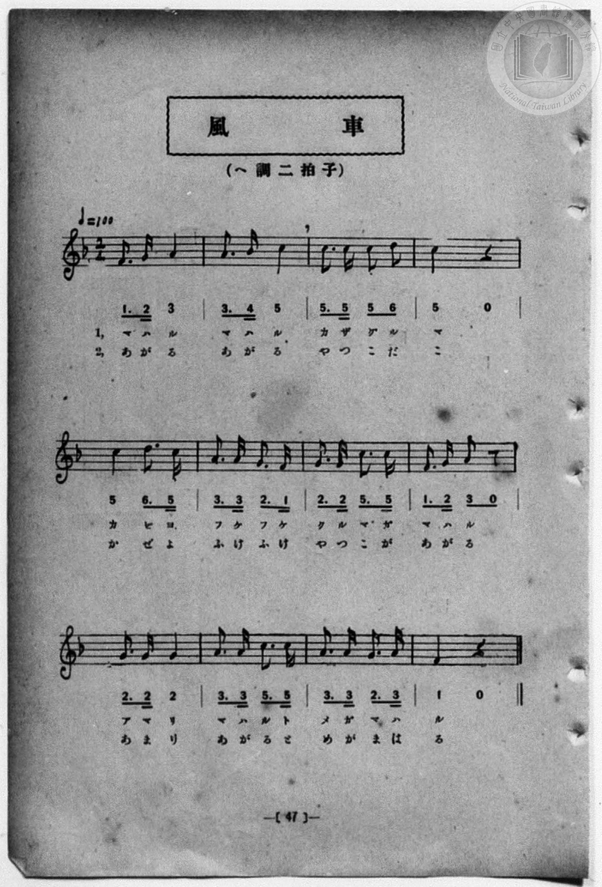

# 風車

> Re:Shōka 使用 AI 協助辨識與重建樂譜，可能會有錯誤。歡迎回報。

- **鋼琴伴奏版**：<br><audio controls src="kazaguruma.mp3"></audio>
- **NEUTRINO 歌聲合成版**：<br><audio controls src="kazaguruma_neutrino.mp3"></audio>

- 一條慎三郎 編《新編 小學校・公學校 唱歌教材集》（大正十二年十二月，索書號 0725-41）

## 說明

曲目說明
中文解釋：描寫風車與奴凧（人偶風箏）在風中飛轉升高、令人眼花撩亂的童趣情景。
原書資訊（對應 P054.jpg–P055.jpg，原書 p. 46–47）：
調性與拍號：ヘ調 二拍子，♩=100


## 歌詞

```text
一、まはる／＼風車（かざぐるま）
風（かぜ）よふけふけ車（くるま）がまはる
あまりまはると目（め）がまはる。

二、あがる／＼奴凧（やつこだこ）
風（かぜ）よ吹（ふ）けふけ奴（やつこ）があがる
あまりあがるとめがまはる。
```

## ABC

<div class="abc-score" data-abc-src="kazaguruma.abc" aria-label="五線譜載入中"></div>

[下載 ABC 原始檔](kazaguruma.abc)

## TMD 檔案連結

- [主旋律 TMD 檔案](kazaguruma.tmd) [[在 TMD Studio 編輯](https://tmdlang.github.io/Tmd-TS/#tmd=s7IKdvYPcrWy4qpTUCpJTLdSSM7PyUlNLsnMz7MqzsjPTozPrsyvSsyML84ojTe0NDJWgqssy88pzU21Si9KTEmNN4w3QsgU55cWJadaFSdn5OfnxJekVpQk5edno8vHFySmp1oFGJiaIGQKivLLUvMS84C6C4oy80pSU8DaEQpSyzJTUkHSxcmJefFlqUWZaZmpKUiOSi0qBrsdYkVJUWJecXJRZgHIQwhV-UUlGflAhxdkVFplZBaX5BdlJifmxGcn5iUiFJVkpAK9V5CTWBmfmJcSn56Ym1qMbERmemaeVWkeyD0lUFdoaSm8XLTixe4uBS0tLkVbBUMDAy57WwU3LhsjfRM7kN4nOxqeLZr7rLXvyY7Ol819Cs-3r3jc0PVs2gYgQ-Hphv6na3c8W7DwcfPup61rIGyFp1M2Plvb82zqzGdzJ7yc3fa4ofv9no6nS5Y_W7v4aW_jk109T3dugTCezel4v6fn-ZZFz2bveDFzvoKBuZGpronh-z2dSlz6WgrPZm96Pnvdi1Wrns3o41JQUHiyY-2zae0vli9-2Q40ctaz_v6n61dD3P-io_3p0i1P25cDrXqya9fTxm1A8efr-oFGPZ2zAsgG6n25ePaLvZ1Pe9tfrp7xuKHxye4lQJXP5-x50bXx2aSVT3Y1PZ_V8nz10hfbFj9rbn02c_3jhiaQrU_75oOct7n9xYoukEc29D5r71QAJQO9rIL0Rw2TgUxTEBPoFYhahQI9BRMzoIyJOdB-oEtBxrxYtf9Zw3KgO5919wL9ChR93DwDKKgACofu3qdrJwD1P5q50hYUB1r6XMAA4AIGPtChjxv3PW5c_7gJ6Gegf_ZAPAx0yePG7seN0x43TgBKAdUAreICysEk5gD5j5uA7K2PGydCSJi2friGx409cNO5Hjc2gThNXXChx40rgBEA0tPUiKYaFDhcQKeD3QfU1wN3HzweHje1PG5c8rhx8uPGBUASu_ueTtgJFtkKNh_qUKARyPphVkOtQXYoVAjoUKAT0d0HCkXfRGCiD8hMzMt3qDGoqQbFhIKNoZmWHZhVo2CooAuERgrGYFoXKAJhmSiYwkUgLFMwbYYkoqtgAFMDNs3HsEbhcfM8sMjj5n4gXg03A6d4E4T9uGkbEG8AqwCJIHRg2GIElGtsguhq7AHq6kaYhku8qQUqvgSIJ4NZC6A6QDxUW6BBA_MkyMsg78OCxhgYXCDaECgCYRkpmMZDFMWjBSnIUKTAgXoW5N090OBYAfbqVKjoRhQ2SMd6qLrViCBsWoM1QJHsAgcRzPvAtAbV1wH28Fao6EQUNrZAggQktmCF2AUNKFggQGhEGjJGCRbUwDOGBxTWVNS0COq5eUC8Cm4utlT0uBnsreaF8MBBVgWSgQU6vnS0D6izC2EPlnQEzGPgQGpEyAB1QdjrwTKwAEfYU8vFpWunAMqDCki0MgA)]
- [鋼琴伴奏 TMD 檔案](kazaguruma_piano.tmd) [[在 TMD Studio 編輯](https://tmdlang.github.io/Tmd-TS/#tmd=s7IKdvYPcrWy4qpTUCpJTLdSSM7PyUlNLsnMz7MqzsjPTozPrsyvSsyML84ojTe0NDJWgqssy88pzU21Si9KTEmNN4w3QsgU55cWJadaFSdn5OfnxJekVpQk5edno8vHFySmp1oFGJiaIGQKivLLUvMS84C6C4oy80pSU8DaEQpSyzJTUkHSxcmJefFlqUWZaZmpKUiOSi0qBrsdYkVJUWJecXJRZgHIQwhV-UUlGflAhxdkVFplZBaX5BdlJifmxGcn5iUiFCUWATWnp-am5pVYFWQm5uXHJyYn5-cWJOZlgsSUuLS0FF4uWvFid9f7PR0vZ8981tn9snvP8wlbnuzZ8nRp__s9nQpaWlyKtgqGBgZc9rYKblw2RvomdiDzn-xoeLZo7rPWvic7Ol829yk8377icUPXs2kbgAyFpxv6n67d8WzBwsfNu5-2roGwFZ5O2fhsbc-zqTOfzZ3wcnbb44ZuoK1Plyx_tnbx097GJ7t6nu7cAmE8m9Pxfk_P8y2Lns3e8WLmfAUDcyNTXRNDoHuUuLh8EzPzrAJAvgnycKgxqKnmUgACG0MzLTswq0bBUEEXCI0UjMG0LlAEwjJRMIWLQFimYNoMSURXwQCmBmyaj2GNwuPmeWCRx839QLwabgZO8SYI-3HTNiDeAFYBEkHowLDFCCjX2ATR1dgD1NWNMA2XeFMLVHwJEE8GsxZAdYB4qLZAgwbmSZCXQd6HBY0xMLhAtCFQBMIyUjCNhyiKRwtSkKFIgQP1LMi7e6DBsQLs1alQ0Y0obJCO9VB1qxFB2LQGa4Ai2QUOIpj3HzfOgerrAHt4K1R0IgobWyBBAhJbsELsggYULBAgNCINGaMEC2rgGcMDCmsqaloE9dw8IF4FNxdbKnrcDPZW80J44CCrAsnAAh1fOtoH1NmFsAdLOnrcCI6qpkaEDFAXhL0eLAMLcIQ9tchZ0Ac5C5ogcqC2MRijs0zitUEpDMQ0gDoZQwKi2jRe2zweSqJrwJRD2ICuA-haXTsFkIOjfQxjFeBsIzBbmQsA)]

## 分析

```text
================================================================================
📊 TMD Song Profile: [ 風車 ]
================================================================================
⏱  Duration:       0:28 (28.8s), 24 measures total
🎼 Key & Tempo:    首調基準 F, != 100.0 BPM, <2/4>
   - 分析範圍：      由實際發聲的音符與和弦推測調性；播放脈絡另行呈現
🎤 人聲音域:    C4 (MIDI 60) – D5 (MIDI 74) [跨度: 14 個半音 / 1.2 個八度, 難度: moderate]
   - 最低音:  C4 in [Main #1 @ m.7, 0:07]
   - 最高音: D5 in [Main #1 @ m.3, 0:03]
   - 適合: soprano, mezzo-soprano, contralto, tenor, baritone, bass
🏛  結構:      Main (14.4s) -> Main (14.4s)
⚡ 編曲密度:        Peak 1 軌道同時演奏
🗝  調性診斷：       C 大調（純淨自然大調，未偵測到可信轉調）
   - 風格氣質:    純淨自然大調（陽光明朗、易唱易記，無明顯調外色彩）
   - 轉調歷程:    全曲維持單一推測調性（未偵測到可信轉調）
   - 核心骨幹音:  C, A, G, F, D
   - 調性數值:    C 大調 [相關度: 0.82, 穩定度: Moderate, 自然音純度: 98.8%]
   - 候選調性 (K-S): C 大調 (0.82), A 小調 (0.71), F 大調 (0.67)
   - 五度圈歷程:   +0 -> +0
   - 各段落調性細節:
     • [Main #1]: C 大調 (r: 0.82, 自然音純度: 98.8%, 調外音: A#)
     • [Main #2]: C 大調 (r: 0.82, 自然音純度: 98.8%, 調外音: A#)

  [ 五度圈游移軌跡 ]
              [C ]*
         F            G  
      Bb               D  
      Eb               A  
         Ab           E  
            Db       B  
               F# 
     (* = active key center)

  [ 十二半音累積音高分佈 ]
     C  : ████████████████████████  31.4%
     C# :                            0.0%
     D  : ████                       5.8%
     D# :                            0.0%
     E  :                            0.0%
     F  : ██████████                12.8%
     F# :                            0.0%
     G  : ██████████████████        23.3%
     G# :                            0.0%
     A  : ████████████████████      25.6%
     A# : █                          1.2%
     B  :                            0.0%
--------------------------------------------------------------------------------
Assignment 軌道音域：
  - Piano         : C4 – D5 (14 個半音 / 1.2 個八度, 74 個音符)
================================================================================
```


## 原書掃描頁






