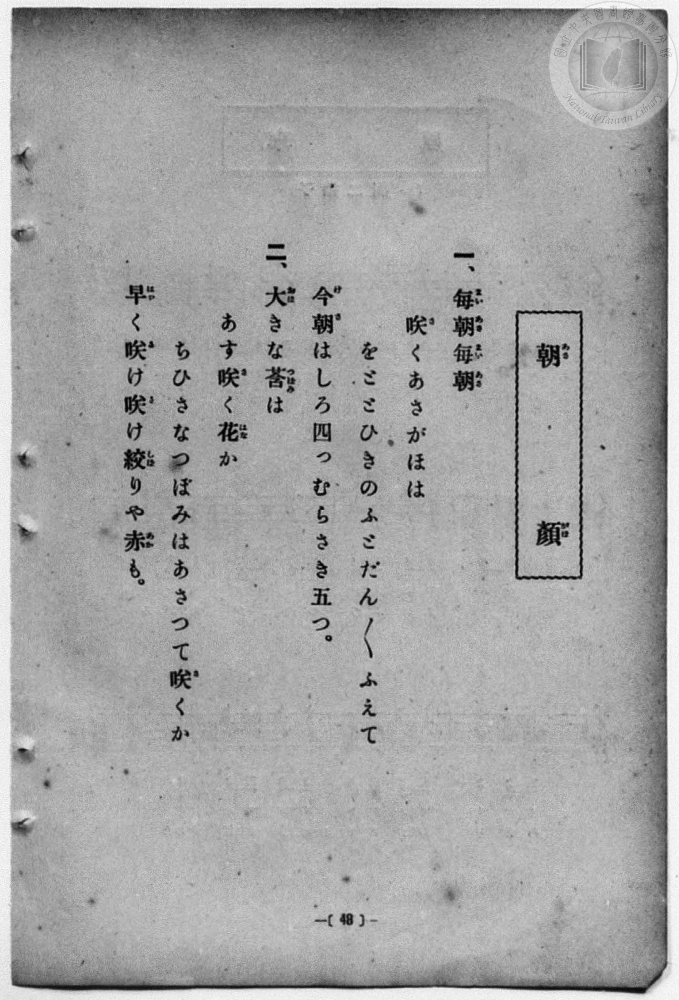
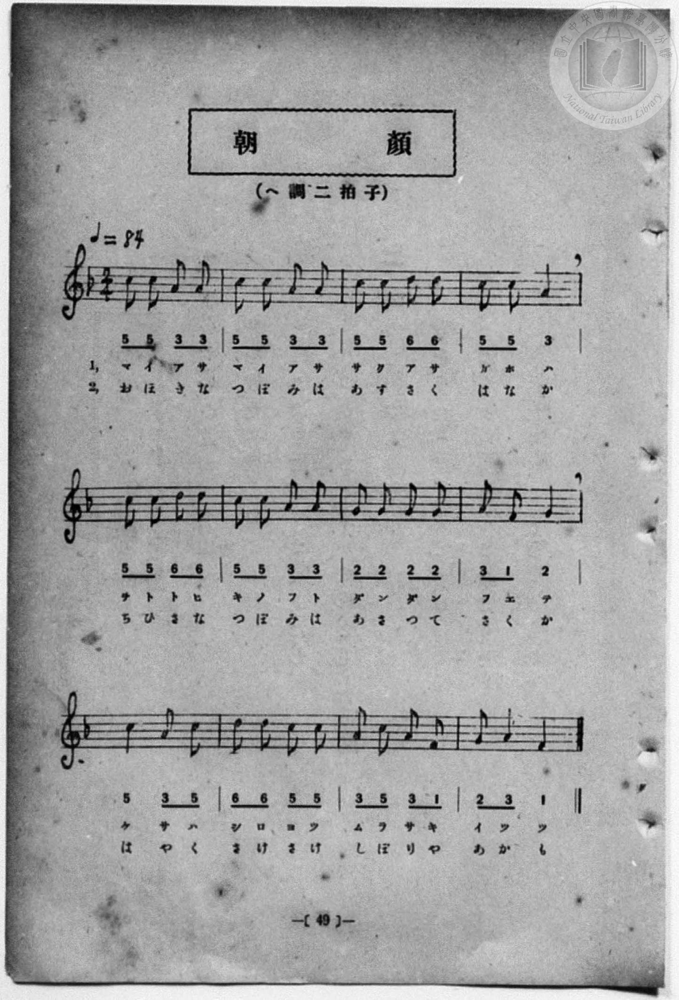

# 朝顔

> Re:Shōka 使用 AI 協助辨識與重建樂譜，可能會有錯誤。歡迎回報。

- **鋼琴伴奏版**：<br><audio controls src="asagao.mp3"></audio>
- **NEUTRINO 歌聲合成版**：<br><audio controls src="asagao_neutrino.mp3"></audio>

- 詞：文部省
- 曲：文部省
- 一條慎三郎 編《新編 小學校・公學校 唱歌教材集》（大正十二年十二月，索書號 0725-41）
- 臺灣教育會公認《新定兒童唱歌》尋常科第一學年用（2020.006.0847.0001）

## 說明

曲目說明
中文解釋：描寫清晨盛開的牽牛花與夏日庭院景色。

原書資訊與歌詞全文（對應 P056.jpg–P057.jpg，原書 p. 48–49）：
調性與拍號：ヘ調 二拍子，♩=84


## 歌詞

```text
一、毎朝（まいあさ）毎朝（まいあさ）
咲（さ）くあさがほは
をととひきのふとだん／＼ふえて
今朝（けさ）はしろ四つむらさき五つ。

二、大（おほ）きな蕾（つぼみ）は
あす咲（さ）く花（はな）か
ちひさなつぼみはあさつて咲（さ）くか
早（はや）く咲（さ）け咲（さ）け絞（しぼ）りや赤（あか）も。
```

## ABC

<div class="abc-score" data-abc-src="asagao.abc" aria-label="五線譜載入中"></div>

[下載 ABC 原始檔](asagao.abc)

## TMD 檔案連結

- [主旋律 TMD 檔案](asagao.tmd) [[在 TMD Studio 編輯](https://tmdlang.github.io/Tmd-TS/#tmd=s7IKdvYPcrWy4qpTUCpJTLdSSM7PyUlNLsnMz7MqzsjPTozPrsyvSsyML84ojTe0NDJWgqssy88pzU21Si9KTEmNN4w3QsgU55cWJadaFSdn5OfnxJekVpQk5edno8vHFySmp1oFGJiaIWQKivLLUvMS84C6C4oy80pSU8DaEQpSyzJTUkHSxcmJefFlqUWZaZmpKUiOSi0qBrsdYkVJUWJecXJRZgHIQwhV-UUlGflAhxdkVFplZBaX5BdlJifmxGcn5iUiFJVkpAK9V5CTmIdkP1BlemaeVW5-XlIpMHyUuLS0FJ7Nmfty4RQFLS0uRVsFCxMue1sFNy4bI30TO5C2Jzsani2a-6y178mOzpfNfQrPt6943ND1bNoGIEPh6Yb-p2t3PFuw8HHz7qetayBshadTNj5b2_Ns6sxncye8nN32uKH7_Z6Op0uWP1u7-Glv45NdPU93boEwns3peL-n5_mWRc9m73gxc76CgbmRqa6J4fs9nWAnv1g57_2eWc-mtb9sXvF8TiNY7NnsTRhiL9p3PW9cDLTwRdOmZ3OagS55saoX4sqn62Y9bZ30fPVSiKOAbnm6ofvpjh3Pl098vmYN0HNANwOd83zKCqAbjQyMDPQMDMz0DCxMzIEMA4hL9IFhNHvT89nrXqxa9WxGH5eCgsKTHWuBTnixfPHLdqDnZj3r73-6fvWzHa3PZq54Pnv2y2ndz2e1PO_c-7xz9ouujS862p8u6X82fenTXWtfzlz0bOb6F52bHjc0cWnpc4EMt6UWALnsad98UGBubn-xogtoMdDPwFB82roC6FxQLGzofdbeqQBKtXpZBemPGiYDmeYgJjAeIFoVCvQUTCyAMiaWQN8DPQcy9cWq_c8aloPM6-4FRhRQ9HHzDKCgAigSu3ufrp0A1P9o5kpbYPqBhE_D44bGZ-v7gIkLaO3jxn2PG1seNzY9bpwKNBSXONj9k4DxC5QA8R839kPkHjf2PG7c_bhxPUjF46ZJjxtXgNGmx429jxvXPW7cCuYueNw0-f2e_vd79oBFgKYsAztmdxfMuokwg9c_bpz-uKn36ezZjxuXPG5qeNwEFATa0_tk1xSQCDB2wFp3AZNMIzDtgnV3AR0B1g20dNWLqfvAgkseNwKt2w8xFew-kJNnovkDmAzAXKC9q8Ai3RClC8GeAFq8Cm4SWBHE10CRZRgBAtb5bPpKqHlNLRAJVHUT0bjPtwKzEpA7HWgHSKSpC6jxxdYlYEGgZcBUDBRsAvkbaDrlSREKFEBJ3LE4MT0x3yogMzEv36HGoKYaZIWCjYWWHZhRo2AKhMZAiM4yA0KYmK5CDVi1j2GNwuPmecBUsASIFwHxVqAaLCJA8nHTehSRNUB1s4G4H2GaEVC8sQuIdwNxLxCvAqlsBJrUuAeI9wPxerBIExDPBOKpQNwPFgGaDVQNDDqwaUheQXY2yCtGUFgD5BkCaVSvbALiDiieBHbmWiCrD4iBVgFFQWoagHgznAaJAOWaVgDpNjSvLARioIlgZ-LzCkgeJLMMLALxFIZXdIEONgWyQB4CeQfkAZCnDMGeAtEoXmnaCOSDwx0YwiD-diAL5BmQQ1vAzl4AxCuhcbMWrAboCKAcCKN6ZD3YLKAMNLRBTpwIp0Ei0yEeawLGHlAdzGPdQF4T2KxaLi5dOwVI4lNAYSkDAA)]
- [鋼琴伴奏 TMD 檔案](asagao_piano.tmd) [[在 TMD Studio 編輯](https://tmdlang.github.io/Tmd-TS/#tmd=s7IKdvYPcrWy4qpTUCpJTLdSSM7PyUlNLsnMz7MqzsjPTozPrsyvSsyML84ojTe0NDJWgqssy88pzU21Si9KTEmNN4w3QsgU55cWJadaFSdn5OfnxJekVpQk5edno8vHFySmp1oFGJiaIWQKivLLUvMS84C6C4oy80pSU8DaEQpSyzJTUkHSxcmJefFlqUWZaZmpKUiOSi0qBrsdYkVJUWJecXJRZgHIQwhV-UUlGflAhxdkVFplZBaX5BdlJifmxGcn5iUqcWlpKTybM_flwinv93S8nD3zWWf3y-49zydsebJny9Ol_e_3dCpoaXEp2ipYmHDZ2yq4cdkY6ZvYgYx-sqPh2aK5z1r7nuzofNncp_B8-4rHDV3Ppm0AMhSebuh_unbHswULHzfvftq6BsJWeDpl47O1Pc-mznw2d8LL2W2PG7qBlj5dsvzZ2sVPexuf7Op5unMLhPFsTsf7PT3Ptyx6NnvHi5nzFQzMjUx1TQyBzgF768XKee_3zHo2rf1l84rncxrBYs9mb8IQe9G-63njYqCFL5o2PZvTDHTJi1W9EFc-XTfraeuk56uXQhwFdMvTDd1Pd-x4vnzi8zVrgJ4DuhnonOdTVgDdaGRgZKBnYGCmZ2BhYg5kGEBcwuVYnJiemG8VkJmYlx_k4VBjUFPNpQAENhZadmBGjYIpEBoDITrLDAhhYroKNWDVPoY1Co-b5yk8bloCxIuAeCtQDRYRIPm4aT2KyBqgutlA3I8wzQgo3tgFxLuBuBeIV4FUNgJNatwDxPuBeD1YpAmIZwLxVCDuB4sAzQaqftzYDTYNySvIzgZ5xQgKa4A8QyCN6pVNQNwBxZPAzlwLZPUBMdAqoChITQMQb4bTIBGgXNMKIN2G5pWFQAw0EexMfF4ByYNkloFFIJ7C8Iou0MGmQBbIQyDvgDwA8pQh2FMgGsUrTRuBfHC4A0MYxN8OZIE8A3JoC9jZC4B4JTRu1oLVAB0BlANhVI-sB5sFlIGGNsiJE-E0SGQ6xGNNwNgDqoN5rBvIawKbVYua9nyQ054JPO0ZxitEG8aiM0yQRZBUoogrmMYDWabxMDEwC91YEwzzwboMwWqBTtS1U4C4MtoHKIvEMwLzlLkA)]

## 分析

```text
================================================================================
📊 TMD Song Profile: [ 朝顔 ]
================================================================================
⏱  Duration:       0:34 (34.3s), 24 measures total
🎼 Key & Tempo:    首調基準 F, != 84.0 BPM, <2/4>
   - 分析範圍：      由實際發聲的音符與和弦推測調性；播放脈絡另行呈現
🎤 人聲音域:    F4 (MIDI 65) – D5 (MIDI 74) [跨度: 9 個半音 / 0.8 個八度, 難度: easy]
   - 最低音:  F4 in [Asagao #1 @ m.8, 0:10]
   - 最高音: D5 in [Asagao #1 @ m.3, 0:03]
   - 適合: soprano, mezzo-soprano, contralto, tenor, baritone, bass
🏛  結構:      Asagao (17.1s) -> Asagao (17.1s)
⚡ 編曲密度:        Peak 1 軌道同時演奏
🗝  調性診斷：       C 調性不明確（純淨自然大調，未偵測到可信轉調）
   - 風格氣質:    純淨自然大調（陽光明朗、易唱易記，無明顯調外色彩）
   - 轉調歷程:    全曲維持單一推測調性（未偵測到可信轉調）
   - 核心骨幹音:  C, A, G, D, F
   - 調性數值:    C 調性不明確 [相關度: 0.78, 穩定度: Ambiguous, 自然音純度: 100.0%]
   - 候選調性 (K-S): C 大調 (0.78), A 小調 (0.77), F 大調 (0.63)
   - 五度圈歷程:   +0 -> +0
   - 各段落調性細節:
     • [Asagao #1]: C 調性不明確 (r: 0.78, 自然音純度: 100.0%)
     • [Asagao #2]: C 調性不明確 (r: 0.78, 自然音純度: 100.0%)

  [ 五度圈游移軌跡 ]
              [C ]*
         F            G  
      Bb               D  
      Eb               A  
         Ab           E  
            Db       B  
               F# 
     (* = active key center)

  [ 十二半音累積音高分佈 ]
     C  : ████████████████████████  37.5%
     C# :                            0.0%
     D  : ████████                  12.5%
     D# :                            0.0%
     E  :                            0.0%
     F  : █████                      8.3%
     F# :                            0.0%
     G  : █████████                 14.6%
     G# :                            0.0%
     A  : █████████████████         27.1%
     A# :                            0.0%
     B  :                            0.0%
--------------------------------------------------------------------------------
Assignment 軌道音域：
  - Piano         : F4 – D5 (9 個半音 / 0.8 個八度, 88 個音符)
================================================================================
```


## 原書掃描頁






