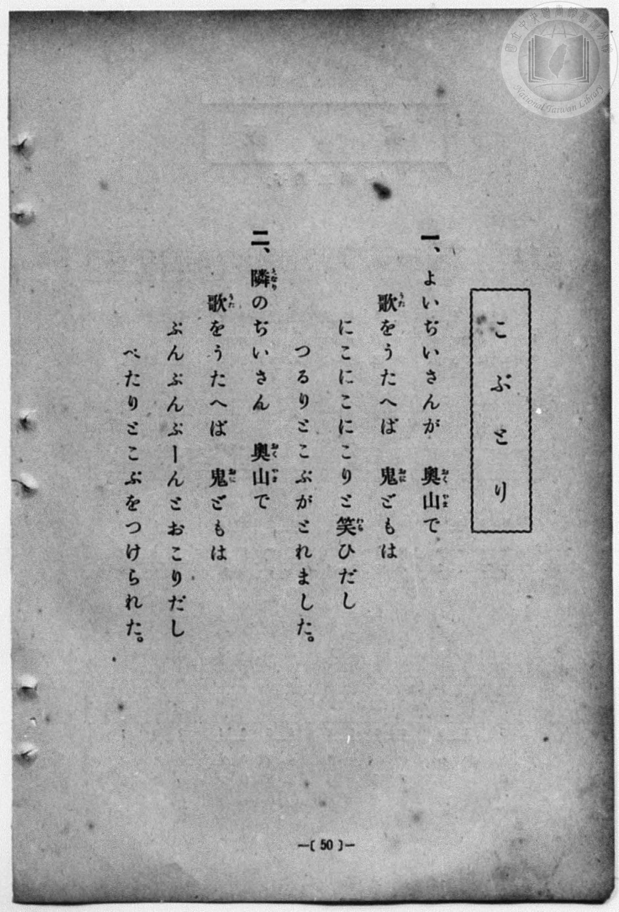
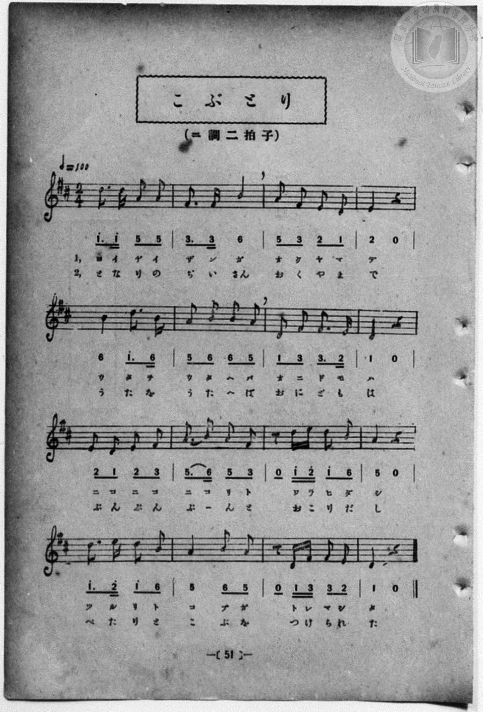

# こぶとり

> Re:Shōka 使用 AI 協助辨識與重建樂譜，可能會有錯誤。歡迎回報。

<audio controls src="kobutori.mp3"></audio>

- 一條慎三郎 編《新編 小學校・公學校 唱歌教材集》（大正十二年十二月，索書號 0725-41）

## 說明

曲目說明
中文解釋：日本民間故事「瘤取り爺さん」（摘瘤爺爺），描寫心地善良的老爺爺在深山唱歌讓鬼開心地替他摘下臉上的瘤，而隔壁的老爺爺卻被多貼了一個瘤。
原書資訊（對應 P058.jpg–P059.jpg，原書 p. 50–51）：
調性與拍號：ニ調 二拍子，♩=100


## 歌詞

```text
一、よいぢいさんが　奥山（おくやま）で
歌（うた）をうたへば　鬼（おに）どもは
にこにこにこりと笑（わら）ひだし
つるりとこぶがとれました。

二、隣（となり）のぢいさん　奥山（おくやま）で
歌（うた）をうたへば　鬼（おに）どもは
ぶんぶんぶーんと怒（おこ）りだし
べたりとこぶをつけられた。
```

## ABC

```abc
X:1
T:こぶとり
M:2/4
L:1/16
Q:1/4=100
K:D
V:V1 name="Piano" snm="Pia"
[V:V1]
d3 d A2 A2 | F3 F B4 | A2 F2 E2 D2 | E4 z4 |
w: 1.~ヨ イ ヂ イ | サ ン ガ | オ ク ヤ マ | デ
w: 2.~と な り の | ぢ い さん | お く や ま | で
B4 d3 B | A2 B2 B2 A2 | D2 F2 F3 E | D4 z4 |
w: 1.~ウ タ ヲ | ウ タ ヘ バ | オ ニ ド モ | ハ
w: 2.~う た を | う た へ ば | お に ど も | は
E2 D2 E2 F2 | A3 B A2 F2 | z2 d e d2 B2 | A4 z4 |
w: 1.~ニ コ ニ コ | ニ コ リ ト | ワ ラ ヒ ダ | シ
w: 2.~ぶ ん ぶ ん | ぶ _ ん と | お こ り だ | し
d3 e d2 B2 | A4 B2 A2 | z2 D F F2 E2 | D4 z4 |
w: 1.~ツ ル リ ト | コ ブ ガ | ト レ マ シ | タ
w: 2.~べ た り と | こ ぶ を | つ け ら れ | た
```

## TMD 檔案連結

- [主旋律 TMD 檔案](kobutori.tmd) [[在 TMD Studio 編輯](https://tmdlang.github.io/Tmd-TS/#tmd=s7IKdvYPcrWy4qpTUCpJTLdSSM7PyUlNLsnMz7MqzsjPTozPrsyvSsyML84ojTe0NDJWgqssy88pzU21Si9KTEmNN4w3QsgU55cWJadaFSdn5OfnxJekVpQk5edno8vHFySmp1oFGJhaIGQKivLLUvMS84C6C4oy80pSU8DaEQpSyzJTUkHSxcmJefFlqUWZaZmpKUiOSi0qBrsdYkVJUWJecXJRZgHIQwhV-UUlGflAhxdkVFplZBaX5BdlJifmxGcn5iUiFJVkpAK9l5afk52TX5SqxKWlpfC4cfLjxm2PG1c8bupS0NLiUrRVMDQw4LK3VXDhsjHSN7EDaX6yo-HZornPWvue7Oh82dyn8Hz7iscNXc-mbQAyFJ5u6H-6dsezBQsfN-9-2roGwlZ4OmXjs7U9z6bOfDZ3wsvZbY8but_v6Xi6ZPmztYuf9jY-2dXzdOcWCOPZnI73e3qeb1n0bPaOFzPnKxiYG5nqmhi-39OpxKWvpfBs9qbns9e9WLXq2Yw-LgUFhSc71j6b1v5i-eKX7UAjZz2bvvTZnDXPNkx8OW3ys6mtT3Z1P27oeT5jydP-aUAfPe_Y9bhx6uOmyY8beoH2P5s4AygFFAQioPlAa5_19z9dv_rp_uanczY8ndbyonP981ktLxoaIWqezlnxbPvGpxs3QnzzYt3kl2v2vJzWDVH_bPb-J7unAc18sqP7RXvnkx1dQL1A84HGvmjoeTlrytPFjSim9e5-sWj10yWzXmza82RXGzBQnzZ0A9U_bmgCeexp33xQCGxuf7GiCxRWG3qftXcqgBKTXlZB-qOGyUCmJYgJNB-iVqFAT8HUAChjCgotYGCAjHmxav-zhuUvOtqfdfcCgxMo-ri5GyioAArq7t6naycA9T-audIWFM1a-lzAMOYCOuVxQ-Pjpo7HjS2PGxeBSXCoNfY8bmh4unQpMAiATnrc2PW4sf9xE1B2H9DCx43LuYChApZoe9wItKrzcdMkCPtx447HjRuAmoEBBtO5Gqxn5eOmpseN67mAfHDaQyKbgIpWPF8zEaShCWgP0EtADZseNy543DgdqGHJ46ZuiCJYqu0BJ1wguQ-oAmQtMCi5gB4F-ublrMVgi4FqVwE1gY1ah-I52vlsGzjsYGTzHjBjxbOGSTANk8EmAhlQn-0EGYzsM5BtSx43TgQGAth_YJ-BYss3MTPPKiAzMS_focagphoU4wo2hmZadmBWjYJhnIIuEAIpUyAFwjUKxmAhYwUzMA0SAYmDRI1ASsEiIBYIGsDUgM3zMaxReNy8AizyuGkJkN0EZYH0PG7aCpFp3gxkr4Gb_rhpFVjVerAcSO3j5nkQmeZ27PYYAeUaofY0rgLq7QKz1kF0NS6CyrQAMSjuEFY1QhT2gy1sAbP3QWWWY1gFDSNYOEDDygwaICBhEIYEGihYQEEECTwjqAiOIGpaBhV73LQfGiSbwAEBEoeIPW6eASYnIAdRczeY7ITqWQQOIpBfcAVRG8yexvlQ-yaB_QoSh4gB0yeY3IASPqvB5EqoniawDCh6sIYPLFWAaJD3IcEDChxYuqkBawKGn1EcJBRB4QZThj0RgX3atBnhazAbJgPhP26GhEoH3IrHzeuBeCUQTwLzGqChtx1PGG0DmwZKI8hsmAzELogsKMFB7QGGEzDrwRPeAqiO6bjCCJp2sPsfkYrAwQQMMlhmw5uKmkHpF-TL1WghAQkriNw0sPtBmQ0WQh1AvAaaxSAhA9IBSYfYQ2gnxCxgeoH5FxISoBCApS9IyIFCHRZCwOzfOBEoBkqtwEIJqgOSDpHtqeXi0rVTABVUCkBamQsA)]
- [鋼琴伴奏 TMD 檔案](kobutori_piano.tmd) [[在 TMD Studio 編輯](https://tmdlang.github.io/Tmd-TS/#tmd=s7IKdvYPcrWy4qpTUCpJTLdSSM7PyUlNLsnMz7MqzsjPTozPrsyvSsyML84ojTe0NDJWgqssy88pzU21Si9KTEmNN4w3QsgU55cWJadaFSdn5OfnxJekVpQk5edno8vHFySmp1oFGJhaIGQKivLLUvMS84C6C4oy80pSU8DaEQpSyzJTUkHSxcmJefFlqUWZaZmpKUiOSi0qBrsdYkVJUWJecXJRZgHIQwhV-UUlGflAhxdkVFplZBaX5BdlJifmxGcn5iUiFCUWATWnp-am5pVYFWQm5uXHJyYn5-cWJOZlgsSUuLS0FB43Tn7cuO1x44rHTV3v93S8nD3zWWf3y-49zydsebJny9Ol_e_3dCpoaXEp2ioYGhhw2dsquHDZGOmb2IFsebKj4dmiuc9a-57s6HzZ3KfwfPuKxw1dz6ZtADIUnm7of7p2x7MFCx83737augbCVng6ZeOztT3Pps58NnfCy9ltjxu6gbY-XbL82drFT3sbn-zqebpzC4TxbE7H-z09z7csejZ7x4uZ8xUMzI1MdU0Mge5R4uLyTczMswoA-SnIw6HGoKaaSwEIbAzNtOzArBoFwzgFXSAEUqZACoRrFIzBQsYKZmAaJAISB4kagZSCRUAsEDSAqQGb52NYo_C4eQVY5HHTEiC7CcoC6XnctBUi07wZyF4DN_1x0yqwqvVgOZDax83zIDLN7djtMQLKNULtaVwF1NsFZq2D6GpcBJVpAeKpj5smI6xqhCjsB1vYAmbvg8osx7AKGkawcICGlRk0QEDCIAwJNFCwgIIIEnhGUBEcQdS0DCr2uGk_NEg2gQMCJA4Re9w8A0xOQA6i5m4w2QnVswgcRCC_4AqiNpg9jfOh9k0C-xUkDhF73LgDTG5ACZ_VYHIlVE8TWAYUPVjDB5YqQDTI-5DgAQUOLN3UgDUBw88oDhKKoHCDKcOeiMA-bdqM8DWYDZOB8B83Q0KlA27F4-b1QLwSiCeBeQ3Q0NuOJ4y2gU0DpRFkNkwGYhdEFpTgoPYAwwlYJsAT3gKojum4wgiadrD7H5GKwMEEDDJYZsObippB6Rfky9VoIQEJK4jcNLD7QZkNFkIdQLwGmsUgIQPSAUmH2ENoJ8QsYHqB-RcSEqAQgKUvSMiBQh0WQsDs3zgRKAZKrY-beqA6IOkQ2Z5a5HLKB7mcMkEUU9rGYAxhmcRrG0KZpvHaoLwGpMzjgWZCXF0DUYGkDKEXohLCRqiHiCLLYbUNoQFNArf5QN_p2imAPBjtYxirAGcbgdnKXAA)]

## 分析

```text
================================================================================
📊 TMD Song Profile: [ こぶとり ]
================================================================================
⏱  Duration:       0:19 (19.2s), 16 measures total
🎼 Key & Tempo:    首調基準 D, != 100.0 BPM, <2/4>
   - 分析範圍：      由實際發聲的音符與和弦推測調性；播放脈絡另行呈現
🎤 人聲音域:    D4 (MIDI 62) – E5 (MIDI 76) [跨度: 14 個半音 / 1.2 個八度, 難度: moderate]
   - 最低音:  D4 in [Main #1 @ m.3, 0:03]
   - 最高音: E5 in [Main #1 @ m.11, 0:12]
   - 適合: soprano, mezzo-soprano, contralto, tenor, baritone, bass
🏛  結構:      Main (19.2s)
⚡ 編曲密度:        Peak 1 軌道同時演奏
🗝  調性診斷：       D 大調（純淨自然大調，未偵測到可信轉調）
   - 風格氣質:    純淨自然大調（陽光明朗、易唱易記，無明顯調外色彩）
   - 轉調歷程:    全曲維持單一推測調性（未偵測到可信轉調）
   - 核心骨幹音:  D, A, B, F#, E
   - 調性數值:    D 大調 [相關度: 0.87, 穩定度: High, 自然音純度: 100.0%]
   - 候選調性 (K-S): D 大調 (0.87), B 小調 (0.71), A 大調 (0.70)
   - 五度圈歷程:   +2
   - 各段落調性細節:
     • [Main #1]: D 大調 (r: 0.87, 自然音純度: 100.0%)

  [ 五度圈游移軌跡 ]
               C  
         F            G  
      Bb              [D ]*
      Eb               A  
         Ab           E  
            Db       B  
               F# 
     (* = active key center)

  [ 十二半音累積音高分佈 ]
     C  :                            0.0%
     C# :                            0.0%
     D  : ████████████████████████  27.8%
     D# :                            0.0%
     E  : ████████████              13.9%
     F  :                            0.0%
     F# : ██████████████            16.7%
     G  :                            0.0%
     G# :                            0.0%
     A  : ████████████████████      23.1%
     A# :                            0.0%
     B  : ████████████████          18.5%
--------------------------------------------------------------------------------
Assignment 軌道音域：
  - Piano         : D4 – E5 (14 個半音 / 1.2 個八度, 49 個音符)
================================================================================
```


## 原書掃描頁






