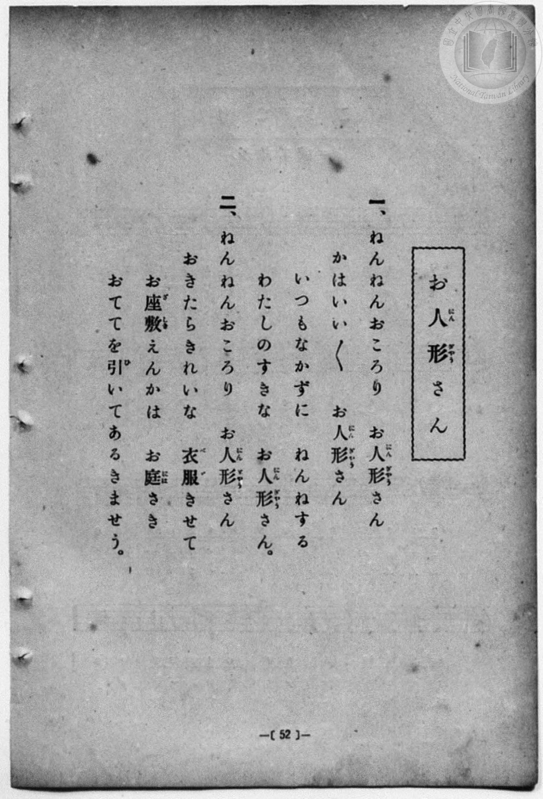
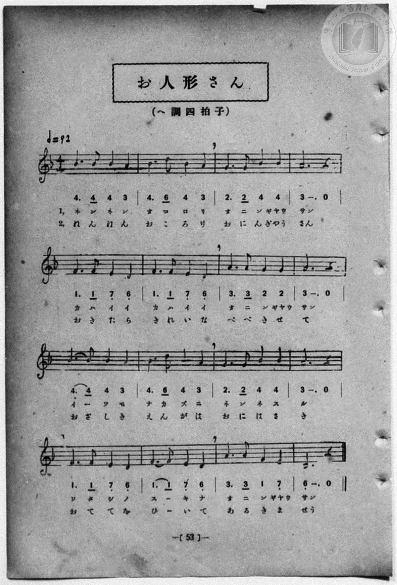

# お人形さん

> Re:Shōka 使用 AI 協助辨識與重建樂譜，可能會有錯誤。歡迎回報。

<audio controls src="oningyosan.mp3"></audio>

- 一條慎三郎 編《新編 小學校・公學校 唱歌教材集》（大正十二年十二月，索書號 0725-41）
- 日治時期公學校《唱歌帳》（典藏號 2020.006.0843・P145）
- 原載《小公唱歌教材集》第 53 頁（大正 13 年 12 月 12 日抄）

## 說明


- 出處：《唱歌帳》（國立臺灣歷史博物館典藏號 2020.006.0843）第 P145.jpg 頁（手寫頁碼 16）。
- 標註：（小公唱歌教材集 53p ヨリ）13.12.12.（大正 13 年 12 月 12 日抄錄）。
- 調性與拍號：ヘ調- ニ短調（F 大調關係小調 D minor，自然小調／都節調式），4/4 拍，速度 != 92。
- 背景與曲風：溫柔的搖籃曲風，哄著不哭不鬧的可愛洋娃娃入睡，並期待醒來後替她換上漂亮衣裳、牽手散步。
- 版本說明：本檔案為原頁單聲部簡譜之忠實數位化版本。
【原頁歌詞全文與中文語譯】（對應 P145.jpg）

### 編曲說明（鋼琴伴奏版）：

1. 前奏 (Intro, 4 小節)：引用結尾樂句「ワタシノスーキナ オニンギャウサン」，以輕柔搖籃曲伴奏鋪陳。
2. 主歌伴奏 (Song, 16 小節 × 2 段)：右手演奏主旋律，左手以平穩和弦搖擺伴奏。


## 跨冊／重複收錄參照

> 同曲（《新編 小學校・公學校 唱歌教材集》、《楊金土手抄唱歌帖》共同收錄教材）

- **[同曲]** 楊金土手抄《唱歌帖》第 1 冊（2020.006.0843）：[**〈お人形さん〉**](../../../shokacho/vol_01/p145_oningyosan/index.md)（`F` / `4/4` — [原始 TMD](../../../shokacho/vol_01/p145_oningyosan/oningyosan.tmd)）
- 總表：[跨冊重複與同名歌曲總索引](../../../duplicate_songs.md)

## 歌詞

```text
（一）ネンネンオコロリ　オニンギャウサン
カハイイカハイイ　オニンギャウサン
イーツモナカズニ　ネンネスル
ワタシノスーキナ　オニンギャウサン
總是不哭不鬧地乖乖睡覺，我最喜歡的洋娃娃呀。）

（二）ネンネンオコロリ　オニンギャウサン
オキタラキレイナ　ベベキセテ
オザシキエンガハ　オニハサキ
オテテヲヒーイテ　アルキマセウ
在客廳、走廊與庭院前，牽著妳的小手一起散步吧。）
```

## ABC

```abc
X:1
T:お人形さん
M:4/4
L:1/16
Q:1/4=92
K:Dm
V:V1 name="Piano" snm="Pia"
[V:V1]
B6 B2 B4 A4 | B4 d4 B4 A4 | G6 G2 B4 B4 | A12 z4 |
F6 F2 E4 D4 | F6 F2 E4 D4 | A6 A2 G4 G4 | A12 z4 |
B6 B2 B4 A4 | B4 d4 B4 A4 | G6 G2 B4 B4 | A12 z4 |
F6 F2 E4 D4 | F6 F2 E4 D4 | A6 A2 F4 E4 | D12 z4 |
```

## TMD 檔案連結

- [主旋律 TMD 檔案](oningyosan.tmd) [[在 TMD Studio 編輯](https://tmdlang.github.io/Tmd-TS/#tmd=s7IKdvYPcrWy4qpTUCpJTLdSSM7PyUlNLsnMz7MqzsjPTozPrsyvSsyML84ojTe0NDJWgqssy88pzU21Si9KTEmNN4w3QsgU55cWJadaFSdn5OfnxJekVpQk5edno8vHFySmp1oFGJgZIGQKivLLUvMS84C6C4oy80pSU8DaEQpSyzJTUkHSqSmZJflFmYk5SA5KLSoGuxtifElRYl5xclFmAcgzSlxaWgqPG7ue7Nr1dO-ix41THzdNVtDS4lK0VbA04rK3VXDjyk6ttFVwyeWyMdE3sQMZ-mRHw7NFc5-19j3Z0fmyuU_h-fYVjxu6nk3bAGQoPN3Q_3TtjmcLFj5u3v20dQ2ErfB0ysZna3ueTZ35bO6El7PbHjd0v9_T8XTJ8mdrFz_tbXyyq-fpzi0QxrM5He_39DzfsujZ7B0vZs5XMDA3MtU1MXy_pxPsoWfTlz7btPvZzKZnc-bDjQfaDrHg6Y7NUKNbd7yY3g_Sb2RgZKBnYGCmZ2BhYgx0U4ChiSnMsKd981_s6QTpBjoaaBiGI5-vWaNgaqzwckEj3LkKhsYKQMcqGBopAJ0KpoBO6moBm8mlr6VgSy3ApaCg8LhhwrPZm57PXvdi1apnM_oeN0wEiwKDtn3Xi5lT3--ZhcXvc7qfr-5-0b7reePiZ2u3P-3f9LR31vPOlS-XrMARLEC3g3wKChq9rIJ0qH-fdXY_Xb8ayH6-aI-CoRlQ0eOGJqj1z1bMfLFiN9B6kH3YAg8YbAVAhSseN68CajQ01jM0AiGCwfiyBxSSCIterNr_rGH5i472Z929QHeDPNw8AygIlHrc3P18_logG2iomwLQWCDz5fQ5T_Y3AV0EZCu4KORm5uUXAZPTi_ZVz1u2QYTf7-l_2bz3-foGIPvpnn6gbUAFwKStALQByHrZMP_prmUK4PSP5Izmnmcz14OcMXvTy0UrgM54tmv1s_lTns9qeTZh2vONzTDxnqeTW15MnP5kR-_TyWuB5Ms1y4Fqnvavf9Yy-9mW7qcrmkGodenzuQuBip_sWAZKx_taX7ZNerKv7em-nmez9z9duvNZ_-wnO7qe7Wl6smvdi4WLXywGRm3j8869wCh5NhUYqUsRLnve2fFszhpI8gA5a86aZ6umPFvY8bxpFzB5A2Pv6bR1Lxo3vWxe8XzDwhdr5zzZ2f10_4Kn65c9m7rjyd7epz3TICaATISmOIg-YGy-WDnvaeuKZ9PagR5_smMtiLFq3ou164HJEBzvvc_aO-GpBhiQYAOAMsACAhSJzb2PmzdDyaZVj5uA7LXA9PC4oQHEbe4Gi6973Lz4cdOyx01bgVyIAxqgqGn14-b-x01LwAiJTbT-JY-b9zxubnncvOhxcxfIiKZdIG1AKbjTmnY-bl6Nqq15_eOm_Y-btj9u7gNL73ncBHR2FwFrgd6GBA4wEoCR-3TCcgj5ZOc0IIJENyIBTAQG0OynS_dCEgacAUpOSGqgsayg8HzH3mcz1iMnqqdzNsBNfrFsF8jwjonP5jQ8nTbn2dqFmOYgx86uHqrEDlDPWlBINa8EB9AacHiDg6l5JgiBZIGZtA1T2zZQ6IKkgcUD0JI1oKhFWAuM5q1AWQxtzW1gtOlx8yRwpABtA5bRQClg7AKjFuiEeSALm5aRGR3P13bCs-HTnaufLtv8fOV-eDYEBikkJwI1QiLl6ZwVT9cteroblDdfbN3wdHcXMJs83bX25cxFTztBRQkwwwKLApA5wBJgQz8w8wIzxout2yFZGOgYaLwAzaK8toACBS19Lq7g_Lx0q4DMxLx8hxqDGoVqsHttLLTswAxgHaUBdIgmsPQART6MqlEABjIQgwTWAvEqmEhzNxADRWGJASwOSg8gu0AG1iiYKOgCoQmYNgZiiIgZWAwmYgRWYwQWAeEasDgMGoBEwCkUyX1Nq4E29wPpJWAMshdThBgXgo3c1QMyEuRFoPea9gO1rAQrBHl2DcTI5i6QSPNMCAar2w0WaUP41RDsXkMF83iQF0EEdjGI74zB_gZhYvwLcsIeIG4B4kVgi7sgfm7aBfYlSKQX4lcQ3bQTLLIahze3AfF2sDdA3lwBDSOgV4EhiBxyoPDcCg0KWkdp83pI2IMcBmw6gizdCfE0OB7A4U9GlAIjCII3gUNkEtRIUHi2gbUuAocTxJJ5YBFQSUF-rILkwOI1EBlUT9dycenaKYCyoQKQVuYCAA)]
- [鋼琴伴奏 TMD 檔案](oningyosan_piano.tmd) [[在 TMD Studio 編輯](https://tmdlang.github.io/Tmd-TS/#tmd=s7IKdvYPcrWy4qpTUCpJTLdSSM7PyUlNLsnMz7MqzsjPTozPrsyvSsyML84ojTe0NDJWgqssy88pzU21Si9KTEmNN4w3QsgU55cWJadaFSdn5OfnxJekVpQk5edno8vHFySmp1oFGJgZIGQKivLLUvMS84C6C4oy80pSU8DaEQpSyzJTUkHSqSmZJflFmYk5SA5KLSoGuxtifElRYl5xclFmAcgzSlxaWgqPG7ue7Nr1dO-ix41THzdNfr-n4-Xsmc86u19273k-YcuTPVueLu1_v6dTQUuLS9FWwdKIy95WwY0rO7XSVsEll8vGRN_EDmTZkx0NzxbNfdba92RH58vmPoXn21c8buh6Nm0DkKHwdEP_07U7ni1Y-Lh599PWNRC2wtMpG5-t7Xk2deazuRNezm573NANtPzpkuXP1i5-2tv4ZFfP051bIIxnczre7-l5vmXRs9k7Xsycr2BgbmSqa2IIdBbYo8-mL322afezmU3P5syHGw-0HWLB0x2boUa37ngxvR-k38jAyEDPwMBMz8DCxBjopgBDE1OYYU_75r_Y0wnSDXQ00DAMRz5fs0bB1Fjh5YJGJS4ufS0FW2oBLgUFhccNE57N3vR89roXq1Y9m9H3uGEiWBQYbO27Xsyc-n7PLCz-mtP9fHX3i_ZdzxsXP1u7_Wn_pqe9s553rny5ZAUOLwP9CvIFyNt6WQXpIL88bmiC2vRi1f5nDctfdLQ_6-4F6gRZ2TwDKAiUetzc_Xz-WiAbaKuLQm5mXn4R0Chg1ABTgQJQOZD1smH-013LFMBJBWEmMBEAvQXxEyiFIaWt553AuAWaMQukVEHBUE_haWcvUFxBwzOvpChfR8EElHyer2_QBKp5umfq8ykrnm-d8HTDvmcrmp72L33c0PO4ef3jpv2Pm7Y_bu573LTzcfOex01rHzd3KTxuWgV08ePmzY-b1j1uXvy4adnjpq0gbgPIpU92L32xZ-qz-VOeTZj2fGMz0H0QB73sXvVyJlAN2O0KCkZ6Ck927AaGN0RWQSM4Py9dR8HQDOoshcPTFYwUnq3bCnZf_2Zg1nm2ZwpQJUjX9O6n-4BR1PN0-zKgONDGpzs3P1-58umknqd7lgHtfTZ5F8RYqHWUJyIoUNDS5-ICB6BVQGZiXn6Qh0ONQY1CNdhPNhZadmBGjYKhgi4QGiqYxwMpMxCBXcwYLGYMlgOL10BkYNAAJMRVi2KnD4qdJnA7zeLjFaLNcmMRDOxixkCWMZAFo9FUGUAsBEUHfj-agF1oAqZB_oCImIHFYCJGYDVGYBEQhvkY2XfkhRjIZBDGbeLAuo9gjCICGFeEGgFjxQg17kyALBMUEZgiGI0Sv6C4REscWGIdixAB0-jvMuISra6dAjijKAAZoPBFppW5AA)]

## 分析

```text
================================================================================
📊 TMD Song Profile: [ お人形さん ]
================================================================================
⏱  Duration:       0:41 (41.7s), 16 measures total
🎼 Key & Tempo:    首調基準 F, != 92.0 BPM, <4/4>
   - 分析範圍：      由實際發聲的音符與和弦推測調性；播放脈絡另行呈現
🎤 人聲音域:    D4 (MIDI 62) – D5 (MIDI 74) [跨度: 12 個半音 / 1.0 個八度, 難度: easy]
   - 最低音:  D4 in [Song #1 @ m.5, 0:12]
   - 最高音: D5 in [Song #1 @ m.2, 0:03]
   - 適合: soprano, mezzo-soprano, contralto, tenor, baritone, bass
🏛  結構:      Song (41.7s)
⚡ 編曲密度:        Peak 1 軌道同時演奏
🗝  調性診斷：       D 小調（純淨自然小調，未偵測到可信轉調）
   - 風格氣質:    純淨自然小調（陰鬱抒情、旋律集中，無明顯調外色彩）
   - 轉調歷程:    全曲維持單一推測調性（未偵測到可信轉調）
   - 核心骨幹音:  A, A#, D, F, G
   - 調性數值:    D 小調 [相關度: 0.72, 穩定度: High, 自然音純度: 100.0%]
   - 候選調性 (K-S): D 小調 (0.72), A# 大調 (0.56), F 大調 (0.54)
   - 五度圈歷程:   +2
   - 各段落調性細節:
     • [Song #1]: D 小調 (r: 0.72, 自然音純度: 100.0%)

  [ 五度圈游移軌跡 ]
               C  
         F            G  
      Bb              [D ]*
      Eb               A  
         Ab           E  
            Db       B  
               F# 
     (* = active key center)

  [ 十二半音累積音高分佈 ]
     C  :                            0.0%
     C# :                            0.0%
     D  : █████████████             15.0%
     D# :                            0.0%
     E  : ███████                    8.3%
     F  : █████████████             15.0%
     F# :                            0.0%
     G  : ████████                  10.0%
     G# :                            0.0%
     A  : ████████████████████████  28.3%
     A# : ████████████████████      23.3%
     B  :                            0.0%
--------------------------------------------------------------------------------
Assignment 軌道音域：
  - Piano         : D4 – D5 (12 個半音 / 1.0 個八度, 52 個音符)
================================================================================
```


## 原書掃描頁






