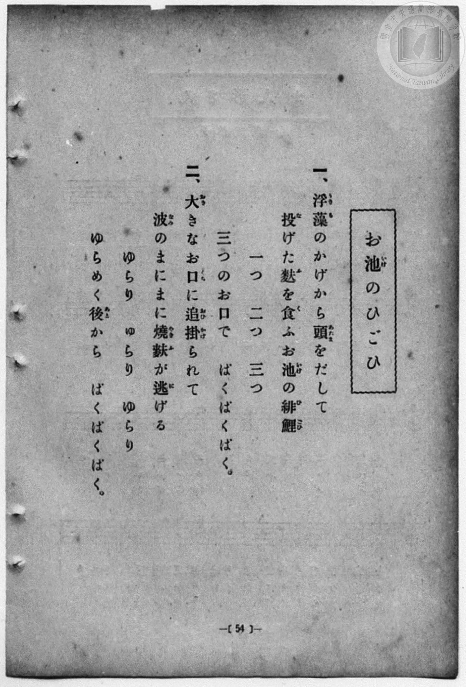
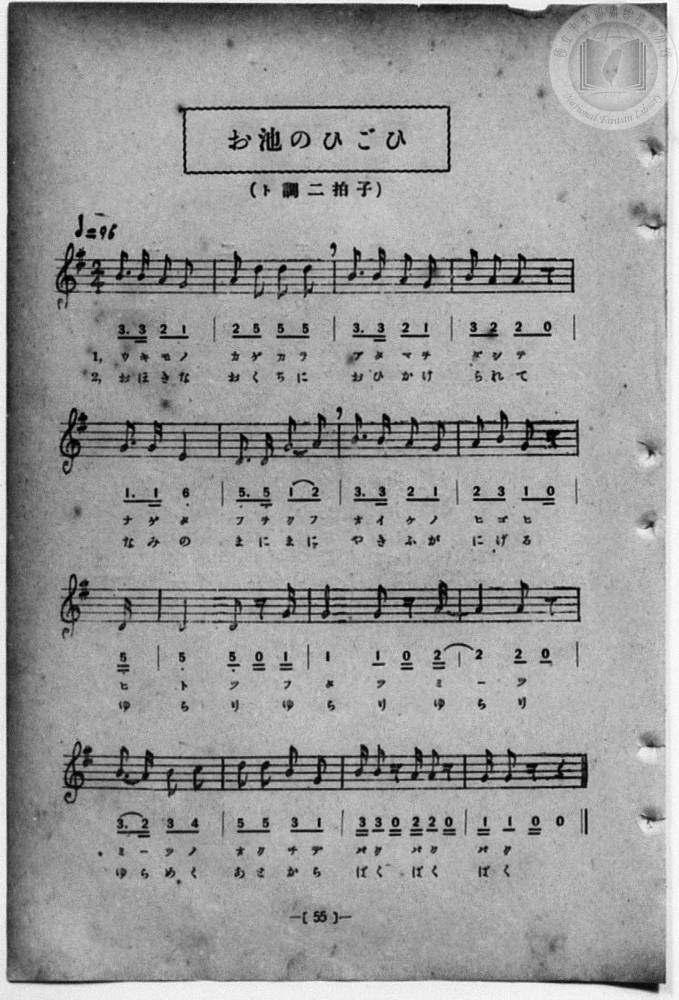

# お池のひごひ

> Re:Shōka 使用 AI 協助辨識與重建樂譜，可能會有錯誤。歡迎回報。

<audio controls src="oike_no_higoi.mp3"></audio>

- 一條慎三郎 編《新編 小學校・公學校 唱歌教材集》（大正十二年十二月，索書號 0725-41）

## 說明

曲目說明
中文解釋：描寫池塘裡的紅鯉魚從浮萍間探頭爭食烤麩、大口吞食的趣味情景。
原書資訊（對應 P062.jpg–P063.jpg，原書 p. 54–55）：
調性與拍號：ト調 二拍子，♩=96


## 歌詞

```text
一、浮藻（うきも）のかげから頭（あたま）をだして
投（な）げた麩（ふ）を食（く）ふお池（いけ）の緋鯉（ひごひ）
一つ　二つ　三つ
三つのお口（くち）で　ばくばくばく。

二、大（おほ）きなお口（くち）に追掛（おひかけ）られて
波（なみ）のまにまに燒麩（やきふ）が逃（に）げる
ゆらり　ゆらり　ゆらり
ゆらめく後（あと）から　ばくばくばく。
```

## ABC

```abc
X:1
T:お池のひごひ
M:2/4
L:1/16
Q:1/4=96
K:G
V:V1 name="Piano" snm="Pia"
[V:V1]
B3 B A2 G2 | A2 d2 d2 d2 | B3 B A2 G2 | B2 A2 A2 z2 |
w: ウ キ モ ノ | カ ゲ カ ラ | ア タ マ ヲ | ダ シ テ
G3 G E4 | D3 D G2 A2 | B3 B A2 G2 | A2 B2 G2 z D |
w: ナ ゲ タ | フ ヲ ク フ | オ イ ケ ノ | ヒ ゴ ヒ ヒ
D4 D2 z G | G4 G2 z A | A4 A2 z2 | B3 A B2 c2 |
w: ト ツ フ | タ ツ ミ | _ ツ | ミ ツ ノ オ
d2 d2 B2 G2 | B B z2 A A z2 | G G z2 z4 | B3 B A2 G2 |
w: ク チ デ _ | バ ク バ ク | バ ク | お ほ き な
A2 d2 d2 d2 | B3 B A2 G2 | B2 A2 A2 z2 | G3 G E4 |
w: お く ち に | お ひ か け | ら れ て | な み の
D3 D G2 A2 | B3 B A2 G2 | A2 B2 G2 z D | D4 D2 z G |
w: ま に ま に | や き ふ が | に げ る ゆ | ら り ゆ
G4 G2 z A | A4 A2 z2 | B3 A B2 c2 | d2 d2 B2 G2 |
w: ら り ゆ | ら り | ゆ ら め く | あ と か ら
B B z2 A A z2 | G G z2 z4 |
w: ば く ば く | ば く
```

## TMD 檔案連結

- [主旋律 TMD 檔案](oike_no_higoi.tmd) [[在 TMD Studio 編輯](https://tmdlang.github.io/Tmd-TS/#tmd=s7IKdvYPcrWy4qpTUCpJTLdSSM7PyUlNLsnMz7MqzsjPTozPrsyvSsyML84ojTe0NDJWgqssy88pzU21Si9KTEmNN4w3QsgU55cWJadaFSdn5OfnxJekVpQk5edno8vHFySmp1oFGJgh6Swoyi9LzUvMA-ouKMrMK0lNAWtHKEgty0xJBUkXJyfmxZelFmWmZaamIDkqtagY7HaIFSVFiXnFyUWZBSAPIVTlF5Vk5AMdXpBRaZWRWVySX5SZnJgTn52Yl4hQVJKRCvReYl5mbmKOEpeWlsLjxq5nGxc8blz3uHHT48YpQFJBS4tL0VbB0ozL3lbBncvGSN_EDqT_yY6GZ4vmPmvte7Kj82Vzn8Lz7SseN3Q9m7YByFB4uqH_6dodzxYsfNy8-2nrGghb4emUjc_W9jybOvPZ3AkvZ7c9buh-v6fj6ZLlz9Yuftrb-GRXz9OdWyCMZ3M63u_peb5l0bPZO17MnK9gYG5kqmti-H5PpxKXvpbCs9mbns9e92LVqmcz-rgUFBSe7Fj7bFr7i-WLX7YDjZz1rL__6frVQH88XTjjxeKFz2e1PN_S-nJ958u1s57um_ds67oXE3pfTpv8rG_RywVrn3esfbl4_vPmJS93rXzc0Ah0ztP-xU8nzAMJzmp5sW3x04mbnzW3Ppu5_nFDE8iyp33zQa7a3P5iRRfI_Rt6n7V3KoDiWC-rIP1Rw2Qg0xjEBPoAolahQE_B1AQoY2oK9AHQgSBjXqza_6xh-YuO9mfdvUAvAkUfN3cABRVA3u_ufbp2AlD_o5krbYEhr6XPBfQ2FzDIgS4EuX_6bqDNjxvbHjf2Pm5qAhoKjrHux42TQGRTJ9BfYAVNjxvnP27cB1LQBJQCRuz0x43LuJ51TQVLrwLrBErMB3oeLLIVohToeTC3H6xgKyRVgEVaHjdOhNj3fHs3MEzBgtCkAhQHu7FxyeOGBqA3oIwdQNVLgBIgCuzOLmAIQ4x_3LgQbNhyoLrHjRvAIkgkMMC5QOaAowWso-txI9DrQB29QNdjM2n1i_17n_XNhikGugwYKmAXNwER0ElA329eBPH948b9sKDbB9QJIZ-3T4IGRhPQr0BrwEHS2POyoRmsazU0zJq6uR43tYFN7QK5HhsbrqIR6MKn-3pgcbICbAYoonD6GxTlvomZeVYBmYl5-Q41BjXVoFSjYGNopmUHZtUoGCvoAqGxghGQNATiGjDLFAljUwMSAfFA2AAkAjbNx7BG4XHTMrDqx01rFR43LwKxgBkbpOdx02qw-CYwCWY3r4TKgNSBRPcDxeaBZUCqgDLNDWDx7WCxNlTbjIDyjV0QnY27gbgXzFoF0QmWAQYEmFwIJkF2IuvZBMTdYNZEqDs6wbb1gMVA_oDYBg0qkNdBAWAWD2aAdJhCmEAKJAkKDVwhChIF8QxAipGCqxnqGGCwgLwPM_hx81SIODAgHjetB7NAIiBHgjwI0rEEiDciB3DzJLD4FrAYiG0AppGDC6q3ERjQjesQtjXug4qvhrLhgdXUApXpBeKtYBYoeEB6wFHYCLETFIxA25raEMEFDRtw6IAkDeFBCAsJI2jYgCCWlNTcAZV73AxyBMgzU8FOggUTQnw-UBwihhBFSSfgmIUEGyjAoU4lQRwpHUAi2AhMm4DDApZVYJEMUmMM1mQEhGDNQHFDMAuEwaGO5NH5cIdD4hISxyBnQGK-EUy2w3QC2RPAciCzkNmoMmg2gYMBlIVA5ncCMdhUcAYBxWYTmLcCTIIzBTgIQDIbwKrAdiGxUWUQdtVycenaKYCKnWgfw1gFONsIzFYGAA)]
- [鋼琴伴奏 TMD 檔案](oike_no_higoi_piano.tmd) [[在 TMD Studio 編輯](https://tmdlang.github.io/Tmd-TS/#tmd=s7IKdvYPcrWy4qpTUCpJTLdSSM7PyUlNLsnMz7MqzsjPTozPrsyvSsyML84ojTe0NDJWgqssy88pzU21Si9KTEmNN4w3QsgU55cWJadaFSdn5OfnxJekVpQk5edno8vHFySmp1oFGJgh6Swoyi9LzUvMA-ouKMrMK0lNAWtHKEgty0xJBUkXJyfmxZelFmWmZaamIDkqtagY7HaIFSVFiXnFyUWZBSAPIVTlF5Vk5AMdXpBRaZWRWVySX5SZnJgTn52Yl4hQlFgE1JyempuaV2JVkJmYlx-fmJycn1uQmJcJElPi0tJSeNzY9WzjgseN6x43bnrcOAVIvt_T8XL2zGed3S-79zyfsOXJni1Pl_a_39OpoKXFpWirYGnGZW-r4M5lY6RvYgey6smOhmeL5j5r7Xuyo_Nlc5_C8-0rHjd0PZu2AchQeLqh_-naHc8WLHzcvPtp6xoIW-HplI3P1vY8mzrz2dwJL2e3PW7oBlr6dMnyZ2sXP-1tfLKr5-nOLRDGszkd7_f0PN-y6NnsHS9mzlcwMDcy1TUxBDpHiYvLNzEzzyoA5LEgD4cag5pqLgUgsDE007IDs2oUjBV0gdBYwQhIGgJxDZhlioSxqQGJgHggbAASAZvmY1ij8LhpGVj146a1Co-bF4FYQB-D9DxuWg0W3wQmwezmlVAZkDqQ6H6g2DywDEgVUKa5ASy-HSzWhmqbEVC-sQuis3E3EPeCWasgOsEyjxv7weRCMAmyE1nPJiDuBrMmQt3RCbatBywG8gfENmhQgbwOCgCzeDADpMMUwgRSIElQaOAKUZAoiGcAUowUXM1QxwCDBeR9mMGPm6dCxIEB8bhpPZgFEgE5EuRBkI4lQLwROYCbJ4HFt4DFQGwDMI0cXFC9jcCAblyHsK1xH1R8NZQND6ymFqhMLxBvBbNAwQPSA47CRoidoGAE2tbUhgguaNiAQwckaQgPQlhIGEHDBgSxpKTmDqjc42aQI0CemQp2EiyYEOLzgeIQMYQoSjoBxywk2EABDnUqCeJI6QASwUZg2gQcFrCsAotkkBpjsCYjIARrBoobglkgDA51JI_OhzscEpeQOAY5AxLzjWCyHaYTyJ4AlgOZhcxGlUGzCRwMoCwEMr8TiMGmgjMIKDabwLwVYBKcKcBBAJLZAFYFtguJjSqDsKsWudTxQS51TOCFjmG8tjEwy4BJUEKJ1zaPj4fTuOQNoD6ByZsAxQ2RFcA0YNcO5cNTJ3GWwuWxOh1Ig_I-ir3oJoKcDQwUXTsFULhE-xjGKsDZRmC2MhcA)]

## 分析

```text
================================================================================
📊 TMD Song Profile: [ お池のひごひ ]
================================================================================
⏱  Duration:       0:37 (37.5s), 30 measures total
🎼 Key & Tempo:    首調基準 G, != 96.0 BPM, <2/4>
   - 分析範圍：      由實際發聲的音符與和弦推測調性；播放脈絡另行呈現
🎤 人聲音域:    D4 (MIDI 62) – D5 (MIDI 74) [跨度: 12 個半音 / 1.0 個八度, 難度: easy]
   - 最低音:  D4 in [Main[L1] #1 @ m.6, 0:06]
   - 最高音: D5 in [Main[L1] #1 @ m.2, 0:01]
   - 適合: soprano, mezzo-soprano, contralto, tenor, baritone, bass
🏛  結構:      Main[L1] (18.8s) -> Main[L2] (18.8s)
⚡ 編曲密度:        Peak 1 軌道同時演奏
🗝  調性診斷：       G 大調（純淨自然大調，未偵測到可信轉調）
   - 風格氣質:    純淨自然大調（陽光明朗、易唱易記，無明顯調外色彩）
   - 轉調歷程:    全曲維持單一推測調性（未偵測到可信轉調）
   - 核心骨幹音:  A, G, B, D, E
   - 調性數值:    G 大調 [相關度: 0.78, 穩定度: Moderate, 自然音純度: 100.0%]
   - 候選調性 (K-S): G 大調 (0.78), D 大調 (0.72), B 小調 (0.61)
   - 五度圈歷程:   +1 -> +1
   - 各段落調性細節:
     • [Main[L1] #1]: G 大調 (r: 0.78, 自然音純度: 100.0%)
     • [Main[L2] #1]: G 大調 (r: 0.78, 自然音純度: 100.0%)

  [ 五度圈游移軌跡 ]
               C  
         F           [G ]*
      Bb               D  
      Eb               A  
         Ab           E  
            Db       B  
               F# 
     (* = active key center)

  [ 十二半音累積音高分佈 ]
     C  : ██                         1.9%
     C# :                            0.0%
     D  : ███████████████████       20.4%
     D# :                            0.0%
     E  : ████                       3.9%
     F  :                            0.0%
     F# :                            0.0%
     G  : ███████████████████████   24.3%
     G# :                            0.0%
     A  : ████████████████████████  25.2%
     A# :                            0.0%
     B  : ███████████████████████   24.3%
--------------------------------------------------------------------------------
Assignment 軌道音域：
  - Piano         : D4 – D5 (12 個半音 / 1.0 個八度, 104 個音符)
================================================================================
```


## 原書掃描頁






