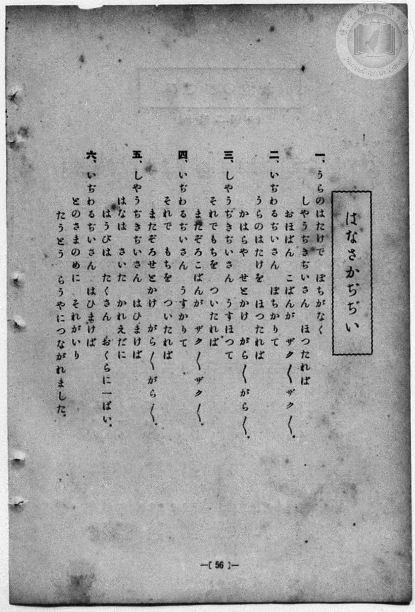
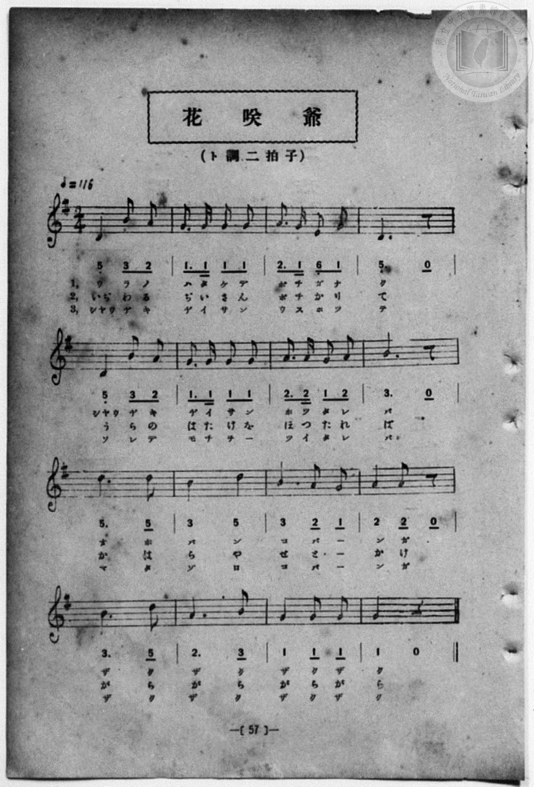

# 花咲爺

> Re:Shōka 使用 AI 協助辨識與重建樂譜，可能會有錯誤。歡迎回報。

<audio controls src="hanasaka_jijii.mp3"></audio>

- 詞：石原和三郎
- 曲：田村虎藏
- 一條慎三郎 編《新編 小學校・公學校 唱歌教材集》（大正十二年十二月，索書號 0725-41）
- 臺灣教育會公認《新定兒童唱歌》尋常科第二學年用（2020.006.0847.0002）

## 說明

原書資訊與歌詞全文（對應 P050.jpg – P051.jpg，書頁 pp. 35–36，第三學期第 7 首）：
調性與拍號：ト調二拍子（G 大調 2/4 拍），「オモシロク」


## 跨冊／重複收錄參照

> 同曲＋同名異曲（《公學校唱歌集》、《新定兒童唱歌》、《新編 小學校・公學校 唱歌教材集》跨冊對照曲目）

- **[同名異曲]** 《公學校唱歌集》（大正4年／1915，國臺圖 0725 26）：[**〈花咲爺〉**](../../../kogakko_shokashu_1915/3_07_hanasaka_jijii/index.md)（`D` / `2/4` — [原始 TMD](../../../kogakko_shokashu_1915/3_07_hanasaka_jijii/hanasaka_jijii.tmd)）
- **[同曲]** 《新定兒童唱歌》尋常科第二學年用（2020.006.0847.0002）：[**〈花さかぢぢい〉**](../../../shintei_jido_shoka/grade_2_2020.006.0847.0002/3_07_hanasaka_jijii/index.md)（`G` / `2/4` — [原始 TMD](../../../shintei_jido_shoka/grade_2_2020.006.0847.0002/3_07_hanasaka_jijii/hanasaka_jijii.tmd)）
- **[同名異曲]** 《新編小公學校唱歌教材集》第三、四學年（大正12年／1923，國臺圖 0725-41）：[**〈花咲爺〉**](../../grade_3_4/09_hanasaka_jijii/index.md)（`D` / `2/4` — [原始 TMD](../../grade_3_4/09_hanasaka_jijii/hanasaka_jijii.tmd)）
- 總表：[跨冊重複與同名歌曲總索引](../../../duplicate_songs.md)

## 歌詞

```text
一
うらの畠でポチがなく
しやうぢきぢいさんほつたれば
大ばん小ばんが　ザク／＼ザク／＼

二
いぢわるぢいさん　ポチかりて
うらの畠を　ほつたれば
かはらやせとかけガラ／＼ガラ／＼

三
しやうぢきぢいさん　臼ほつて
それでもちを　ついたれば
又ぞろ小ばんが　ザク／＼ザク／＼

四
いぢわるぢいさん　臼かりて
それでもちを　ついたれば
又ぞろせとかけ　ガラ／＼ガラ／＼

五
しやうぢきぢいさん　灰まけば
花は咲いた　かれ枝に
はうびはたくさん　おくらに一ぱい

六
いぢわるぢいさん　灰まけば
とのさまの目にそれが入り
とう／＼らうやに　つながれました
```

## ABC

```abc
X:1
T:花咲爺
C:曲：田村虎藏
M:2/4
L:1/16
Q:1/4=104
K:G
V:V1 name="Piano" snm="Pia"
[V:V1]
D4 B2 A2 | G2 G2 G2 G2 | A3 G E2 G2 | D6 z2 |
w: 1.~う ら の | は た け で | ぽ ち が な | く
w: 2.~い ぢ わ | る ぢ い さ | ん ぽ ち か | り
w: 3.~しやう ぢ き | ぢ い さ ん | う す ほ つ | て
w: 4.~い ぢ わ | る ぢ い さ | ん う す か | り
w: 5.~しやう ぢ き | ぢ い さ ん | は ひ ま け | ば
w: 6.~い ぢ わ | る ぢ い さ | ん は ひ ま | け
D4 B2 A2 | G2 G2 G2 G2 | A3 A G2 A2 | B6 z2 |
w: 1.~しやう ぢ き | ぢ い さ ん | ほ つ た れ | ば
w: 2.~う ら の | は た け を | ほ つ た れ | ば
w: 3.~そ れ で | も ち を _ | つ い た れ | ば
w: 4.~そ れ で | も ち を _ | つ い た れ | ば
w: 5.~は な は | さ い た _ | か れ え だ | に
w: 6.~と の さ | ま の め に | そ れ が い | り
d6 d2 | B6 d2 | B4 A2 G2 | A4 A2 z2 |
w: 1.~お ほ | ば ん | こ ば _ | ん が
w: 2.~か は | ら や | せ と _ | か け
w: 3.~ま た | ぞ ろ | こ ば _ | ん が
w: 4.~ま た | ぞ ろ | せ と _ | か け
w: 5.~は う | び は | た く さ | ん _
w: 6.~と う | と う | ら う や | に _
B6 d2 | A6 B2 | G4 G2 G2 | G4 z4 |
w: 1.~ざ く | ざ く | ざ く ざ | く
w: 2.~が ら | が ら | が ら が | ら
w: 3.~ざ く | ざ く | ざ く ざ | く
w: 4.~が ら | が ら | が ら が | ら
w: 5.~お く | ら に | い つ ぱ | い
w: 6.~つ な | が れ | ま し _ | た
```

## TMD 檔案連結

- [主旋律 TMD 檔案](hanasaka_jijii.tmd) [[在 TMD Studio 編輯](https://tmdlang.github.io/Tmd-TS/#tmd=s7IKdvYPcrWy4qpTUCpJTLdSSM7PyUlNLsnMz7MqzsjPTozPrsyvSsyML84ojTe0NDJWgqssy88pzU21Si9KTEmNN4w3QsgU55cWJadaFSdn5OfnxJekVpQk5edno8vHFySmp1oFGJiZIGQKivLLUvMS84C6C4oy80pSU8DaEQpSyzJTUkHSqSmZJflFmYk5SA5KLSoGuxtifElRYl5xclFmAcgzCFUlGalAV6fl52Tn5BelKnFpaSm86Nr4dNKm5x27FLS0uBRtFQwNTLjsbRXcuWyM9E3sQDqf7Gh4tmjus9a-Jzs6Xzb3KTzfvuJxQ9ezaRuADIWnG_qfrt3xbMHCx827n7augbAVnk7Z-Gxtz7OpM5_NnfBydtvjhu73ezqeLln-bO3ip72NT3b1PN25BcJ4Nqfj_Z6e51sWPZu948XM-QoG5kamuiaG7_d0gl39YuW893tmPZ-_-Wnf_KeTeiAuAMs8m70JJDNlw7O5E1_M7HsxvR-ioX3X88bFQJtfNG16NqcZ6KQXq3ohzn26btbT1knPVy-FuA7oqKcbup_u2PF8-cTna9aAHLV2B9Bdz6esADrWyMDIQM_AwEzPwMLEHMgwMAI7iUtfS8GWWoBLQUEB6C-Qzze3v1jR9aKjHeguoJeftq54Nq0dFGQbep-1dyoEGJga6GUVpCs8apgM4hiCOMBgA-p8uaBRoaBAT8HYFChnbAYKS6BfdnSCImLOfCBbwVzh5bJpQMcDQwtk4YtV-581LAdZ1d0LDHCg6OPmDqAgKC66e5-unQC01l0BGFdAMQVgElAAioJ1AwOs53HTqsfNix43bX_cvPZx0_rHDb1cIDOBKQREPW5se9zU-bhx3fOpCx43Ln_cPPdxc-Pjxp7HjaseN_ZDVEx_3NQCUte46HFjL5gEcqc-bpr8uHH348YljxvnP24CatgADpsly4EsoBwwkUEYIMMaGh43bQNa_n5P__s9e5DZELfs6oHYBDQX6NL-x03dKNYAtUPd1f24qetx4zIMlzdNAinCdA5IR-N6kDqQF2Y_blwBFpn4uGnN4-aVMOcg2NCg6STk8YaGF-17YPZBnTMXbO3yx01NjxsXwlwElAbqQQ6g_o7HjfMeN_WSEkBPZ88mEEBg56CEDonOQQkdkHPwBdCuKYQD6DnQc437QKZBbAIWWsCoAJZbUCeAnAN0cM-zeXMfN66GmLcebNhmMGM-MP0h4r8R6DGgt4HxvRqYch83As1qgQRN61oCQYPuELA314GkQaLrns8GslfDwqvnaetSYCjC1bXBggBoMzC9AU1dDQtIYAYBZi6gHqAp04HuBemhvICBAgUtfS4uj8S8xOLE7ESvzKzMTKuAzMS8fIcag5pqkE0KNoZmWnZgVo2CabyCLhgaA7ERENcoGAJJZFwDFgexzUCKIUJwfSBoABICG-hjWAPKXlBxoN9BZOM6sBZg3IB588HkRDC5HCqzF6K-cSEQ94BZq6Ay_Uj2gOyE2mMEkmuB2dO4CGwbSC1QvKkbIQZWA4wxqMxkqPq9YLtALJBakEwXdnuMQfZAEyuqbY29UBei2wOxBREOjxtnAvFuMGsJVGYZdttMKPNVG9guInxlSomvQLEIEt0ExPvALFBcgmQ2YLfNjDJfrQfbBWKBbAOZBbIP0x6SErMRmAdRA1KNKymTG0ig6IZEODTBN4GSNZ5AAidoojNO0yRy7QEn6LlweyCZDZoNm5rAPHDGANsAgiD1oGQL8SmRtoATMs1tASdjSHKEFRkQPkgcHB_QuAGZBrMFlOAgZj9u7ADLLoDKrMZuCzj5roDbAooTeCKFZgCwWFMjmA0yBeF7iD0Q_4PcgjtTApMvkjiIjZoyUUVAKRc5PUNE0FMvsk2QtIIemogUC8luIHUweUQmBImC_ICeXiFhCVMBDXlw2kWYD_V142y4OlhYIpsASdfo6RQUugjzQbEIEp2HYn4vee4Hp1BSzCfR_ShpE6IClLtBoptRRGHpFZZGIVUeejEIMRtXqkQ1H6soPFYgIoh4gaV6VPOxpT1YSgNBkCykdAVBROkKEwGlRHAYIaXGaSjuglYABERhoQHig8RhzQFYSY-cGkExjIg3kH8Ji8JKWmhJAw8lNPPBqZGG7genRhq6H5waUUsDWAWMklvhpReiugaVysBWM5o4mvng1Agpv2H6YA04VPfDSnRYzgPWsDCTkPIAwvRaLi5dOwWU5qwCUECZCwA)]
- [鋼琴伴奏 TMD 檔案](hanasaka_jijii_piano.tmd) [[在 TMD Studio 編輯](https://tmdlang.github.io/Tmd-TS/#tmd=s7IKdvYPcrWy4qpTUCpJTLdSSM7PyUlNLsnMz7MqzsjPTozPrsyvSsyML84ojTe0NDJWgqssy88pzU21Si9KTEmNN4w3QsgU55cWJadaFSdn5OfnxJekVpQk5edno8vHFySmp1oFGJiZIGQKivLLUvMS84C6C4oy80pSU8DaEQpSyzJTUkHSqSmZJflFmYk5SA5KLSoGuxtifElRYl5xclFmAcgzSlxaWgovujY-nbTpeceu93s6Xs6e-ayz-2X3nucTtjzZs-Xp0v73ezoVtLS4FG0VDA1MuOxtFdy5bIz0TexA5j_Z0fBs0dxnrX1PdnS-bO5TeL59xeOGrmfTNgAZCk839D9du-PZgoWPm3c_bV0DYSs8nbLx2dqeZ1NnPps74eXstscN3UBbny5Z_mzt4qe9jU929TzduQXCeDan4_2enudbFj2bvePFzPkKBuZGpromhkD3gP32YuW893tmPZ-_-Wnf_KeTeiAuAMs8m70JJDNlw7O5E1_M7HsxvR-ioX3X88bFQJtfNG16NqcZ6KQXq3ohzn26btbT1knPVy-FuA7oqKcbup_u2PF8-cTna9aAHLV2B9Bdz6esADrWyMDIQM_AwEzPwMLEHMgwMAI7icsjMS-xODE70SszKzPTKiAzMS8_yMOhxqCmmksBCGwMzbTswKwaBdN4BV0wNAZiIyCuUTAEksi4BiwOYpuBFEOE4PpA0AAkBDbQx7BG4XFjG1T8cVMniGxcB9byuHE9mDcfTE4Ek8uhMnsh6hsXAnEPmLUKKtOPZA_ITqg9RiC5Fpg9jYvAtoHUAsWbuhFiYDWPG6dCZSZD1e8F2wVigdSCZLqw22MMsmf646YWJF9BTe6FuhDdHogtiHB43DgTiHeDWUugMsuw22ZCma_awHYR4StTSnwFikWQ6CYg3gdmgeISJLMBu21mlPlqPdguEAtkG8gskH2Y9pCUmI3APIgakGpcSZncQAJFNyTCoQm-CZSs8QQSOEETnXGaJpFrDzhBz4XbA8ls0GzY1ATmgTMG2AYQBKkHJVuIT4m0BZyQaW4LOBlDkiOsyIDwQeLg-IDGDcg0mC2gBAcx-3FjB1h2AVRmNXZbwMl3BdwWUJzAEyk0A4DFmhrBbJApCN9D7IH4H-QW3JkSmHyRxEFs1JSJKgJKucjpGSKCnnqRbYKkFfTQRKRYSHYDqYPJIzIhSBTkB_T0CglLmApoyIPTLsJ8qK8bZ8PVwcIS2QRIukZPp6DQRZgPikWQ6DwU83vJcz84hZJiPonuR0mbEBWg3A0S3YwiCkuvsDQKqfLQi0GI2bhSJar5WEXhsQIRQcQLLNWjmo8t7cFSGgiCZCGlKwgiSleYCCglgsMIKTVOQ3EXtAIgIAoLDRAfJA5rDsBKeuTUCIphRLyB_EtYFFbSQksaeCihmQ9OjTR0Pzg10tD94NSIWhrAKmCU3AovvRDVNahUfty4EU0czXxwaoSU3zB9sAYcqvthJTos5wFrWJhJSHkAYXot1tasD3Jr1gTemDWMV4g2jEVmmMAYpvHxwDQJS9uYCkHy0abxUDF8KlG0YFGIahKqmUDf6NopoHgo2geoC1PQCJugMTZBE2yCptgEzcCCylwA)]

## 分析

```text
================================================================================
📊 TMD Song Profile: [ 花咲爺 ]
================================================================================
⏱  Duration:       0:18 (18.5s), 16 measures total
🎼 Key & Tempo:    首調基準 G, != 104.0 BPM, <2/4>
   - 分析範圍：      由實際發聲的音符與和弦推測調性；播放脈絡另行呈現
🎤 人聲音域:    D4 (MIDI 62) – D5 (MIDI 74) [跨度: 12 個半音 / 1.0 個八度, 難度: easy]
   - 最低音:  D4 in [HanasakaJijii #1 @ m.1, 0:00]
   - 最高音: D5 in [HanasakaJijii #1 @ m.9, 0:09]
   - 適合: soprano, mezzo-soprano, contralto, tenor, baritone, bass
🏛  結構:      HanasakaJijii (18.5s)
⚡ 編曲密度:        Peak 1 軌道同時演奏
🗝  調性診斷：       G 大調（純淨自然大調，未偵測到可信轉調）
   - 風格氣質:    純淨自然大調（陽光明朗、易唱易記，無明顯調外色彩）
   - 轉調歷程:    全曲維持單一推測調性（未偵測到可信轉調）
   - 核心骨幹音:  G, B, A, D, E
   - 調性數值:    G 大調 [相關度: 0.82, 穩定度: Moderate, 自然音純度: 100.0%]
   - 候選調性 (K-S): G 大調 (0.82), D 大調 (0.71), B 小調 (0.61)
   - 五度圈歷程:   +1
   - 各段落調性細節:
     • [HanasakaJijii #1]: G 大調 (r: 0.82, 自然音純度: 100.0%)

  [ 五度圈游移軌跡 ]
               C  
         F           [G ]*
      Bb               D  
      Eb               A  
         Ab           E  
            Db       B  
               F# 
     (* = active key center)

  [ 十二半音累積音高分佈 ]
     C  :                            0.0%
     C# :                            0.0%
     D  : ██████████████████        22.0%
     D# :                            0.0%
     E  : █                          1.7%
     F  :                            0.0%
     F# :                            0.0%
     G  : ████████████████████████  29.7%
     G# :                            0.0%
     A  : ███████████████████       22.9%
     A# :                            0.0%
     B  : ███████████████████       23.7%
--------------------------------------------------------------------------------
Assignment 軌道音域：
  - Piano         : D4 – D5 (12 個半音 / 1.0 個八度, 41 個音符)
================================================================================
```


## 原書掃描頁






