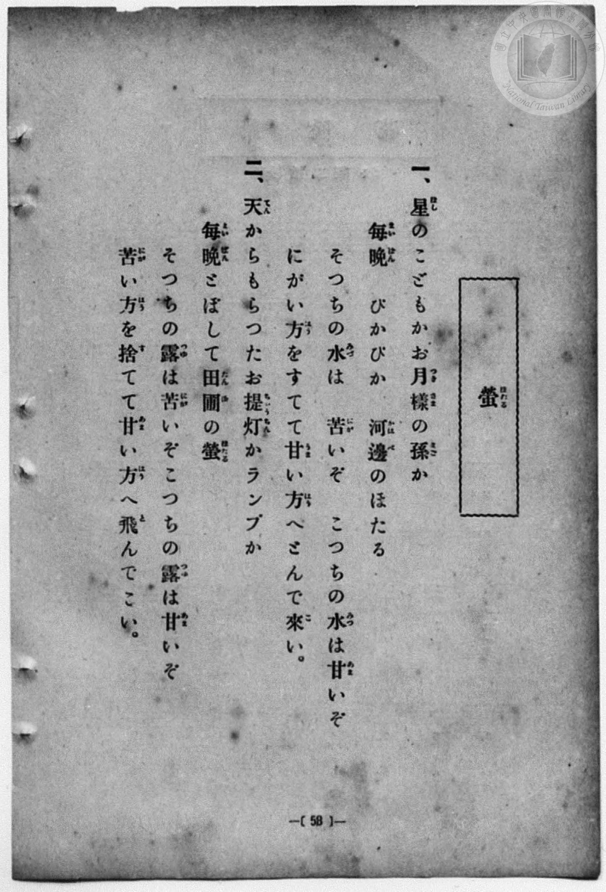
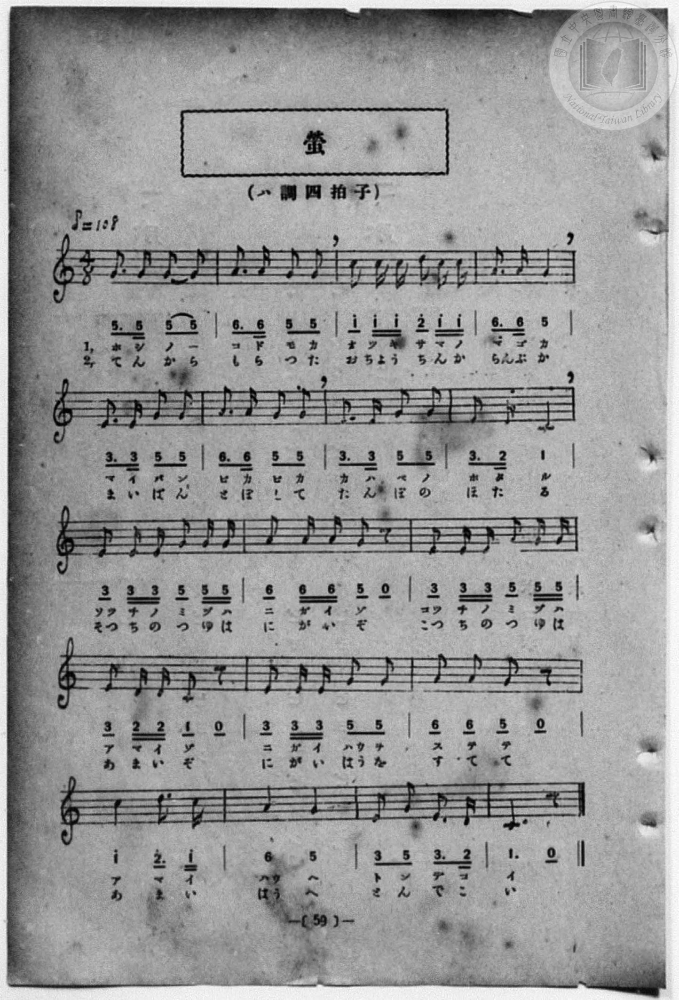

# 螢

> Re:Shōka 使用 AI 協助辨識與重建樂譜，可能會有錯誤。歡迎回報。

- **鋼琴伴奏版**：<br><audio controls src="hotaru.mp3"></audio>
- **NEUTRINO 歌聲合成版**：<br><audio controls src="hotaru_neutrino.mp3"></audio>

- 一條慎三郎 編《新編 小學校・公學校 唱歌教材集》（大正十二年十二月，索書號 0725-41）

## 說明

曲目說明
中文解釋：將夏夜閃閃發光的螢火蟲比作星星的孩子、月亮的孫子與提燈，並融合傳統「那邊的水苦、這邊的水甜」呼喚螢火蟲飛來的歌謠。
原書資訊（對應 P066.jpg–P067.jpg，原書 p. 58–59）：
調性與拍號：ハ調 四拍子（4/8 拍），♪=108（即 ♩=54）


## 歌詞

```text
一、星（ほし）のこどもかお月様（つきさま）の孫（まご）か
毎晩（まいばん）　ぴかぴか　河邊（かはべ）のほたる
そつちの水（みづ）は　苦（にが）いぞ　こつちの水（みづ）は甘（あま）いぞ
にがい方（はう）をすてて甘（あま）い方（はう）へとんで來（こ）い。

二、天（てん）からもらつたお提灯（ちやうちん）かランプか
毎晩（まいばん）とぼして田圃（たんぼ）の螢（ほたる）
そつちの露（つゆ）は苦（にが）いぞこつちの露（つゆ）は甘（あま）いぞ
苦（にが）い方（はう）を捨（す）てて甘（あま）い方（はう）へ飛（と）んでこい。
```

## ABC

```abc
X:1
T:螢
M:4/8
L:1/16
Q:1/8=108
K:C
V:V1 name="Piano" snm="Pia"
[V:V1]
G3 G G2 G2 | A3 A G2 G2 | c2 c c d c c2 | A3 A G4 |
w: 1.~ホ シ ノ _ | コ ド モ カ | オ ツ キ サ マ ノ | マ ゴ カ
w: 2.~て ん か ら | も ら つ た | お ち よう ち ん か | らん ぷ か
E3 E G2 G2 | A3 A G2 G2 | E3 E G2 G2 | E3 D C4 |
w: 1.~マ イ バ ン | ピ カ ピ カ | カ ハ ベ ノ | ホ タ ル
w: 2.~ま い ば ん | と ぼ し て | た ん ぼ の | ほ た る
E2 E E G2 G G | A2 A A G2 z2 | E2 E E G2 G G | E2 D D C2 z2 |
w: 1.~ソッ チ ノ ミ ヅ ハ | ニ ガ イ ゾ | コッ チ ノ ミ ヅ ハ | ア マ イ ゾ
w: 2.~そつ ち の つ ゆ は | に が い ぞ | こつ ち の つ ゆ は | あ ま い ぞ
E2 E E G2 G2 | A2 A2 G2 z2 | c4 d3 c | A4 G4 |
w: 1.~ニ ガ イ ハウ ヲ | ス テ テ | ア マ イ | ハウ ヘ
w: 2.~に が い はう を | す て て | あ ま い | はう へ
E2 G2 E3 D | C4 z4 | G3 G G2 G2 | A3 A G2 G2 |
w: 1.~ト ン デ コ | イ | ホ シ ノ _ | コ ド モ カ
w: 2.~と ん で こ | い | て ん か ら | も ら つ た
c2 c c d c c2 | A3 A G4 | E3 E G2 G2 | A3 A G2 G2 |
w: 1.~オ ツ キ サ マ ノ | マ ゴ カ | マ イ バ ン | ピ カ ピ カ
w: 2.~お ち よう ち ん か | らん ぷ か | ま い ば ん | と ぼ し て
E3 E G2 G2 | E3 D C4 | E2 E E G2 G G | A2 A A G2 z2 |
w: 1.~カ ハ ベ ノ | ホ タ ル | ソッ チ ノ ミ ヅ ハ | ニ ガ イ ゾ
w: 2.~た ん ぼ の | ほ た る | そつ ち の つ ゆ は | に が い ぞ
E2 E E G2 G G | E2 D D C2 z2 | E2 E E G2 G2 | A2 A2 G2 z2 |
w: 1.~コッ チ ノ ミ ヅ ハ | ア マ イ ゾ | ニ ガ イ ハウ ヲ | ス テ テ
w: 2.~こつ ち の つ ゆ は | あ ま い ぞ | に が い はう を | す て て
c4 d3 c | A4 G4 | E2 G2 E3 D | C4 z4 |
w: 1.~ア マ イ | ハウ ヘ | ト ン デ コ | イ
w: 2.~あ ま い | はう へ | と ん で こ | い
```

## TMD 檔案連結

- [主旋律 TMD 檔案](hotaru.tmd) [[在 TMD Studio 編輯](https://tmdlang.github.io/Tmd-TS/#tmd=s7IKdvYPcrWy4qpTUCpJTLdSSM7PyUlNLsnMz7MqzsjPTozPrsyvSsyML84ojTe0NDJWgqssy88pzU21Si9KTEmNN4w3QsgU55cWJadaFSdn5OfnxJekVpQk5edno8vHFySmp1oFGJiZIWQKivLLUvMS84C6C4oy80pSU8DaEQpSyzJTUkHSxcmJefFlqUWZaZmpKUiOSi0qBrsdYkVJUWJecXJRZgHIQwhV-UUlGflAhxdkVFplZBaX5BdlJifmxGcn5iUiFJVkpAK9l5dYUlqUiqw1Mz0zzyo3Py-pFBhASlxaWgov5i1S0NLiUrRVMDXhsrdVcOayMdG3sAPpebKj4dmiuc9a-57s6HzZ3KfwfPuKxw1dz6ZtADIUnm7of7p2x7MFCx83737augbCVng6ZeOztT3Pps58NnfCy9ltjxu63-_peLpk-bO1i5_2Nj7Z1fN05xYI49mcjvd7ep5vWfRs9o4XM-crGJgbmeqaGL7f06nEpa-l8Gz2puez171YterZjD4uBQWFJzvWPpvW_mL54pftQCNnPd3Q_nRJ_9Mlc15Oawai5zP3PG3tfD6rBeib542rX8zf9Gz9lCd75zybMR-IgOJP1658unbC44ZGoLVPdq0Di6wGirzoaH_WP-F5O8gtT3YsezGv9-mEjqdNm59v3fi4oedl0-KXTV1Axc82bHnRvQyo_WXDTLjI8ylzHjf0Pp245-m0WXB7Xy6e_WRfG0jB2p4XaxY8bmgCuf5p33yQNze3v1jRBQqQDb3P2jsVQMlHL6sg_VHDZCDTHMQEOgOiVqFAT8HUAihjagkMEqCPQca8WLX_WcNykJu7e4FhBhR93NwPFFR4Ons2UAjoH6DhwNhTAHLAunoezVxla2hgAbKzd7PCo5krbU1NgDJcWvpcwFDmAsYwKExmAI3qeNy4-3HjdKDk48Z1jxsnP25c-bip6XFj9-PGLmCgPVs-A6xmyePG3seNUx837oOoBAYjWHzf48YpYJFurmfr-57NXAkTbXncuOFx02SQXEPD48YtYBPBZEPDs02bgaEJVgkUXP-4cSfMeqBT5j9u6uZ63DgXbOdCoCgwyMFK9z9uXApWtx5oBDBawIKrHzf2gAWB9s0D2wT0AU6Nz6dAfAP0H8QfIF1Ay0CmADnPpgEdApQGuqgNJN006XHjzMeNy4AIUye64sYdjxtXAH38uHE5MCWApcC-B9oBTAxcwKQPDPKnSyABtAwaNED_NwHtaQKRIGfPB4U6MGE2rgcrW_i4CejCNjADpr555ePmzY-bp-MNcqBLGvcAoxXs8g1P5zSD1QCDFui8PZDABiZdWOyDghyUOpBD_eWcTdCIb4J4bz32IEcKb0wt2MMb0yDMgH_WuwIsMhOsgNgYAOZCsAhQL9AQUFSA3QeOAVDS900EFoMBmYl5-Q41BjXVoLylYGNopmUHZtUomCroAqEpmAbhGgUzsIgZkohhHJACEkBkBCbBAqgqQbAGbKaPYY3C4-bZYJHHTduB7D6YPJC_GSLe3AnEi8AqVkNlVoHFW4CstUC8FcieB9ULMm8e1LwtUB1I9hkB5RuXQeUnA9ndYFYn1NwmqAzQxsYlIFbjfIhMYxeYtxAoBwzANigTZgBIKyhEIbobgf4AC0PshQaeMZhrjDfwMNVARIwUDLEEG8ybS4DsCeAAAQUYSGYKVGY1lI0IOEhwAMtHIJ4JZsECDRYJ-4FsbIG2D-o5YKA3boAGHyRoVkBl9gDxdDALFMAgGVDgwQJ6D1hmHVRmN1TPfKAs1qAyhgeDKTSozKBBZQAPGBQ1iIBp2vu4uRnst0aw_x43g9zxuLkV7G-QXyGRvgYSdk0gn0EMBSY5vFqRggNUFIB9AEwHQF9BeU2glLEe7ENQGAJzMDTEQHEFtQNcJODWihwIRtCYx-ZlWAoCYXiwIAUCOMOAsgW6H1F939z_uAkUXY-bN0GDYCeY1wYnkQwG-xyUR0DJAdNjqF4GlTtgmyZBpcHpDZw2ICTEYKh3wcUEOK1DGEA-LIdA_AcpFEBhAOLB8gVQI1QOZBpaDgGHASS9I_IKKASgfoZIzYAb_ri5AywCykaPm9uhWjaDQwUUR1isgYcIJDkjMglIHBoCEKEdCGvAOQaSf4BlMFR-MlimBcOaWi4uXTsFUNGsgEQrAwA)]
- [鋼琴伴奏 TMD 檔案](hotaru_piano.tmd) [[在 TMD Studio 編輯](https://tmdlang.github.io/Tmd-TS/#tmd=s7IKdvYPcrWy4qpTUCpJTLdSSM7PyUlNLsnMz7MqzsjPTozPrsyvSsyML84ojTe0NDJWgqssy88pzU21Si9KTEmNN4w3QsgU55cWJadaFSdn5OfnxJekVpQk5edno8vHFySmp1oFGJiZIWQKivLLUvMS84C6C4oy80pSU8DaEQpSyzJTUkHSxcmJefFlqUWZaZmpKUiOSi0qBrsdYkVJUWJecXJRZgHIQwhV-UUlGflAhxdkVFplZBaX5BdlJifmxGcn5iUiFCUWATWnp-am5pVYFWQm5uXHJyYn5-cWJOZlgsSUuLS0FF7MW_R-T8fL2TOfdXa_7N7zfMKWJ3u2PF3a_35Pp4KWFpeirYKpCZe9rYIzl42JvoUdyOwnOxqeLZr7rLXvyY7Ol819Cs-3r3jc0PVs2gYgQ-Hphv6na3c8W7DwcfPup61rIGyFp1M2Plvb82zqzGdzJ7yc3fa4oRto6dMly5-tXfy0t_HJrp6nO7dAGM_mdLzf0_N8y6Jns3e8mDlfwcDcyFTXxBDoHCUuLt_EzDyrAJBPgjwcagxqqrkUgMDG0EzLDsyqUTBV0AVCUzANwjUKZmARMyQRwzggBSSAyAhMggVQVYJgDdhMH8MahcfNs8Eij5u2A9l9MHkgfzNEvLkTiBeBVayGyqwCi7cAWWuBeCuQPQ-qF2TePKh5W6A6kOwzAso3LoPKTwayu8GsTqi5TVAZoI2NS0CsxvkQmcYuMG8hUK7jcWMblAkzAKS1E8QF624E-gMsDLEXGnjGYK4x3sDDVAMRMVIwxBJsMG8uAbIngAMEFGAgmSlQmdVQNiLgIMHxuLkfiGeCWbBAg0XCfiAbW6Dtg3oOGOiNG6DBBwmaFVCZPUA8HcwCBTBIBhR4sIDeA5ZZB5XZDdUzHyiLNaiM4cFgCg0qM2hQGcADBkUNImCa9j5ubgb7rRHsv8fNIHc8bm4F-xvkV0ikr4GEXRPIZxBDgUkOr1ak4JgLSyDAdAD0FZTXBEoZ68E-BIXh48YeaIiB4gpqR-NkvFqRA8EIGvPYvAxLQSAMDxakQABnGFC2QPcjqu-b-x83gaLrcfMmaBDsBPPa4CSSwWCfg_IIKDlgegzVy-tB-QRk0ySoNDi9gdMGhIQYDPUuuJgAp3UIA8iH5RCI_yCFAigMQDxYvgBqhMqBTEPLIeAwgKR3RF4BhQDUzxCpGXDDHzd3gEVA2ehxcztUy2ZwqIDiCIs18BCBJGdEJgGJQ0MAIrQDYQ04x0Dyz-PG5VD5yWCZFgxrapFLZh_kktkEXjAbahuDcY2CSby2IZQJIk3jtUFhhBAlpAHCAmozjydBA6x-QGjDqgHJLAyHwUSBBkDYBhC_69opgLwf7WMYqwBnG4HZylwA)]

## 分析

```text
================================================================================
📊 TMD Song Profile: [ 螢 ]
================================================================================
⏱  Duration:       1:20 (80.0s), 36 measures total
🎼 Key & Tempo:    首調基準 C, != 54.0 BPM, <4/8>
   - 分析範圍：      由實際發聲的音符與和弦推測調性；播放脈絡另行呈現
🎤 人聲音域:    C4 (MIDI 60) – D5 (MIDI 74) [跨度: 14 個半音 / 1.2 個八度, 難度: moderate]
   - 最低音:  C4 in [Main #1 @ m.8, 0:16]
   - 最高音: D5 in [Main #1 @ m.3, 0:05]
   - 適合: soprano, mezzo-soprano, contralto, tenor, baritone, bass
🏛  結構:      Main (40.0s) -> Main (40.0s)
⚡ 編曲密度:        Peak 1 軌道同時演奏
🗝  調性診斷：       C 調性不明確（純淨自然大調，未偵測到可信轉調）
   - 風格氣質:    純淨自然大調（陽光明朗、易唱易記，無明顯調外色彩）
   - 轉調歷程:    全曲維持單一推測調性（未偵測到可信轉調）
   - 核心骨幹音:  G, E, A, C, D
   - 調性數值:    C 調性不明確 [相關度: 0.75, 穩定度: Ambiguous, 自然音純度: 100.0%]
   - 候選調性 (K-S): C 大調 (0.75), E 小調 (0.73), G 大調 (0.73)
   - 五度圈歷程:   +0 -> +0
   - 各段落調性細節:
     • [Main #1]: C 調性不明確 (r: 0.75, 自然音純度: 100.0%)
     • [Main #2]: C 調性不明確 (r: 0.75, 自然音純度: 100.0%)

  [ 五度圈游移軌跡 ]
              [C ]*
         F            G  
      Bb               D  
      Eb               A  
         Ab           E  
            Db       B  
               F# 
     (* = active key center)

  [ 十二半音累積音高分佈 ]
     C  : ███████████               16.4%
     C# :                            0.0%
     D  : ████                       6.0%
     D# :                            0.0%
     E  : ██████████████            22.4%
     F  :                            0.0%
     F# :                            0.0%
     G  : ████████████████████████  37.3%
     G# :                            0.0%
     A  : ████████████              17.9%
     A# :                            0.0%
     B  :                            0.0%
--------------------------------------------------------------------------------
Assignment 軌道音域：
  - Piano         : C4 – D5 (14 個半音 / 1.2 個八度, 140 個音符)
================================================================================
```


## 原書掃描頁






