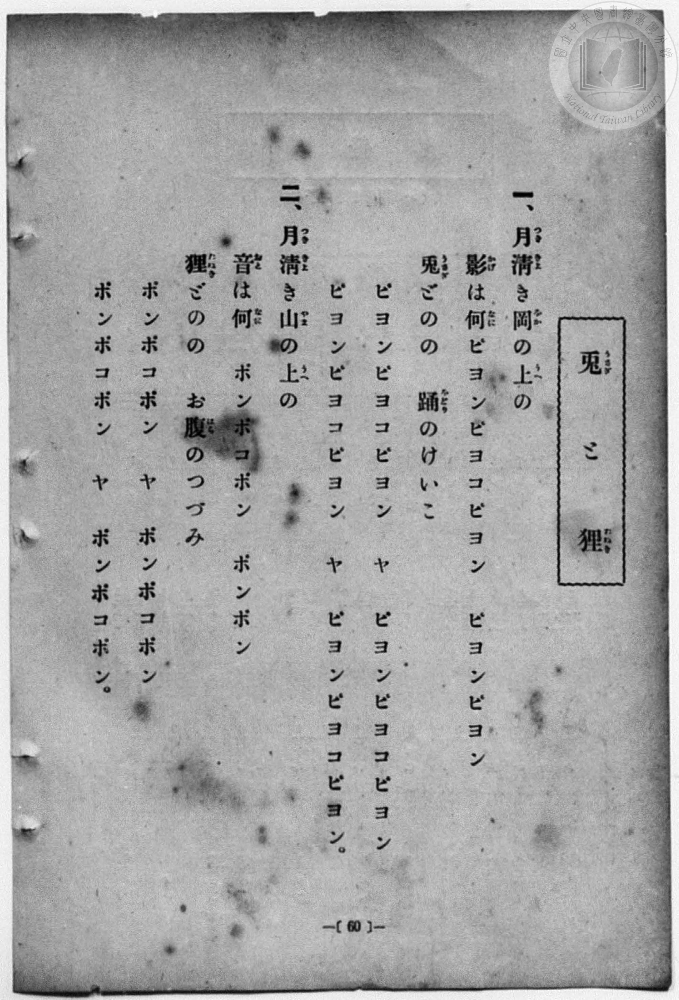
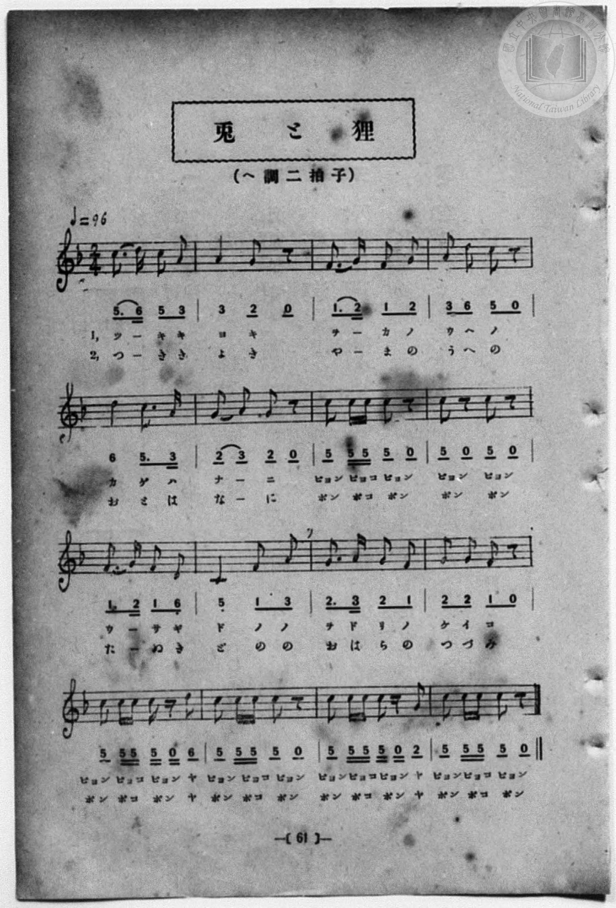

# 兎と狸

> Re:Shōka 使用 AI 協助辨識與重建樂譜，可能會有錯誤。歡迎回報。

- **鋼琴伴奏版**：<br><audio controls src="usagi_to_tanuki.mp3"></audio>
- **NEUTRINO 歌聲合成版**：<br><audio controls src="usagi_to_tanuki_neutrino.mp3"></audio>

- 一條慎三郎 編《新編 小學校・公學校 唱歌教材集》（大正十二年十二月，索書號 0725-41）

## 說明

曲目說明
中文解釋：描寫皎潔月夜下，山丘上的兔子練習蹦蹦跳跳舞、狸貓拍著肚皮打鼓的熱鬧情景。
原書資訊（對應 P068.jpg–P069.jpg，原書 p. 60–61）：
調性與拍號：ヘ調 二拍子，♩=96


## 歌詞

```text
一、月（つき）清（きよ）き岡（をか）の上（うへ）の
影（かげ）は何（なに）ピヨンピヨコピヨン　ピヨンピヨン
兎（うさぎ）どのの　踊（をどり）のけいこ
ピヨンピヨコピヨン　ヤ　ピヨンピヨコピヨン
ピヨンピヨコピヨン　ヤ　ピヨンピヨコピヨン。

二、月（つき）清（きよ）き山（やま）の上（うへ）の
音（おと）は何（なに）　ポンポコポン　ポンポン
狸（たぬき）どのの　お腹（はら）のつづみ
ポンポコポン　ヤ　ポンポコポン
ポンポコポン　ヤ　ポンポコポン。
```

## ABC

<div class="abc-score" data-abc-src="usagi_to_tanuki.abc" aria-label="五線譜載入中"></div>

[下載 ABC 原始檔](usagi_to_tanuki.abc)

## TMD 檔案連結

- [主旋律 TMD 檔案](usagi_to_tanuki.tmd) [[在 TMD Studio 編輯](https://tmdlang.github.io/Tmd-TS/#tmd=s7IKdvYPcrWy4qpTUCpJTLdSSM7PyUlNLsnMz7MqzsjPTozPrsyvSsyML84ojTe0NDJWgqssy88pzU21Si9KTEmNN4w3QsgU55cWJadaFSdn5OfnxJekVpQk5edno8vHFySmp1oFGJhZIGQKivLLUvMS84C6C4oy80pSU8DaEQpSyzJTUkHSxcmJefFlqUWZaZmpKUiOSi0qBrsdYkVJUWJecXJRZgHIQwhV-UUlGflAhxdkVFplZBaX5BdlJifmxGcn5iUiFJVkpAK9l5iXmZuYg6w1Mz0zz6o0D-SOEqjtWloKT1v7HjeueN69Q0FLi0vRVsHSjMveVsGNy8ZI38QOpPvJjoZni-Y-a-17sqPzZXOfwvPtKx43dD2btgHIUHi6of_p2h3PFix83Lz7aesaCFvh6ZSNz9b2PJs689ncCS9ntz1u6H6_p-PpkuXP1i5-2tv4ZFfP051bIIxnczre7-l5vmXRs9k7Xsycr2BgbmSqa2L4fk-nEpe-lsKz2Zuez173YtWqZzP6uBQUFJ7sWPtsWvuL5YtftgONnPWsv__p-tXPZ_U92zsFaNLTJXOe7ACK9zzduPHJjhlPdnQ9n9XytHXK07UTnm_f8nz_pBc7l4HQ9s0g1DHvcUMj0N8vNk1-1t37YuL0F02zns9a96xz8ss9k4Ean7dtfLlm-bPm1mcz1z9uaAJZ_7RvPsidm9tfrOgC-WhD77P2TgVQStDLKkh_1DAZyLQEMUFuAKtVKNBTMDMAypiB_AR0MsiYF6v2P2tY_qKjHWTvzPlA0cfNM4CCCqAA6e4FOheo_9HMlbbAuNDS5wIGBBcwEoCuBYdWx-PGJY8be4HGPdvRCub2Pm4CincCGU83LQSJNE163AgMB6DIOmAggNW0PW7cARHherp3I1io-3HjJLDQ-id7p4JFVj1uXA0SaZ7yuHnF4-bNUEYTjAEUaWhAl23ezAVMQzBLpj5uBLKBhq4EWgVCDQ0vIE4AOWrl4yYgG-SKx40THze2PG6czEXItiVY7ERSQ6l-UNRyAQOeqODdCA65JqC79-EM3pfzN4OFuoDZCnvwgtwzF-yYuWCXgNnIgkBfARMmWM_8x41rIM5BDlKg6S9ad4IVrH_cBExXkCAFOnzp48b9wCDBajwkJNClSFMNCi5QmvRNBBYmAZmJefkONQY11aBkrWBjaKZlB2bVKJgq6AKhGZg2BuIaMAmCRkBsABYxhPJBNEgUosYMiEG6wGrApvkY1ig8bm6B6n_ctBZOgsRXoIhDTH7cvAkuuhpEAsstsHjTMjBvBlwMyRYjoHzjEpi-xl44CdLXgSIOtaUJ7qbGfWByHUS8sQ3M2wEXg9gCDRqQB0EQEkTGQBGQ50FeRwQNSM4UDJFFQCwsQQP2IsSzEG8_bu4HB0IXTLy5GylogAl_OTAmweIgNlDbZhRhTIUgEQwVSKEGt6gREhvAZAkOh1VwcZATYeaC0hHYwLlQq6ECaPIQS5HlYCGInHDM4iHBA6JAECQGSXCg0ASxQTRIFCIC46GHIShhQMJwK5iERmVzJzwMQckFnpCgCQwk_7gZ5E1EEtsI1g9KSCDfYQbWfHigrAGT0CTWuBIuDrIbkZgggQsKUmBWR5EB29G4FEzuRw8kRBIyACc5XIkKpgaSAzHUIOVAAgnHAMgGuYjMNEYlMxEBjSOdIRtJZEok1wSuWi4uXTsFUFmpgEQrcwEA)]
- [鋼琴伴奏 TMD 檔案](usagi_to_tanuki_piano.tmd) [[在 TMD Studio 編輯](https://tmdlang.github.io/Tmd-TS/#tmd=s7IKdvYPcrWy4qpTUCpJTLdSSM7PyUlNLsnMz7MqzsjPTozPrsyvSsyML84ojTe0NDJWgqssy88pzU21Si9KTEmNN4w3QsgU55cWJadaFSdn5OfnxJekVpQk5edno8vHFySmp1oFGJhZIGQKivLLUvMS84C6C4oy80pSU8DaEQpSyzJTUkHSxcmJefFlqUWZaZmpKUiOSi0qBrsdYkVJUWJecXJRZgHIQwhV-UUlGflAhxdkVFplZBaX5BdlJifmxGcn5iUiFCUWATWnp-am5pVYFWQm5uXHJyYn5-cWJOZlgsSUuLS0FJ629j1uXPG8e8f7PR0vZ8981tn9snvP8wlbnuzZ8nRp__s9nQpaWlyKtgqWZlz2tgpuXDZG-iZ2IBue7Gh4tmjus9a-Jzs6Xzb3KTzfvuJxQ9ezaRuADIWnG_qfrt3xbMHCx827n7augbAVnk7Z-Gxtz7OpM5_NnfBydtvjhm6gpU-XLH-2dvHT3sYnu3qe7twCYTyb0_F-T8_zLYuezd7xYuZ8BQNzI1NdE0Ogc5S4uHwTM_OsAkD-CfJwqDGoqeZSAAIbQzMtOzCrRsFUQRcIzcC0MRDXgEkQNAJiA7CIIZQPokGiEDVmQAzSBVYDNs3HsEbhcXMLVP_jprVwEiS-AkUcYvLj5k1w0dUgEhg6YPGmZWDeDLgYki1GQPnGJTB9jb1wEqSvA0UcaksT3E2N-8DkOoh4YxuYtwMuBrEFGjQgD4IgJIiMgSIgz4O8jggakJwpGCKLgFhYggbsRYhnId5-3NwPDoQumHhzN1LQTHncvPxx82awOIgN1LYZRRhTIUgEQwVSqMEtaoTExuPG9eBwWAUXBzkRZu5cmO1zoVZDBdDkIZYiy8FCEDnhmMVDggdEgSBIDJLgQKEJYoNokChEBMZDD0NQwoCE4VYwCY3K5k54GIKSCzwhQRMYSP5xM8ibiCS2EawflJBAvsMMrPnwQFkDJqFJrHElXBxkNyIxQQIXFKSPm0CuQciA7WhcCib3owcSIgkZgJMcrkQFUwPJgRhqkHIggYRjAGSDXERmGqOSmYiAxpHOkI0kMiWSawJXLXJR6YNcVJrAS0pDbWMwBqVhbfN4oE5kMTgLqtokXtuQgHKgCJLRYA2YtkBIGA_ZBjRNMPNhGmA2AL2ma6cA8l20j2GsApxtBGYrcwEA)]

## 分析

```text
================================================================================
📊 TMD Song Profile: [ 兎と狸 ]
================================================================================
⏱  Duration:       0:40 (40.0s), 32 measures total
🎼 Key & Tempo:    首調基準 F, != 96.0 BPM, <2/4>
   - 分析範圍：      由實際發聲的音符與和弦推測調性；播放脈絡另行呈現
🎤 人聲音域:    C4 (MIDI 60) – D5 (MIDI 74) [跨度: 14 個半音 / 1.2 個八度, 難度: moderate]
   - 最低音:  C4 in [Main #1 @ m.10, 0:11]
   - 最高音: D5 in [Main #1 @ m.1, 0:00]
   - 適合: soprano, mezzo-soprano, contralto, tenor, baritone, bass
🏛  結構:      Main (20.0s) -> Main (20.0s)
⚡ 編曲密度:        Peak 1 軌道同時演奏
🗝  調性診斷：       C 大調（純淨自然大調，未偵測到可信轉調）
   - 風格氣質:    純淨自然大調（陽光明朗、易唱易記，無明顯調外色彩）
   - 轉調歷程:    全曲維持單一推測調性（未偵測到可信轉調）
   - 核心骨幹音:  C, G, F, A, D
   - 調性數值:    C 大調 [相關度: 0.89, 穩定度: High, 自然音純度: 100.0%]
   - 候選調性 (K-S): C 大調 (0.89), F 大調 (0.68), C 小調 (0.66)
   - 五度圈歷程:   +0 -> +0
   - 各段落調性細節:
     • [Main #1]: C 大調 (r: 0.89, 自然音純度: 100.0%)
     • [Main #2]: C 大調 (r: 0.89, 自然音純度: 100.0%)

  [ 五度圈游移軌跡 ]
              [C ]*
         F            G  
      Bb               D  
      Eb               A  
         Ab           E  
            Db       B  
               F# 
     (* = active key center)

  [ 十二半音累積音高分佈 ]
     C  : ████████████████████████  42.6%
     C# :                            0.0%
     D  : ██████                    10.2%
     D# :                            0.0%
     E  :                            0.0%
     F  : ████████                  14.8%
     F# :                            0.0%
     G  : ███████████               19.4%
     G# :                            0.0%
     A  : ███████                   13.0%
     A# :                            0.0%
     B  :                            0.0%
--------------------------------------------------------------------------------
Assignment 軌道音域：
  - Piano         : C4 – D5 (14 個半音 / 1.2 個八度, 114 個音符)
================================================================================
```


## 原書掃描頁






