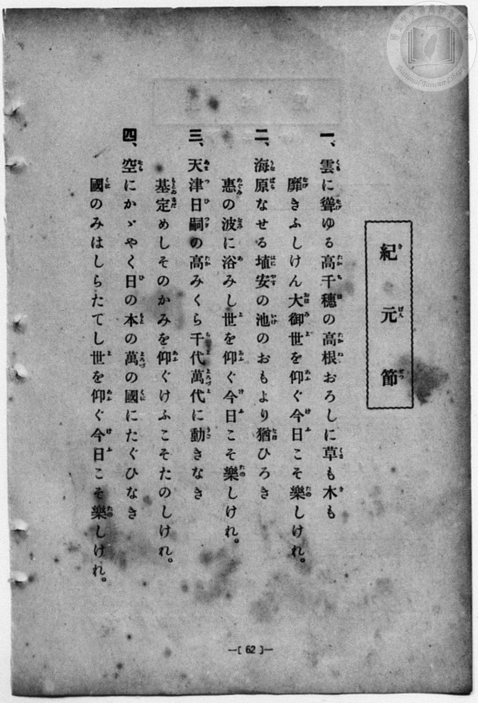
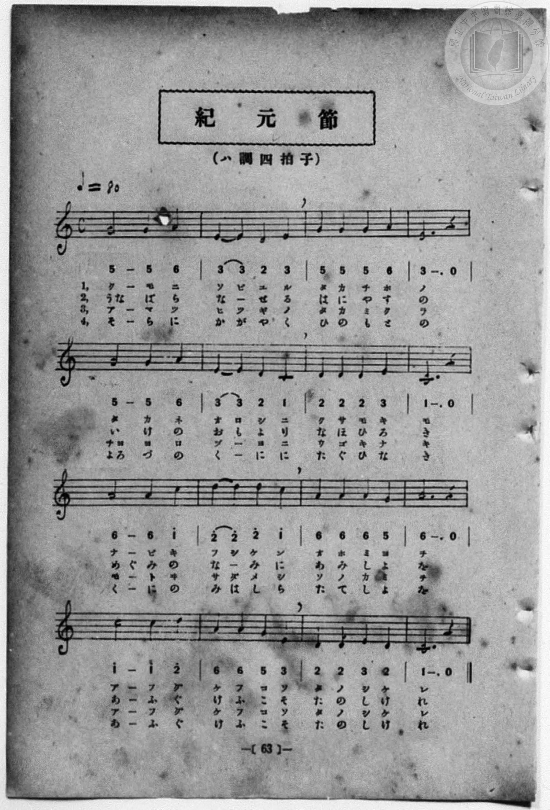

# 紀元節

> Re:Shōka 使用 AI 協助辨識與重建樂譜，可能會有錯誤。歡迎回報。

- **NEUTRINO 歌聲合成版**：<br><audio controls src="kigensetsu_neutrino.mp3"></audio>
- **鋼琴伴奏版**：<br><audio controls src="kigensetsu.mp3"></audio>


- 詞：高崎正風
- 曲：伊澤修二
- 一條慎三郎 編《新編 小學校・公學校 唱歌教材集》（大正十二年十二月，索書號 0725-41）
- 臺灣總督府《公學校唱歌集》（大正四年三月，索書號 0725 26）

## 說明

原書資訊與歌詞全文（對應 P070.jpg–P071.jpg，原書 p. 62–63，第 31 首）：
調性與拍號：ハ調四拍子（C 大調 4/4 拍），♩=80


## 歌詞

```text
一、
雲（くも）に聳（そび）ゆる　高千穗（たかちほ）の
高根（たかね）おろしに　草（くさ）も木（き）も
靡（なび）きふしけん　大御世（おほみよ）を
仰（あふ）ぐ今日（けふ）こそ　樂（たの）しけれ。

二、
海原（うなばら）なせる　埴安（はにやす）の
池（いけ）のおもより　猶（なほ）ひろき
惠（めぐみ）の波（なみ）に　浴（あ）みし世（よ）を
仰（あふ）ぐ今日（けふ）こそ　樂（たの）しけれ。

三、
天津（あまつ）日嗣（ひつぎ）の　高（たか）みくら
千代（ちよ）萬代（よろづよ）に　動（うご）きなき
基（もとゐ）定（さだ）めし　そのかみを
仰（あふ）ぐけふこそ　たのしけれ。

四、
空（そら）にかゝやく　日（ひ）の本（もと）の
萬（よろづ）の國（くに）に　たぐひなき
國（くに）のみはしら　たてし世（よ）を
仰（あふ）ぐ今日（けふ）こそ　樂（たの）しけれ。
```

## ABC

```abc
X:1
T:紀元節
C:曲：伊澤修二
M:4/4
L:1/16
Q:1/4=80
K:C
V:V1 name="Vocal" snm="Voc"
[V:V1]
G4 G4 G4 A4 | E4 E4 D4 E4 | G4 G4 G4 A4 | E12 z4 |
w: 1.~く _ も に | そ び ゆ る | た か ち ほ | の
w: 2.~う な ば ら | な _ せ る | は に や す | の
w: 3.~あ _ ま つ | ひ つ ぎ の | た か み く | ら
w: 4.~そ _ ら に | か が や く | ひ の も と | の
G4 G4 G4 A4 | E4 E4 D4 C4 | D4 D4 D4 E4 | C12 z4 |
w: 1.~た _ か ね | お ろ し に | く さ も き | も
w: 2.~い _ け の | お も よ り | な ほ ひ ろ | き
w: 3.~ち よ よ ろ | づ _ よ に | う ご き な | き
w: 4.~よ ろ づ の | く _ に に | た ぐ ひ な | き
A4 A4 A4 c4 | d4 d4 d4 c4 | A4 A4 A4 G4 | A12 z4 |
w: 1.~な _ び き | ふ し け ん | お ほ み よ | を
w: 2.~め ぐ み の | な _ み に | あ み し よ | を
w: 3.~も _ と ゐ | さ だ め し | そ の か み | を
w: 4.~く _ に の | み は し ら | た て し よ | を
c8 c4 d4 | A4 A4 G4 E4 | D4 D4 E4 D4 | C12 z4 |
w: 1.~あ ふ ぐ | け ふ こ そ | た の し け | れ
w: 2.~あ ふ ぐ | け ふ こ そ | た の し け | れ
w: 3.~あ ふ ぐ | け ふ こ そ | た の し け | れ
w: 4.~あ ふ ぐ | け ふ こ そ | た の し け | れ
G4 G4 G4 A4 | E4 E4 D4 E4 | G4 G4 G4 A4 | E12 z4 |
w: 1.~く _ も に | そ び ゆ る | た か ち ほ | の
w: 2.~う な ば ら | な _ せ る | は に や す | の
w: 3.~あ _ ま つ | ひ つ ぎ の | た か み く | ら
w: 4.~そ _ ら に | か が や く | ひ の も と | の
G4 G4 G4 A4 | E4 E4 D4 C4 | D4 D4 D4 E4 | C12 z4 |
w: 1.~た _ か ね | お ろ し に | く さ も き | も
w: 2.~い _ け の | お も よ り | な ほ ひ ろ | き
w: 3.~ち よ よ ろ | づ _ よ に | う ご き な | き
w: 4.~よ ろ づ の | く _ に に | た ぐ ひ な | き
A4 A4 A4 c4 | d4 d4 d4 c4 | A4 A4 A4 G4 | A12 z4 |
w: 1.~な _ び き | ふ し け ん | お ほ み よ | を
w: 2.~め ぐ み の | な _ み に | あ み し よ | を
w: 3.~も _ と ゐ | さ だ め し | そ の か み | を
w: 4.~く _ に の | み は し ら | た て し よ | を
c8 c4 d4 | A4 A4 G4 E4 | D4 D4 E4 D4 | C12 z4 |
w: 1.~あ ふ ぐ | け ふ こ そ | た の し け | れ
w: 2.~あ ふ ぐ | け ふ こ そ | た の し け | れ
w: 3.~あ ふ ぐ | け ふ こ そ | た の し け | れ
w: 4.~あ ふ ぐ | け ふ こ そ | た の し け | れ
```

## TMD 檔案連結

- [主旋律 TMD 檔案](kigensetsu.tmd) [[在 TMD Studio 編輯](https://tmdlang.github.io/Tmd-TS/#tmd=s7IKdvYPcrWy4qpTUCpJTLdSSM7PyUlNLsnMz7MqzsjPTozPrsyvSsyML84ojTe0NDJWgqssy88pzU21Si9KTEmNN4w3QsgU55cWJadaFSdn5OfnxJekVpQk5edno8vHFySmp1oFGJgbIGQKivLLUvMS84C6C4oy80pSU8DaEQpSyzJTUkHSxcmJefFlqUWZaZmpKUiOSi0qBrsdYkVJUWJecXJRZgHIQwhV-UUlGflAhxdkVFplZBaX5BdlJifmxGcn5iUiFJVkpAK9l5lbALQkMQddPDm1KDU3Pw9FBmhMemaeFVA4qRQYeJgSqZlZmUjhoaWl8HxLw9PW5ufrGxS0tLgUbRUsDLjsbRWcuWxM9E3sQPqf7Gh4tmjus9a-Jzs6Xzb3KTzfvuJxQ9ezaRuADIWnG_qfrt3xbMHCx827n7augbAVnk7Z-Gxtz7OpM5_NnfBydtvjhu73ezqeLln-bO3ip72NT3b1PN25BcJ4Nqfj_Z6e51sWPZu948XM-QoG5kamuiaG7_d0gt3-YuW893tmvVw94-mWPqDml4tWgIWfzd4EFH6yp-vZviVP9q8DmgNR3b7reePi5zv2Pp-7-OmuOUBXwp0EcRG6W2bPBjoE6C1srlAwMgO7gktfS8GWWoBLQUHhad98kDWb21-s6HrR0Q50FtCXT1tXPJvWDnLZht5n7Z0KoESpl1WQ_qhhMpBpCGICXQjRqlCgp2BmBJQxMwa5es0aBWNDhZfLpgGdCwwVkBUvVu1_1rAcZHh3L9A_QNHHzf1AQaCHgSJP104AWuSsAAwEoJgCMJ4VgKJg3T2PZq60BaYAkCHAeH_c0AhivQQFd8fjxv7HTU1AZY8bV79o3AwWmfsYxOh83NT2uKn7cUMDKKZ6m5-vnA6Wnf-4sftx48LHjbvButaBzVo949mCnUjSa8FyXY-beh83TgcaDTTlRS_QKWD7GqeCTW96NmcFWATkSiAXbNDchWChVVAnNAL1bwUbMfFx02SgKUDvPd238MkOYLgAlXUBXfG4cf_jJmBMA42YBPbh7g1guSagTrARE57s7no2fSlYcCJMcDLImw0Nz1YA_Q5x9TqwOMSmnscNTZDg2gVkgoPr2dbtwIgCK24Du2_D4yagh4BagOzZkIB6On_L03UQX64Hebqp5XHjTEQoPdu4ACwHFJ0IEQUHURPQ-Y-buoD6n_dsg_keEribwAHYC9bcDNbc1Aj0ENDLEP3PNi-CaYCIgAL62dYtkAAAi-wH-gkaXLQLpR2d0FB6umTlsy0QQ4Am73vcuASoHmjs0-mLwYKbgCKPG_ugvgcnLXiqgTkXmCA7wWb1Nj_ZDdG2EOL2FxPWQEVAIQYMmaVQP4H9_bQbmK4g0TMFlnaAAQMOvafzd4G1AR214nETMKd0Pl03C6x66uNGYMACgwUYsNOBpoCTPzBigIkYmK5whBUkiODhAwkZjGABZkxosDxfCbYeqBiaZlaDLGgCcoFpoR8UwtCQB2ZJcLzOWQN3LiL9AL2P7HeIxNM5oKIPnK1Ww4MC7CCgK4HBDQ8BdHVA9wIDG5hOpwMdBdOzjMapBWgW5eUtFCho6XNxeWemp-YVp5YUl1qF5QMrW4cag5pqkDUKNhZadmAGtqJeAVjAAovCFwt7FDRMQPUdsKrUAZXP4EJZE4sGoGUgw2oUTBV04dgMiGsUjIEkCBtBaVxqYNAAJAI2zcewRgEYJVBxYHyDyMbVYB3AwATzNoNl2sBkN1RmPlgGxAPmDTC5GyqzDsmeeIQ9RiA5sBmNq8DkBrB5nVBdIDGwCxpno9izHu4eYEoFs2fit8cYJAfyBcS0fWByCVTPJjgPWASASZAp6P7ZDyZBYQKUAbsQiz0msPCBhBtIFSLcIOb0ILkaahrUBSBbYWG9Aqd_8KedXT3UTzuGYBEQC4YhqQkkjivtgEIOEtYQX6-F-qcL7MdesNh0lNABhQWw2EMKA5AqUFjD4g1b2gGFI8SeifAwRNgDNqepA0yCRGBpCpIuoeEOdg1IBkTjSjvg1Aw1CULCdC2FuQAiDvcPJFVPgfsEYjMee0BpB8lsiMkIH8FzIyTdw-2BpNEJCP_gsYdAudNJTtoBpRcYNowDW20EohAEVBRZISihQURwJSBE1gcXNLDE0LgVzIMkHXCUN02GyoCjHBqx4MwKDkxQoE7CHuCgBNTUiBR8kCwOC3CECyDisACHJE6IGNgdhOwBJSB4IoZkbWBdDzUNnOAbF4DFIG4BmYkoZsGFAlIRhMcecOGDnkxgvoG4F1JwQlwNK2QhCWgZUf7Bm4CA7QpyEhA4eYAgmAFOMYjEAkookNIGuewB0fjLH0RwQxIMLLghpQREDJRwIMGMCAZIcCOSFygYQCU2juRDD3vQ6i6a2QNOPrS1p5aLS9dOAdE2UsDgKXMBAA)]
- [鋼琴伴奏 TMD 檔案](kigensetsu_piano.tmd) [[在 TMD Studio 編輯](https://tmdlang.github.io/Tmd-TS/#tmd=s7IKdvYPcrWy4qpTUCpJTLdSSM7PyUlNLsnMz7MqzsjPTozPrsyvSsyML84ojTe0NDJWgqssy88pzU21Si9KTEmNN4w3QsgU55cWJadaFSdn5OfnxJekVpQk5edno8vHFySmp1oFGJgbIGQKivLLUvMS84C6C4oy80pSU8DaEQpSyzJTUkHSxcmJefFlqUWZaZmpKUiOSi0qBrsdYkVJUWJecXJRZgHIQ0pcWloKz7c0PG1tfr6-4f2ejpezZz7r7H7Zvef5hC1P9mx5urT__Z5OBS0tLkVbBQsDLntbBWcuGxN9EzuQ8U92NDxbNPdZa9-THZ0vm_sUnm9f8bih69m0DUCGwtMN_U_X7ni2YOHj5t1PW9dA2ApPp2x8trbn2dSZz-ZOeDm77XFDN9DSp0uWP1u7-Glv45NdPU93boEwns3peL-n5_mWRc9m73gxc76CgbmRqa6JIdA5YK-9WDnv_Z5ZL1fPeLqlD6j55aIVYOFnszcBhZ_s6Xq2b8mT_euA5kBUt-963rj4-Y69z-cufrprDtCVcCdBXITultmzgQ4BegubKxSMzMCu4PLOTE_NK04tKS61CshMzMsP8nCoMaip5lIAAhsLLTswQ19LwRYdKDxfswYYeC8W9ihomIBCChj4OgrAeDfUyypI18SiQUsfbFiNgqmCLhybAXGNgjGQBGEjKI1LDQwagETApvkY1ig8buyHij9uagKRjavBOh43zgXzNoNl2sBkN1RmPlgGxHvcuBBM7obKrEOyJx5hjxFIDmxG4yowuQFsXidUF0gM7ILG2Sj2rIe753FTC5g9E789xiA5kC8gpu0Dk0ugejbBeY8b-8AkyBR0_-wHk6AwAcqAXYjFHhNY-EDCDaQKEW4Qc3qQXA01DeoCkK2wsF6B0z_4086uHuqnHUOwCIgFw5DUBBLHlXZAIQcJa4iv10L90wX2Yy9YbDpK6IDC4nHjVKQwAKkChTUs3rClHVA4QuyZCA9DhD1gc5o6wCRIBJamIOkSGu5g14BkQDSutANOzVCTICRM11KYCyDicP9AUvUUuE8gNuOxB5R2kMyGmIzwETw3QtI93B5IGp2A8A8eewiUO53kpB1QeoFhwziw1UYgCkFARZEVghIaRARXAkJkfXBBA0sMjVvBPEjSAUd502SoDDjKoRELzqzgwAQF6iTsAQ5KQE2NSMEHyeKwAEe4ACIOC3BI4oSIgd1ByB5QAoInYkjWftwEshFkGjjBNy4Ai0HcAjITUcyCCwWkIgiPPeDCBz2ZwHwDcS-k4IS4GlbIQhLQMqL8gzcBAetGchIQOHmAIJgBTjGIxAJKKJDSBrnsAdH4yx9EcEMSDCy4IaUERAyUcCDBjAgGSHAjkhcoGEAlNo7kQw970OoumtkDTj60tacWs2nkg9w0MkE0jV70db1s7wUmqWfdvU_XTng6qedF4yZIwxMp6cQrRBvGgimTWATfNB5C41QApAyg3ibCEDDLNB67uQhzTCAGQCms2pCUoPGxOgekGa4IKo5kLkIJqnOAoaxrp4AI6GgfoByaiBGGiDGGCNBSoIgyFwA)]

## 分析

```text
================================================================================
📊 TMD Song Profile: [ 紀元節 ]
================================================================================
⏱  Duration:       1:36 (96.0s), 32 measures total
🎼 Key & Tempo:    首調基準 C, != 80.0 BPM, <4/4>
   - 分析範圍：      由實際發聲的音符與和弦推測調性；播放脈絡另行呈現
🎤 人聲音域:    C4 (MIDI 60) – D5 (MIDI 74) [跨度: 14 個半音 / 1.2 個八度, 難度: moderate]
   - 最低音:  C4 in [Kigensetsu #1 @ m.6, 0:17]
   - 最高音: D5 in [Kigensetsu #1 @ m.10, 0:27]
   - 適合: soprano, mezzo-soprano, contralto, tenor, baritone, bass
🏛  結構:      Kigensetsu (48.0s) -> Kigensetsu (48.0s)
⚡ 編曲密度:        Peak 1 軌道同時演奏
🗝  調性診斷：       A 調性不明確（純淨自然大調，未偵測到可信轉調）
   - 風格氣質:    純淨自然大調（陽光明朗、易唱易記，無明顯調外色彩）
   - 轉調歷程:    全曲維持單一推測調性（未偵測到可信轉調）
   - 核心骨幹音:  A, C, D, E, G
   - 調性數值:    A 調性不明確 [相關度: 0.75, 穩定度: Ambiguous, 自然音純度: 100.0%]
   - 候選調性 (K-S): A 小調 (0.75), C 大調 (0.73), G 大調 (0.68)
   - 五度圈歷程:   +3 -> +3
   - 各段落調性細節:
     • [Kigensetsu #1]: A 調性不明確 (r: 0.75, 自然音純度: 100.0%)
     • [Kigensetsu #2]: A 調性不明確 (r: 0.75, 自然音純度: 100.0%)

  [ 五度圈游移軌跡 ]
               C  
         F            G  
      Bb               D  
      Eb              [A ]*
         Ab           E  
            Db       B  
               F# 
     (* = active key center)

  [ 十二半音累積音高分佈 ]
     C  : █████████████████████     20.0%
     C# :                            0.0%
     D  : █████████████████████     20.0%
     D# :                            0.0%
     E  : ███████████████████       18.3%
     F  :                            0.0%
     F# :                            0.0%
     G  : ███████████████████       18.3%
     G# :                            0.0%
     A  : ████████████████████████  23.3%
     A# :                            0.0%
     B  :                            0.0%
--------------------------------------------------------------------------------
Assignment 軌道音域：
  - Vocal         : C4 – D5 (14 個半音 / 1.2 個八度, 102 個音符)
================================================================================
```


## 原書掃描頁






