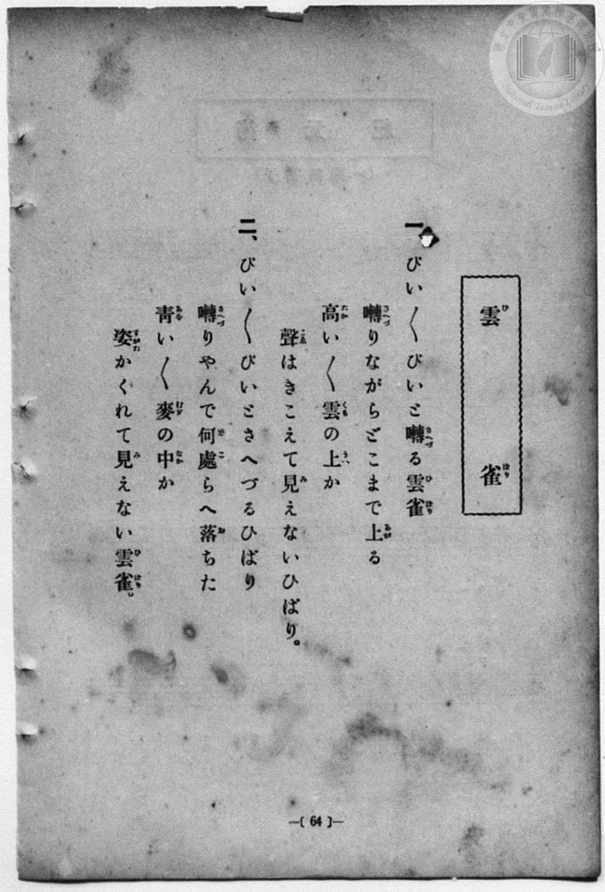
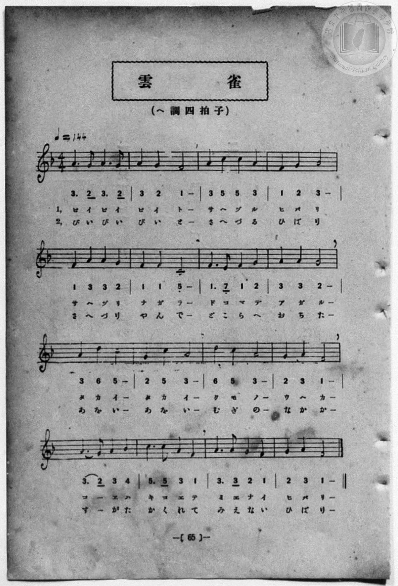

# 雲雀

> Re:Shōka 使用 AI 協助辨識與重建樂譜，可能會有錯誤。歡迎回報。

<audio controls src="hibari.mp3"></audio>

- 一條慎三郎 編《新編 小學校・公學校 唱歌教材集》（大正十二年十二月，索書號 0725-41）

## 說明

原書資訊與歌詞全文（對應 P072.jpg–P073.jpg，原書 p. 64–65，第 32 首）：
調性與拍號：ヘ調四拍子（F 大調 4/4 拍），♩=144


## 歌詞

```text
一、
ぴい〱ぴいと　囀（さへづ）る雲雀（ひばり）
囀（さへづ）りながら　どこまで上（あが）る
高（たか）い〱　雲（くも）の上（うへ）か
聲（こゑ）はきこえて　見（み）えないひばり。

二、
ぴい〱ぴいと　さへづるひばり
囀（さへづ）りやんで　何處（どこ）らへ落（お）ちた
青（あを）い〱　麥（むぎ）の中（なか）か
姿（すがた）かくれて　見（み）えない雲雀（ひばり）。
```

## ABC

```abc
X:1
T:雲雀
M:4/4
L:1/16
Q:1/4=144
K:F
V:V1 name="Vocal" snm="Voc"
[V:V1]
A6 G2 A6 G2 | A4 G4 F8 | A4 c4 c4 A4 | F4 G4 A8 |
w: 1.~ぴ い ぴ い | ぴ い と | さ へ づ る | ひ ば り
w: 2.~ぴ い ぴ い | ぴ い と | さ へ づ る | ひ ば り
F4 A4 A4 G4 | F4 F4 C8 | F6 E2 F4 G4 | A4 A4 G8 |
w: 1.~さ へ づ り | な が ら | ど こ ま で | あ が る
w: 2.~さ へ づ り | や ん で | ど こ ら へ | お ち た
A4 d4 c8 | G4 c4 A8 | d4 c4 A8 | G4 A4 F8 |
w: 1.~た か い | た か い | く も の | う へ か
w: 2.~あ を い | あ を い | む ぎ の | な か か
A6 G2 A4 B4 | c6 c2 A4 F4 | A6 A2 G4 F4 | G4 A4 F8 |
w: 1.~こ _ ゑ は | き こ え て | み え な い | ひ ば り
w: 2.~す _ が た | か く れ て | み え な い | ひ ば り
A6 G2 A6 G2 | A4 G4 F8 | A4 c4 c4 A4 | F4 G4 A8 |
w: 1.~ぴ い ぴ い | ぴ い と | さ へ づ る | ひ ば り
w: 2.~ぴ い ぴ い | ぴ い と | さ へ づ る | ひ ば り
F4 A4 A4 G4 | F4 F4 C8 | F6 E2 F4 G4 | A4 A4 G8 |
w: 1.~さ へ づ り | な が ら | ど こ ま で | あ が る
w: 2.~さ へ づ り | や ん で | ど こ ら へ | お ち た
A4 d4 c8 | G4 c4 A8 | d4 c4 A8 | G4 A4 F8 |
w: 1.~た か い | た か い | く も の | う へ か
w: 2.~あ を い | あ を い | む ぎ の | な か か
A6 G2 A4 B4 | c6 c2 A4 F4 | A6 A2 G4 F4 | G4 A4 F8 |
w: 1.~こ _ ゑ は | き こ え て | み え な い | ひ ば り
w: 2.~す _ が た | か く れ て | み え な い | ひ ば り
```

## TMD 檔案連結

- [主旋律 TMD 檔案](hibari.tmd) [[在 TMD Studio 編輯](https://tmdlang.github.io/Tmd-TS/#tmd=s7IKdvYPcrWy4qpTUCpJTLdSSM7PyUlNLsnMz7MqzsjPTozPrsyvSsyML84ojTe0NDJWgqssy88pzU21Si9KTEmNN4w3QsgU55cWJadaFSdn5OfnxJekVpQk5edno8vHFySmp1oFGJgj6Swoyi9LzUvMA-ouKMrMK0lNAWtHKEgty0xJBUkXJyfmxZelFmWmZaamIDkqtagY7HaIFSVFiXnFyUWZBSAPIVTlF5Vk5AMdXpBRaZWRWVySX5SZnJgTn52Yl4hQVJKRCvReXmJJaVEqumhiXmZuYk6xEpeWlsLL2Ztezm5Q0NLiUrRVMDQx4bK3VXDjsjHRN7ED6Xqyo-HZornPWvue7Oh82dyn8Hz7iscNXc-mbQAyFJ5u6H-6dsezBQsfN-9-2roGwlZ4OmXjs7U9z6bOfDZ3wsvZbY8but_v6Xi6ZPmztYuf9jY-2dXzdOcWCOPZnI73e3qeb1n0bPaOFzPnKwAD01TXxPD9nk4lLi59LQVbagEuBQWFp33zQdZsbn-xoutFRzvQiS9WznvauuLZtHaQ-zb0PmvvVADFp15WQfqjhslApjGICXQhRKtCgZ6CmQlQxswU5Oo1axSMjRReLpsGdO77PbNAVrxYtf9Zw3KQ4d29QP8ARR83zwAKPp09GyjydO0EoEVuCsCgAIopAENYASgK1t3zaOZKW1Dgg0wBBvnjhkYQ63HjlseNLY8bNkIZjcCwb3g6uwFozOPGqY8bdzxuXArU_7ipGxKLYPFNjxs3PG7qAoqDfY1FddfjxlWPG3seN3UCjXvcuPJx4-THjfseNy5_sgOoDai4CSgLMRdkxMvVM8Ci8x83AmOyE-qihgagnWDx_sdNTWDxdTD9bUDLwCJg_S8aIeomP26aCBZd_7ixF2wnUHAZ0KAXy0Ap5HHjfrAskAF0HdCzUI88bmiCBMuuHnzBAvci0NVwvbhDoKnlcRPQBcuBOp_snfpi5lSwGlBQgBUA3bHjxYS9YEFQUD5uXAgMAHBozJ0EDaMmIAMpNHYBje543AR0SB8sNNaCVQJ9Awk3cGg8XQ70JlB0JigGGoFpBCQBDkQgF2doYI1fUMgATaQ8e0CBgpY-F5dHZlJiUaZVWD6wSHGoMaipBlmhYGOhZQdmYMuVCsC8AEy0Lxb2KGiYgAqF5-sbdEBZCZx_NLFoAFoEMqxGwVhBFwiN4DRExAiIDcEiulARUygGsWvAciA1EF1AEbBpPoY1oKQBFgEGGQobJgNig8gVcNOBCQMssgNMLgWRTd1QmU1gsQ1gsS5Uu4zoYxf-MN_VQ06Yg0IPFHKwkIaIgLBpPNypkOA3j4eHNSQeYHrQQx3TXyA_gGRWgcV6wGKdSCGxEhpek4F4H5i1HCrThKQDFDrooY7TriZweDdNhpuGxS6wGyC6QTIgncC8DSbnExnqOzrJTelmoDCGuwsUjrA0DRGBySNEYKkcnhuQwhzkXmDZASZBPof5Fpd4Pzh0IKG7Dkm8DSk8sYU3WEfTJAzzcIg3NYBF-jDsgaQEiLsQ9uANa2DFSWmpYgK2HRLqpvCwhKkxhpc1-MMalKbAaahpItj966F-6oWIglNxB5i1DCqzHyrTAfc5KIyIKVVmwuyC5AFwfILEIWEGikdgXUGRXbVcXLp2CpCSXgGFpcwFAA)]
- [鋼琴伴奏 TMD 檔案](hibari_piano.tmd) [[在 TMD Studio 編輯](https://tmdlang.github.io/Tmd-TS/#tmd=s7IKdvYPcrWy4qpTUCpJTLdSSM7PyUlNLsnMz7MqzsjPTozPrsyvSsyML84ojTe0NDJWgqssy88pzU21Si9KTEmNN4w3QsgU55cWJadaFSdn5OfnxJekVpQk5edno8vHFySmp1oFGJgj6Swoyi9LzUvMA-ouKMrMK0lNAWtHKEgty0xJBUkXJyfmxZelFmWmZaamIDkqtagY7HaIFSVFiXnFyUWZBSAPIVQlFgHF01NzU_NKrAoyE_Py4xOTk_NzCxLzMkFiSlxaWgovZ296Obvh_Z6Ol7NnPuvsftm95_mELU_2bHm6tP_9nk4FLS0uRVsFQxMTLntbBTcuGxN9EzuQ-U92NDxbNPdZa9-THZ0vm_sUnm9f8bih69m0DUCGwtMN_U_X7ni2YOHj5t1PW9dA2ApPp2x8trbn2dSZz-ZOeDm77XFDN9DWp0uWP1u7-Glv45NdPU93boEwns3peL-n5_mWRc9m73gxc74CMOxMdU0Mge5R4uLyyExKLMq0CgD5J8jDocagpppLAQhsLLTswAx9LQVbdKDwfM0aoJNfLOxR0DABue_5-gYdBWCkGOtlFaRrYtGgpQ82rEbBUNtYQRcIzeO1jVA5MDkwR1fBECyjCxc21jaFkxARoAyScqhRQGGwTT6GNQqPG7eARR43tqCwYTIgNohcAbfqceNUsMgOMLkURDZ1Q2U2gcU2gMW6UO0yoo9d-ONjVw9Z8QEPO5TQh0oAsWk8IiKgkYUc7rDoQdGNHg2YHgV5CiSzCizWAxbrRAqaldAAnAzE-8Cs5VCZJiQdoOBCjwacdjWBI6BpMtw0LHaB3QDRDZIB6XzcuBBMzicyGnZ0kp8tTLTNgCQkjUNcBw1QI6RkD5FAVoosDtVgGg-JFSyRAfLI40ZQ0EHSJCwYcIn3g4MNEuzrkMTbkAIaW0SAdTRNwjAPh3hTA1ikD8MeSBKBuAthD95IeDp7NpXKJiNtE7AzYHECoqEJHiwO0wKikQouYuIBlBDBCa9pIthv66H-7YWIgpN-B5i1DCqzHyrTAQ8VUPgRUzbNhNkFyTjguAaJQ8ITFMePmyAy5NpVi1qV-CBXJSbQqgQYXPGg8gRCQnkoXGOYPDCBIytFaIeoAGnDxsVqHFgWYQLQYJgSkAySeyAyEH0gSWTj0D0AVIvEA2tAdT9CuwEkeHTtFCAhFO1jGKuAxDMC85S5AA)]

## 分析

```text
================================================================================
📊 TMD Song Profile: [ 雲雀 ]
================================================================================
⏱  Duration:       0:53 (53.3s), 32 measures total
🎼 Key & Tempo:    首調基準 F, != 144.0 BPM, <4/4>
   - 分析範圍：      由實際發聲的音符與和弦推測調性；播放脈絡另行呈現
🎤 人聲音域:    C4 (MIDI 60) – D5 (MIDI 74) [跨度: 14 個半音 / 1.2 個八度, 難度: moderate]
   - 最低音:  C4 in [Hibari #1 @ m.6, 0:09]
   - 最高音: D5 in [Hibari #1 @ m.9, 0:13]
   - 適合: soprano, mezzo-soprano, contralto, tenor, baritone, bass
🏛  結構:      Hibari (26.7s) -> Hibari (26.7s)
⚡ 編曲密度:        Peak 1 軌道同時演奏
🗝  調性診斷：       A 小調（純淨自然小調，未偵測到可信轉調）
   - 風格氣質:    純淨自然小調（陰鬱抒情、旋律集中，無明顯調外色彩）
   - 轉調歷程:    全曲維持單一推測調性（未偵測到可信轉調）
   - 核心骨幹音:  A, F, G, C, D
   - 調性數值:    A 小調 [相關度: 0.75, 穩定度: Moderate, 自然音純度: 98.4%]
   - 候選調性 (K-S): A 小調 (0.75), F 大調 (0.70), C 大調 (0.52)
   - 五度圈歷程:   +3 -> +3
   - 各段落調性細節:
     • [Hibari #1]: A 小調 (r: 0.75, 自然音純度: 98.4%, 調外音: A#)
     • [Hibari #2]: A 小調 (r: 0.75, 自然音純度: 98.4%, 調外音: A#)

  [ 五度圈游移軌跡 ]
               C  
         F            G  
      Bb               D  
      Eb              [A ]*
         Ab           E  
            Db       B  
               F# 
     (* = active key center)

  [ 十二半音累積音高分佈 ]
     C  : ██████████                15.6%
     C# :                            0.0%
     D  : ██                         3.1%
     D# :                            0.0%
     E  :                            0.8%
     F  : ██████████████            22.7%
     F# :                            0.0%
     G  : ███████████               18.0%
     G# :                            0.0%
     A  : ████████████████████████  38.3%
     A# : █                          1.6%
     B  :                            0.0%
--------------------------------------------------------------------------------
Assignment 軌道音域：
  - Vocal         : C4 – D5 (14 個半音 / 1.2 個八度, 110 個音符)
================================================================================
```


## 原書掃描頁






