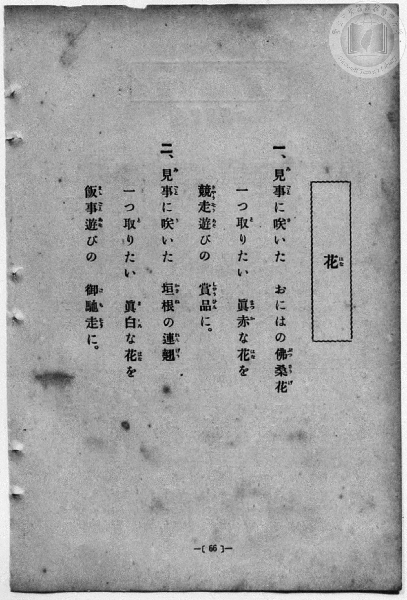
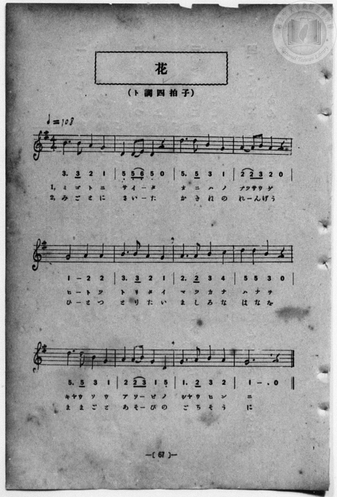

# 花

> Re:Shōka 使用 AI 協助辨識與重建樂譜，可能會有錯誤。歡迎回報。

- **鋼琴伴奏版**：<br><audio controls src="hana.mp3"></audio>
- **NEUTRINO 歌聲合成版**：<br><audio controls src="hana_neutrino.mp3"></audio>

- 詞：文部省（臺灣總督府改作）
- 曲：文部省
- 一條慎三郎 編《新編 小學校・公學校 唱歌教材集》（大正十二年十二月，索書號 0725-41）
- 臺灣總督府《公學校唱歌集》（大正四年三月，索書號 0725 26）

## 說明

原書資訊與歌詞全文（對應 P074.jpg–P075.jpg，原書 p. 66–67，第 33 首）：
調性與拍號：ト調四拍子（G 大調 4/4 拍），♩=108
說明：採自文部省《尋常小學唱歌》第一學年〈花〉，將第一節「れんげの花」改為臺灣風物「佛桑花（ぶっさうげ）」。


## 歌詞

```text
一、見事（みごと）に咲（さ）いた　おにはの佛桑花（ぶつさうげ）
一（ひと）つ取（と）りたい　眞赤（まつか）な花（はな）を
競走遊（きやうそうあそ）びの　賞品（しやうひん）に。

二、見事（みごと）に咲（さ）いた　垣根（かきね）の連翹（れんげう）
一（ひと）つ取（と）りたい　眞白（ましろ）な花（はな）を
飯事遊（ままごとあそ）びの　御馳走（ごちそう）に。
```

## ABC

<div class="abc-score" data-abc-src="hana.abc" aria-label="五線譜載入中"></div>

[下載 ABC 原始檔](hana.abc)

## TMD 檔案連結

- [主旋律 TMD 檔案](hana.tmd) [[在 TMD Studio 編輯](https://tmdlang.github.io/Tmd-TS/#tmd=s7IKdvYPcrWy4qpTUCpJTLdSSM7PyUlNLsnMz7MqzsjPTozPrsyvSsyML84ojTe0NDJWgqssy88pzU21Si9KTEmNN4w3QsgU55cWJadaFSdn5OfnxJekVpQk5edno8vHFySmp1oFGJibIGQKivLLUvMS84C6C4oy80pSU8DaEQpSyzJTUkHSxcmJefFlqUWZaZmpKUiOSi0qBrsdYkVJUWJecXJRZgHIQwhV-UUlGflAhxdkVFplZBaX5BdlJifmxGcn5iUiFJVkpAK9V5CTmIdkP1BlemaeVW5-XlIpMHwwJEoSM8uBDstPS8tMzkzMUeLS0lJ40bVRQUuLS9FWwdDAgsveVsGdy8ZE38QOpPfJjoZni-Y-a-17sqPzZXOfwvPtKx43dD2btgHIUHi6of_p2h3PFix83Lz7aesaCFvh6ZSNz9b2PJs689ncCS9ntz1u6H6_p-PpkuXP1i5-2tv4ZFfP051bIIxnczre7-l5vmXRs9k7Xsycr2BgbmSqa2L4fk8n2N0vVs57v2fWs2ntL5tXPJ_TCDTlRfuu542Ln-_Y-3zu4qe75jybsvPJ3jkw5c9mb0JWDjECVQPQ6XB3QpyJ7sDZs4GuA_oVm9MUjMzAdnHpaynYUgtwKSgoPO2bD7Jmc_uLFV0vOtqBzgJ6_WnrCqBfQC7b0PusvVMBlBD1sgrSHzVMBjJNQUygCyFaFQr0FMzMgDJm5iBXr1mjYGys8HLZNKBzgUECsuLFqv3PGpaDDO_uBfoHKPq4uQMoCPQwUOTp2glAi9wVgIEAFFMARr4CUBSsu-fRzJW2oHQBNmTVsxl9oEDuW_iifRU8qEHBuqH76Y4dkAQBCVlgsAIdAkw_IJGdWx43dADT2eMGkJFPN7RDpJ6vb3jc0PO4CYgmP26c9LhxHVhNLzBinzftgkTey0UrnneuBCp7snf2s4UTgQqATn3cuO1x4-LHjVMfN7YBNQJdCtT1uKGJC-RMoMGPGxpfLOt-sgsUs48b9z9unPK4cQVIVePqp5OAyQQoOBXMbXncOP9xQ8Pjxi6g1OPG9UAnYNizBNkeqAVguU0wQ5c87QeGNVAEzG0CmjUfZHRDw_M5815sXQKW2gc2COggoPpVMNOB9q0Ca5kEMvf56m0vtm542dgFlut93AR0HdDauWCyCcgAa94MdCPQ6Beb5z2dDMoUjxunw1RuAoYjxJfwsNgFjAjSwuLpvMXPFuwEi3eDXNG4Fiy77mXD4uf7weKI-GojJ0Sez9wLCxGgy0HJDGeIvFy8HuhwWIgANQARyPmYwfF038KXyzYDgw-sEqhmISTgEMEBNI7y7AoFClr6XFwewOLYKiAzMS_focagphpkgYKNhZYdmIGtjFCApPoXC3sUNExApScw_euAMjY4N2ti0QC0BmRYjYKxgi4QGisYAUlDIK5RMI0HUkDCLB7CNICIgtWZgtVD1IF0GEF1gtWATfQxrFEAJgawamBwAfEKMGs1WA8wRYB5LWByPpAE2QAS74LqWA3E68GsdVAZUIYEC0wF4jYgngTTBrHQiDwLu6E6eoF4LbKFTT0gXtNksBgoKcKtwx_-u3rICX9QWIIgJDRBDsCMERALEta6Cibw2ABhkAh62G-CmggLiCVQD4N4II91QQMCEiggmX1Q9YuhwQLMKVAZSEyAeMB8gyXYybdrOlC2lwi7CKT5TnLCHHdaBvHAiR4WMZBAh0QMLKpAED3QgWVqM9RnoCQ6F8qC-KwJzIOIbQaTsLQNLKaQtYGCE5LyQJKgFAyD6AEPC8Z94DQPiwD8loHUgfgLMRyIaVMtF5eunQKoIFJAopW5AA)]
- [鋼琴伴奏 TMD 檔案](hana_piano.tmd) [[在 TMD Studio 編輯](https://tmdlang.github.io/Tmd-TS/#tmd=s7IKdvYPcrWy4qpTUCpJTLdSSM7PyUlNLsnMz7MqzsjPTozPrsyvSsyML84ojTe0NDJWgqssy88pzU21Si9KTEmNN4w3QsgU55cWJadaFSdn5OfnxJekVpQk5edno8vHFySmp1oFGJibIGQKivLLUvMS84C6C4oy80pSU8DaEQpSyzJTUkHSxcmJefFlqUWZaZmpKUiOSi0qBrsdYkVJUWJecXJRZgHIQ0pcWloKL7o2vt_T8XL2zGed3S-79zyfsOXJni1Pl_a_39OpoKXFpWirYGhgwWVvq-DOZWOib2IHMvnJjoZni-Y-a-17sqPzZXOfwvPtKx43dD2btgHIUHi6of_p2h3PFix83Lz7aesaCFvh6ZSNz9b2PJs689ncCS9ntz1u6Aba-nTJ8mdrFz_tbXyyq-fpzi0QxrM5He_39DzfsujZ7B0vZs5XMDA3MtU1MQS6B-yrFyvnvd8z69m09pfNK57PaQSa8qJ91_PGxc937H0-d_HTXXOeTdn5ZO8cmPJnszchK4cYgaoB6HS4OyHORHfg7NlA1wH9is1pCkZmYLu4PBLzEq0CMhPz8oM8HGoMaqq5FIDAxkLLDszQ11KwRQcKz9esAYbli4U9ChomoIB7vr5BRwGYAkz1sgrSNbFo0NIHG1ajYKygC4TGCkZA0hCIaxRM44EUkDCLhzANIKJgdaZg9RB1IB1GUJ1gNWATfQxrFB437gerftw4BYhXgFmrwXoeN04F81rA5HwgCbIBJN4F1bEaiNeDWeugMtseNy4GC0wF4jYgngTTBrHQiDwLu6E6eoF4LbKFTT0gXtNksNgkkJUw6_CH_64ecsIfFJYgCAlNkAMwYwTEgoS1roIJPDZAGCSCHvaboCbCAmIJ1MMgHshjXdCAgAQKSGYfVP1iaLA8blwFlYHEBIj3uAlbsJNv13SgbC8RdhFI853khDnutAzigRM9LGIggQ6JGFhUgSB6oPc-bmqG-gyUROdCWRCfNYF5ELHNYBKWtqejagMFJyTlgSRBKRgG0QMeFoz7wGkeFgH4LQOpA_EXYjgQ06Za5HLIB7kcMoGWQ8DwiFeINowFhheIjo-FipgAWUDaAKEASoFKFiDLFCgPYgAVYDEHJIvNZLgkSApFEcQuVKMwbYSLmIBEQG7EtA5qEtDrunYKIN9H-wBF4WwjMFuZCwA)]

## 分析

```text
================================================================================
📊 TMD Song Profile: [ 花 ]
================================================================================
⏱  Duration:       0:53 (53.3s), 24 measures total
🎼 Key & Tempo:    首調基準 G, != 108.0 BPM, <4/4>
   - 分析範圍：      由實際發聲的音符與和弦推測調性；播放脈絡另行呈現
🎤 人聲音域:    D4 (MIDI 62) – D5 (MIDI 74) [跨度: 12 個半音 / 1.0 個八度, 難度: easy]
   - 最低音:  D4 in [Hana #1 @ m.2, 0:02]
   - 最高音: D5 in [Hana #1 @ m.3, 0:04]
   - 適合: soprano, mezzo-soprano, contralto, tenor, baritone, bass
🏛  結構:      Hana (26.7s) -> Hana (26.7s)
⚡ 編曲密度:        Peak 1 軌道同時演奏
🗝  調性診斷：       G 大調（純淨自然大調，未偵測到可信轉調）
   - 風格氣質:    純淨自然大調（陽光明朗、易唱易記，無明顯調外色彩）
   - 轉調歷程:    全曲維持單一推測調性（未偵測到可信轉調）
   - 核心骨幹音:  G, A, B, D, C
   - 調性數值:    G 大調 [相關度: 0.78, 穩定度: Moderate, 自然音純度: 100.0%]
   - 候選調性 (K-S): G 大調 (0.78), D 大調 (0.72), B 小調 (0.58)
   - 五度圈歷程:   +1 -> +1
   - 各段落調性細節:
     • [Hana #1]: G 大調 (r: 0.78, 自然音純度: 100.0%)
     • [Hana #2]: G 大調 (r: 0.78, 自然音純度: 100.0%)

  [ 五度圈游移軌跡 ]
               C  
         F           [G ]*
      Bb               D  
      Eb               A  
         Ab           E  
            Db       B  
               F# 
     (* = active key center)

  [ 十二半音累積音高分佈 ]
     C  : ██                         2.3%
     C# :                            0.0%
     D  : ████████████████████      21.6%
     D# :                            0.0%
     E  : █                          1.1%
     F  :                            0.0%
     F# :                            0.0%
     G  : ████████████████████████  26.1%
     G# :                            0.0%
     A  : ████████████████████████  26.1%
     A# :                            0.0%
     B  : █████████████████████     22.7%
--------------------------------------------------------------------------------
Assignment 軌道音域：
  - Piano         : D4 – D5 (12 個半音 / 1.0 個八度, 88 個音符)
================================================================================
```


## 原書掃描頁






