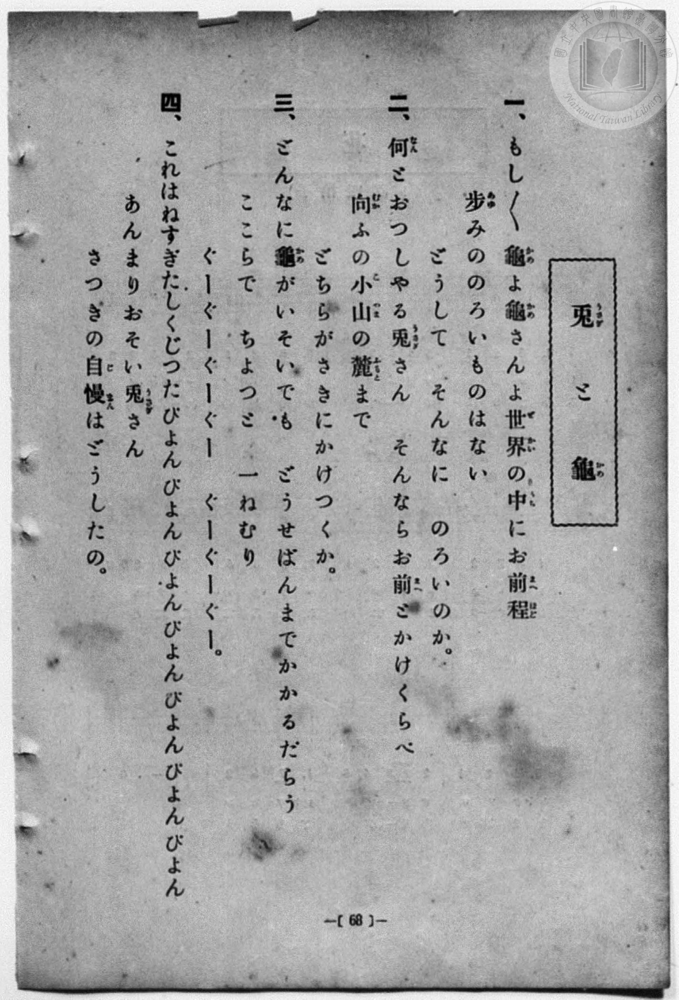
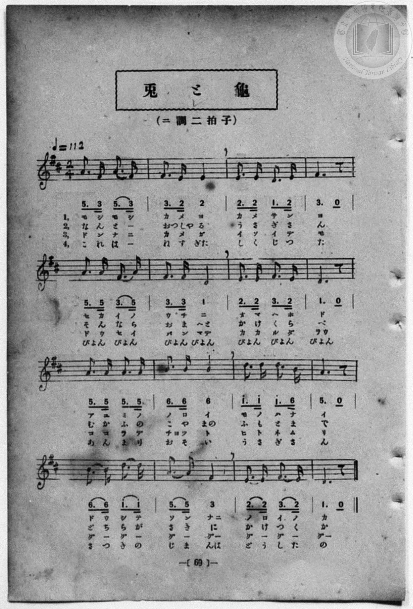

# 兎と龜

> Re:Shōka 使用 AI 協助辨識與重建樂譜，可能會有錯誤。歡迎回報。

- **鋼琴伴奏版**：<br><audio controls src="usagi_to_kame.mp3"></audio>
- **NEUTRINO 歌聲合成版**：<br><audio controls src="usagi_to_kame_neutrino.mp3"></audio>

- 詞：石原和三郎
- 曲：納所辨次郎
- 一條慎三郎 編《新編 小學校・公學校 唱歌教材集》（大正十二年十二月，索書號 0725-41）
- 臺灣教育會公認《新定兒童唱歌》尋常科第一學年用（2020.006.0847.0001）

## 說明

曲目說明
中文解釋：改寫〈龜兔賽跑〉故事，強調穩定努力勝過驕傲急躁。

原書資訊與歌詞全文（對應 P076.jpg–P077.jpg，原書 p. 68–69，第 34 首）：
調性與拍號：ニ調二拍子（D 大調 2/4 拍），♩=112


## 歌詞

```text
一、
もし〱龜（かめ）よ　龜（かめ）さんよ
世界（せかい）の中（なか）に　お前（まへ）程（ほど）
歩（あゆ）みののろい　ものはない
どうしてそんなに　のろいのか。

二、
何（なん）とおつしやる　兎（うさぎ）さん
そんならお前（まへ）と　かけくらべ
向（むか）ふの小山（こやま）の　麓（ふもと）まで
どちらがさきに　かけつくか。

三、
どんなに龜（かめ）が　いそいでも
どうせばんまで　かかるだらう
ここらでちよつと　一（ひと）ねむり
ぐーぐーぐーぐー　ぐーぐーぐー。

四、
これはねすぎた　しくじつた
ぴよんぴよんぴよんぴよん　ぴよんぴよんぴよん
あんまりおそい　兎（うさぎ）さん
さつきの自慢（じまん）は　どうしたの。
```

## ABC

```abc
X:1
T:兎と龜
C:曲：納所辨次郎
M:2/4
L:1/16
Q:1/4=112
K:D
V:V1 name="Piano" snm="Pia"
[V:V1]
A3 F A3 F | F3 E E3 E | E3 E D3 E | F6 z2 |
w: 1.~も し も し | か め よ _ | か め さ ん | よ
w: 2.~な _ ん と | おつ しや る _ | う さ ぎ さ | ん
w: 3.~ど ん な に | か め が _ | い そ い で | も
w: 4.~こ _ れ は | ね す ぎ た | し く じ つ | た
A3 A F3 A | F3 F D3 D | E3 E F3 E | D6 z2 |
w: 1.~せ か い の | う ち に _ | お ま へ ほ | ど
w: 2.~そ ん な ら | お ま へ と | か け く ら | べ
w: 3.~ど う せ _ | ば ん ま で | か か る だ | らう
w: 4.~ぴよ ん ぴよ ん | ぴよ ん ぴよ ん | ぴよ ん ぴよ ん | ぴよん
A3 A A3 A | B3 B B3 B | d3 d d3 B | A6 z2 |
w: 1.~あ ゆ み の | の ろ い _ | も の は な | い
w: 2.~む か ふ の | こ や ま の | ふ も と ま | で
w: 3.~こ こ ら で | ちよ つ と _ | ひ と ね む | り
w: 4.~あ ん ま り | お そ い _ | う さ ぎ さ | ん
B3 B d3 d | A3 A F3 F | E3 E F3 E | D6 z2 |
w: 1.~ど う し て | そ ん な に | の ろ い の | か
w: 2.~ど ち ら が | さ き に _ | か け つ く | か
w: 3.~ぐ ー ぐ ー | ぐ ー ぐ ー | ぐ ー ぐ ー | ぐー
w: 4.~さ つ き の | じ ま ん は | ど う し た | の
A3 F A3 F | F3 E E3 E | E3 E D3 E | F6 z2 |
w: 1.~も し も し | か め よ _ | か め さ ん | よ
w: 2.~な _ ん と | おつ しや る _ | う さ ぎ さ | ん
w: 3.~ど ん な に | か め が _ | い そ い で | も
w: 4.~こ _ れ は | ね す ぎ た | し く じ つ | た
A3 A F3 A | F3 F D3 D | E3 E F3 E | D6 z2 |
w: 1.~せ か い の | う ち に _ | お ま へ ほ | ど
w: 2.~そ ん な ら | お ま へ と | か け く ら | べ
w: 3.~ど う せ _ | ば ん ま で | か か る だ | らう
w: 4.~ぴよ ん ぴよ ん | ぴよ ん ぴよ ん | ぴよ ん ぴよ ん | ぴよん
A3 A A3 A | B3 B B3 B | d3 d d3 B | A6 z2 |
w: 1.~あ ゆ み の | の ろ い _ | も の は な | い
w: 2.~む か ふ の | こ や ま の | ふ も と ま | で
w: 3.~こ こ ら で | ちよ つ と _ | ひ と ね む | り
w: 4.~あ ん ま り | お そ い _ | う さ ぎ さ | ん
B3 B d3 d | A3 A F3 F | E3 E F3 E | D6 z2 |
w: 1.~ど う し て | そ ん な に | の ろ い の | か
w: 2.~ど ち ら が | さ き に _ | か け つ く | か
w: 3.~ぐ ー ぐ ー | ぐ ー ぐ ー | ぐ ー ぐ ー | ぐー
w: 4.~さ つ き の | じ ま ん は | ど う し た | の
```

## TMD 檔案連結

- [主旋律 TMD 檔案](usagi_to_kame.tmd) [[在 TMD Studio 編輯](https://tmdlang.github.io/Tmd-TS/#tmd=s7IKdvYPcrWy4qpTUCpJTLdSSM7PyUlNLsnMz7MqzsjPTozPrsyvSsyML84ojTe0NDJWgqssy88pzU21Si9KTEmNN4w3QsgU55cWJadaFSdn5OfnxJekVpQk5edno8vHFySmp1oFGJibIWQKivLLUvMS84C6C4oy80pSU8DaEQpSyzJTUkHSxcmJefFlqUWZaZmpKUiOSi0qBrsdYkVJUWJecXJRZgHIQwhV-UUlGflAhxdkVFplZBaX5BdlJifmxGcn5iUiFJVkpAK9l5iXmZuYg6w1Mz0zzyo3NTMrE8lrWloKT1v7HjeueLlvjoKWFpeirYKhoRGXva2CC5eNkb6JHciAJzsani2a-6y178mOzpfNfQrPt6943ND1bNoGIEPh6Yb-p2t3PFuw8HHz7qetayBshadTNj5b2_Ns6sxncye8nN32uKH7_Z6Op0uWP1u7-Glv45NdPU93boEwns3peL-n5_mWRc9m73gxc76CgbmRqa6J4fs9nWDHv1g57_2eWc_nb37aN__ppB6IC8Ayz2ZvAsls6X3W2fBi34pnaxbCZF6073reuBho-YumTc_mNANd9WJVL8TFT9fNeto66fnqpRAHAt31dEP30x07ni-f-HzNGqBHge4HOu35lBVA9xoZGBnoGRiY6RlYmJgDGQYQV-lrKQDtfj573YtVq57N6ONSUFB4smPts2ntL5YvftkO9OisZ1N2Pl2_-nFDBzBUn7ZOebF574vtEx83dD6b2vpkF1BBz9M921-s2v985UqQe7pWPe2a_bR77svGvpcrpz4Furlh6YtdjY8bmri09LlA1tlSC4DcCgxIUFBvbn-xoutFRzswFIBh_LR1BdADoDja0PusvVMBlLz1sgrSHzVMBjLNQUyQs8FaFQr0FMwsgDJmlqCYW7NGwdhE4eWyacDAAfodZAXQb88aloMM7-4FxilQ9HFzN1AQFN3dvU_XTgBa5KIATA5AMQVgKlMAioJ19zyaudIWlAAhgdrwuKERxHrc1PS4cfrjho3A8ARqfdzY_bipEajhcVPH44YGdMHGqY-bJgOlIGZMez61Byw9G6SisQWsYh0wwsCCq4CCYBFgbDU8bux62gl0CFB83-PGHUDx5ytA6fZx4-7HjSuBXJCJz9YCWUChpsdNbWCd-4HGgVBTL9B0kCkgxwJF1oNNbwG7v3Hl48Y2kBcalz1unAtyHkgOYidMJ0hPNyjSwe7eBUybYL8_2TsV6tKmyWD7VgCd-bhxCci0ppbHTUAtDcAsDFYDtGLq40YgGxoIELth9jUBRdE9CDIO5AhgyEx83NgPVrMTnEomTASpawLJgdVtBToQlNc3bgTrBwYw0Mn7IKEJioRdQNcBxbeCvQ_MPUBxoB3L4d5fCDa7B-xCoH8hfodYC_RLP7Lfd3TC4h2oERZWGLEMDCCgCUBHzAWTy4EWI4c1MLo3gDWDXAGzDKgZSC4AO6UNohqoAugXIH852I1AG4DOAQUKMPmBLdwE885aUGg0dUG0TXjcvAcLCbIHUxDir6ezZ8P9BbQSGBTAJLL2ceNMYJQ9bpwP1gtMIcCgmAF2xHyI0i0gR4E8gpsB0olTFmIKMLmCw6IJmHaACBxmhBIOUAjoDGBkrXvRvupZ6yKwUqDbgKZAkuJ6sM3wtD0fnBTAsUB5UQUFCqAiMLQ4MT0zJN87EVixBWQm5uU71BjUVIPsUbAxNNOyA7OwlZMKkEL9xcIeBQ0TUFX1fH2DDqhwA5domlg0AK0DGVajYKqgC4TGcLoGiEEsIyCE0DVwliFcBKIGAg2AuAZsmo9hDagMA4sCQwqFDZRp7IbwmhqBuAOqG028cSqUPRkkA1cFgvEIe4xAulZBxUFqIbasAJsGKjVg1gJzL1AeYj7Erjao1FQg7oOzQXZBTMGwyxikayXcJpi9wKyK4fYeJHtaoKrmIrGXg-2BhAmGPSYgXTA3ALMNVM96sGlrobyZSK6eD5aZDuX1A_EMKHsJWGY-hj3408-uHvLTjyk0RZjC04YxNLUYIqUfWMqqgcphTT-Ns6G-6EYKuXUocbcQHPqIsO6Ciu8D4h1Q9m6wDCTesKefudCQRorTpk6c5kHSFjS2GyeCQxxZz07sNiGnHqD7Yb6DuHsDkgv2QdWA0wjcHmAYQFMvsDgHpx5QiY7dKnACAhWGSKaicKkljy2rECiaOilJWjC6RsEMzDKD08CEFAdmAikoCyQI0YA9dUFLpCZQXOyHhiwkda2DyvTC0x04luBl2DpwboSwVyHlcaypq6kBqhKUirei2AMtrUAlEzzWITJQdUAbQekNlgZBMsux2wROXbDSDxhfwLSInIpA9TxUYAncSEjS2wQVXwHEa6HWNoC9C0n82FMXLPCQEixQPXKWQRR3pBe3eNMQsFVBThqCpRREOkEvskBVHmkFFHJ2hhW_y8C-xVKkQKsJzMQFi3RY5YQlEcFtAhZ48KjtAeuCVpONIPOQi0LkAgpWC_bjswechCZAVDbvQWGTLQNi4E5EMKeDkmQvSlDA6i9guQuv0yH1H7Ygh9R_kIBFtqmWi0vXTgGpLaWAyVXmAgA)]
- [鋼琴伴奏 TMD 檔案](usagi_to_kame_piano.tmd) [[在 TMD Studio 編輯](https://tmdlang.github.io/Tmd-TS/#tmd=s7IKdvYPcrWy4qpTUCpJTLdSSM7PyUlNLsnMz7MqzsjPTozPrsyvSsyML84ojTe0NDJWgqssy88pzU21Si9KTEmNN4w3QsgU55cWJadaFSdn5OfnxJekVpQk5edno8vHFySmp1oFGJibIWQKivLLUvMS84C6C4oy80pSU8DaEQpSyzJTUkHSxcmJefFlqUWZaZmpKUiOSi0qBrsdYkVJUWJecXJRZgHIQ0pcWloKT1v7HjeueLlvzvs9HS9nz3zW2f2ye8_zCVue7NnydGn_-z2dClpaXIq2CoaGRlz2tgouXDZG-iZ2IPOf7Gh4tmjus9a-Jzs6Xzb3KTzfvuJxQ9ezaRuADIWnG_qfrt3xbMHCx827n7augbAVnk7Z-Gxtz7OpM5_NnfBydtvjhm6grU-XLH-2dvHT3sYnu3qe7twCYTyb0_F-T8_zLYuezd7xYuZ8BQNzI1NdE0Oge8B-e7Fy3vs9s57P3_y0b_7TST0QF4Blns3eBJLZ0vuss-HFvhXP1iyEybxo3_W8cTHQ8hdNm57NaQa66sWqXoiLn66b9bR10vPVSyEOBLrr6Ybupzt2PF8-8fmaNUCPAt0PdNrzKSuA7jUyMDLQMzAw0zOwMDEHMgwgruIKLU5MzwzJ904EJoKAzMS8fIcag5pqLgUgsDE007IDs_S1FGzRgQLEjhcLexQ0TEAh93x9g44CMCGY62UVpGti0aClDzasRsFUQRcIjeF0DRCDWEZACKFr4CxDuAhEDQQaAHEN2DQfwxqFx01NYNHHjdNR2ECZxm4Ir6kRiDugutHEG6dC2ZNBMnBVIBiPsMcIpGsVVBykFmLLCrBpXY8bl8CsfdzUApSHmA-xqw0qNRWI--BskF0QUzDsMgbpWgm3CWbv48bVGG7vQbKnBapqLhJ7OdgeSJhg2GMC0gVzw-MmiFmPG9eDTVsL5c1EcvV8sMx0KK8fiGdA2UvAMvMx7MGffnb1kJ9-TKEpwhSeNoyhqcUQKf3AUlYNVA5r-mmcDfVFN1LIrUOJu4Xg0EeEdRdUfB8Q74Cyd4NlIPGGPf3MhYY0Upw2deI0D5K2oLHdOBEc4sh6dmK3CTn1AN0P8x3E3RuQXLAPqgacRuD2AMMAmnofNy4Ap55OWDBgT0BbYHkGYioKl1ry2LIKgaKpk5KkBaNrFMzALDM4DUxIcWAmkIKyQIIQDdhTF7REagLFxX5oyEJS1zqoTC883YFjCV6GrQPnRgh7FVIex5q6mhqgKkGpeCuKPdDSClQywWMdIgNVB7QRlN5gaRAksxy7TeDUBSv9gPEFTIvIqWghPPaARQLMSEjS2wQVXwHEa6HWNoC9C0n82FMXLPCQEixQPXKWQRR3pBe3eNPQ09mzyUlDsJSCSCfoRRaoyiOtgELOzrDidxnYt1iKFGg1gZm4YJEOq5ywJCK4TcACDx61PWBd0GqyEWQeclGIXEDBasF-fPaAk9AEiMrmPShssmVADNyJCOZ0UJLsRQkKWP0FLHfhdTqk_sMW5JD6DxKwyDbVYmlI-XggNaVMoC0pYCzHK0QbxoKSRDyQZRqPxgRKG0CdjqQWmybsKk2ADBMUBoo6ZFFcJgI9o2ungOSfaB-gSnQhI0whY0whoF1AIWUuAA)]

## 分析

```text
================================================================================
📊 TMD Song Profile: [ 兎と龜 ]
================================================================================
⏱  Duration:       0:34 (34.3s), 32 measures total
🎼 Key & Tempo:    首調基準 D, != 112.0 BPM, <2/4>
   - 分析範圍：      由實際發聲的音符與和弦推測調性；播放脈絡另行呈現
🎤 人聲音域:    D4 (MIDI 62) – D5 (MIDI 74) [跨度: 12 個半音 / 1.0 個八度, 難度: easy]
   - 最低音:  D4 in [UsagiToKame #1 @ m.3, 0:02]
   - 最高音: D5 in [UsagiToKame #1 @ m.11, 0:10]
   - 適合: soprano, mezzo-soprano, contralto, tenor, baritone, bass
🏛  結構:      UsagiToKame (17.1s) -> UsagiToKame (17.1s)
⚡ 編曲密度:        Peak 1 軌道同時演奏
🗝  調性診斷：       D 大調（純淨自然大調，未偵測到可信轉調）
   - 風格氣質:    純淨自然大調（陽光明朗、易唱易記，無明顯調外色彩）
   - 轉調歷程:    全曲維持單一推測調性（未偵測到可信轉調）
   - 核心骨幹音:  D, A, F#, E, B
   - 調性數值:    D 大調 [相關度: 0.86, 穩定度: Moderate, 自然音純度: 100.0%]
   - 候選調性 (K-S): D 大調 (0.86), A 大調 (0.74), F# 小調 (0.69)
   - 五度圈歷程:   +2 -> +2
   - 各段落調性細節:
     • [UsagiToKame #1]: D 大調 (r: 0.86, 自然音純度: 100.0%)
     • [UsagiToKame #2]: D 大調 (r: 0.86, 自然音純度: 100.0%)

  [ 五度圈游移軌跡 ]
               C  
         F            G  
      Bb              [D ]*
      Eb               A  
         Ab           E  
            Db       B  
               F# 
     (* = active key center)

  [ 十二半音累積音高分佈 ]
     C  :                            0.0%
     C# :                            0.0%
     D  : ████████████████████████  25.0%
     D# :                            0.0%
     E  : ████████████████          16.7%
     F  :                            0.0%
     F# : ██████████████████████    23.3%
     G  :                            0.0%
     G# :                            0.0%
     A  : ███████████████████████   24.2%
     A# :                            0.0%
     B  : ██████████                10.8%
--------------------------------------------------------------------------------
Assignment 軌道音域：
  - Piano         : D4 – D5 (12 個半音 / 1.0 個八度, 104 個音符)
================================================================================
```


## 原書掃描頁






